# แผนผังการทำงานระบบและโฟลว์ชาร์ตครบทั้ง 53 ฟังก์ชัน (All 53 Functions Flowcharts)
## โครงการ: PetStore Pro — ระบบการซื้อขายและของใช้สัตว์เลี้ยงออนไลน์
**วิชา:** CSI402 การเชื่อมต่อโปรแกรมส่วนหน้ากับโปรแกรมส่วนหลัง  
**คณะเทคโนโลยีสารสนเทศ มหาวิทยาลัยศรีปทุม**  
**อ้างอิง:** มาตรฐานการแจกแจงฟังก์ชันละเอียด 100% ครบทุก Action Method ใน Controllers

---

## 📑 สารบัญแจกแจงครบทั้ง 53 ฟังก์ชัน (53 Action Methods)

| ฟังก์ชันที่ | คอนโทรลเลอร์ & แอ็กชัน | ประเภท | บทบาท | ชื่อฟังก์ชันการทำงาน | ตาราง DB ที่เกี่ยวข้อง |
|:---:|---|:---:|:---:|---|---|
| 1 | `AccountController.Profile` | `GET` | Customer | [ดูข้อมูลโปรไฟล์และสมุดที่อยู่จัดส่ง](#ฟังก์ชันที่-1-profile) | `User, UserAddress` |
| 2 | `AccountController.UpdateProfile` | `POST` | Customer | [แก้ไขข้อมูลส่วนตัวลูกค้า](#ฟังก์ชันที่-2-updateprofile) | `User, AuditLog` |
| 3 | `AccountController.SaveAddress` | `POST` | Customer | [เพิ่มหรือแก้ไขที่อยู่จัดส่ง](#ฟังก์ชันที่-3-saveaddress) | `UserAddress` |
| 4 | `AccountController.DeleteAddress` | `POST` | Customer | [ลบที่อยู่จัดส่ง](#ฟังก์ชันที่-4-deleteaddress) | `UserAddress` |
| 5 | `AccountController.SetDefaultAddress` | `POST` | Customer | [กำหนดที่อยู่จัดส่งเริ่มต้น (Default Address)](#ฟังก์ชันที่-5-setdefaultaddress) | `UserAddress` |
| 6 | `AccountController.Orders` | `GET` | Customer | [ดูประวัติและติดตามสถานะคำสั่งซื้อ](#ฟังก์ชันที่-6-orders) | `Orders, OrderItem, Product` |
| 7 | `AccountController.UploadSlip` | `POST` | Customer | [อัปโหลดสลิปโอนเงินเพิ่มเติมภายหลัง](#ฟังก์ชันที่-7-uploadslip) | `Orders` |
| 8 | `AccountController.CancelOrder` | `POST` | Customer | [ขอยกเลิกคำสั่งซื้อ หรือขอยื่นคืนเงิน](#ฟังก์ชันที่-8-cancelorder) | `Orders, Product, AuditLog` |
| 9 | `AccountController.Support` | `GET` | Customer | [หน้าศูนย์ช่วยเหลือและเปิดตั๋วแจ้งปัญหา](#ฟังก์ชันที่-9-support) | `SupportTicket` |
| 10 | `AccountController.SubmitTicket` | `POST` | Customer | [บันทึกการเปิดตั๋วแจ้งปัญหาของลูกค้า](#ฟังก์ชันที่-10-submitticket) | `SupportTicket, AuditLog` |
| 11 | `AccountingController.Index` | `GET` | AccountingStaff, Owner | [แดชบอร์ดภาพรวมการเงินและการตรวจสอบสลิป](#ฟังก์ชันที่-11-index) | `Orders, FinancialSummary, MonthlyFinancialEntry` |
| 12 | `AccountingController.ApprovePayment` | `POST` | AccountingStaff, Owner | [อนุมัติสลิปการชำระเงิน](#ฟังก์ชันที่-12-approvepayment) | `Orders, FinancialSummary, AuditLog` |
| 13 | `AccountingController.RejectPayment` | `POST` | AccountingStaff, Owner | [ปฏิเสธสลิปการชำระเงิน](#ฟังก์ชันที่-13-rejectpayment) | `Orders, AuditLog` |
| 14 | `AccountingController.ApproveRefund` | `POST` | AccountingStaff, Owner | [อนุมัติการคืนเงินให้ลูกค้า](#ฟังก์ชันที่-14-approverefund) | `Orders, FinancialSummary, AuditLog` |
| 15 | `AccountingController.SaveMonthlyExpense` | `POST` | AccountingStaff, Owner | [บันทึกรายจ่ายและต้นทุนประจำเดือน](#ฟังก์ชันที่-15-savemonthlyexpense) | `MonthlyFinancialEntry, FinancialSummary, AuditLog` |
| 16 | `AccountingController.ExportFinancialCsv` | `GET` | AccountingStaff, Owner | [ส่งออกรายงานสรุปการเงินเป็นไฟล์ CSV](#ฟังก์ชันที่-16-exportfinancialcsv) | `FinancialSummary, MonthlyFinancialEntry` |
| 17 | `AdminController.Index` | `GET` | Admin | [หน้าจัดการผู้ใช้งาน สิทธิ์ และตรวจสอบ Audit Log](#ฟังก์ชันที่-17-index) | `User, AuditLog` |
| 18 | `AdminController.UpdateUserRole` | `POST` | Admin | [ปรับเปลี่ยนบทบาทและสถานะการเปิด/ระงับบัญชี](#ฟังก์ชันที่-18-updateuserrole) | `User, AuditLog` |
| 19 | `AdminController.CreateUser` | `POST` | Admin | [สร้างบัญชีพนักงานหรือผู้ใช้งานใหม่](#ฟังก์ชันที่-19-createuser) | `User, AuditLog` |
| 20 | `AuthController.Login` | `GET` | Guest / Unauthenticated | [แสดงหน้าเข้าสู่ระบบ](#ฟังก์ชันที่-20-login) | `-` |
| 21 | `AuthController.Login` | `POST` | Guest / Unauthenticated | [ตรวจสอบรหัสผ่านและสร้างเซสชันล็อกอิน](#ฟังก์ชันที่-21-login) | `User, AuditLog` |
| 22 | `AuthController.QuickLogin` | `POST` | Demo / Testing | [เข้าสู่ระบบคลิกเดียวด้วยบัญชีทดสอบ (Quick Demo Login)](#ฟังก์ชันที่-22-quicklogin) | `User, AuditLog` |
| 23 | `AuthController.SwitchRole` | `GET/POST` | All Roles | [สลับมุมมองบทบาทแบบ Real-time พร้อมออก Session ใหม่](#ฟังก์ชันที่-23-switchrole) | `User, AuditLog` |
| 24 | `AuthController.Register` | `GET` | Guest | [แสดงหน้าฟอร์มสมัครสมาชิกใหม่](#ฟังก์ชันที่-24-register) | `-` |
| 25 | `AuthController.Register` | `POST` | Guest | [ประมวลผลการสมัครสมาชิกใหม่สำหรับลูกค้า](#ฟังก์ชันที่-25-register) | `User, Cart, AuditLog` |
| 26 | `AuthController.Logout` | `GET/POST` | Authenticated Users | [ออกจากระบบและล้างเซสชัน](#ฟังก์ชันที่-26-logout) | `AuditLog` |
| 27 | `AuthController.AccessDenied` | `GET` | All Roles | [หน้าแจ้งเตือนปฏิเสธการเข้าถึง (Access Denied)](#ฟังก์ชันที่-27-accessdenied) | `-` |
| 28 | `CartController.Index` | `GET` | Customer & Guest | [แสดงหน้าตะกร้าสินค้าและคำนวณ 5 โปรโมชั่น](#ฟังก์ชันที่-28-index) | `Cart, CartItem, Product, Promotion, AppliedPromotionSummary` |
| 29 | `CartController.Add` | `POST` | Customer & Guest | [เพิ่มสินค้าลงตะกร้า (AJAX Optimistic UI)](#ฟังก์ชันที่-29-add) | `Cart, CartItem, Product` |
| 30 | `CartController.Update` | `POST` | Customer & Guest | [ปรับปรุงจำนวนสินค้าในตะกร้า](#ฟังก์ชันที่-30-update) | `CartItem, Product` |
| 31 | `CartController.Remove` | `POST` | Customer & Guest | [ลบรายการสินค้าออกจากตะกร้า](#ฟังก์ชันที่-31-remove) | `CartItem` |
| 32 | `CartController.Checkout` | `GET` | Customer | [หน้าสรุปยอดชำระเงินและเลือกที่อยู่จัดส่ง](#ฟังก์ชันที่-32-checkout) | `Cart, CartItem, UserAddress, Product, Promotion` |
| 33 | `CartController.SubmitOrder` | `POST` | Customer | [ยืนยันการสั่งซื้อ บันทึกออเดอร์ และตัดสต็อก](#ฟังก์ชันที่-33-submitorder) | `Orders, OrderItem, Product, Cart, CartItem, AuditLog` |
| 34 | `CartController.SubmitOrder` | `GET` | Customer | [รองรับกรณีผู้ใช้กด Refresh หรือ Back ในหน้าสั่งซื้อ](#ฟังก์ชันที่-34-submitorder) | `-` |
| 35 | `HomeController.Index` | `GET` | Guest & Customer | [หน้าร้านค้า แคตตาล็อก และระบบตัวกรองอัจฉริยะ](#ฟังก์ชันที่-35-index) | `Product, CartItem` |
| 36 | `HomeController.Details` | `GET` | Guest & Customer | [หน้ารายละเอียดสินค้า ข้อมูลโภชนาการ และสินค้าแนะนำตามช่วงวัย](#ฟังก์ชันที่-36-details) | `Product, CartItem` |
| 37 | `HomeController.SwitchRole` | `POST` | All Roles | [สลับบทบาทการทดสอบจาก Role Switcher Bar](#ฟังก์ชันที่-37-switchrole) | `User` |
| 38 | `InventoryController.Index` | `GET` | InventoryStaff, Owner | [แดชบอร์ดสต็อกสินค้าและการแจ้งเตือน Low Stock Alert](#ฟังก์ชันที่-38-index) | `Product` |
| 39 | `InventoryController.UpdateStock` | `POST` | InventoryStaff, Owner | [ปรับปรุงจำนวนสต็อกสินค้าด่วน (Quick In/Out)](#ฟังก์ชันที่-39-updatestock) | `Product, AuditLog` |
| 40 | `InventoryController.SaveProduct` | `POST` | InventoryStaff, Owner | [เพิ่มสินค้าใหม่ หรือแก้ไขข้อมูลสินค้าและอัปโหลดรูปภาพ](#ฟังก์ชันที่-40-saveproduct) | `Product, AuditLog` |
| 41 | `InventoryController.DeleteProduct` | `POST` | InventoryStaff, Owner | [ระงับการจำหน่ายหรือลบสินค้า](#ฟังก์ชันที่-41-deleteproduct) | `Product, AuditLog` |
| 42 | `MarketingController.Index` | `GET` | MarketingStaff, Owner | [แดชบอร์ดจัดการ 5 แคมเปญโปรโมชั่นและดูสถิติ](#ฟังก์ชันที่-42-index) | `Promotion` |
| 43 | `MarketingController.ToggleStatus` | `POST` | MarketingStaff, Owner | [สวิตช์เปิด/ปิดการใช้งานโปรโมชั่นแบบ Real-time](#ฟังก์ชันที่-43-togglestatus) | `Promotion, AuditLog` |
| 44 | `MarketingController.Save` | `POST` | MarketingStaff, Owner | [บันทึกเงื่อนไข Rule Builder แคมเปญโปรโมชั่น](#ฟังก์ชันที่-44-save) | `Promotion, AuditLog` |
| 45 | `MarketingController.Create` | `POST` | MarketingStaff, Owner | [สร้างแคมเปญโปรโมชั่นใหม่](#ฟังก์ชันที่-45-create) | `Promotion, AuditLog` |
| 46 | `MarketingController.Delete` | `POST` | MarketingStaff, Owner | [ลบแคมเปญโปรโมชั่น](#ฟังก์ชันที่-46-delete) | `Promotion, AuditLog` |
| 47 | `OrderController.Index` | `GET` | OrderStaff, Owner | [คิวงานคำสั่งซื้อที่ชำระเงินแล้วและออกใบแพ็กของ](#ฟังก์ชันที่-47-index) | `Orders, OrderItem, Product` |
| 48 | `OrderController.UpdateStatus` | `POST` | OrderStaff, Owner | [อัปเดตสถานะการเตรียมสินค้า (Preparing / ReadyToShip)](#ฟังก์ชันที่-48-updatestatus) | `Orders, AuditLog` |
| 49 | `OwnerController.Index` | `GET` | Owner (Super-Access) | [แดชบอร์ดผู้บริหารสูงสุด (Executive BI Dashboard)](#ฟังก์ชันที่-49-index) | `Orders, OrderItem, Product, Promotion, FinancialSummary` |
| 50 | `ShippingController.Index` | `GET` | ShippingStaff, Owner | [ตารางพัสดุที่รอจัดส่งและบันทึกเลขพัสดุ](#ฟังก์ชันที่-50-index) | `Orders` |
| 51 | `ShippingController.DispatchOrder` | `POST` | ShippingStaff, Owner | [บันทึกน้ำหนักจริง เลข Tracking และเปลี่ยนสถานะจัดส่งแล้ว](#ฟังก์ชันที่-51-dispatchorder) | `Orders, AuditLog` |
| 52 | `SupportController.Index` | `GET` | ITSupport, Owner | [กระดานตั๋วแจ้งปัญหาของฝ่ายเทคนิค (IT Helpdesk Board)](#ฟังก์ชันที่-52-index) | `SupportTicket` |
| 53 | `SupportController.ResolveTicket` | `POST` | ITSupport, Owner | [บันทึกผลการแก้ไขปัญหาและปิดงานตั๋ว Helpdesk](#ฟังก์ชันที่-53-resolveticket) | `SupportTicket, AuditLog` |

---

### ฟังก์ชันที่ 1: ดูข้อมูลโปรไฟล์และสมุดที่อยู่จัดส่ง (AccountController.Profile)

* **คอนโทรลเลอร์ & Action:** `AccountController.Profile` [GET]
* **บทบาทที่มีสิทธิ์ (Role):** Customer
* **ข้อกำหนดที่เกี่ยวข้อง (Requirements):** Profile & Address Management
* **ตารางฐานข้อมูลที่เกี่ยวข้อง:** `User, UserAddress`

#### ลำดับขั้นตอนการทำงาน (Process Steps):
1. ดึง UserId ของผู้ใช้ที่เข้าสู่ระบบจาก Claims
2. คิวรีตาราง User เพื่อนำชื่อ นามสกุล อีเมล และเบอร์โทร
3. คิวรีตาราง UserAddress เพื่อดึงรายการที่อยู่จัดส่งทั้งหมด
4. ส่งข้อมูลไปยังหน้า Profile View

#### แผนผังโฟลว์ชาร์ต (Flowchart Diagram):
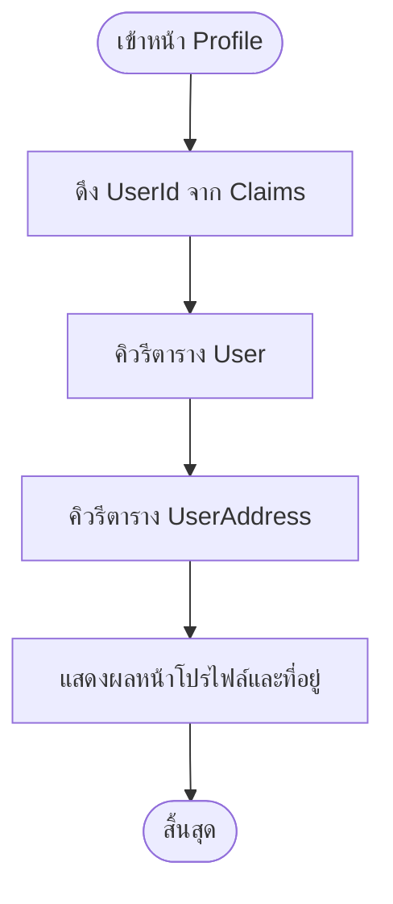

---
### ฟังก์ชันที่ 2: แก้ไขข้อมูลส่วนตัวลูกค้า (AccountController.UpdateProfile)

* **คอนโทรลเลอร์ & Action:** `AccountController.UpdateProfile` [POST]
* **บทบาทที่มีสิทธิ์ (Role):** Customer
* **ข้อกำหนดที่เกี่ยวข้อง (Requirements):** Profile Management
* **ตารางฐานข้อมูลที่เกี่ยวข้อง:** `User, AuditLog`

#### ลำดับขั้นตอนการทำงาน (Process Steps):
1. รับข้อมูล Form: FullName, Email, Phone
2. ตรวจสอบความถูกต้องของข้อมูล (Model Validation)
3. อัปเดตข้อมูลลงตาราง User
4. บันทึกกิจกรรมลงตาราง AuditLog และแสดง Toast แจ้งเตือนสำเร็จ

#### แผนผังโฟลว์ชาร์ต (Flowchart Diagram):
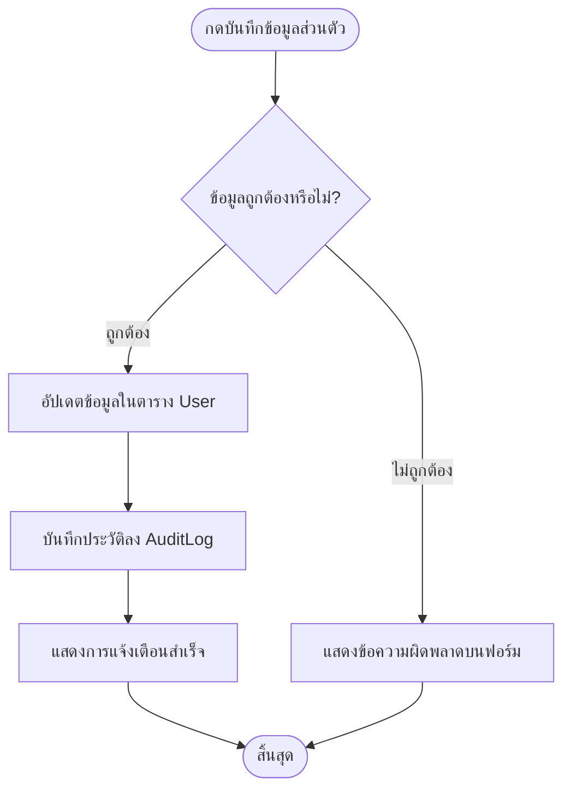

---
### ฟังก์ชันที่ 3: เพิ่มหรือแก้ไขที่อยู่จัดส่ง (AccountController.SaveAddress)

* **คอนโทรลเลอร์ & Action:** `AccountController.SaveAddress` [POST]
* **บทบาทที่มีสิทธิ์ (Role):** Customer
* **ข้อกำหนดที่เกี่ยวข้อง (Requirements):** Multi-Address Management
* **ตารางฐานข้อมูลที่เกี่ยวข้อง:** `UserAddress`

#### ลำดับขั้นตอนการทำงาน (Process Steps):
1. รับข้อมูลที่อยู่: ชื่อผู้รับ เบอร์โทร ที่อยู่ ตำบล อำเภอ จังหวัด รหัสไปรษณีย์
2. เช็กว่าเป็นที่อยู่ใหม่ (Id=0) หรือแก้ไข
3. หากระบุเป็นที่อยู่หลัก ให้ปลด IsDefault ของที่อยู่อื่นออก
4. บันทึกข้อมูลลงตาราง UserAddress

#### แผนผังโฟลว์ชาร์ต (Flowchart Diagram):
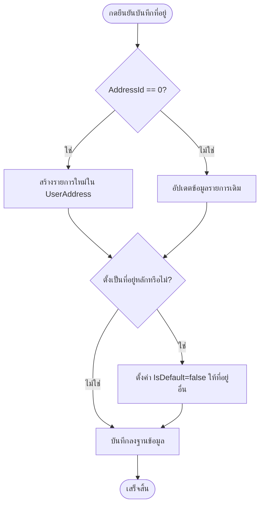

---
### ฟังก์ชันที่ 4: ลบที่อยู่จัดส่ง (AccountController.DeleteAddress)

* **คอนโทรลเลอร์ & Action:** `AccountController.DeleteAddress` [POST]
* **บทบาทที่มีสิทธิ์ (Role):** Customer
* **ข้อกำหนดที่เกี่ยวข้อง (Requirements):** Address Management
* **ตารางฐานข้อมูลที่เกี่ยวข้อง:** `UserAddress`

#### ลำดับขั้นตอนการทำงาน (Process Steps):
1. รับ AddressId ที่ต้องการลบ
2. ตรวจสอบสิทธิ์ความเป็นเจ้าของที่อยู่
3. ลบแถวออกจากตาราง UserAddress
4. รีเฟรชหน้ารายการที่อยู่

#### แผนผังโฟลว์ชาร์ต (Flowchart Diagram):
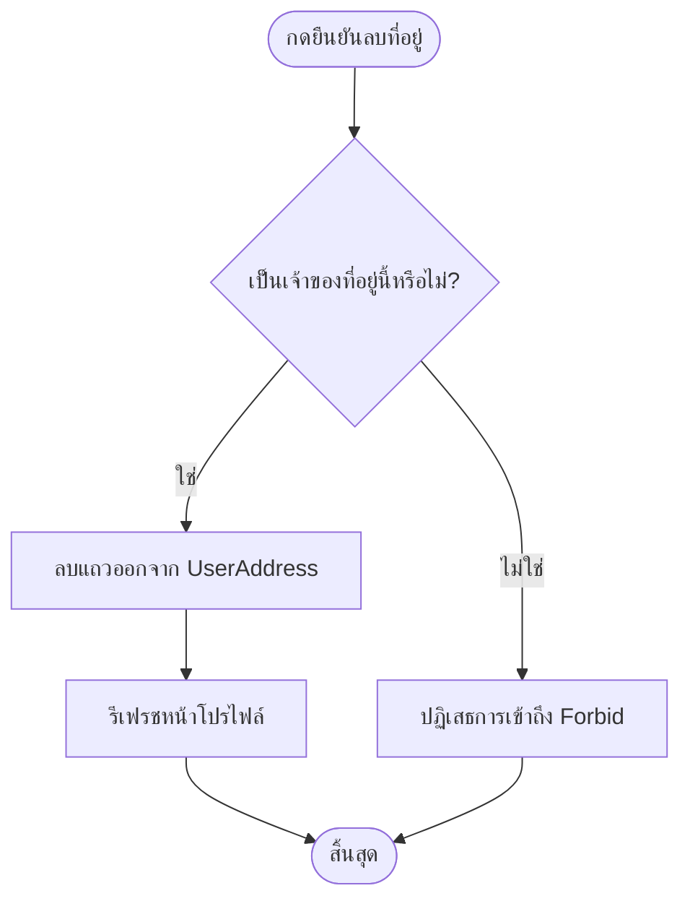

---
### ฟังก์ชันที่ 5: กำหนดที่อยู่จัดส่งเริ่มต้น (Default Address) (AccountController.SetDefaultAddress)

* **คอนโทรลเลอร์ & Action:** `AccountController.SetDefaultAddress` [POST]
* **บทบาทที่มีสิทธิ์ (Role):** Customer
* **ข้อกำหนดที่เกี่ยวข้อง (Requirements):** Default Address
* **ตารางฐานข้อมูลที่เกี่ยวข้อง:** `UserAddress`

#### ลำดับขั้นตอนการทำงาน (Process Steps):
1. รับ AddressId ที่ต้องการตั้งเป็นหลัก
2. ปรับ IsDefault ของทุกที่อยู่ในบัญชีของผู้ใช้นี้ให้เป็น false
3. ตั้ง IsDefault = true ให้กับที่อยู่ที่เลือก
4. บันทึกการเปลี่ยนแปลง

#### แผนผังโฟลว์ชาร์ต (Flowchart Diagram):
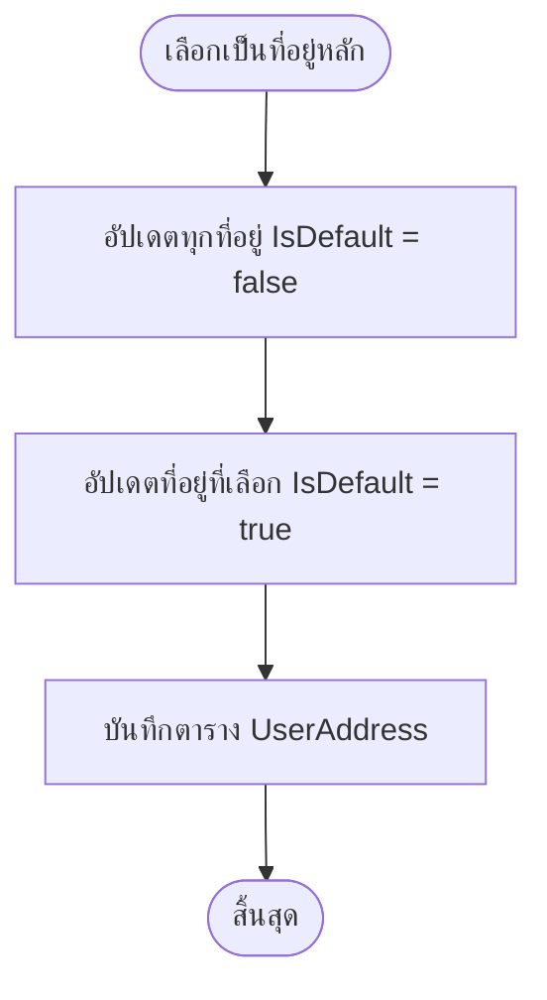

---
### ฟังก์ชันที่ 6: ดูประวัติและติดตามสถานะคำสั่งซื้อ (AccountController.Orders)

* **คอนโทรลเลอร์ & Action:** `AccountController.Orders` [GET]
* **บทบาทที่มีสิทธิ์ (Role):** Customer
* **ข้อกำหนดที่เกี่ยวข้อง (Requirements):** Order History & Step Tracking
* **ตารางฐานข้อมูลที่เกี่ยวข้อง:** `Orders, OrderItem, Product`

#### ลำดับขั้นตอนการทำงาน (Process Steps):
1. ดึงคำสั่งซื้อทั้งหมดที่ผูกกับ UserId ของลูกค้ารายนี้
2. เชื่อมโยงข้อมูลสินค้าและจำนวนจาก OrderItem
3. ประมวลผล Step Progress Bar (รอชำระ -> กำลังเตรียม -> จัดส่งแล้ว -> สำเร็จ)
4. ส่งข้อมูลไปยังหน้า Orders View

#### แผนผังโฟลว์ชาร์ต (Flowchart Diagram):
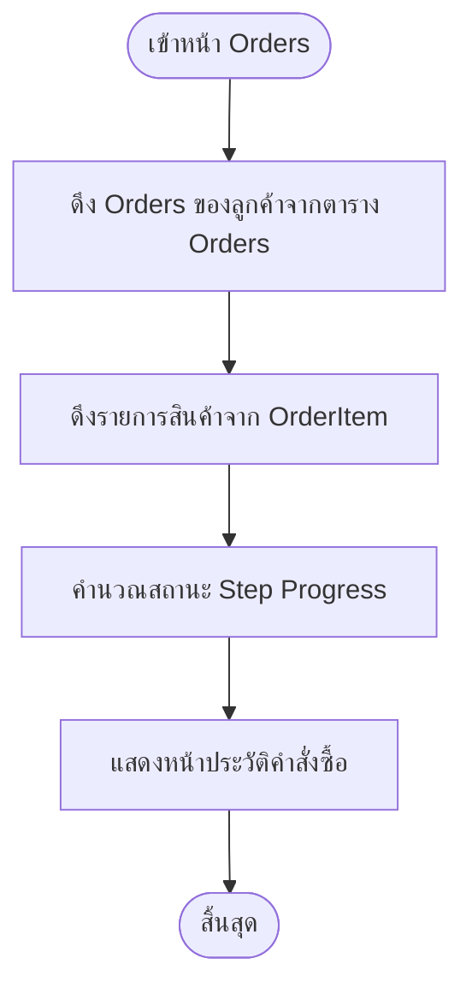

---
### ฟังก์ชันที่ 7: อัปโหลดสลิปโอนเงินเพิ่มเติมภายหลัง (AccountController.UploadSlip)

* **คอนโทรลเลอร์ & Action:** `AccountController.UploadSlip` [POST]
* **บทบาทที่มีสิทธิ์ (Role):** Customer
* **ข้อกำหนดที่เกี่ยวข้อง (Requirements):** Req 19 Payment Slip Upload
* **ตารางฐานข้อมูลที่เกี่ยวข้อง:** `Orders`

#### ลำดับขั้นตอนการทำงาน (Process Steps):
1. รับ OrderId และไฟล์รูปภาพสลิป IFormFile
2. บันทึกไฟล์รูปภาพลงโฟลเดอร์ /wwwroot/uploads/slips
3. อัปเดตฟิลด์ PaymentSlipUrl ในตาราง Orders
4. แจ้งเตือนลูกค้าว่าส่งสลิปเรียบร้อย

#### แผนผังโฟลว์ชาร์ต (Flowchart Diagram):
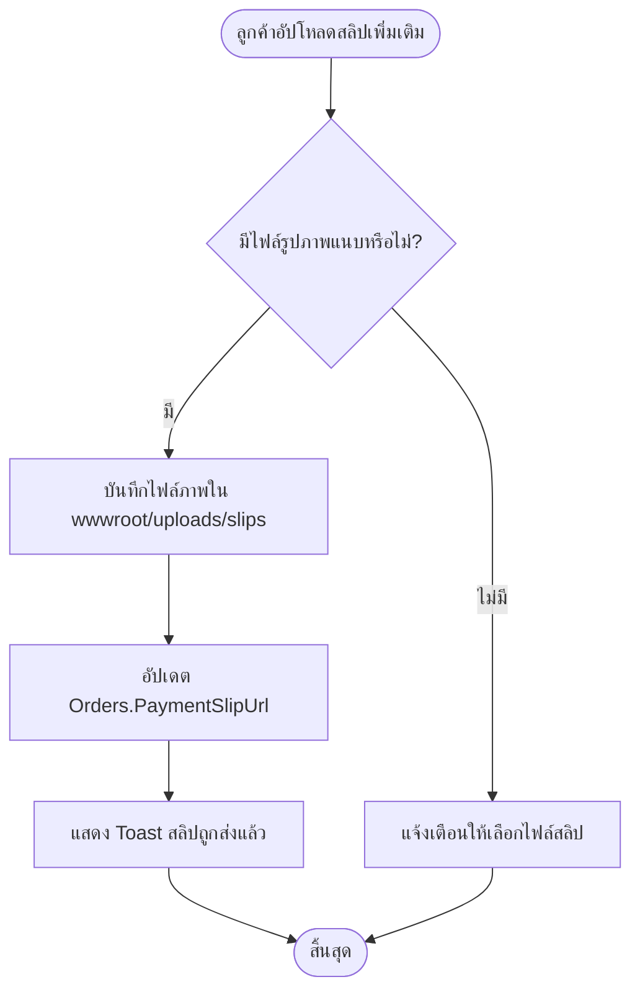

---
### ฟังก์ชันที่ 8: ขอยกเลิกคำสั่งซื้อ หรือขอยื่นคืนเงิน (AccountController.CancelOrder)

* **คอนโทรลเลอร์ & Action:** `AccountController.CancelOrder` [POST]
* **บทบาทที่มีสิทธิ์ (Role):** Customer
* **ข้อกำหนดที่เกี่ยวข้อง (Requirements):** Req 20 Order Cancellation & Refund
* **ตารางฐานข้อมูลที่เกี่ยวข้อง:** `Orders, Product, AuditLog`

#### ลำดับขั้นตอนการทำงาน (Process Steps):
1. ตรวจสอบสถานะคำสั่งซื้อปัจจุบัน
2. หากยังไม่ชำระเงิน (PendingPayment) ให้เปลี่ยนเป็น Cancelled และคืนสต็อกสินค้าใน Product
3. หากชำระเงินแล้ว ให้เปลี่ยนเป็น RefundRequested ส่งต่อฝ่ายบัญชี
4. บันทึก AuditLog

#### แผนผังโฟลว์ชาร์ต (Flowchart Diagram):
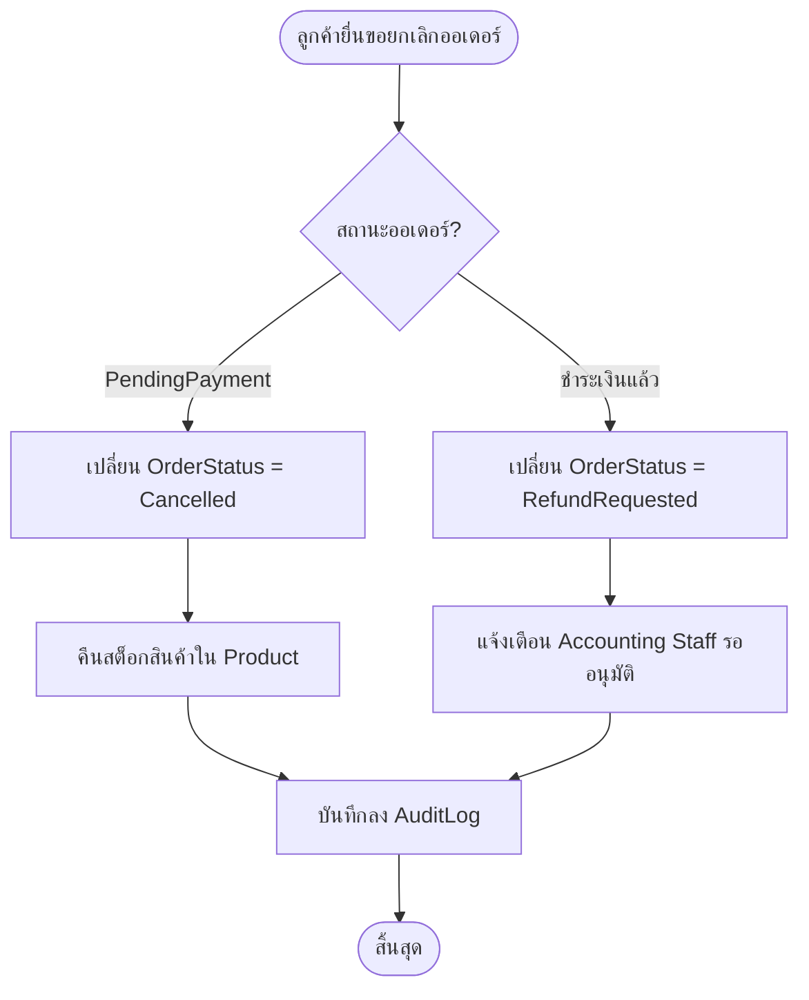

---
### ฟังก์ชันที่ 9: หน้าศูนย์ช่วยเหลือและเปิดตั๋วแจ้งปัญหา (AccountController.Support)

* **คอนโทรลเลอร์ & Action:** `AccountController.Support` [GET]
* **บทบาทที่มีสิทธิ์ (Role):** Customer
* **ข้อกำหนดที่เกี่ยวข้อง (Requirements):** Req 22 Customer Helpdesk
* **ตารางฐานข้อมูลที่เกี่ยวข้อง:** `SupportTicket`

#### ลำดับขั้นตอนการทำงาน (Process Steps):
1. ดึงประวัติตั๋วปัญหาเดิมที่ลูกค้าเคยส่งเข้ามา
2. โหลดรายการหมวดหมู่ปัญหาและระดับความสำคัญ
3. แสดงแบบฟอร์มเปิดตั๋ว Support ใหม่

#### แผนผังโฟลว์ชาร์ต (Flowchart Diagram):
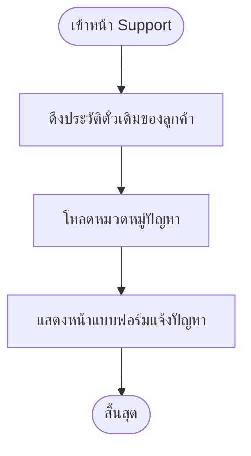

---
### ฟังก์ชันที่ 10: บันทึกการเปิดตั๋วแจ้งปัญหาของลูกค้า (AccountController.SubmitTicket)

* **คอนโทรลเลอร์ & Action:** `AccountController.SubmitTicket` [POST]
* **บทบาทที่มีสิทธิ์ (Role):** Customer
* **ข้อกำหนดที่เกี่ยวข้อง (Requirements):** Req 22 Ticket Creation
* **ตารางฐานข้อมูลที่เกี่ยวข้อง:** `SupportTicket, AuditLog`

#### ลำดับขั้นตอนการทำงาน (Process Steps):
1. รับข้อมูลหัวข้อ, หมวดหมู่, รายละเอียดปัญหา, เบอร์โทร, ความสำคัญ
2. สร้างแถวใหม่ในตาราง SupportTicket สถานะเริ่มต้นเป็น New
3. บันทึก AuditLog และแจ้งเตือนทีม IT Support

#### แผนผังโฟลว์ชาร์ต (Flowchart Diagram):
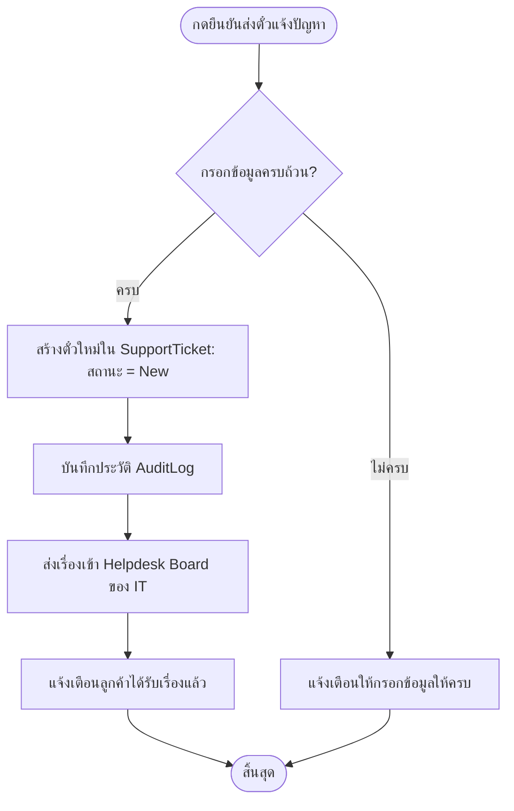

---
### ฟังก์ชันที่ 11: แดชบอร์ดภาพรวมการเงินและการตรวจสอบสลิป (AccountingController.Index)

* **คอนโทรลเลอร์ & Action:** `AccountingController.Index` [GET]
* **บทบาทที่มีสิทธิ์ (Role):** AccountingStaff, Owner
* **ข้อกำหนดที่เกี่ยวข้อง (Requirements):** Req 19, 20, 21 Financial Dashboard
* **ตารางฐานข้อมูลที่เกี่ยวข้อง:** `Orders, FinancialSummary, MonthlyFinancialEntry`

#### ลำดับขั้นตอนการทำงาน (Process Steps):
1. คำนวณยอดขายรวม Gross Revenue, กำไรสุทธิ, ยอดคืนเงินสะสม
2. คัดกรองออเดอร์ที่รอตรวจสอบสลิป และรายการที่ยื่นขอคืนเงิน
3. ดึงบันทึกรายรับ-รายจ่ายรายเดือน
4. ส่งข้อมูลไปยังหน้า Accounting Dashboard

#### แผนผังโฟลว์ชาร์ต (Flowchart Diagram):
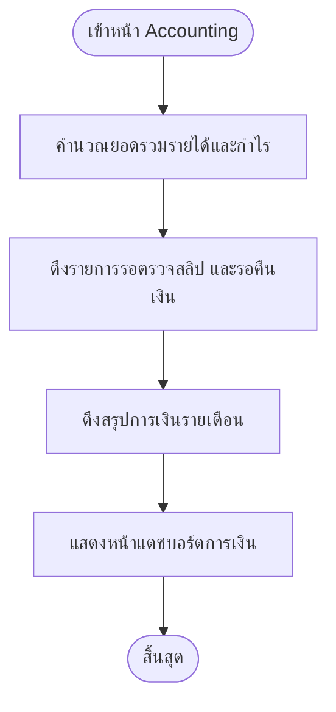

---
### ฟังก์ชันที่ 12: อนุมัติสลิปการชำระเงิน (AccountingController.ApprovePayment)

* **คอนโทรลเลอร์ & Action:** `AccountingController.ApprovePayment` [POST]
* **บทบาทที่มีสิทธิ์ (Role):** AccountingStaff, Owner
* **ข้อกำหนดที่เกี่ยวข้อง (Requirements):** Req 19 Payment Verification
* **ตารางฐานข้อมูลที่เกี่ยวข้อง:** `Orders, FinancialSummary, AuditLog`

#### ลำดับขั้นตอนการทำงาน (Process Steps):
1. ตรวจสอบสลิปและยอดเงิน
2. อัปเดต Orders.OrderStatus = PaymentVerified
3. บวกยอดเงินเข้า GrossRevenue ใน FinancialSummary
4. บันทึก AuditLog และส่งออเดอร์เข้าคิว Order Staff

#### แผนผังโฟลว์ชาร์ต (Flowchart Diagram):
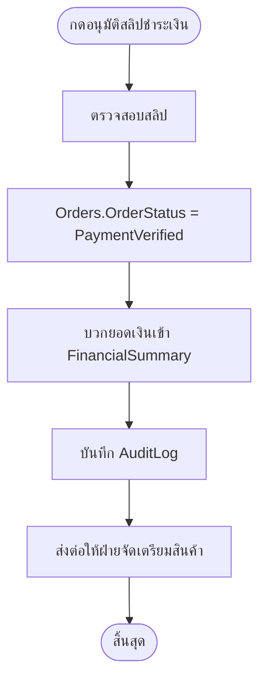

---
### ฟังก์ชันที่ 13: ปฏิเสธสลิปการชำระเงิน (AccountingController.RejectPayment)

* **คอนโทรลเลอร์ & Action:** `AccountingController.RejectPayment` [POST]
* **บทบาทที่มีสิทธิ์ (Role):** AccountingStaff, Owner
* **ข้อกำหนดที่เกี่ยวข้อง (Requirements):** Req 19 Reject Invalid Slip
* **ตารางฐานข้อมูลที่เกี่ยวข้อง:** `Orders, AuditLog`

#### ลำดับขั้นตอนการทำงาน (Process Steps):
1. รับเหตุผลการปฏิเสธสลิปจากเจ้าหน้าที่การเงิน
2. เปลี่ยนสถานะ Orders.OrderStatus = PaymentFailed
3. บันทึกหมายเหตุและแจ้งเตือนให้ลูกค้าอัปโหลดสลิปใหม่

#### แผนผังโฟลว์ชาร์ต (Flowchart Diagram):
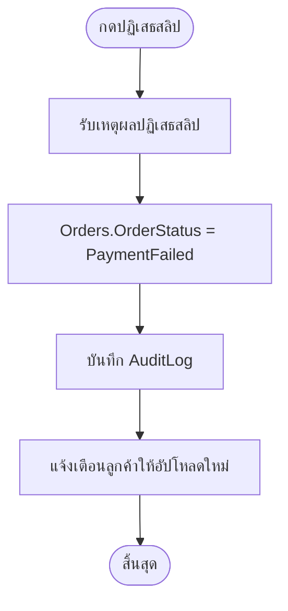

---
### ฟังก์ชันที่ 14: อนุมัติการคืนเงินให้ลูกค้า (AccountingController.ApproveRefund)

* **คอนโทรลเลอร์ & Action:** `AccountingController.ApproveRefund` [POST]
* **บทบาทที่มีสิทธิ์ (Role):** AccountingStaff, Owner
* **ข้อกำหนดที่เกี่ยวข้อง (Requirements):** Req 20 Refund Processing
* **ตารางฐานข้อมูลที่เกี่ยวข้อง:** `Orders, FinancialSummary, AuditLog`

#### ลำดับขั้นตอนการทำงาน (Process Steps):
1. ตรวจสอบหลักฐานสินค้าชำรุดและเหตุผลขอคืนเงิน
2. เปลี่ยนสถานะ Orders.OrderStatus = Refunded
3. บันทึกยอดเงินคืนลง FinancialSummary.RefundedAmount
4. บันทึกประวัติการคืนเงินลง AuditLog

#### แผนผังโฟลว์ชาร์ต (Flowchart Diagram):
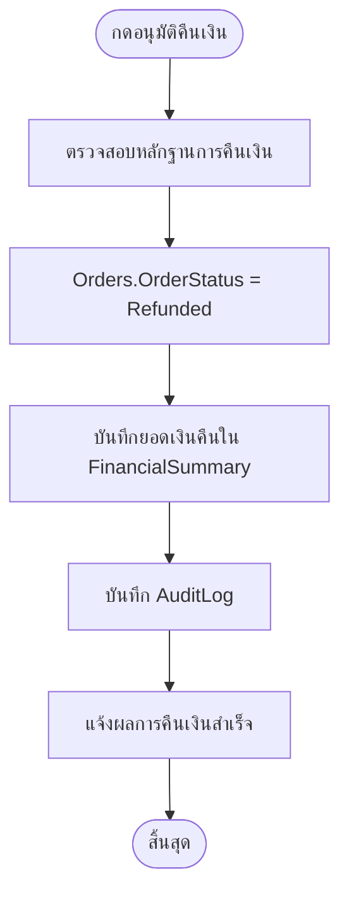

---
### ฟังก์ชันที่ 15: บันทึกรายจ่ายและต้นทุนประจำเดือน (AccountingController.SaveMonthlyExpense)

* **คอนโทรลเลอร์ & Action:** `AccountingController.SaveMonthlyExpense` [POST]
* **บทบาทที่มีสิทธิ์ (Role):** AccountingStaff, Owner
* **ข้อกำหนดที่เกี่ยวข้อง (Requirements):** Req 21 Financial Records
* **ตารางฐานข้อมูลที่เกี่ยวข้อง:** `MonthlyFinancialEntry, FinancialSummary, AuditLog`

#### ลำดับขั้นตอนการทำงาน (Process Steps):
1. รับข้อมูลเดือนและยอดรายจ่ายจริง (ต้นทุนสินค้า ค่าเช่า ขนส่ง)
2. อัปเดตข้อมูลในตาราง MonthlyFinancialEntry
3. คำนวณกำไรสุทธิใหม่ NetProfit = Revenue - Expense
4. บันทึก AuditLog

#### แผนผังโฟลว์ชาร์ต (Flowchart Diagram):
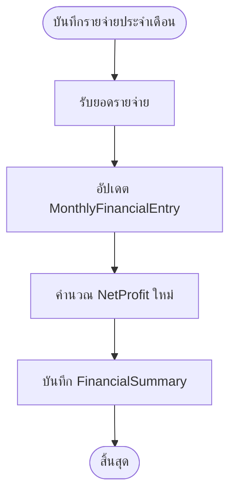

---
### ฟังก์ชันที่ 16: ส่งออกรายงานสรุปการเงินเป็นไฟล์ CSV (AccountingController.ExportFinancialCsv)

* **คอนโทรลเลอร์ & Action:** `AccountingController.ExportFinancialCsv` [GET]
* **บทบาทที่มีสิทธิ์ (Role):** AccountingStaff, Owner
* **ข้อกำหนดที่เกี่ยวข้อง (Requirements):** Req 21 CSV Financial Export
* **ตารางฐานข้อมูลที่เกี่ยวข้อง:** `FinancialSummary, MonthlyFinancialEntry`

#### ลำดับขั้นตอนการทำงาน (Process Steps):
1. คิวรีข้อมูลสรุปรายได้ รายจ่าย กำไรสุทธิ และยอดคืนเงิน
2. จัดรูปแบบข้อความเป็นโครงสร้าง Comma-Separated Values (CSV)
3. ส่งออกเป็นไฟล์ดาวน์โหลดด้วย MIME Type text/csv

#### แผนผังโฟลว์ชาร์ต (Flowchart Diagram):
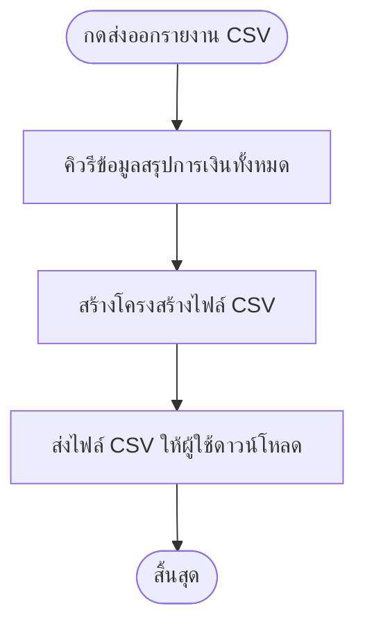

---
### ฟังก์ชันที่ 17: หน้าจัดการผู้ใช้งาน สิทธิ์ และตรวจสอบ Audit Log (AdminController.Index)

* **คอนโทรลเลอร์ & Action:** `AdminController.Index` [GET]
* **บทบาทที่มีสิทธิ์ (Role):** Admin
* **ข้อกำหนดที่เกี่ยวข้อง (Requirements):** Req 57, 58 User & Permission Hub
* **ตารางฐานข้อมูลที่เกี่ยวข้อง:** `User, AuditLog`

#### ลำดับขั้นตอนการทำงาน (Process Steps):
1. ดึงรายชื่อผู้ใช้และพนักงานทั้งหมดในระบบ
2. ดึงตาราง Matrix สิทธิ์การเข้าถึง 10 บทบาท
3. ดึงบันทึกกิจกรรมย้อนหลัง AuditLog ล่าสุด
4. ส่งข้อมูลไปยังหน้า Admin Management

#### แผนผังโฟลว์ชาร์ต (Flowchart Diagram):
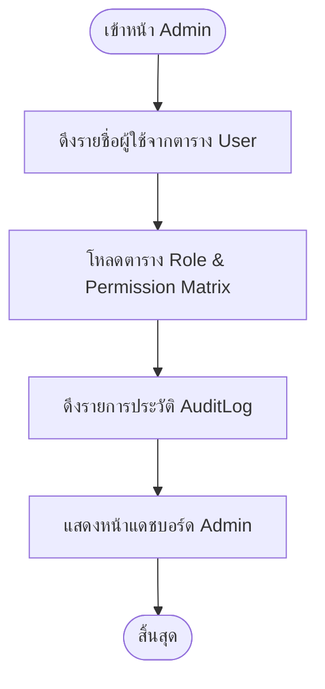

---
### ฟังก์ชันที่ 18: ปรับเปลี่ยนบทบาทและสถานะการเปิด/ระงับบัญชี (AdminController.UpdateUserRole)

* **คอนโทรลเลอร์ & Action:** `AdminController.UpdateUserRole` [POST]
* **บทบาทที่มีสิทธิ์ (Role):** Admin
* **ข้อกำหนดที่เกี่ยวข้อง (Requirements):** Req 58 RBAC Role Assignment
* **ตารางฐานข้อมูลที่เกี่ยวข้อง:** `User, AuditLog`

#### ลำดับขั้นตอนการทำงาน (Process Steps):
1. รับ UserId, บทบาทใหม่ NewRole, และสถานะ IsActive
2. ตรวจสอบว่าไม่ได้ระงับบัญชีของตนเอง
3. อัปเดตตาราง User ในฐานข้อมูล
4. บันทึกการเปลี่ยนแปลงสิทธิ์ลง AuditLog

#### แผนผังโฟลว์ชาร์ต (Flowchart Diagram):
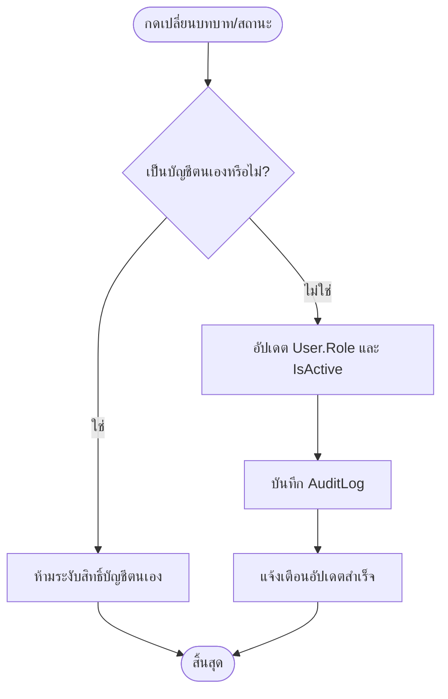

---
### ฟังก์ชันที่ 19: สร้างบัญชีพนักงานหรือผู้ใช้งานใหม่ (AdminController.CreateUser)

* **คอนโทรลเลอร์ & Action:** `AdminController.CreateUser` [POST]
* **บทบาทที่มีสิทธิ์ (Role):** Admin
* **ข้อกำหนดที่เกี่ยวข้อง (Requirements):** Req 57 User Creation
* **ตารางฐานข้อมูลที่เกี่ยวข้อง:** `User, AuditLog`

#### ลำดับขั้นตอนการทำงาน (Process Steps):
1. รับข้อมูลผู้ใช้ใหม่: Username, Password, FullName, Email, Role
2. ตรวจสอบความซ้ำซ้อนของ Username
3. บันทึกบัญชีใหม่ลงตาราง User
4. บันทึก AuditLog

#### แผนผังโฟลว์ชาร์ต (Flowchart Diagram):
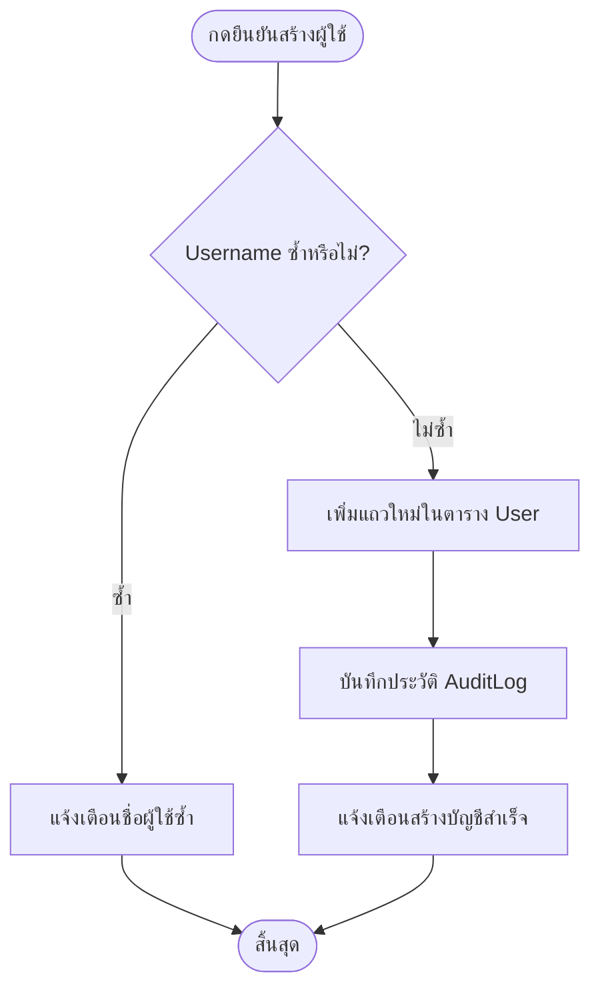

---
### ฟังก์ชันที่ 20: แสดงหน้าเข้าสู่ระบบ (AuthController.Login)

* **คอนโทรลเลอร์ & Action:** `AuthController.Login` [GET]
* **บทบาทที่มีสิทธิ์ (Role):** Guest / Unauthenticated
* **ข้อกำหนดที่เกี่ยวข้อง (Requirements):** Login View
* **ตารางฐานข้อมูลที่เกี่ยวข้อง:** `-`

#### ลำดับขั้นตอนการทำงาน (Process Steps):
1. ตรวจสอบ ReturnUrl (หากมี)
2. แสดงผลหน้าฟอร์มเข้าสู่ระบบ

#### แผนผังโฟลว์ชาร์ต (Flowchart Diagram):
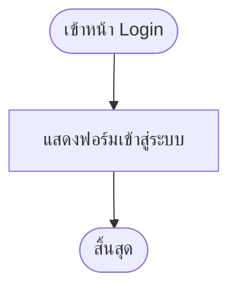

---
### ฟังก์ชันที่ 21: ตรวจสอบรหัสผ่านและสร้างเซสชันล็อกอิน (AuthController.Login)

* **คอนโทรลเลอร์ & Action:** `AuthController.Login` [POST]
* **บทบาทที่มีสิทธิ์ (Role):** Guest / Unauthenticated
* **ข้อกำหนดที่เกี่ยวข้อง (Requirements):** Authentication
* **ตารางฐานข้อมูลที่เกี่ยวข้อง:** `User, AuditLog`

#### ลำดับขั้นตอนการทำงาน (Process Steps):
1. รับ Username และ Password จาก Form
2. ตรวจสอบกับตาราง User
3. เช็ก IsActive == 1
4. สร้าง Claims ออก Cookie Authentication
5. บันทึก AuditLog นำทางผู้ใช้ตามสิทธิ์ Role

#### แผนผังโฟลว์ชาร์ต (Flowchart Diagram):
```mermaid
flowchart TD
    Start([กดปุ่มเข้าสู่ระบบ]) --> QueryUser[ค้นหา Username ใน User]
    QueryUser --> CheckPass{รหัสผ่านถูกต้อง?}
    CheckPass -- ไม่ถูกต้อง --> ErrLogin[แจ้งชื่อหรือรหัสผ่านผิด]
    CheckPass -- ถูกต้อง --> CheckActive{IsActive == 1?}
    CheckActive -- ไม่ใช่ --> ErrSuspended[แจ้งบัญชีถูกระงับ]
    CheckActive -- ใช่ --> IssueClaims[สร้าง Claims & ออก Cookie]
    IssueClaims --> LogAudit[บันทึก AuditLog]
    LogAudit --> RouteRole[นำทางไปยังหน้าตาม Role]
    ErrLogin --> End([สิ้นสุด])
    ErrSuspended --> End
    RouteRole --> End
```

---
### ฟังก์ชันที่ 22: เข้าสู่ระบบคลิกเดียวด้วยบัญชีทดสอบ (Quick Demo Login) (AuthController.QuickLogin)

* **คอนโทรลเลอร์ & Action:** `AuthController.QuickLogin` [POST]
* **บทบาทที่มีสิทธิ์ (Role):** Demo / Testing
* **ข้อกำหนดที่เกี่ยวข้อง (Requirements):** Developer Fast Switch
* **ตารางฐานข้อมูลที่เกี่ยวข้อง:** `User, AuditLog`

#### ลำดับขั้นตอนการทำงาน (Process Steps):
1. รับ Username ทดสอบที่เลือก
2. ดึงข้อมูล User และออก Claims ทันที
3. บันทึก Session Storage และ Cookie
4. นำทางไปยังหน้าของ Role นั้น

#### แผนผังโฟลว์ชาร์ต (Flowchart Diagram):
```mermaid
flowchart TD
    Start([กดปุ่ม Quick Login]) --> FindDemoUser[ค้นหาบัญชี Demo]
    FindDemoUser --> IssueCookie[สร้าง Claims และออก Cookie ทันที]
    IssueCookie --> RoutePortal[ส่งไปยัง Portal ตามสิทธิ์]
    RoutePortal --> End([สิ้นสุด])
```

---
### ฟังก์ชันที่ 23: สลับมุมมองบทบาทแบบ Real-time พร้อมออก Session ใหม่ (AuthController.SwitchRole)

* **คอนโทรลเลอร์ & Action:** `AuthController.SwitchRole` [GET/POST]
* **บทบาทที่มีสิทธิ์ (Role):** All Roles
* **ข้อกำหนดที่เกี่ยวข้อง (Requirements):** Multi-Role Realtime Switcher
* **ตารางฐานข้อมูลที่เกี่ยวข้อง:** `User, AuditLog`

#### ลำดับขั้นตอนการทำงาน (Process Steps):
1. รับ Role ปลายทางที่ต้องการสลับ
2. ปรับปรุง Session Storage ประจำ Tab (petshop_tab_role)
3. ออก Cookie Claims บัญชีของ Role นั้น
4. เปลี่ยนเส้นทางไปยังหน้าแรกของแผนกนั้นทันที

#### แผนผังโฟลว์ชาร์ต (Flowchart Diagram):
```mermaid
flowchart TD
    Start([เลือกสลับบทบาทบน Bar]) --> SetTabSession[อัปเดต sessionStorage ประจำแท็บ]
    SetTabSession --> ReissueClaims[ออก Cookie Claims สำหรับ Role ใหม่]
    ReissueClaims --> RedirectToRole[Redirect ไปยังหน้า Dashboard ของบทบาทนั้น]
    RedirectToRole --> End([สิ้นสุด])
```

---
### ฟังก์ชันที่ 24: แสดงหน้าฟอร์มสมัครสมาชิกใหม่ (AuthController.Register)

* **คอนโทรลเลอร์ & Action:** `AuthController.Register` [GET]
* **บทบาทที่มีสิทธิ์ (Role):** Guest
* **ข้อกำหนดที่เกี่ยวข้อง (Requirements):** Customer Registration View
* **ตารางฐานข้อมูลที่เกี่ยวข้อง:** `-`

#### ลำดับขั้นตอนการทำงาน (Process Steps):
1. แสดงหน้าฟอร์มสมัครสมาชิกให้กรอกข้อมูล

#### แผนผังโฟลว์ชาร์ต (Flowchart Diagram):
```mermaid
flowchart TD
    Start([เข้าหน้า Register]) --> RenderForm[แสดงฟอร์มกรอกข้อมูลสมัครสมาชิก]
    RenderForm --> End([สิ้นสุด])
```

---
### ฟังก์ชันที่ 25: ประมวลผลการสมัครสมาชิกใหม่สำหรับลูกค้า (AuthController.Register)

* **คอนโทรลเลอร์ & Action:** `AuthController.Register` [POST]
* **บทบาทที่มีสิทธิ์ (Role):** Guest
* **ข้อกำหนดที่เกี่ยวข้อง (Requirements):** Customer Registration Processing
* **ตารางฐานข้อมูลที่เกี่ยวข้อง:** `User, Cart, AuditLog`

#### ลำดับขั้นตอนการทำงาน (Process Steps):
1. ตรวจสอบความถูกต้องของข้อมูล (Validation)
2. ตรวจสอบชื่อผู้ใช้และอีเมลไม่ให้ซ้ำ
3. สร้างผู้ใช้ใหม่กำหนด Role = Customer
4. สร้าง Cart ว่างเริ่มต้นสำหรับผู้ใช้ใหม่
5. ล็อกอินให้อัตโนมัติและนำทางไปยังหน้าร้าน

#### แผนผังโฟลว์ชาร์ต (Flowchart Diagram):
```mermaid
flowchart TD
    Start([กดยืนยันสมัครสมาชิก]) --> ValidateModel{ข้อมูลถูกต้อง?}
    ValidateModel -- ถูกต้อง --> CheckDup{Username ซ้ำ?}
    CheckDup -- ไม่ซ้ำ --> CreateUser[บันทึก User บทบาท Customer]
    CreateUser --> CreateCart[สร้าง Cart ว่างในตาราง Cart]
    CreateCart --> AutoSignIn[ล็อกอินอัตโนมัติ]
    AutoSignIn --> GoStorefront[ไปที่หน้าร้านค้า]
    CheckDup -- ซ้ำ --> ShowDup[แจ้งชื่อผู้ใช้มีในระบบแล้ว]
    ValidateModel -- ผิดพลาด --> ShowErr[แจ้งเตือนข้อผิดพลาด]
    GoStorefront --> End([สิ้นสุด])
    ShowDup --> End
    ShowErr --> End
```

---
### ฟังก์ชันที่ 26: ออกจากระบบและล้างเซสชัน (AuthController.Logout)

* **คอนโทรลเลอร์ & Action:** `AuthController.Logout` [GET/POST]
* **บทบาทที่มีสิทธิ์ (Role):** Authenticated Users
* **ข้อกำหนดที่เกี่ยวข้อง (Requirements):** Sign Out
* **ตารางฐานข้อมูลที่เกี่ยวข้อง:** `AuditLog`

#### ลำดับขั้นตอนการทำงาน (Process Steps):
1. เรียก HttpContext.SignOutAsync ล้าง Cookie
2. ล้าง Session Storage ประจำ Tab ให้เป็น Guest
3. บันทึก AuditLog และเปลี่ยนเส้นทางไปยังหน้าแรก

#### แผนผังโฟลว์ชาร์ต (Flowchart Diagram):
```mermaid
flowchart TD
    Start([กดยืนยันออกจากระบบ]) --> SignOutCookie[ล้าง Cookie Authentication]
    SignOutCookie --> ClearSession[ตั้งค่า sessionStorage เป็น Guest]
    ClearSession --> LogAudit[บันทึก AuditLog]
    LogAudit --> GoHome[กลับสู่หน้าแรก Home/Index]
    GoHome --> End([สิ้นสุด])
```

---
### ฟังก์ชันที่ 27: หน้าแจ้งเตือนปฏิเสธการเข้าถึง (Access Denied) (AuthController.AccessDenied)

* **คอนโทรลเลอร์ & Action:** `AuthController.AccessDenied` [GET]
* **บทบาทที่มีสิทธิ์ (Role):** All Roles
* **ข้อกำหนดที่เกี่ยวข้อง (Requirements):** Security Access Control
* **ตารางฐานข้อมูลที่เกี่ยวข้อง:** `-`

#### ลำดับขั้นตอนการทำงาน (Process Steps):
1. แสดงหน้าแจ้งเตือนว่าผู้ใช้ไม่มีสิทธิ์ในหน้างานดังกล่าว
2. แสดงปุ่มกลับหน้าร้าน และปุ่มสลับบัญชี

#### แผนผังโฟลว์ชาร์ต (Flowchart Diagram):
```mermaid
flowchart TD
    Start([เข้าหน้าระบบที่ไม่ได้รับสิทธิ์]) --> RenderDenied[แสดงข้อความปฏิเสธการเข้าถึง]
    RenderDenied --> ShowButtons[แสดงปุ่มกลับหน้าร้านและปุ่มสลับบัญชี]
    ShowButtons --> End([สิ้นสุด])
```

---
### ฟังก์ชันที่ 28: แสดงหน้าตะกร้าสินค้าและคำนวณ 5 โปรโมชั่น (CartController.Index)

* **คอนโทรลเลอร์ & Action:** `CartController.Index` [GET]
* **บทบาทที่มีสิทธิ์ (Role):** Customer & Guest
* **ข้อกำหนดที่เกี่ยวข้อง (Requirements):** Req 3, 4, 11-16 Cart & Promotion Engine
* **ตารางฐานข้อมูลที่เกี่ยวข้อง:** `Cart, CartItem, Product, Promotion, AppliedPromotionSummary`

#### ลำดับขั้นตอนการทำงาน (Process Steps):
1. ดึงรายการสินค้าทั้งหมดในตะกร้า
2. คำนวณยอดรวมราคาสินค้าและน้ำหนักรวม
3. ตรวจสอบกฎแคมเปญโปรโมชั่น 1 ถึง 5 แบบ Real-time
4. คำนวณค่าจัดส่งตามน้ำหนักรวม (เกณฑ์ 10kg และ 20฿/kg)
5. บันทึก AppliedPromotionSummary และแสดงผลในหน้า Cart

#### แผนผังโฟลว์ชาร์ต (Flowchart Diagram):
```mermaid
flowchart TD
    Start([เข้าหน้า Cart]) --> FetchItems[ดึง CartItem และ Product]
    FetchItems --> CalcSubtotal[คำนวณราคารวมและน้ำหนักรวม]
    CalcSubtotal --> Eval5Promos[ประมวลผล 5 โปรโมชั่นอัตโนมัติ]
    Eval5Promos --> CalcWeightShip[คำนวณค่าส่งตามเกณฑ์น้ำหนัก 10kg]
    CalcWeightShip --> SaveSummary[บันทึก AppliedPromotionSummary]
    SaveSummary --> RenderCart[แสดงผลหน้าตะกร้าสินค้า]
    RenderCart --> End([สิ้นสุด])
```

---
### ฟังก์ชันที่ 29: เพิ่มสินค้าลงตะกร้า (AJAX Optimistic UI) (CartController.Add)

* **คอนโทรลเลอร์ & Action:** `CartController.Add` [POST]
* **บทบาทที่มีสิทธิ์ (Role):** Customer & Guest
* **ข้อกำหนดที่เกี่ยวข้อง (Requirements):** Req 11 Add to Cart
* **ตารางฐานข้อมูลที่เกี่ยวข้อง:** `Cart, CartItem, Product`

#### ลำดับขั้นตอนการทำงาน (Process Steps):
1. รับ ProductId และ Quantity ที่ต้องการเพิ่ม
2. ตรวจสอบจำนวนสต็อกใน Product
3. เพิ่มจำนวนใน CartItem (หากมีแล้วให้บวกเพิ่ม หากยังไม่มีให้สร้างแถวใหม่)
4. ส่งผลลัพธ์ JSON ตอบกลับทันที (0ms Optimistic UI)

#### แผนผังโฟลว์ชาร์ต (Flowchart Diagram):
```mermaid
flowchart TD
    Start([กดปุ่มเพิ่มลงตะกร้า]) --> CheckStock{สต็อกคงเหลือเพียงพอ?}
    CheckStock -- พอ --> CheckExist{มีในตะกร้าแล้วหรือยัง?}
    CheckExist -- มีแล้ว --> IncQty[บวกจำนวนเพิ่มใน CartItem]
    CheckExist -- ยังไม่มี --> AddItem[เพิ่มแถวใหม่ใน CartItem]
    IncQty --> ReturnJson[ส่ง JSON สำเร็จ + อัปเดตตัวนับตะกร้า]
    AddItem --> ReturnJson
    CheckStock -- ไม่พอ --> ReturnErr[ส่ง JSON แจ้งสินค้าไม่พอ]
    ReturnJson --> End([สิ้นสุด])
    ReturnErr --> End
```

---
### ฟังก์ชันที่ 30: ปรับปรุงจำนวนสินค้าในตะกร้า (CartController.Update)

* **คอนโทรลเลอร์ & Action:** `CartController.Update` [POST]
* **บทบาทที่มีสิทธิ์ (Role):** Customer & Guest
* **ข้อกำหนดที่เกี่ยวข้อง (Requirements):** Req 11 Update Cart Quantity
* **ตารางฐานข้อมูลที่เกี่ยวข้อง:** `CartItem, Product`

#### ลำดับขั้นตอนการทำงาน (Process Steps):
1. รับ ProductId และจำนวนใหม่ Quantity
2. หาก Quantity <= 0 ให้ลบรายการออก
3. หากมีสต็อกเพียงพอ อัปเดตตาราง CartItem
4. รีเฟรชคำนวณส่วนลดและค่าส่งใหม่

#### แผนผังโฟลว์ชาร์ต (Flowchart Diagram):
```mermaid
flowchart TD
    Start([เปลี่ยนจำนวนสินค้า]) --> CheckZero{Quantity <= 0?}
    CheckZero -- ใช่ --> RemoveItem[ลบรายการออกจาก CartItem]
    CheckZero -- ไม่ใช่ --> CheckStock{สต็อกพอหรือไม่?}
    CheckStock -- พอ --> UpdateQty[อัปเดต CartItem.Quantity]
    CheckStock -- ไม่พอ --> CapMax[ปรับเป็นจำนวนสูงสุดที่มี]
    RemoveItem --> Recalc[คำนวณราคาและโปรโมชั่นใหม่]
    UpdateQty --> Recalc
    CapMax --> Recalc
    Recalc --> End([สิ้นสุด])
```

---
### ฟังก์ชันที่ 31: ลบรายการสินค้าออกจากตะกร้า (CartController.Remove)

* **คอนโทรลเลอร์ & Action:** `CartController.Remove` [POST]
* **บทบาทที่มีสิทธิ์ (Role):** Customer & Guest
* **ข้อกำหนดที่เกี่ยวข้อง (Requirements):** Req 11 Remove Cart Item
* **ตารางฐานข้อมูลที่เกี่ยวข้อง:** `CartItem`

#### ลำดับขั้นตอนการทำงาน (Process Steps):
1. รับ ProductId ที่ต้องการลบ
2. ลบแถวใน CartItem ที่ตรงกับสินค้านี้
3. นำทางกลับหน้าตะกร้าเพื่อคำนวณยอดเงินใหม่

#### แผนผังโฟลว์ชาร์ต (Flowchart Diagram):
```mermaid
flowchart TD
    Start([กดปุ่มลบสินค้า]) --> DeleteItem[ลบแถวออกจากตาราง CartItem]
    DeleteItem --> RecalcTotals[คำนวณยอดเงินและโปรโมชั่นใหม่]
    RecalcTotals --> End([สิ้นสุด])
```

---
### ฟังก์ชันที่ 32: หน้าสรุปยอดชำระเงินและเลือกที่อยู่จัดส่ง (CartController.Checkout)

* **คอนโทรลเลอร์ & Action:** `CartController.Checkout` [GET]
* **บทบาทที่มีสิทธิ์ (Role):** Customer
* **ข้อกำหนดที่เกี่ยวข้อง (Requirements):** Checkout Preparation
* **ตารางฐานข้อมูลที่เกี่ยวข้อง:** `Cart, CartItem, UserAddress, Product, Promotion`

#### ลำดับขั้นตอนการทำงาน (Process Steps):
1. ตรวจสอบว่ามีสินค้าในตะกร้าหรือไม่
2. ดึงสมุดที่อยู่จัดส่ง UserAddress ของลูกค้า
3. คำนวณยอดเงินสุทธิ ส่วนลด 5 โปรโมชั่น และค่าส่งตามน้ำหนัก
4. แสดง QR Code พร้อมเพย์สำหรับชำระเงิน

#### แผนผังโฟลว์ชาร์ต (Flowchart Diagram):
```mermaid
flowchart TD
    Start([กดดำเนินการสั่งซื้อ Checkout]) --> CheckCartEmpty{ตะกร้าว่างหรือไม่?}
    CheckCartEmpty -- ว่าง --> GoBackCart[กลับไปหน้าตะกร้าสินค้า]
    CheckCartEmpty -- มีสินค้า --> LoadAddr[ดึงสมุดที่อยู่ของลูกค้า]
    LoadAddr --> CalcBill[คำนวณยอดสุทธิและค่าส่ง]
    CalcBill --> GenQR[สร้าง QR Code พร้อมเพย์]
    GenQR --> RenderCheckout[แสดงหน้าจอสรุปการสั่งซื้อ]
    GoBackCart --> End([สิ้นสุด])
    RenderCheckout --> End
```

---
### ฟังก์ชันที่ 33: ยืนยันการสั่งซื้อ บันทึกออเดอร์ และตัดสต็อก (CartController.SubmitOrder)

* **คอนโทรลเลอร์ & Action:** `CartController.SubmitOrder` [POST]
* **บทบาทที่มีสิทธิ์ (Role):** Customer
* **ข้อกำหนดที่เกี่ยวข้อง (Requirements):** Req 19 Order Placement & Payment
* **ตารางฐานข้อมูลที่เกี่ยวข้อง:** `Orders, OrderItem, Product, Cart, CartItem, AuditLog`

#### ลำดับขั้นตอนการทำงาน (Process Steps):
1. รับที่อยู่จัดส่ง วิธีชำระเงิน และรูปภาพสลิปโอนเงิน
2. สร้างแถวใหม่ใน Orders: สถานะ = PendingPayment
3. บันทึกรายการสินค้าลง OrderItem
4. ตัดสต็อกสินค้าใน Product ทันที
5. ล้างตะกร้าสินค้า และนำทางไปหน้าสำเร็จ

#### แผนผังโฟลว์ชาร์ต (Flowchart Diagram):
```mermaid
flowchart TD
    Start([กดยืนยันการสั่งซื้อ]) --> ValidateInput{ข้อมูลและสลิปครบถ้วน?}
    ValidateInput -- ครบ --> SaveSlip[บันทึกไฟล์สลิปลง wwwroot]
    SaveSlip --> InsertOrder[สร้าง Order ในตาราง Orders]
    InsertOrder --> InsertItems[คัดลอกลงตาราง OrderItem]
    InsertItems --> DeductStock[ตัดยอดสต็อกสินค้าใน Product]
    DeductStock --> ClearCart[ล้างสินค้าในตะกร้า CartItem]
    ClearCart --> ShowSuccess[แสดงหน้าสั่งซื้อสำเร็จ Order Completed]
    ValidateInput -- ไม่ครบ --> ShowErr[แจ้งเตือนแนบสลิป/เลือกที่อยู่]
    ShowSuccess --> End([สิ้นสุด])
    ShowErr --> End
```

---
### ฟังก์ชันที่ 34: รองรับกรณีผู้ใช้กด Refresh หรือ Back ในหน้าสั่งซื้อ (CartController.SubmitOrder)

* **คอนโทรลเลอร์ & Action:** `CartController.SubmitOrder` [GET]
* **บทบาทที่มีสิทธิ์ (Role):** Customer
* **ข้อกำหนดที่เกี่ยวข้อง (Requirements):** Safe Navigation Fallback
* **ตารางฐานข้อมูลที่เกี่ยวข้อง:** `-`

#### ลำดับขั้นตอนการทำงาน (Process Steps):
1. ดักจับกรณีผู้ใช้เข้าสู่ /Cart/SubmitOrder ผ่าน HTTP GET
2. นำทางผู้ใช้กลับไปยังหน้า /Cart/Checkout อย่างปลอดภัย

#### แผนผังโฟลว์ชาร์ต (Flowchart Diagram):
```mermaid
flowchart TD
    Start([เข้า /Cart/SubmitOrder ด้วย GET]) --> Redirect[Redirect ไปยัง /Cart/Checkout]
    Redirect --> End([สิ้นสุด])
```

---
### ฟังก์ชันที่ 35: หน้าร้านค้า แคตตาล็อก และระบบตัวกรองอัจฉริยะ (HomeController.Index)

* **คอนโทรลเลอร์ & Action:** `HomeController.Index` [GET]
* **บทบาทที่มีสิทธิ์ (Role):** Guest & Customer
* **ข้อกำหนดที่เกี่ยวข้อง (Requirements):** Req 1, 2, 7, 8, 9, 10 Multi-Filter & Social Proof
* **ตารางฐานข้อมูลที่เกี่ยวข้อง:** `Product, CartItem`

#### ลำดับขั้นตอนการทำงาน (Process Steps):
1. รับตัวกรอง: ประเภทสัตว์, หมวดสินค้า, ช่วงวัย Layer, น้ำหนัก, คำค้นหา
2. คิวรีสินค้าใน Product ที่ IsActive = 1
3. คำนวณจำนวนคนที่ใส่สินค้านี้ในตะกร้า CartCount จากตาราง CartItem (Req 8)
4. ส่งข้อมูลไปยังหน้าแรก Storefront

#### แผนผังโฟลว์ชาร์ต (Flowchart Diagram):
```mermaid
flowchart TD
    Start([เข้าหน้าแรก Home/Index]) --> ReadFilters[รับค่าตัวกรองประเภทสัตว์ ช่วงวัย น้ำหนัก]
    ReadFilters --> QueryProducts[คิวรีตาราง Product]
    QueryProducts --> CountCartUsers["นับจำนวนคนใส่ตะกร้าจาก CartItem (Req 8)"]
    CountCartUsers --> RenderStorefront[แสดงแคตตาล็อกสินค้าพร้อมป้าย Layer]
    RenderStorefront --> End([สิ้นสุด])
```

---
### ฟังก์ชันที่ 36: หน้ารายละเอียดสินค้า ข้อมูลโภชนาการ และสินค้าแนะนำตามช่วงวัย (HomeController.Details)

* **คอนโทรลเลอร์ & Action:** `HomeController.Details` [GET]
* **บทบาทที่มีสิทธิ์ (Role):** Guest & Customer
* **ข้อกำหนดที่เกี่ยวข้อง (Requirements):** Req 7, 8, 10 Product Details & Recommendations
* **ตารางฐานข้อมูลที่เกี่ยวข้อง:** `Product, CartItem`

#### ลำดับขั้นตอนการทำงาน (Process Steps):
1. รับ ProductId ที่ต้องการดู
2. ดึงข้อมูลโภชนาการ น้ำหนัก ป้ายช่วงวัย และแบรนด์
3. ดึงสินค้าแนะนำในสายพันธุ์และช่วงวัยเดียวกัน
4. แสดงหน้า Product Details

#### แผนผังโฟลว์ชาร์ต (Flowchart Diagram):
```mermaid
flowchart TD
    Start([คลิกดูสินค้า]) --> FindProduct[ดึงข้อมูลสินค้าตาม ProductId]
    FindProduct --> GetRecommendations[ดึงสินค้าแนะนำช่วงวัยเดียวกัน]
    GetRecommendations --> RenderDetails[แสดงหน้า Details โภชนาการและน้ำหนัก]
    RenderDetails --> End([สิ้นสุด])
```

---
### ฟังก์ชันที่ 37: สลับบทบาทการทดสอบจาก Role Switcher Bar (HomeController.SwitchRole)

* **คอนโทรลเลอร์ & Action:** `HomeController.SwitchRole` [POST]
* **บทบาทที่มีสิทธิ์ (Role):** All Roles
* **ข้อกำหนดที่เกี่ยวข้อง (Requirements):** Fast Testing Role Switcher
* **ตารางฐานข้อมูลที่เกี่ยวข้อง:** `User`

#### ลำดับขั้นตอนการทำงาน (Process Steps):
1. รับบทบาทเป้าหมายที่เลือกบนแถบ Bar
2. ส่งต่อไปยัง AuthController เพื่อออกเซสชัน
3. รีเฟรชหน้าร้านตามมุมมองบทบาทใหม่

#### แผนผังโฟลว์ชาร์ต (Flowchart Diagram):
```mermaid
flowchart TD
    Start([สลับบทบาทบน Bar]) --> DispatchAuth[ส่งต่อให้ AuthController.SwitchRole]
    DispatchAuth --> Reload[รีเฟรชหน้าจอตามสิทธิ์ใหม่]
    Reload --> End([สิ้นสุด])
```

---
### ฟังก์ชันที่ 38: แดชบอร์ดสต็อกสินค้าและการแจ้งเตือน Low Stock Alert (InventoryController.Index)

* **คอนโทรลเลอร์ & Action:** `InventoryController.Index` [GET]
* **บทบาทที่มีสิทธิ์ (Role):** InventoryStaff, Owner
* **ข้อกำหนดที่เกี่ยวข้อง (Requirements):** Req 18 Low Stock Alert
* **ตารางฐานข้อมูลที่เกี่ยวข้อง:** `Product`

#### ลำดับขั้นตอนการทำงาน (Process Steps):
1. ดึงรายการสินค้าทั้งหมดในระบบ
2. ตรวจสอบสินค้าที่สต็อกต่ำกว่าเกณฑ์ MinStockThreshold
3. จัดหมวดหมู่ตัวกรอง All, Low Stock, Out of Stock
4. แสดงผลตารางสต็อกสินค้า

#### แผนผังโฟลว์ชาร์ต (Flowchart Diagram):
```mermaid
flowchart TD
    Start([เข้าหน้า Inventory]) --> FetchAll[ดึงสินค้าทั้งหมดจาก Product]
    FetchAll --> EvalLowStock{มีสินค้า <= MinStockThreshold?}
    EvalLowStock -- มี --> ShowBadge[แสดงแถบเตือนสีแดง Low Stock Alert]
    EvalLowStock -- ไม่มี --> NormalTable[แสดงตารางสต็อกปกติ]
    ShowBadge --> RenderView[แสดงแดชบอร์ดสต็อกสินค้า]
    NormalTable --> RenderView
    RenderView --> End([สิ้นสุด])
```

---
### ฟังก์ชันที่ 39: ปรับปรุงจำนวนสต็อกสินค้าด่วน (Quick In/Out) (InventoryController.UpdateStock)

* **คอนโทรลเลอร์ & Action:** `InventoryController.UpdateStock` [POST]
* **บทบาทที่มีสิทธิ์ (Role):** InventoryStaff, Owner
* **ข้อกำหนดที่เกี่ยวข้อง (Requirements):** Stock Quick Adjustment
* **ตารางฐานข้อมูลที่เกี่ยวข้อง:** `Product, AuditLog`

#### ลำดับขั้นตอนการทำงาน (Process Steps):
1. รับ ProductId และค่าการปรับยอด (+1, -1, หรือตัวเลขระบุ)
2. ปรับยอด StockQuantity ในตาราง Product (ไม่ให้ต่ำกว่า 0)
3. บันทึกกิจกรรมลง AuditLog
4. รีเฟรชคงสถานะตัวกรองเดิมไว้

#### แผนผังโฟลว์ชาร์ต (Flowchart Diagram):
```mermaid
flowchart TD
    Start([กดปุ่ม + หรือ - สต็อก]) --> CalcNewStock[คำนวณ StockQuantity ใหม่]
    CalcNewStock --> CheckNegative{ค่าใหม่ < 0?}
    CheckNegative -- ใช่ --> SetZero[กำหนดสต็อก = 0]
    CheckNegative -- ไม่ใช่ --> SetValue[กำหนดค่าตามผลคำนวณ]
    SetZero --> UpdateDB[อัปเดตตาราง Product]
    SetValue --> UpdateDB
    UpdateDB --> LogAudit[บันทึกประวัติลง AuditLog]
    LogAudit --> End([สิ้นสุด])
```

---
### ฟังก์ชันที่ 40: เพิ่มสินค้าใหม่ หรือแก้ไขข้อมูลสินค้าและอัปโหลดรูปภาพ (InventoryController.SaveProduct)

* **คอนโทรลเลอร์ & Action:** `InventoryController.SaveProduct` [POST]
* **บทบาทที่มีสิทธิ์ (Role):** InventoryStaff, Owner
* **ข้อกำหนดที่เกี่ยวข้อง (Requirements):** Req 6, 17 Product CRUD
* **ตารางฐานข้อมูลที่เกี่ยวข้อง:** `Product, AuditLog`

#### ลำดับขั้นตอนการทำงาน (Process Steps):
1. รับข้อมูลสินค้า: ชื่อ, หมวด, ประเภทสัตว์, ช่วงวัย, ราคา, น้ำหนัก kg, จุดสั่งซื้อซ้ำ
2. บันทึกไฟล์รูปภาพ (ถ้ามี)
3. หากเป็นสินค้าใหม่ ให้สร้างแถวใหม่ หากแก้ไขให้อัปเดตข้อมูลเดิม
4. บันทึก AuditLog

#### แผนผังโฟลว์ชาร์ต (Flowchart Diagram):
```mermaid
flowchart TD
    Start([กดยืนยันบันทึกสินค้า]) --> CheckImage{มีไฟล์รูปภาพใหม่แนบ?}
    CheckImage -- มี --> UploadImg[บันทึกรูปลง wwwroot/uploads/products]
    CheckImage -- ไม่มี --> KeepImg[ใช้ URL รูปเดิม]
    UploadImg --> CheckIsNew{ProductId == 0?}
    KeepImg --> CheckIsNew
    CheckIsNew -- ใช่ --> InsertProd[เพิ่มสินค้าใหม่ใน Product]
    CheckIsNew -- ไม่ใช่ --> UpdateProd[อัปเดตข้อมูลใน Product]
    InsertProd --> LogAudit[บันทึก AuditLog]
    UpdateProd --> LogAudit
    LogAudit --> End([สิ้นสุด])
```

---
### ฟังก์ชันที่ 41: ระงับการจำหน่ายหรือลบสินค้า (InventoryController.DeleteProduct)

* **คอนโทรลเลอร์ & Action:** `InventoryController.DeleteProduct` [POST]
* **บทบาทที่มีสิทธิ์ (Role):** InventoryStaff, Owner
* **ข้อกำหนดที่เกี่ยวข้อง (Requirements):** Req 17 Product Deletion
* **ตารางฐานข้อมูลที่เกี่ยวข้อง:** `Product, AuditLog`

#### ลำดับขั้นตอนการทำงาน (Process Steps):
1. รับ ProductId ที่ต้องการลบ
2. ตั้งค่า IsActive = false (Soft Delete) หรือลบออกจากระบบ
3. บันทึก AuditLog

#### แผนผังโฟลว์ชาร์ต (Flowchart Diagram):
```mermaid
flowchart TD
    Start([กดยืนยันลบสินค้า]) --> SoftDelete[ตั้งค่า Product.IsActive = false]
    SoftDelete --> LogAudit[บันทึก AuditLog]
    LogAudit --> End([สิ้นสุด])
```

---
### ฟังก์ชันที่ 42: แดชบอร์ดจัดการ 5 แคมเปญโปรโมชั่นและดูสถิติ (MarketingController.Index)

* **คอนโทรลเลอร์ & Action:** `MarketingController.Index` [GET]
* **บทบาทที่มีสิทธิ์ (Role):** MarketingStaff, Owner
* **ข้อกำหนดที่เกี่ยวข้อง (Requirements):** Req 5, 27 Promotion Dashboard & Stats
* **ตารางฐานข้อมูลที่เกี่ยวข้อง:** `Promotion`

#### ลำดับขั้นตอนการทำงาน (Process Steps):
1. ดึงแคมเปญโปรโมชั่นทั้ง 5 แคมเปญ
2. ดึงสถิติจำนวนครั้งที่ถูกนำไปใช้ (TimesApplied)
3. แสดงผลตารางโปรโมชั่นพร้อมสถานะเปิด/ปิด

#### แผนผังโฟลว์ชาร์ต (Flowchart Diagram):
```mermaid
flowchart TD
    Start([เข้าหน้า Marketing]) --> FetchPromos[ดึงข้อมูลตาราง Promotion]
    FetchPromos --> FetchStats[รวบรวมสถิติจำนวนครั้งที่โปรโมชั่นถูกใช้]
    FetchStats --> RenderView[แสดงผลหน้าแดชบอร์ดการตลาด]
    RenderView --> End([สิ้นสุด])
```

---
### ฟังก์ชันที่ 43: สวิตช์เปิด/ปิดการใช้งานโปรโมชั่นแบบ Real-time (MarketingController.ToggleStatus)

* **คอนโทรลเลอร์ & Action:** `MarketingController.ToggleStatus` [POST]
* **บทบาทที่มีสิทธิ์ (Role):** MarketingStaff, Owner
* **ข้อกำหนดที่เกี่ยวข้อง (Requirements):** Req 5 Real-time Promotion Switch
* **ตารางฐานข้อมูลที่เกี่ยวข้อง:** `Promotion, AuditLog`

#### ลำดับขั้นตอนการทำงาน (Process Steps):
1. รับ PromotionId
2. สลับค่า IsActive = !IsActive
3. บันทึกตาราง Promotion มีผลกับหน้าร้านทันที
4. บันทึก AuditLog

#### แผนผังโฟลว์ชาร์ต (Flowchart Diagram):
```mermaid
flowchart TD
    Start([คลิก Toggle สวิตช์โปรโมชั่น]) --> FindPromo[ค้นหาโปรโมชั่นตาม Id]
    FindPromo --> InvertStatus[สลับ IsActive = !IsActive]
    InvertStatus --> SaveDB[บันทึกลงตาราง Promotion]
    SaveDB --> LogAudit[บันทึก AuditLog]
    LogAudit --> End([สิ้นสุด])
```

---
### ฟังก์ชันที่ 44: บันทึกเงื่อนไข Rule Builder แคมเปญโปรโมชั่น (MarketingController.Save)

* **คอนโทรลเลอร์ & Action:** `MarketingController.Save` [POST]
* **บทบาทที่มีสิทธิ์ (Role):** MarketingStaff, Owner
* **ข้อกำหนดที่เกี่ยวข้อง (Requirements):** Req 5, 25, 26 Promotion Rule Builder
* **ตารางฐานข้อมูลที่เกี่ยวข้อง:** `Promotion, AuditLog`

#### ลำดับขั้นตอนการทำงาน (Process Steps):
1. รับข้อมูลเงื่อนไข: ยอดซื้อขั้นต่ำ, จำนวนชิ้นขั้นต่ำ, แบรนด์ที่ร่วมรายการ
2. กำหนดช่วงเวลาเริ่มต้น StartDate และสิ้นสุด EndDate
3. อัปเดตตาราง Promotion
4. บันทึก AuditLog

#### แผนผังโฟลว์ชาร์ต (Flowchart Diagram):
```mermaid
flowchart TD
    Start([กดบันทึกเงื่อนไขโปรโมชั่น]) --> ParseRules[รับค่ายอดขั้นต่ำ/ชิ้น/แบรนด์]
    ParseRules --> SetDates[กำหนดวันเริ่มและวันสิ้นสุด]
    SetDates --> UpdatePromo[อัปเดตข้อมูลตาราง Promotion]
    UpdatePromo --> LogAudit[บันทึก AuditLog]
    LogAudit --> End([สิ้นสุด])
```

---
### ฟังก์ชันที่ 45: สร้างแคมเปญโปรโมชั่นใหม่ (MarketingController.Create)

* **คอนโทรลเลอร์ & Action:** `MarketingController.Create` [POST]
* **บทบาทที่มีสิทธิ์ (Role):** MarketingStaff, Owner
* **ข้อกำหนดที่เกี่ยวข้อง (Requirements):** Promotion Creation
* **ตารางฐานข้อมูลที่เกี่ยวข้อง:** `Promotion, AuditLog`

#### ลำดับขั้นตอนการทำงาน (Process Steps):
1. รับข้อมูลแคมเปญใหม่
2. เพิ่มแถวใหม่ลงตาราง Promotion
3. บันทึก AuditLog

#### แผนผังโฟลว์ชาร์ต (Flowchart Diagram):
```mermaid
flowchart TD
    Start([สร้างโปรโมชั่นใหม่]) --> InsertPromo[เพิ่มแถวในตาราง Promotion]
    InsertPromo --> LogAudit[บันทึก AuditLog]
    LogAudit --> End([สิ้นสุด])
```

---
### ฟังก์ชันที่ 46: ลบแคมเปญโปรโมชั่น (MarketingController.Delete)

* **คอนโทรลเลอร์ & Action:** `MarketingController.Delete` [POST]
* **บทบาทที่มีสิทธิ์ (Role):** MarketingStaff, Owner
* **ข้อกำหนดที่เกี่ยวข้อง (Requirements):** Promotion Deletion
* **ตารางฐานข้อมูลที่เกี่ยวข้อง:** `Promotion, AuditLog`

#### ลำดับขั้นตอนการทำงาน (Process Steps):
1. รับ PromotionId ที่ต้องการลบ
2. ลบแถวออกจากตาราง Promotion
3. บันทึก AuditLog

#### แผนผังโฟลว์ชาร์ต (Flowchart Diagram):
```mermaid
flowchart TD
    Start([กดยืนยันลบโปรโมชั่น]) --> DeletePromoRow[ลบแถวออกจากตาราง Promotion]
    DeletePromoRow --> LogAudit[บันทึก AuditLog]
    LogAudit --> End([สิ้นสุด])
```

---
### ฟังก์ชันที่ 47: คิวงานคำสั่งซื้อที่ชำระเงินแล้วและออกใบแพ็กของ (OrderController.Index)

* **คอนโทรลเลอร์ & Action:** `OrderController.Index` [GET]
* **บทบาทที่มีสิทธิ์ (Role):** OrderStaff, Owner
* **ข้อกำหนดที่เกี่ยวข้อง (Requirements):** Req 42, 43, 44 Order Queue & Packing Slip
* **ตารางฐานข้อมูลที่เกี่ยวข้อง:** `Orders, OrderItem, Product`

#### ลำดับขั้นตอนการทำงาน (Process Steps):
1. ดึงคำสั่งซื้อที่มีสถานะ PaymentVerified
2. ตรวจสอบของแถมโปรโมชั่นที่ต้องจัดแพ็กเกจ (เช่น เสื้อฟรี)
3. แสดงคิวงานพร้อมปุ่มพิมพ์ใบ Packing Slip

#### แผนผังโฟลว์ชาร์ต (Flowchart Diagram):
```mermaid
flowchart TD
    Start([เข้าหน้า Order]) --> FetchPaid[ดึงออเดอร์สถานะ PaymentVerified]
    FetchPaid --> CheckGifts[ตรวจสอบของแถมโปรโมชั่นที่ต้องแพ็ก]
    CheckGifts --> ShowQueue[แสดงคิวงานและปุ่มพิมพ์ Packing Slip]
    ShowQueue --> End([สิ้นสุด])
```

---
### ฟังก์ชันที่ 48: อัปเดตสถานะการเตรียมสินค้า (Preparing / ReadyToShip) (OrderController.UpdateStatus)

* **คอนโทรลเลอร์ & Action:** `OrderController.UpdateStatus` [POST]
* **บทบาทที่มีสิทธิ์ (Role):** OrderStaff, Owner
* **ข้อกำหนดที่เกี่ยวข้อง (Requirements):** Order Status Update
* **ตารางฐานข้อมูลที่เกี่ยวข้อง:** `Orders, AuditLog`

#### ลำดับขั้นตอนการทำงาน (Process Steps):
1. รับ OrderId และสถานะใหม่ NewStatus
2. อัปเดต Orders.OrderStatus = Preparing (กำลังแพ็ก) หรือพร้อมส่ง
3. ส่งต่อให้ฝ่ายจัดส่ง (Shipping Staff)
4. บันทึก AuditLog

#### แผนผังโฟลว์ชาร์ต (Flowchart Diagram):
```mermaid
flowchart TD
    Start([กดเปลี่ยนสถานะเตรียมสินค้า]) --> SetPreparing[อัปเดต Orders.OrderStatus = Preparing]
    SetPreparing --> LogAudit[บันทึก AuditLog]
    LogAudit --> ForwardToShip[ส่งต่อเข้าคิวงานฝ่าย Shipping]
    ForwardToShip --> End([สิ้นสุด])
```

---
### ฟังก์ชันที่ 49: แดชบอร์ดผู้บริหารสูงสุด (Executive BI Dashboard) (OwnerController.Index)

* **คอนโทรลเลอร์ & Action:** `OwnerController.Index` [GET]
* **บทบาทที่มีสิทธิ์ (Role):** Owner (Super-Access)
* **ข้อกำหนดที่เกี่ยวข้อง (Requirements):** Req 60, 61 Owner Executive BI
* **ตารางฐานข้อมูลที่เกี่ยวข้อง:** `Orders, OrderItem, Product, Promotion, FinancialSummary`

#### ลำดับขั้นตอนการทำงาน (Process Steps):
1. คำนวณ KPI: ยอดขายรวม Gross Revenue, กำไรสุทธิ Net Profit, ยอดเงินขอคืนสะสม
2. คำนวณสัดส่วนยอดขายตามประเภทสัตว์เลี้ยง (สุนัข vs แมว)
3. ดึง 5 อันดับสินค้าขายดี และโปรโมชั่นที่สร้างยอดขายสูงสุด
4. แสดงทางลัด Super-Access ไปยังทุกแผนก

#### แผนผังโฟลว์ชาร์ต (Flowchart Diagram):
```mermaid
flowchart TD
    Start([เข้าหน้า Owner]) --> CalcKPI[คำนวณ KPI ยอดขายรวม กำไรสุทธิ และยอดคืนเงิน]
    CalcKPI --> CalcRatio[คำนวณสัดส่วนยอดขาย สุนัข vs แมว]
    CalcRatio --> QueryTop5[ดึง Top 5 สินค้าขายดี และโปรโมชั่นยอดนิยม]
    QueryTop5 --> RenderDashboard[แสดงหน้า Executive BI Dashboard]
    RenderDashboard --> End([สิ้นสุด])
```

---
### ฟังก์ชันที่ 50: ตารางพัสดุที่รอจัดส่งและบันทึกเลขพัสดุ (ShippingController.Index)

* **คอนโทรลเลอร์ & Action:** `ShippingController.Index` [GET]
* **บทบาทที่มีสิทธิ์ (Role):** ShippingStaff, Owner
* **ข้อกำหนดที่เกี่ยวข้อง (Requirements):** Req 4, 14, 16 Shipping Operations
* **ตารางฐานข้อมูลที่เกี่ยวข้อง:** `Orders`

#### ลำดับขั้นตอนการทำงาน (Process Steps):
1. ดึงรายการคำสั่งซื้อที่มีสถานะ Preparing (แพ็กเสร็จสิ้น)
2. แสดงช่องชั่งน้ำหนักพัสดุจริงและช่องกรอกเลข Tracking Number
3. แสดงหน้าจอจัดการการจัดส่ง

#### แผนผังโฟลว์ชาร์ต (Flowchart Diagram):
```mermaid
flowchart TD
    Start([เข้าหน้า Shipping]) --> FetchReady[ดึงออเดอร์สถานะ Preparing]
    FetchReady --> RenderShipTable[แสดงตารางพัสดุและช่องกรอก Tracking]
    RenderShipTable --> End([สิ้นสุด])
```

---
### ฟังก์ชันที่ 51: บันทึกน้ำหนักจริง เลข Tracking และเปลี่ยนสถานะจัดส่งแล้ว (ShippingController.DispatchOrder)

* **คอนโทรลเลอร์ & Action:** `ShippingController.DispatchOrder` [POST]
* **บทบาทที่มีสิทธิ์ (Role):** ShippingStaff, Owner
* **ข้อกำหนดที่เกี่ยวข้อง (Requirements):** Req 4, 14, 16 Order Dispatching
* **ตารางฐานข้อมูลที่เกี่ยวข้อง:** `Orders, AuditLog`

#### ลำดับขั้นตอนการทำงาน (Process Steps):
1. รับข้อมูล: OrderId, บริษัทขนส่ง Courier, เลขพัสดุ TrackingNumber, น้ำหนักจริง ActualWeightKg
2. อัปเดต Orders.OrderStatus = Shipped
3. บันทึกประวัติลง AuditLog
4. ลูกค้าสามารถนำเลข Tracking ไปตรวจสอบสถานะได้ทันที

#### แผนผังโฟลว์ชาร์ต (Flowchart Diagram):
```mermaid
flowchart TD
    Start([กดยืนยันจัดส่งพัสดุ]) --> WeighCheck[บันทึกน้ำหนักพัสดุจริง]
    WeighCheck --> InputTrack[บันทึกเลขพัสดุและเลือกบริษัทขนส่ง]
    InputTrack --> SetShipped[อัปเดต Orders.OrderStatus = Shipped]
    SetShipped --> LogAudit[บันทึก AuditLog]
    LogAudit --> NotifyCustomer[อัปเดตให้ลูกค้าตรวจเช็กเลข Tracking ได้]
    NotifyCustomer --> End([สิ้นสุด])
```

---
### ฟังก์ชันที่ 52: กระดานตั๋วแจ้งปัญหาของฝ่ายเทคนิค (IT Helpdesk Board) (SupportController.Index)

* **คอนโทรลเลอร์ & Action:** `SupportController.Index` [GET]
* **บทบาทที่มีสิทธิ์ (Role):** ITSupport, Owner
* **ข้อกำหนดที่เกี่ยวข้อง (Requirements):** Req 23 IT Helpdesk Board
* **ตารางฐานข้อมูลที่เกี่ยวข้อง:** `SupportTicket`

#### ลำดับขั้นตอนการทำงาน (Process Steps):
1. ดึงตั๋วแจ้งปัญหาทั้งหมดในระบบ
2. จัดกลุ่มตั๋วตามสถานะ New, InProgress, Resolved
3. แสดงผลกระดาน Helpdesk Ticket Board

#### แผนผังโฟลว์ชาร์ต (Flowchart Diagram):
```mermaid
flowchart TD
    Start([เข้าหน้า Support ของ IT]) --> QueryTickets[ดึงตั๋วปัญหาทั้งหมดจาก SupportTicket]
    QueryTickets --> GroupStatus[จัดกลุ่มตามสถานะ New, InProgress, Resolved]
    QueryStatus --> RenderBoard[แสดง Helpdesk Ticket Board]
    RenderBoard --> End([สิ้นสุด])
```

---
### ฟังก์ชันที่ 53: บันทึกผลการแก้ไขปัญหาและปิดงานตั๋ว Helpdesk (SupportController.ResolveTicket)

* **คอนโทรลเลอร์ & Action:** `SupportController.ResolveTicket` [POST]
* **บทบาทที่มีสิทธิ์ (Role):** ITSupport, Owner
* **ข้อกำหนดที่เกี่ยวข้อง (Requirements):** Req 24 Ticket Resolution
* **ตารางฐานข้อมูลที่เกี่ยวข้อง:** `SupportTicket, AuditLog`

#### ลำดับขั้นตอนการทำงาน (Process Steps):
1. รับ TicketId, ชื่อเจ้าหน้าที่ผู้แก้ไข Technician, บันทึกการแก้ไข ResolutionNote, และสถานะใหม่
2. อัปเดตตาราง SupportTicket สถานะเป็น Resolved
3. บันทึก AuditLog
4. ระบบแจ้งผลการแก้ไขปัญหาให้ผู้แจ้งทราบ

#### แผนผังโฟลว์ชาร์ต (Flowchart Diagram):
```mermaid
flowchart TD
    Start([กดบันทึกผลการแก้ไขตั๋ว]) --> InputSolution[กรอกสาเหตุและวิธีแก้ไขปัญหา]
    InputSolution --> SetResolved[อัปเดต SupportTicket: สถานะ = Resolved]
    SetResolved --> LogAudit[บันทึก AuditLog]
    LogAudit --> NotifyReporter[ส่งข้อความแจ้งผลการแก้ไขให้ผู้แจ้ง]
    NotifyReporter --> End([สิ้นสุด])
```

---
