# คู่มือและโครงสร้างการจัดทำเล่มรายงานฉบับสมบูรณ์ (CSI402 Project Report Blueprint)
## โครงการ: PetStore Pro — ระบบการซื้อขายและของใช้สัตว์เลี้ยงออนไลน์
**วิชา:** CSI402 การเชื่อมต่อโปรแกรมส่วนหน้ากับโปรแกรมส่วนหลัง (Front-end and Back-end Integration)  
**คณะเทคโนโลยีสารสนเทศ มหาวิทยาลัยศรีปทุม**  
**อ้างอิงมาตรฐาน:** รูปแบบเอกสารเล่มรายงาน 135 หน้า (BakeQuery Standard)

---

## 📑 สารบัญโครงสร้างเล่มรายงานที่ต้องมี (Master Table of Contents)

หากต้องการทำเล่มรายงานให้ได้คะแนนเต็มและได้มาตรฐานเดียวกับตัวอย่างเล่มรายงาน เล่มจะต้องประกอบด้วย **5 บทหลัก** ดังนี้:

* **ส่วนนำ (Preliminary Pages):**
  * ปกนอก / ปกใน (ระบุชื่อระบบ, รหัสนักศึกษา, ชื่อ-นามสกุล, อาจารย์ที่ปรึกษา, วิชา, คณะ, สถาบัน)
  * กิตติกรรมประกาศ (Acknowledgements)
  * บทคัดย่อภาษาไทย / ภาษาอังกฤษ (Abstract)
  * สารบัญเนื้อหา (Table of Contents), สารบัญตาราง (List of Tables), สารบัญภาพ (List of Figures)
* **บทที่ 1: บทนำและวัตถุประสงค์ (Introduction & Project Scope):**
  * 1.1 ความเป็นมาและความสำคัญของปัญหา
  * 1.2 วัตถุประสงค์ของโครงการ
  * 1.3 ขอบเขตของโครงการ (10 บทบาทผู้ใช้งาน, 27 ข้อกำหนดความต้องการ, 5 แคมเปญโปรโมชั่น)
  * 1.4 ประโยชน์ที่คาดว่าจะได้รับ
  * 1.5 เครื่องมือและเทคโนโลยีที่ใช้ในการพัฒนา (.NET 10, ASP.NET Core MVC, Entity Framework Core, MySQL, Bootstrap/Custom CSS)
* **บทที่ 2: ทฤษฎีและงานวิจัยที่เกี่ยวข้อง (Literature Review & Conceptual Framework):**
  * 2.1 สถาปัตยกรรม MVC (Model-View-Controller)
  * 2.2 การจัดการความปลอดภัย Role-Based Access Control (RBAC) และ Session Management
  * 2.3 การคำนวณโปรโมชั่นแบบ Real-time และระบบโลจิสติกส์คำนวณตามน้ำหนัก (Weight-based Shipping)
  * 2.4 ระบบติดตามการดำเนินงาน (Audit Trail & Logging)
* **บทที่ 3: การวิเคราะห์และออกแบบระบบ (System Analysis & Design):**
  * 3.1 ผังการทำงานของระบบ (System Flowcharts: ครบทุกฟังก์ชันงาน 15 ผังงาน) ⭐
  * 3.2 แผนภาพกระแสข้อมูล (Data Flow Diagrams: Context Diagram Level 0, DFD Level 1, DFD Level 2)
  * 3.3 พจนานุกรมข้อมูล (Data Dictionary: 13 ตารางฐานข้อมูล และ Enums E1–E6)
  * 3.4 แผนภาพความสัมพันธ์ของข้อมูล (ER-Diagram / Database Relational Schema)
  * 3.5 การออกแบบส่วนติดต่อผู้ใช้งาน (UX/UI Low-Fidelity Wireframes 17 หน้า)
* **บทที่ 4: การพัฒนาและการทำงานของระบบ (System Implementation & Output Results):**
  * บันทึกรายละเอียดการทำงานของทุก Controller และ Action Method (แบ่งเป็น 30+ ฟังก์ชัน)
  * ในแต่ละฟังก์ชันระบุ: (1) ชื่อฟังก์ชัน (2) Controller/Action (3) ViewModel (4) ตาราง DB ที่เกี่ยวข้อง (5) ลำดับการทำงาน (6) ซอร์สโค้ดส่วนสำคัญ (7) รูปภาพหน้าจอผลลัพธ์การทำงานจริง
* **บทที่ 5: สรุปผล ปัญหาอุปสรรค และข้อเสนอแนะ (Conclusion & Future Work):**
  * 5.1 สรุปผลการดำเนินงานเทียบกับวัตถุประสงค์
  * 5.2 ปัญหาและอุปสรรคที่พบระหว่างการพัฒนา พร้อมแนวทางแก้ไข
  * 5.3 ข้อเสนอแนะในการพัฒนาต่อยอด (Future Enhancements เช่น Payment Gateway จริง, Webhook ขนส่ง)
* **บรรณานุกรม (References) & ภาคผนวก (Appendix):**
  * สคริปต์ฐานข้อมูล SQL (DDL Schema), คู่มือการติดตั้งและทดสอบระบบ

---

## 🧭 รวมผังงานระบบ (System Flowcharts ครบทุกฟังก์ชันงาน 15 ผังงาน)

ส่วนนี้คืองานสำคัญที่สุดที่อาจารย์ตรวจเข้มงวด โดยได้ออกแบบผังงานตาม Flow การทำงานจริงของระบบ PetStore Pro ในโปรเจกต์นี้ ครบทุกฟังก์ชัน ทุกบทบาท:

---

### ผังงานที่ 1: ภาพรวมระบบและการจำแนกบทบาท (Overall System Architecture Flowchart)
ผังงานภาพรวมการเข้าใช้งานระบบตั้งแต่ผู้ใช้เข้าสู่เว็บไซต์ จนถึงการแยกเส้นทางระหว่างหน้าร้าน (Storefront) และหลังบ้าน (Back-Office)

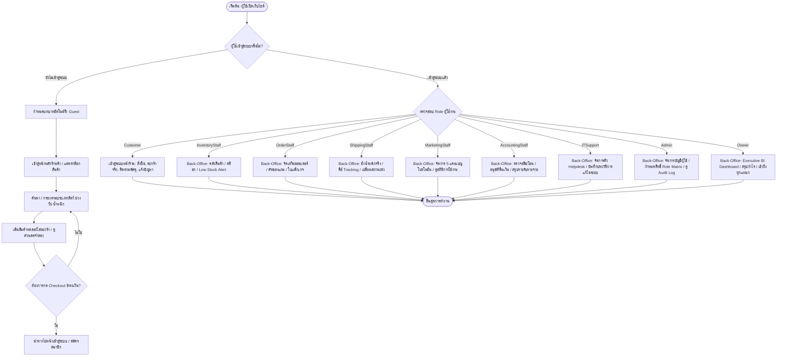

---

### ผังงานที่ 2: ระบบยืนยันตัวตนและการสลับสิทธิ์ (Authentication & Fast Role Switch Flowchart)
ครอบคลุมการ Login, Register, Logout และกลไก Fast Role Switch เพื่อการทดสอบสิทธิ์ 10 บทบาท

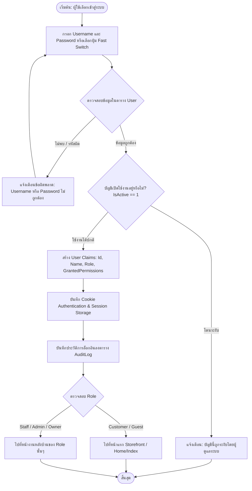

---

### ผังงานที่ 3: หน้าร้าน แคตตาล็อก และระบบกรองสินค้าอัจฉริยะ (Storefront Multi-Filter & Social Proof)
รองรับ Requirements ข้อ 1, 2, 7, 8, 9, 10 (แยกหมา/แมว, กรองน้ำหนัก, กรองช่วงวัย Layer, ตัวนับคนใส่ตะกร้า)

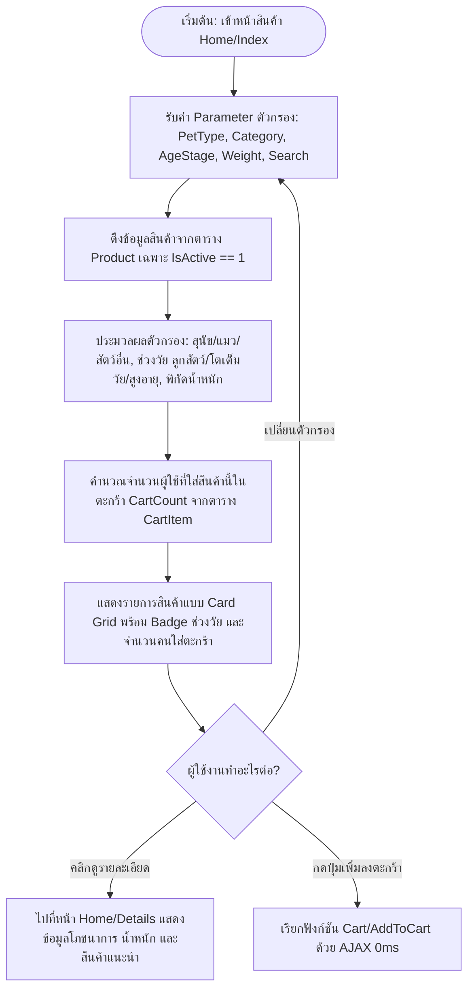

---

### ผังงานที่ 4: ระบบตะกร้าสินค้าและการคำนวณ 5 โปรโมชั่นอัตโนมัติ (Cart & 5-Promotion Engine)
รองรับ Requirements ข้อ 11, 12, 13 และโปรโมชั่นทั้ง 5 รูปแบบ (คำนวณส่วนลดอัตโนมัติแบบ Real-time)

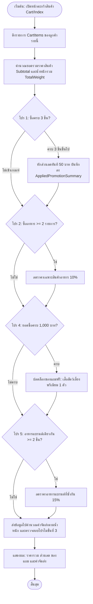

---

### ผังงานที่ 5: ระบบคำนวณค่าจัดส่งตามน้ำหนักรวม (Weight-Based Shipping Calculation Flowchart)
รองรับ Requirements ข้อ 3, 4, 14, 15, 16 (เกณฑ์น้ำหนัก 10 kg, ส่วนเกิน 20 บาท/kg, และโปรโมชั่นจัดส่งฟรี)

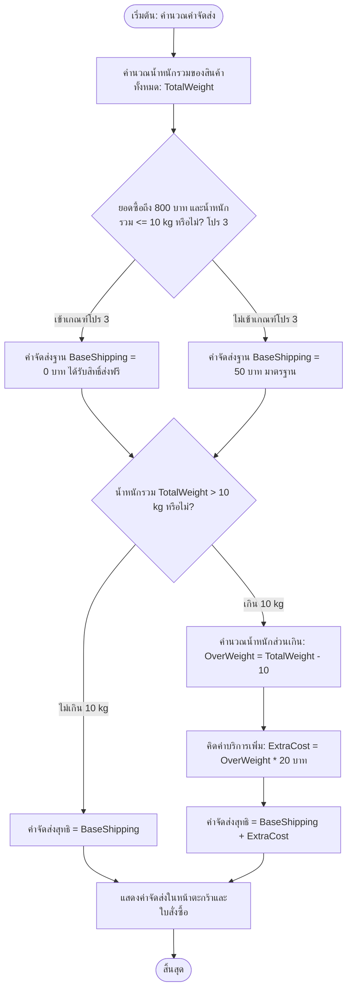

---

### ผังงานที่ 6: การสั่งซื้อ ชำระเงิน และแนบสลิป (Checkout & Payment Flowchart)
รองรับ Requirements ข้อ 19 (เลือกที่อยู่จัดส่ง, ชำระเงิน QR PromptPay, แนบหลักฐานสลิป)

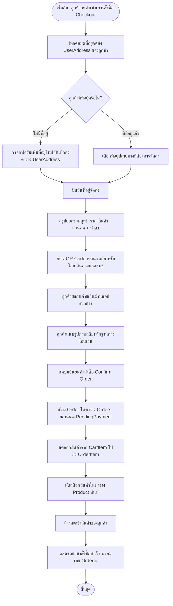

---

### ผังงานที่ 7: ลูกค้าติดตามคำสั่งซื้อ ขอคืนเงิน และแจ้งปัญหา (Customer Orders, Refund & Helpdesk)
รองรับ Requirements ข้อ 20, 22, 24 (Step Progress, ขอคืนเงิน, และเปิดตั๋ว Support Ticket)

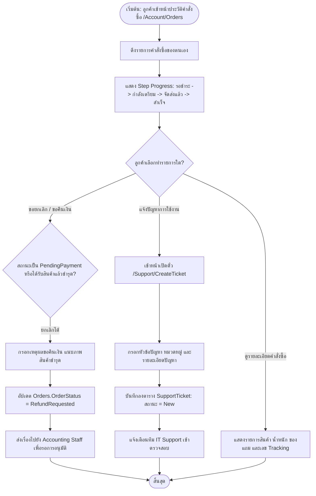

---

### ผังงานที่ 8: คลังสินค้าและสินค้าคงคลัง (Inventory Staff Flowchart)
รองรับ Requirements ข้อ 6, 17, 18 (สต็อกสินค้า, ปรับยอดด่วน In/Out, แจ้งเตือน Low Stock, เพิ่ม/แก้สินค้า)

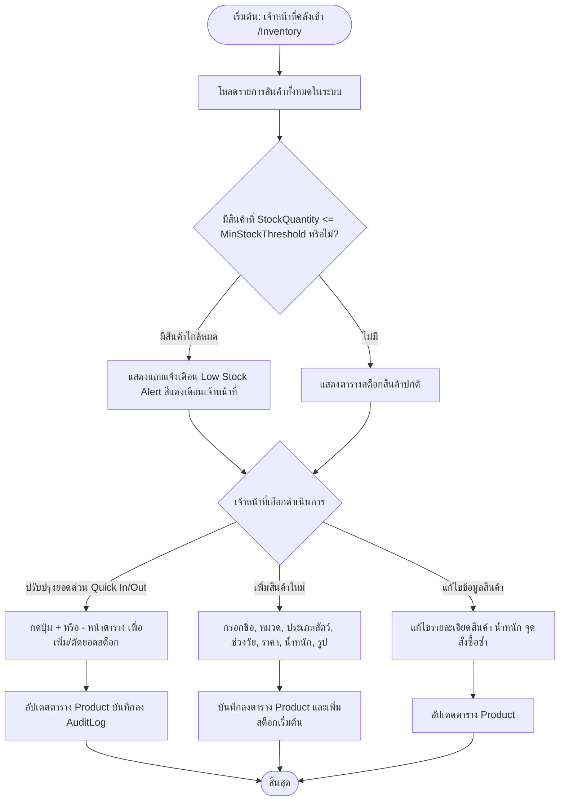

---

### ผังงานที่ 9: การจัดการคำสั่งซื้อและเตรียมสินค้า (Order Staff Flowchart)
รองรับ Requirements ข้อ 42, 43, 44 (ตรวจสลิป, ตรวจสอบของแถม, เตรียมสินค้า, ออกใบแพ็กของ)

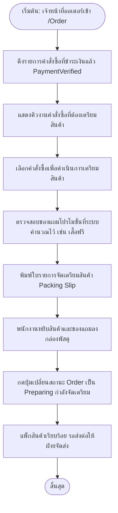

---

### ผังงานที่ 10: ฝ่ายจัดส่งและเลขพัสดุ (Shipping Staff Flowchart)
รองรับ Requirements ข้อ 4, 14, 16, 45, 46, 47 (ชั่งน้ำหนักจริง, กรอกเลข Tracking, เปลี่ยนสถานะเป็น Shipped)

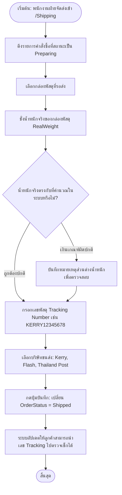

---

### ผังงานที่ 11: ฝ่ายการตลาดและแคมเปญโปรโมชั่น (Marketing Staff Flowchart)
รองรับ Requirements ข้อ 5, 25, 26, 27 (จัดการ 5 แคมเปญ, Rule Builder, เปิด/ปิด, ดูสถิติการใช้งาน)

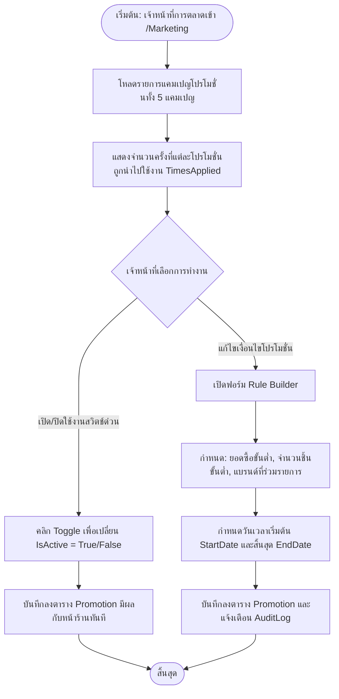

---

### ผังงานที่ 12: การเงิน บัญชี และตรวจสอบสลิป (Accounting Staff Flowchart)
รองรับ Requirements ข้อ 19, 20, 21, 51, 52 (ตรวจสลิป, อนุมัติคืนเงิน, รายงานสรุปรายรับ-รายจ่าย)

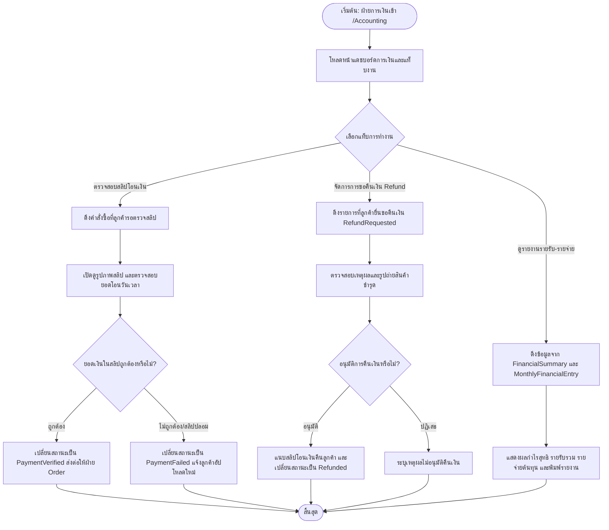

---

### ผังงานที่ 13: ศูนย์ช่วยเหลือและฝ่ายเทคนิค (IT Support Helpdesk Flowchart)
รองรับ Requirements ข้อ 22, 23, 24, 54, 55 (กระดาน Ticket Helpdesk, ตรวจสอบ, อัปเดตสถานะ, บันทึกการแก้ไข)

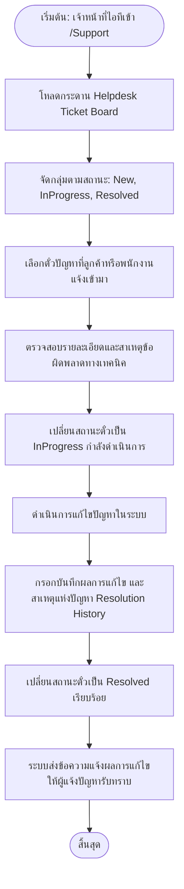

---

### ผังงานที่ 14: ผู้ดูแลระบบและจัดการสิทธิ์ (Admin Flowchart)
รองรับ Requirements ข้อ 57, 58 (จัดการบัญชี 10 บทบาท, กำหนด Role & Permission Matrix, ตรวจสอบ Audit Log)

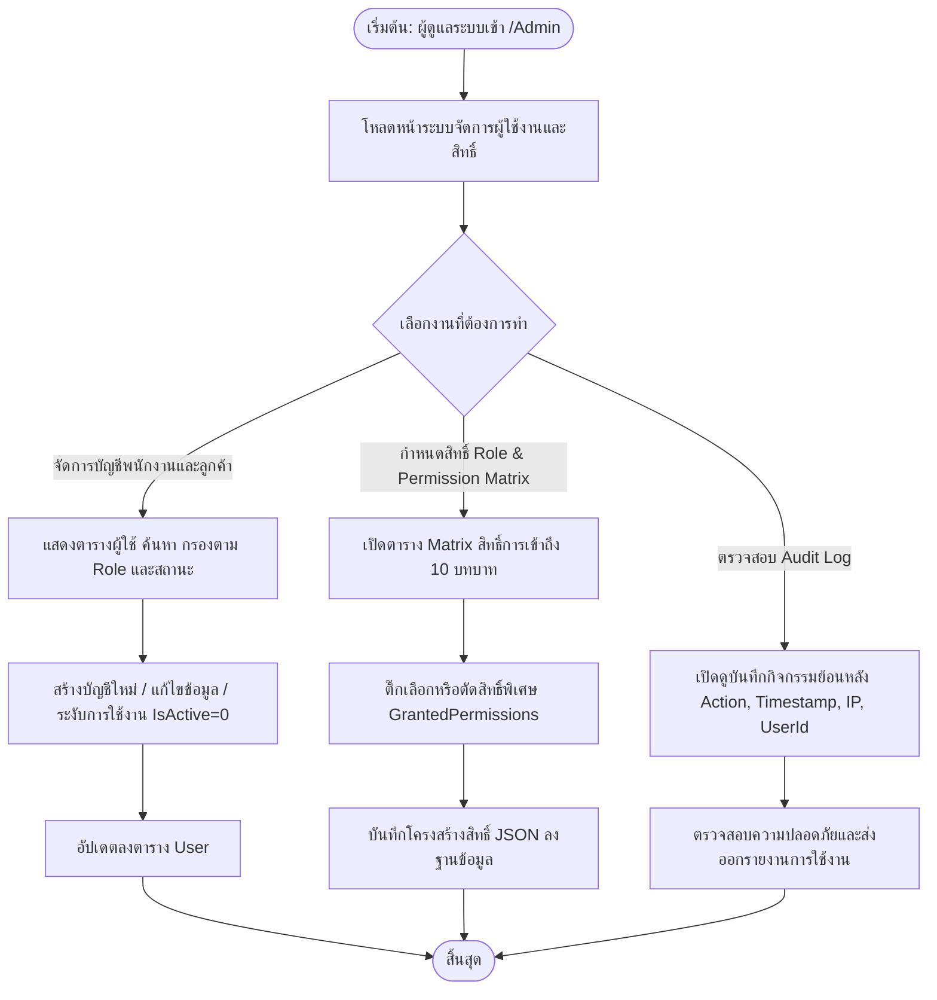

---

### ผังงานที่ 15: เจ้าของร้านและภาพรวมธุรกิจ (Owner Executive BI Dashboard Flowchart)
รองรับ Requirements ข้อ 60, 61 (Executive BI Dashboard, สัดส่วนยอดขาย, สินค้าขายดี, ทางลัดเข้าถึงทุกแผนก)

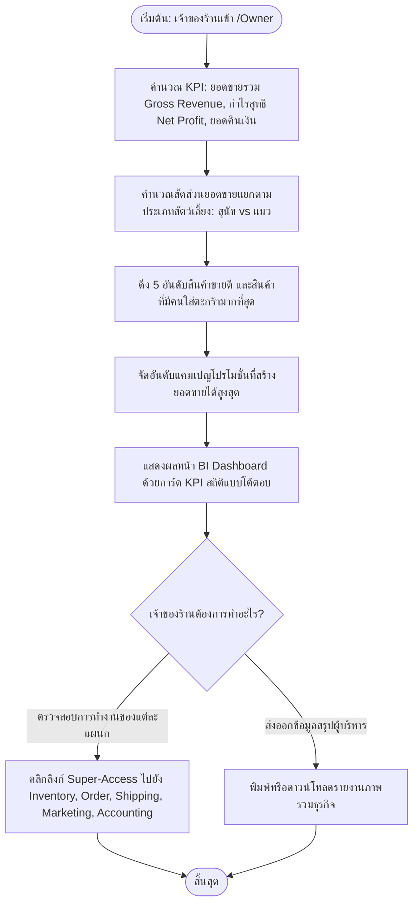

---

## 📊 รายการเอกสารและสิ่งที่ต้องแนบในแต่ละบท (Checklist ส่งงานอาจารย์)

| หมวดหมู่เอกสาร | สิ่งที่ต้องใส่ในเล่ม | มีพร้อมในโปรเจกต์นี้แล้วหรือยัง? | แหล่งที่มา / วิธีนำไปใช้ |
|---|---|:---:|---|
| **ข้อกำหนดระบบ (Req 1–27)** | ตารางแจกแจง Functional Requirements ทั้ง 27 ข้อ | ✅ พร้อม 100% | มีอยู่ใน `req.md` ก๊อปปี้ไปใส่บทที่ 1 หรือ 2 ได้ทันที |
| **บทบาทผู้ใช้ (10 Roles)** | ตาราง Role & Permission Matrix แสดงสิทธิ์ 10 บทบาท | ✅ พร้อม 100% | มีอยู่ใน `UX_UI_SPECIFICATION.md` ข้อ 4 |
| **พจนานุกรมข้อมูล (Data Dictionary)** | โครงสร้างตาราง 13 ตาราง และ Enums E1–E6 | ✅ พร้อม 100% | มีอยู่ใน `DATA_DICTIONARY.md` สมบูรณ์ครบทุกฟิลด์ |
| **ผังงานระบบ (Flowcharts)** | แผนผัง Flowchart ครบทั้ง 15 ผังงาน | ✅ พร้อม 100% | อยู่ในไฟล์นี้ (หัวข้อที่ 2 ด้านบน) วาดด้วย Mermaid |
| **แบบร่างหน้าจอ (Wireframes 17 หน้า)** | ภาพ Wireframe Grayscale ครบ 17 หน้า | ✅ พร้อม 100% | เปิด `wireframe_viewer.html` แล้วกดปุ่ม "Print All to PDF" |
| **ภาพหน้าจอจริง (Live Screenshots)** | ถ่ายภาพหน้าจอระบบจริงเพื่อใส่บทที่ 4 | ⏳ รอแคปภาพ | รันโปรเจกต์ `http://localhost:5135` แล้วแคปหน้าจอจริง |
| **ซอร์สโค้ด (Source Code Snippets)** | โค้ดสำคัญของ Controller, Model, View | ✅ พร้อม 100% | ดึงจากโฟลเดอร์ `Controllers/` และ `Models/` |

---

## 💡 ลำดับขั้นตอนแนะนำในการทำเล่มส่งอาจารย์ (Step-by-Step Action Plan)

1. **ขั้นตอนที่ 1 (เตรียมโครงเอกสาร Word):**
   * สร้างไฟล์ Microsoft Word ใหม่ ตั้งค่าหน้ากระดาษ ขอบบน-ล่าง-ขวา 1 นิ้ว ขอบซ้าย 1.5 นิ้ว ฟอนต์ TH Sarabun PSK / ChulaCharasNew ขนาด 16 pt
2. **ขั้นตอนที่ 2 (คัดลอกส่วนวิเคราะห์และออกแบบใส่บทที่ 1 - 3):**
   * ก๊อปปี้เนื้อหาจาก `req.md` ใส่บทที่ 1
   * ก๊อปปี้ตาราง 10 บทบาทจาก `UX_UI_SPECIFICATION.md` ใส่บทที่ 2
   * นำ Mermaid Flowcharts ทั้ง 15 ผังงานในไฟล์นี้ Export เป็นรูปภาพ PNG ใส่บทที่ 3
   * ก๊อปปี้ตาราง 13 ตารางจาก `DATA_DICTIONARY.md` ใส่หัวข้อ Data Dictionary ในบทที่ 3
   * บันทึกรูปจาก `wireframe_viewer.html` แนบในบทที่ 3 ส่วนการออกแบบหน้าจอ
3. **ขั้นตอนที่ 3 (จัดทำบทที่ 4 การทำงานของระบบ 30+ ฟังก์ชัน):**
   * เปิดระบบจริง `http://localhost:5135`
   * ทดสอบสลับ 10 บทบาท และแคปเจอร์รูปภาพผลลัพธ์การทำงานของแต่ละหน้าจอ
   * นำโค้ด Action Method ที่เกี่ยวข้องมาวางคู่กับลำดับขั้นตอนการทำงาน (เลียนแบบตัวอย่างเล่ม BakeQuery หน้า 30–135)
4. **ขั้นตอนที่ 4 (สรุปผลและตรวจทานบทที่ 5):**
   * เขียนสรุปความสำเร็จเทียบกับ Functional Requirements ทั้ง 27 ข้อว่าทำได้ครบถ้วน
   * สร้างสารบัญอัตโนมัติ และบันทึกเป็น PDF เพื่อส่งให้อาจารย์ตรวจ

---

## 🔍 บัญชีแจกแจงฟังก์ชันการทำงานระดับ Action Method ทั้งหมด (53 Functions Inventory)

เพื่อให้เล่มรายงานของคุณสมบูรณ์แบบ 100% ตรงตามโครงสร้างเดียวกับเล่มตัวอย่าง BakeQuery (หน้า 30–135) ที่แจกแจงทุก Action ใน Controller อย่างละเอียด ระบบ PetStore Pro มี Action Methods ที่ใช้งานจริงใน 12 Controllers ทั้งหมด **53 ฟังก์ชัน** ดังนี้:

### หมวดที่ 1: AccountController (10 ฟังก์ชัน - จัดการโปรไฟล์ ที่อยู่ และคำสั่งซื้อลูกค้า)
1. **`AccountController.Profile` [GET]:** โหลดหน้าโปรไฟล์ สมุดที่อยู่จัดส่ง และประวัติส่วนตัว (ตาราง `User`, `UserAddress`)
2. **`AccountController.UpdateProfile` [POST]:** บันทึกการแก้ไขชื่อ นามสกุล เบอร์โทร และอีเมล (ตาราง `User`)
3. **`AccountController.SaveAddress` [POST]:** เพิ่มที่อยู่จัดส่งใหม่ หรือแก้ไขที่อยู่เดิมที่มีอยู่ (ตาราง `UserAddress`)
4. **`AccountController.DeleteAddress` [POST]:** ลบที่อยู่จัดส่งที่ไม่ต้องการออกจากสมุดที่อยู่ (ตาราง `UserAddress`)
5. **`AccountController.SetDefaultAddress` [POST]:** กำหนดให้ที่อยู่นี้เป็นที่อยู่จัดส่งหลัก (Default Address) (ตาราง `UserAddress`)
6. **`AccountController.Orders` [GET]:** แสดงรายการคำสั่งซื้อของตนเอง พร้อมสถานะ Step Progress และเลข Tracking (ตาราง `Orders`, `OrderItem`)
7. **`AccountController.UploadSlip` [POST]:** อัปโหลดรูปภาพสลิปการโอนเงินเพิ่มเติมในภายหลัง (Req 19) (ตาราง `Orders`)
8. **`AccountController.CancelOrder` [POST]:** ลูกค้าขอยกเลิกคำสั่งซื้อ หรือยื่นเรื่องขอคืนเงิน Refund (Req 20) (ตาราง `Orders`)
9. **`AccountController.Support` [GET]:** หน้าศูนย์ช่วยเหลือและเปิดตั๋วแจ้งปัญหาการใช้งาน (Req 22) (ตาราง `SupportTicket`)
10. **`AccountController.SubmitTicket` [POST]:** บันทึกการเปิดตั๋วแจ้งปัญหาใหม่เข้าสู่ระบบ (Req 22) (ตาราง `SupportTicket`)

### หมวดที่ 2: AccountingController (6 ฟังก์ชัน - งานบัญชี การเงิน และตรวจสลิป)
11. **`AccountingController.Index` [GET]:** หน้าภาพรวมการเงิน ยอดขายรวม กำไรสุทธิ ยอดรอตรวจสลิป และยอดขอคืนเงิน (Req 19, 20, 21)
12. **`AccountingController.ApprovePayment` [POST]:** อนุมัติสลิปโอนเงิน เปลี่ยนสถานะออเดอร์เป็น `PaymentVerified` (Req 19) (ตาราง `Orders`, `FinancialSummary`)
13. **`AccountingController.RejectPayment` [POST]:** ปฏิเสธสลิปโอนเงินกรณีสลิปไม่ถูกต้อง และแจ้งเหตุผล (Req 19) (ตาราง `Orders`)
14. **`AccountingController.ApproveRefund` [POST]:** อนุมัติการคืนเงินให้ลูกค้า เปลี่ยนสถานะเป็น `Refunded` (Req 20) (ตาราง `Orders`, `FinancialSummary`)
15. **`AccountingController.SaveMonthlyExpense` [POST]:** บันทึกต้นทุนและรายจ่ายจริงประจำเดือน (Req 21) (ตาราง `MonthlyFinancialEntry`, `FinancialSummary`)
16. **`AccountingController.ExportFinancialCsv` [GET]:** ส่งออกรายงานรายรับ-รายจ่ายเป็นไฟล์ CSV (Req 21) (ตาราง `FinancialSummary`, `MonthlyFinancialEntry`)

### หมวดที่ 3: AdminController (3 ฟังก์ชัน - งานผู้ดูแลระบบและจัดการสิทธิ์)
17. **`AdminController.Index` [GET]:** หน้าบริหารจัดการบัญชีผู้ใช้งาน เมทริกซ์สิทธิ์ 10 บทบาท และ Audit Log (Req 57, 58) (ตาราง `User`, `AuditLog`)
18. **`AdminController.UpdateUserRole` [POST]:** ปรับเปลี่ยนบทบาท (Role) และสถานะเปิด/ระงับบัญชี (`IsActive`) (ตาราง `User`, `AuditLog`)
19. **`AdminController.CreateUser` [POST]:** สร้างบัญชีพนักงานหรือผู้ใช้งานใหม่เข้าสู่ฐานข้อมูล (ตาราง `User`, `AuditLog`)

### หมวดที่ 4: AuthController (8 ฟังก์ชัน - ความปลอดภัยและการยืนยันตัวตน)
20. **`AuthController.Login` [GET]:** แสดงหน้าจอเข้าสู่ระบบ
21. **`AuthController.Login` [POST]:** ตรวจสอบ Username/Password, แฮช, เช็ก `IsActive`, ออก Cookie Claims (ตาราง `User`, `AuditLog`)
22. **`AuthController.QuickLogin` [POST]:** ทางลัดคลิกเดียวเพื่อสลับเข้าทดสอบระบบตามบัญชี Demo
23. **`AuthController.SwitchRole` [GET/POST]:** สลับมุมมองบทบาทแบบ Real-time พร้อมออก Session Cookie ตามบทบาทนั้น
24. **`AuthController.Register` [GET]:** แสดงหน้าจอลงทะเบียนสมาชิกใหม่สำหรับลูกค้า
25. **`AuthController.Register` [POST]:** ตรวจสอบความถูกต้อง บันทึกผู้ใช้ใหม่บทบาท Customer และสร้าง Cart (ตาราง `User`, `Cart`, `AuditLog`)
26. **`AuthController.Logout` [GET/POST]:** ออกจากระบบ ล้าง Cookie Authentication และ Session Storage
27. **`AuthController.AccessDenied` [GET]:** หน้าแจ้งเตือนปฏิเสธการเข้าถึงกรณีผู้ใช้ไม่มีสิทธิ์ในหน้างานนั้น

### หมวดที่ 5: CartController (7 ฟังก์ชัน - ตะกร้าสินค้าและระบบคำนวณ)
28. **`CartController.Index` [GET]:** คำนวณราคาสินค้า, 5 โปรโมชั่น, ของแถม, และค่าจัดส่งตามน้ำหนัก 10kg (Req 3, 4, 11–16) (ตาราง `Cart`, `CartItem`, `Product`, `Promotion`, `AppliedPromotionSummary`)
29. **`CartController.Add` [POST]:** เพิ่มสินค้าลงตะกร้า พร้อมตรวจสอบสต็อก (AJAX Optimistic UI 0ms) (ตาราง `Cart`, `CartItem`, `Product`)
30. **`CartController.Update` [POST]:** ปรับปรุงจำนวนชิ้นสินค้าในตะกร้า (ตาราง `CartItem`, `Product`)
31. **`CartController.Remove` [POST]:** ลบรายการสินค้าออกจากตะกร้า (ตาราง `CartItem`)
32. **`CartController.Checkout` [GET]:** หน้าตรวจสอบสรุปคำสั่งซื้อ เลือกที่อยู่จัดส่ง และแสดง QR Code PromptPay (ตาราง `UserAddress`, `Cart`, `CartItem`)
33. **`CartController.SubmitOrder` [POST - PromptPay]:** บันทึกคำสั่งซื้อ แนบสลิป ตัดสต็อก ล้างตะกร้า (Req 19) (ตาราง `Orders`, `OrderItem`, `Product`, `Cart`, `CartItem`)
34. **`CartController.SubmitOrder` [GET]:** ฟังก์ชันสำรองกรณีผู้ใช้กด Refresh หรือกดย้อนกลับหน้าชำระเงิน

### หมวดที่ 6: HomeController (3 ฟังก์ชัน - หน้าร้านและรายละเอียดสินค้า)
35. **`HomeController.Index` [GET]:** แคตตาล็อกสินค้า, ตัวกรองหมา/แมว, กรองช่วงวัย Layer, กรองน้ำหนัก, นับคนใส่ตะกร้า (Req 1, 2, 7, 8, 9, 10) (ตาราง `Product`, `CartItem`)
36. **`HomeController.Details` [GET]:** หน้ารายละเอียดสินค้า, ข้อมูลโภชนาการ, แนะนำสินค้าตามช่วงวัยและสายพันธุ์ (Req 7, 8, 10) (ตาราง `Product`, `CartItem`)
37. **`HomeController.SwitchRole` [POST]:** สลับบทบาทหน้าแรกผ่าน Role Switcher Bar

### หมวดที่ 7: InventoryController (4 ฟังก์ชัน - คลังสินค้าและสต็อก)
38. **`InventoryController.Index` [GET]:** รายการสต็อก, แถบแจ้งเตือน Low Stock Alert (< เกณฑ์), ตัวกรองสินค้าใกล้หมด (Req 18) (ตาราง `Product`)
39. **`InventoryController.UpdateStock` [POST]:** ปรับยอดสต็อกด่วน Quick In/Out (+/-) หน้าตาราง (ตาราง `Product`, `AuditLog`)
40. **`InventoryController.SaveProduct` [POST]:** เพิ่มสินค้าใหม่ หรือแก้ไขข้อมูลสินค้า น้ำหนัก รูปภาพ จุดสั่งซื้อซ้ำ (Req 6, 17) (ตาราง `Product`, `AuditLog`)
41. **`InventoryController.DeleteProduct` [POST]:** ระงับการขายหรือลบสินค้าออกจากระบบ (ตาราง `Product`, `AuditLog`)

### หมวดที่ 8: MarketingController (5 ฟังก์ชัน - การตลาดและแคมเปญ)
42. **`MarketingController.Index` [GET]:** แดชบอร์ดโปรโมชั่น 5 แบบ และสถิติจำนวนครั้งที่ถูกนำไปใช้ (Req 5, 27) (ตาราง `Promotion`)
43. **`MarketingController.ToggleStatus` [POST]:** สวิตช์เปิด/ปิดการใช้งานโปรโมชั่นแบบ Real-time (Req 5) (ตาราง `Promotion`, `AuditLog`)
44. **`MarketingController.Save` [POST]:** บันทึกเงื่อนไข Rule Builder (ยอดขั้นต่ำ, แบรนด์ที่ร่วม, วันที่เริ่ม-สิ้นสุด) (Req 5, 25, 26) (ตาราง `Promotion`, `AuditLog`)
45. **`MarketingController.Create` [POST]:** สร้างแคมเปญโปรโมชั่นใหม่ (ตาราง `Promotion`, `AuditLog`)
46. **`MarketingController.Delete` [POST]:** ลบแคมเปญโปรโมชั่น (ตาราง `Promotion`, `AuditLog`)

### หมวดที่ 9: OrderController (2 ฟังก์ชัน - จัดการคำสั่งซื้อและเตรียมแพ็ก)
47. **`OrderController.Index` [GET]:** กระดานคิวคำสั่งซื้อที่ชำระเงินแล้ว, ตรวจสอบของแถมโปรโมชั่น, พิมพ์ Packing Slip (Req 42, 43, 44) (ตาราง `Orders`, `OrderItem`)
48. **`OrderController.UpdateStatus` [POST]:** อัปเดตสถานะออเดอร์เป็น `Preparing` (กำลังจัดเตรียม) หรือ `ReadyToShip` (ตาราง `Orders`)

### หมวดที่ 10: OwnerController (1 ฟังก์ชัน - ผู้บริหารสูงสุด)
49. **`OwnerController.Index` [GET]:** แดชบอร์ดผู้บริหาร (BI Dashboard), ยอดขายรวม Gross Revenue, กำไรสุทธิ Net Profit, สัดส่วนสุนัข/แมว, สินค้าขายดี Top 5, ทางลัด Super-Access (Req 60, 61) (ตาราง `Orders`, `OrderItem`, `Product`, `Promotion`, `FinancialSummary`)

### หมวดที่ 11: ShippingController (2 ฟังก์ชัน - จัดส่งและโลจิสติกส์)
50. **`ShippingController.Index` [GET]:** ตารางพัสดุที่รอจัดส่ง (สถานะ Preparing) (Req 4, 14, 16) (ตาราง `Orders`)
51. **`ShippingController.DispatchOrder` [POST]:** บันทึกน้ำหนักพัสดุจริง, คีย์เลข Tracking Number, เลือกบริษัทขนส่ง, เปลี่ยนสถานะเป็น `Shipped` (ตาราง `Orders`)

### หมวดที่ 12: SupportController (2 ฟังก์ชัน - ฝ่ายเทคนิค Helpdesk)
52. **`SupportController.Index` [GET]:** Helpdesk Ticket Board แบ่งกลุ่มตั๋วตามสถานะ New, InProgress, Resolved (Req 23) (ตาราง `SupportTicket`)
53. **`SupportController.ResolveTicket` [POST]:** บันทึกผลการแก้ไขปัญหา (Resolution History), ชื่อผู้แก้ปัญหา, และปิดงานตั๋วเป็น `Resolved` (Req 24) (ตาราง `SupportTicket`, `AuditLog`)
