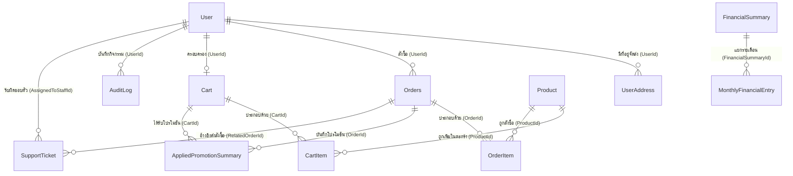

# 📖 การออกแบบฐานข้อมูล (Data Dictionary)
## ระบบจัดการร้านค้าสัตว์เลี้ยงออนไลน์ (PetStore Pro) — วิชา CSI402
### มหาวิทยาลัยศรีปทุม (Sripatum University)

ระบบ **PetStore Pro** ใช้ฐานข้อมูลเชิงสัมพันธ์ (Relational Database: MySQL ชื่อฐานข้อมูล `CSI402DB`) ประกอบด้วยตารางหลัก 13 ตาราง ได้แก่ `User`, `UserAddress`, `Product`, `Promotion`, `Cart`, `CartItem`, `AppliedPromotionSummary`, `Orders`, `OrderItem`, `SupportTicket`, `FinancialSummary`, `MonthlyFinancialEntry` และ `AuditLog` โดยแต่ละตารางมีโครงสร้างและรายละเอียดดังนี้:

---

## 📑 สารบัญตารางฐานข้อมูล (13 Tables)

| # | ชื่อ Table ใน DB | ความหมายภาษาไทย | Primary Key | Foreign Key |
|---|------------------|----------------|-------------|-------------|
| 1 | [User](#1-ตาราง-user-ผู้ใช้งานระบบ) | ผู้ใช้งานระบบทุกบทบาท (10 Roles) | `Id` | — |
| 2 | [UserAddress](#2-ตาราง-useraddress-สมุดที่อยู่จัดส่งของลูกค้า) | สมุดที่อยู่จัดส่งของลูกค้า | `Id` | `UserId` → `User.Id` |
| 3 | [Product](#3-ตาราง-product-สินค้า) | ข้อมูลสินค้าสัตว์เลี้ยง | `Id` | — |
| 4 | [Promotion](#4-ตาราง-promotion-แคมเปญโปรโมชั่น) | แคมเปญโปรโมชั่น 5 แบบ | `Id` | — |
| 5 | [Cart](#5-ตาราง-cart-ตะกร้าสินค้า) | ตะกร้าสินค้า | `Id` | `UserId` → `User.Id` |
| 6 | [CartItem](#6-ตาราง-cartitem-รายการสินค้าในตะกร้า) | รายการสินค้าในตะกร้า | `Id` | `CartId` → `Cart.Id` `ProductId` → `Product.Id` |
| 7 | [AppliedPromotionSummary](#7-ตาราง-appliedpromotionsummary-สรุปโปรโมชั่นที่นำไปใช้) | บันทึกโปรโมชั่นที่ถูกคำนวณใช้ | `Id` | `CartId` → `Cart.Id` `OrderId` → `Orders.OrderId` |
| 8 | [Orders](#8-ตาราง-orders-คำสั่งซื้อ) | คำสั่งซื้อและข้อมูลการจัดส่ง | `OrderId` | `UserId` → `User.Id` |
| 9 | [OrderItem](#9-ตาราง-orderitem-รายการสินค้าในคำสั่งซื้อ) | รายการสินค้าแต่ละชิ้นในคำสั่งซื้อ | `Id` | `OrderId` → `Orders.OrderId` `ProductId` → `Product.Id` |
| 10 | [SupportTicket](#10-ตาราง-supportticket-ตั๋วแจ้งปัญหาการใช้งาน) | ตั๋วแจ้งปัญหา Helpdesk | `Id` | `AssignedToStaffId` → `User.Id` `RelatedOrderId` → `Orders.OrderId` |
| 11 | [FinancialSummary](#11-ตาราง-financialsummary-สรุปภาพรวมการเงิน) | สรุปภาพรวมรายรับ-รายจ่ายของร้าน | `Id` | — |
| 12 | [MonthlyFinancialEntry](#12-ตาราง-monthlyfinancialentry-สรุปรายรับ-รายจ่ายรายเดือน) | สรุปรายรับ-รายจ่ายรายเดือน | `Id` | `FinancialSummaryId` → `FinancialSummary.Id` |
| 13 | [AuditLog](#13-ตาราง-auditlog-บันทึกกิจกรรมย้อนหลังและ-audit-trail) | บันทึกประวัติและกิจกรรมในระบบ | `Id` | `UserId` → `User.Id` |

---

## 📌 ค่าคงที่และนิยาม Enums ในระบบ

* **UserRole (บทบาทผู้ใช้):** 0:Customer (ลูกค้า), 1:Admin (ผู้ดูแลระบบ), 2:InventoryStaff (คลังสินค้า), 3:OrderStaff (คำสั่งซื้อ), 4:ShippingStaff (จัดส่ง), 5:MarketingStaff (การตลาด), 6:AccountingStaff (การเงิน/บัญชี), 7:ITSupport (ไอที), 8:Owner (ผู้บริหารสูงสุด), 9:Guest (ผู้เยี่ยมชม)
* **OrderStatus (สถานะคำสั่งซื้อ):** 0:PendingPayment (รอชำระเงิน/รอตรวจสลิป), 1:PaymentVerified (ชำระเงินแล้ว/รอแพ็ก), 2:Preparing (กำลังจัดเตรียมสินค้า), 3:Shipped (จัดส่งแล้ว มีเลขพัสดุ), 4:Completed (สำเร็จ), 5:Cancelled (ยกเลิก), 6:RefundRequested (ขอคืนเงิน), 7:Refunded (คืนเงินเรียบร้อย)
* **PetType (ประเภทสัตว์เลี้ยง):** 0:Dog (สุนัข), 1:Cat (แมว), 2:Other (อื่นๆ)
* **ProductCategory (หมวดหมู่สินค้า):** 0:Food (อาหาร), 1:Supply (ของใช้และอุปกรณ์), 2:Hygiene (สุขอนามัย)
* **AgeStage (ช่วงวัย):** 0:AllAges (ทุกช่วงวัย), 1:PuppyOrKitten (ลูกสัตว์/วัยเด็ก), 2:Adult (โตเต็มวัย), 3:Senior (สูงวัย)
* **PromotionType (ประเภทโปรโมชั่น):** 0:ซื้อครบ 3 ชิ้นลด 50 บาท, 1:ซื้ออาหาร 2 รายการลด 10%, 2:ส่งฟรีน้ำหนัก ≤ 10 kg, 3:ยอดครบ 1,000 บาทรับของแถมฟรี, 4:ซื้ออาหารแบรนด์เดียวกันตั้งแต่ 2 ชิ้นลด 15%

---

## 🗄️ รายละเอียดโครงสร้างตารางฐานข้อมูล (Data Dictionary)

---

### 1. ตาราง User (ผู้ใช้งานระบบ)
เก็บข้อมูลผู้ใช้งานระบบทุกบทบาท ทั้งลูกค้า (Customer), ผู้บริหารสูงสุด (Owner), ผู้ดูแลระบบ (Admin) และพนักงานฝ่ายต่างๆ (InventoryStaff, OrderStaff, ShippingStaff, MarketingStaff, AccountingStaff, ITSupport) เพื่อกำหนดสิทธิ์การเข้าถึงและการล็อกอินเข้าสู่ระบบ

| ชื่อ Field | ชนิดข้อมูล | ขนาด | Null | Key | คำอธิบาย |
|---|---|---|---|---|---|
| Id | INT | - | NOT NULL | PK | รหัสผู้ใช้งาน (Primary Key, Auto Increment) |
| Username | NVARCHAR | 50 | NOT NULL | - | ชื่อผู้ใช้งานสำหรับเข้าสู่ระบบ (ห้ามซ้ำ) |
| Password | NVARCHAR | 255 | NOT NULL | - | รหัสผ่านในการเข้าสู่ระบบ |
| FullName | NVARCHAR | 150 | NOT NULL | - | ชื่อ-นามสกุลจริงของผู้ใช้งาน |
| Email | NVARCHAR | 100 | NOT NULL | - | อีเมลสำหรับติดต่อและใช้ล็อกอิน (ห้ามซ้ำ) |
| Phone | NVARCHAR | 20 | NULL | - | หมายเลขโทรศัพท์ติดต่อ |
| Role | INT | - | NOT NULL | - | บทบาทผู้ใช้ (0:Customer, 1:Admin, 2:Inventory, 3:Order, 4:Shipping, 5:Marketing, 6:Accounting, 7:ITSupport, 8:Owner) |
| IsActive | TINYINT | 1 | NOT NULL | - | สถานะบัญชีผู้ใช้ (1 = ใช้งานปกติ, 0 = ระงับการใช้งาน) |
| GrantedPermissions | NVARCHAR | MAX | NULL | - | สิทธิ์พิเศษเพิ่มเติมและประวัติการระงับบัญชี (จัดเก็บแบบ JSON) |
| CreatedAt | DATETIME | - | NOT NULL | - | วันและเวลาที่ลงทะเบียนสร้างบัญชี |
| UpdatedAt | DATETIME | - | NOT NULL | - | วันและเวลาที่อัปเดตข้อมูลบัญชีล่าสุด |

---

### 2. ตาราง UserAddress (สมุดที่อยู่จัดส่งของลูกค้า)
เก็บข้อมูลที่อยู่จัดส่งสินค้าของลูกค้า โดยลูกค้าหนึ่งคนสามารถบันทึกได้หลายที่อยู่ และกำหนดที่อยู่เริ่มต้น (Default Address) สำหรับใช้กรอกข้อมูลอัตโนมัติในขั้นตอนสั่งซื้อ

| ชื่อ Field | ชนิดข้อมูล | ขนาด | Null | Key | คำอธิบาย |
|---|---|---|---|---|---|
| Id | INT | - | NOT NULL | PK | รหัสที่อยู่จัดส่ง (Primary Key, Auto Increment) |
| UserId | INT | - | NOT NULL | FK | รหัสผู้ใช้เจ้าของที่อยู่ (อ้างอิง User.Id) |
| Title | NVARCHAR | 50 | NOT NULL | - | ชื่อป้ายกำกับที่อยู่ เช่น บ้าน, ที่ทำงาน, คอนโด |
| RecipientName | NVARCHAR | 150 | NOT NULL | - | ชื่อ-นามสกุลของผู้รับพัสดุ |
| Phone | NVARCHAR | 20 | NOT NULL | - | หมายเลขโทรศัพท์ติดต่อของผู้รับพัสดุ |
| FullAddress | NVARCHAR | 300 | NOT NULL | - | ที่อยู่ เลขที่ ซอย ถนน อาคาร |
| Subdistrict | NVARCHAR | 100 | NOT NULL | - | แขวง / ตำบล |
| District | NVARCHAR | 100 | NOT NULL | - | เขต / อำเภอ |
| Province | NVARCHAR | 100 | NOT NULL | - | จังหวัด |
| PostalCode | NVARCHAR | 10 | NOT NULL | - | รหัสไปรษณีย์ |
| IsDefault | TINYINT | 1 | NOT NULL | - | กำหนดเป็นที่อยู่หลักหรือไม่ (1 = ใช่, 0 = ไม่ใช่) |
| CreatedAt | DATETIME | - | NOT NULL | - | วันและเวลาที่บันทึกข้อมูลที่อยู่ |
| UpdatedAt | DATETIME | - | NOT NULL | - | วันและเวลาที่แก้ไขข้อมูลที่อยู่ล่าสุด |

---

### 3. ตาราง Product (สินค้า)
เก็บข้อมูลสินค้าสัตว์เลี้ยงทั้งหมดในระบบ ทั้งอาหาร ของใช้ และอุปกรณ์สุขอนามัย มีข้อมูลราคาทุน ราคาขาย น้ำหนัก ช่วงวัย แบรนด์ และจำนวนคงเหลือ เพื่อตรวจสอบสต็อกและแจ้งเตือน Low Stock

| ชื่อ Field | ชนิดข้อมูล | ขนาด | Null | Key | คำอธิบาย |
|---|---|---|---|---|---|
| Id | INT | - | NOT NULL | PK | รหัสสินค้า (Primary Key, Auto Increment) |
| Name | NVARCHAR | 200 | NOT NULL | - | ชื่อสินค้า เช่น Royal Canin Medium Adult |
| Brand | NVARCHAR | 100 | NOT NULL | - | ยี่ห้อ/แบรนด์ของสินค้า เช่น Royal Canin, Me-O |
| PetType | INT | - | NOT NULL | - | ประเภทสัตว์เลี้ยง (0:สุนัข, 1:แมว, 2:สัตว์เลี้ยงอื่นๆ) |
| Category | INT | - | NOT NULL | - | หมวดหมู่สินค้า (0:อาหาร, 1:ของใช้และอุปกรณ์, 2:สุขอนามัย) |
| WeightKg | DECIMAL | 10,2 | NOT NULL | - | น้ำหนักสินค้า (กิโลกรัม) สำหรับคำนวณค่าส่งตามเกณฑ์ 10 kg |
| Price | DECIMAL | 18,2 | NOT NULL | - | ราคาขายปกติของสินค้า (บาท) |
| SpecialDiscountPrice | DECIMAL | 18,2 | NULL | - | ราคาพิเศษหลังหักส่วนลดรายชิ้น (ถ้ามี) |
| AgeStage | INT | - | NOT NULL | - | ช่วงวัยสัตว์เลี้ยง (0:ทุกช่วงวัย, 1:วัยเด็ก/ลูกสัตว์, 2:โตเต็มวัย, 3:สูงวัย) |
| SpecialNeed | NVARCHAR | 100 | NOT NULL | - | สูตรเฉพาะทาง เช่น บำรุงขน, บำรุงไต, ควบคุมน้ำหนัก |
| StockQuantity | INT | - | NOT NULL | - | จำนวนสินค้าคงเหลือในคลังสินค้า |
| LowStockThreshold | INT | - | NOT NULL | - | เกณฑ์แจ้งเตือนสินค้าใกล้หมด (ค่าเริ่มต้น 5 ชิ้น) |
| CartAddCount | INT | - | NOT NULL | - | สถิติจำนวนครั้งที่ถูกลูกค้าหยิบใส่ตะกร้า |
| ImageUrl | NVARCHAR | 500 | NOT NULL | - | ลิงก์ URL รูปภาพสินค้า |
| Description | NVARCHAR | MAX | NOT NULL | - | รายละเอียดและคุณสมบัติของสินค้า |
| CreatedAt | DATETIME | - | NOT NULL | - | วันและเวลาที่เพิ่มสินค้าเข้าสู่ระบบ |
| UpdatedAt | DATETIME | - | NOT NULL | - | วันและเวลาที่อัปเดตข้อมูลสินค้าล่าสุด |

---

### 4. ตาราง Promotion (แคมเปญโปรโมชั่น)
เก็บข้อมูล 5 แคมเปญโปรโมชั่นของร้านค้า ได้แก่ โปรซื้อครบ 3 ชิ้น, โปรหมวดอาหารลด 10%, โปรส่งฟรีเมื่อน้ำหนัก ≤ 10 kg, โปรของแถมยอดครบ 1,000 บาท และโปรลด 15% เมื่อซื้ออาหารแบรนด์เดียวกัน โดยฝ่ายการตลาดสามารถเปิด/ปิดแคมเปญได้แบบเรียลไทม์

| ชื่อ Field | ชนิดข้อมูล | ขนาด | Null | Key | คำอธิบาย |
|---|---|---|---|---|---|
| Id | INT | - | NOT NULL | PK | รหัสโปรโมชั่น (Primary Key, Auto Increment) |
| Code | NVARCHAR | 50 | NOT NULL | - | รหัสอ้างอิงโปรโมชั่น เช่น BUY3SAVE, FOOD10, FREESHIP10KG |
| Title | NVARCHAR | 200 | NOT NULL | - | ชื่อแคมเปญโปรโมชั่นที่แสดงบนหน้าเว็บ |
| Description | NVARCHAR | MAX | NOT NULL | - | คำอธิบายเงื่อนไขโปรโมชั่น |
| Type | INT | - | NOT NULL | - | รูปแบบโปรโมชั่น (0:ซื้อ 3 ชิ้นลด 50 บาท, 1:ลดหมวดอาหาร 10%, 2:ส่งฟรีน้ำหนักไม่เกิน 10 kg, 3:ของแถมฟรี, 4:ลด 15% แบรนด์เดียวกัน) |
| MinQuantity | INT | - | NOT NULL | - | จำนวนสินค้าขั้นต่ำที่ต้องซื้อตามเงื่อนไข |
| MinSpend | DECIMAL | 18,2 | NOT NULL | - | ยอดสั่งซื้อขั้นต่ำที่ต้องถึงเกณฑ์ (บาท) |
| ParticipatingBrand | NVARCHAR | 100 | NULL | - | แบรนด์สินค้าที่เข้าร่วมโปรโมชั่น (สำหรับโปร 5) |
| TargetCategory | INT | - | NULL | - | หมวดหมู่สินค้าเป้าหมาย (เช่น หมวดอาหาร = 0) |
| DiscountAmount | DECIMAL | 18,2 | NOT NULL | - | มูลค่าส่วนลดแบบจำนวนเงินคงที่ (บาท) |
| DiscountPercent | DECIMAL | 5,2 | NOT NULL | - | มูลค่าส่วนลดแบบเปอร์เซ็นต์ (%) เช่น 10.00% หรือ 15.00% |
| GiftItemName | NVARCHAR | 200 | NULL | - | ชื่อสินค้าของแถมพิเศษ (สำหรับโปร 4) |
| StartDate | DATETIME | - | NOT NULL | - | วันและเวลาเริ่มต้นแคมเปญ |
| EndDate | DATETIME | - | NOT NULL | - | วันและเวลาสิ้นสุดแคมเปญ |
| IsActive | TINYINT | 1 | NOT NULL | - | สถานะเปิด/ปิดโปรโมชั่น (1 = เปิดใช้งาน, 0 = ปิดใช้งาน) |
| UsageCount | INT | - | NOT NULL | - | สถิติจำนวนครั้งที่โปรโมชั่นนี้ถูกนำไปใช้ในออเดอร์ |
| CreatedAt | DATETIME | - | NOT NULL | - | วันและเวลาที่สร้างโปรโมชั่น |
| UpdatedAt | DATETIME | - | NOT NULL | - | วันและเวลาที่แก้ไขโปรโมชั่นล่าสุด |

---

### 5. ตาราง Cart (ตะกร้าสินค้า)
เก็บข้อมูลตะกร้าสินค้าของลูกค้าแต่ละราย รองรับการเก็บของแถมที่ได้รับและผลการคำนวณค่าจัดส่งตามน้ำหนักรวมสินค้า

| ชื่อ Field | ชนิดข้อมูล | ขนาด | Null | Key | คำอธิบาย |
|---|---|---|---|---|---|
| Id | INT | - | NOT NULL | PK | รหัสตะกร้าสินค้า (Primary Key, Auto Increment) |
| UserId | INT | - | NOT NULL | FK | รหัสลูกค้าเจ้าของตะกร้า (อ้างอิง User.Id) |
| FreeGiftItem | NVARCHAR | 200 | NULL | - | ชื่อของแถมที่ได้รับจากโปรโมชั่น |
| ShippingFee | DECIMAL | 18,2 | NOT NULL | - | ค่าจัดส่งที่คำนวณได้ตามเกณฑ์น้ำหนักรวม |
| ShippingCalculationDetail | NVARCHAR | MAX | NOT NULL | - | รายละเอียดขั้นตอนและสูตรคำนวณค่าจัดส่ง |
| IsFreeShippingQualified | TINYINT | 1 | NOT NULL | - | สถานะผ่านเกณฑ์จัดส่งฟรีหรือไม่ (1 = ใช่, 0 = ไม่ใช่) |

---

### 6. ตาราง CartItem (รายการสินค้าในตะกร้า)
เก็บรายการสินค้าแต่ละรายการที่อยู่ในตะกร้า โดยเชื่อมโยงระหว่างตาราง Cart และ Product พร้อมจำนวนชิ้นที่ต้องการสั่งซื้อ

| ชื่อ Field | ชนิดข้อมูล | ขนาด | Null | Key | คำอธิบาย |
|---|---|---|---|---|---|
| Id | INT | - | NOT NULL | PK | รหัสรายการสินค้าในตะกร้า (Primary Key, Auto Increment) |
| CartId | INT | - | NOT NULL | FK | รหัสตะกร้าสินค้า (อ้างอิง Cart.Id) |
| ProductId | INT | - | NOT NULL | FK | รหัสสินค้าที่เลือก (อ้างอิง Product.Id) |
| Quantity | INT | - | NOT NULL | - | จำนวนชิ้นที่ต้องการสั่งซื้อ |

---

### 7. ตาราง AppliedPromotionSummary (สรุปโปรโมชั่นที่นำไปใช้)
เก็บบันทึกประวัติและรายละเอียดของโปรโมชั่นที่ระบบตรวจสอบผ่านเงื่อนไขและนำไปคำนวณลดราคาในตะกร้าสินค้าหรือคำสั่งซื้อจริง

| ชื่อ Field | ชนิดข้อมูล | ขนาด | Null | Key | คำอธิบาย |
|---|---|---|---|---|---|
| Id | INT | - | NOT NULL | PK | รหัสสรุปโปรโมชั่น (Primary Key, Auto Increment) |
| CartId | INT | - | NULL | FK | รหัสตะกร้าสินค้าที่ได้รับโปรโมชั่น (อ้างอิง Cart.Id) |
| OrderId | NVARCHAR | 30 | NULL | FK | รหัสคำสั่งซื้อที่ได้รับโปรโมชั่น (อ้างอิง Orders.OrderId) |
| PromotionTitle | NVARCHAR | 200 | NOT NULL | - | ชื่อโปรโมชั่นที่คำนวณใช้ |
| DiscountAmount | DECIMAL | 18,2 | NOT NULL | - | มูลค่าส่วนลดที่ได้รับจริง (บาท) |
| Note | NVARCHAR | MAX | NOT NULL | - | เงื่อนไขโปรโมชั่นที่เข้าเกณฑ์และรายละเอียดส่วนลด |

---

### 8. ตาราง Orders (คำสั่งซื้อ)
เก็บข้อมูลคำสั่งซื้อทั้งหมดในระบบ ตั้งแต่สถานะรอตรวจสอบชำระเงิน จนถึงจัดส่งสำเร็จ มีข้อมูลที่อยู่จัดส่ง ขนส่งที่เลือก (Flash Express / Kerry Express) เลข Tracking น้ำหนักชั่งจริง และหลักฐานสลิปโอนเงิน

| ชื่อ Field | ชนิดข้อมูล | ขนาด | Null | Key | คำอธิบาย |
|---|---|---|---|---|---|
| OrderId | NVARCHAR | 30 | NOT NULL | PK | รหัสคำสั่งซื้อ เช่น ORD-20261123-001 (Primary Key) |
| UserId | INT | - | NOT NULL | FK | รหัสลูกค้าผู้สั่งซื้อ (อ้างอิง User.Id) |
| CustomerName | NVARCHAR | 150 | NOT NULL | - | ชื่อ-นามสกุลของผู้รับสินค้า |
| CustomerPhone | NVARCHAR | 20 | NOT NULL | - | หมายเลขโทรศัพท์ติดต่อผู้รับ |
| ShippingAddress | NVARCHAR | 500 | NOT NULL | - | ที่อยู่จัดส่งสินค้าโดยละเอียด |
| OrderDate | DATETIME | - | NOT NULL | - | วันและเวลาที่ลูกค้ากดยืนยันสั่งซื้อ |
| EstimatedWeightKg | DECIMAL | 10,2 | NOT NULL | - | น้ำหนักรวมประมาณการจากข้อมูลสินค้า (กิโลกรัม) |
| ActualWeightKg | DECIMAL | 10,2 | NULL | - | น้ำหนักพัสดุชั่งจริงโดยฝ่าย Shipping (กิโลกรัม) |
| ItemsTotal | DECIMAL | 18,2 | NOT NULL | - | ราคาสินค้ารวมก่อนหักส่วนลด (บาท) |
| DiscountTotal | DECIMAL | 18,2 | NOT NULL | - | มูลค่าส่วนลดรวมทั้งหมดจากโปรโมชั่น (บาท) |
| ShippingFee | DECIMAL | 18,2 | NOT NULL | - | ค่าบริการจัดส่งสินค้า (บาท) |
| GrandTotal | DECIMAL | 18,2 | NOT NULL | - | ยอดเงินสุทธิที่ลูกค้าต้องชำระ (บาท) |
| FreeGiftItem | NVARCHAR | 200 | NULL | - | ชื่อของแถมที่ได้รับในคำสั่งซื้อ (ถ้ามี) |
| Status | INT | - | NOT NULL | - | สถานะคำสั่งซื้อ (0:PendingPayment, 1:PaymentVerified, 2:Preparing, 3:Shipped, 4:Completed, 5:Cancelled, 6:RefundRequested, 7:Refunded) |
| Courier | NVARCHAR | 100 | NOT NULL | - | บริษัทขนส่งที่เลือก (Flash Express / Kerry Express) |
| TrackingNumber | NVARCHAR | 50 | NULL | - | หมายเลขพัสดุสำหรับติดตามการจัดส่ง |
| ShippedDate | DATETIME | - | NULL | - | วันและเวลาที่ฝ่าย Shipping กดส่งพัสดุ |
| PaymentMethod | NVARCHAR | 50 | NOT NULL | - | วิธีการชำระเงิน (เช่น โอนเงินผ่าน PromptPay QR) |
| PaymentSlipUrl | NVARCHAR | 500 | NULL | - | ลิงก์ URL / ชื่อไฟล์รูปภาพสลิปหลักฐานการโอนเงิน |
| IsPaymentApproved | TINYINT | 1 | NOT NULL | - | สถานะตรวจสอบสลิปโดยฝ่ายบัญชี (1 = ผ่าน, 0 = ไม่ผ่าน) |
| RefundAmount | DECIMAL | 18,2 | NULL | - | จำนวนเงินที่ดำเนินการคืนให้ลูกค้า (บาท) |
| RefundReason | NVARCHAR | MAX | NULL | - | เหตุผลที่ลูกค้าขอคืนเงิน |
| RefundedDate | DATETIME | - | NULL | - | วันและเวลาที่ฝ่ายการเงินอนุมัติและโอนเงินคืนสำเร็จ |
| CreatedAt | DATETIME | - | NOT NULL | - | วันและเวลาที่สร้างคำสั่งซื้อ |
| UpdatedAt | DATETIME | - | NOT NULL | - | วันและเวลาที่อัปเดตสถานะคำสั่งซื้อล่าสุด |

---

### 9. ตาราง OrderItem (รายการสินค้าในคำสั่งซื้อ)
เก็บรายการสินค้าแต่ละชิ้นในคำสั่งซื้อ พร้อมบันทึก Snapshot ชื่อสินค้า ราคาต่อหน่วย และน้ำหนัก ณ เวลาสั่งซื้อ เพื่อป้องกันปัญหาราคาและข้อมูลสินค้าเปลี่ยนแปลงในภายหลัง

| ชื่อ Field | ชนิดข้อมูล | ขนาด | Null | Key | คำอธิบาย |
|---|---|---|---|---|---|
| Id | INT | - | NOT NULL | PK | รหัสรายการสินค้าในคำสั่งซื้อ (Primary Key, Auto Increment) |
| OrderId | NVARCHAR | 30 | NOT NULL | FK | รหัสคำสั่งซื้อ (อ้างอิง Orders.OrderId) |
| ProductId | INT | - | NOT NULL | FK | รหัสสินค้า (อ้างอิง Product.Id) |
| ProductName | NVARCHAR | 200 | NOT NULL | - | ชื่อสินค้า ณ เวลาสั่งซื้อ (Snapshot ป้องกันการแก้ไข) |
| UnitPrice | DECIMAL | 18,2 | NOT NULL | - | ราคาขายต่อหน่วย ณ เวลาสั่งซื้อ (บาท) |
| Quantity | INT | - | NOT NULL | - | จำนวนชิ้นที่สั่งซื้อ |
| UnitWeightKg | DECIMAL | 10,2 | NOT NULL | - | น้ำหนักต่อหน่วยของสินค้า ณ เวลาสั่งซื้อ (กิโลกรัม) |

---

### 10. ตาราง SupportTicket (ตั๋วแจ้งปัญหาการใช้งาน)
เก็บข้อมูลการเปิดตั๋วแจ้งปัญหาของลูกค้า (Customer Helpdesk) และประวัติการตรวจสอบแก้ไขปัญหาของฝ่าย IT Support

| ชื่อ Field | ชนิดข้อมูล | ขนาด | Null | Key | คำอธิบาย |
|---|---|---|---|---|---|
| Id | INT | - | NOT NULL | PK | รหัสตั๋วแจ้งปัญหา (Primary Key, Auto Increment) |
| TicketNumber | NVARCHAR | 50 | NOT NULL | - | รหัสอ้างอิงตั๋ว เช่น TCK-20261123-001 (ห้ามซ้ำ) |
| CustomerName | NVARCHAR | 150 | NOT NULL | - | ชื่อลูกค้าผู้แจ้งปัญหา |
| CustomerEmail | NVARCHAR | 100 | NOT NULL | - | อีเมลติดต่อกลับของลูกค้า |
| CustomerPhone | NVARCHAR | 20 | NOT NULL | - | หมายเลขโทรศัพท์ติดต่อของลูกค้า |
| Subject | NVARCHAR | 200 | NOT NULL | - | หัวข้อปัญหาที่แจ้ง |
| Description | NVARCHAR | MAX | NOT NULL | - | รายละเอียดปัญหาที่ได้รับแจ้ง |
| Status | INT | - | NOT NULL | - | สถานะตั๋ว (0:Open, 1:InProgress, 2:Resolved, 3:Closed) |
| Priority | INT | - | NOT NULL | - | ระดับความสำคัญ (0:ต่ำ, 1:ปานกลาง, 2:สูง, 3:เร่งด่วน) |
| AssignedToStaffId | INT | - | NULL | FK | รหัสเจ้าหน้าที่ IT Support ที่รับเรื่อง (อ้างอิง User.Id) |
| StaffNotes | NVARCHAR | MAX | NULL | - | บันทึกประวัติและรายละเอียดผลการแก้ไขปัญหาของฝ่ายไอที |
| RelatedOrderId | NVARCHAR | 30 | NULL | FK | รหัสคำสั่งซื้อที่เกี่ยวข้อง (อ้างอิง Orders.OrderId) |
| ResolvedDate | DATETIME | - | NULL | - | วันและเวลาที่แก้ไขปัญหาเสร็จสิ้น |
| CreatedAt | DATETIME | - | NOT NULL | - | วันและเวลาที่เปิดตั๋วแจ้งปัญหา |

---

### 11. ตาราง FinancialSummary (สรุปภาพรวมการเงิน)
เก็บข้อมูลสรุปยอดทางการเงินของร้านค้า ได้แก่ รายรับรวม รายจ่ายรวม กำไรสุทธิ จำนวนคำสั่งซื้อ และยอดเงินคืน สำหรับแสดงผลบน Executive Dashboard ของ Owner และฝ่ายบัญชี

| ชื่อ Field | ชนิดข้อมูล | ขนาด | Null | Key | คำอธิบาย |
|---|---|---|---|---|---|
| Id | INT | - | NOT NULL | PK | รหัสรายการสรุปการเงิน (Primary Key, Auto Increment) |
| TotalRevenue | DECIMAL | 18,2 | NOT NULL | - | รายรับรวมทั้งหมดจากคำสั่งซื้อที่สำเร็จ (บาท) |
| TotalExpenses | DECIMAL | 18,2 | NOT NULL | - | รายจ่ายรวมทั้งหมด เช่น ต้นทุนสินค้า ค่าจัดส่ง ค่าดำเนินงาน (บาท) |
| NetProfit | DECIMAL | 18,2 | NOT NULL | - | กำไรสุทธิของร้านค้า (รายรับรวม - รายจ่ายรวม - ยอดคืนเงิน) |
| TotalOrdersCount | INT | - | NOT NULL | - | จำนวนคำสั่งซื้อทั้งหมดที่เกิดขึ้นในระบบ |
| SuccessfulOrdersCount | INT | - | NOT NULL | - | จำนวนคำสั่งซื้อที่ดำเนินการสำเร็จ |
| RefundedOrdersCount | INT | - | NOT NULL | - | จำนวนคำสั่งซื้อที่มีการขอคืนเงิน |
| CreatedAt | DATETIME | - | NOT NULL | - | วันและเวลาที่สร้างสรุปข้อมูลการเงิน |
| UpdatedAt | DATETIME | - | NOT NULL | - | วันและเวลาที่อัปเดตยอดการเงินล่าสุด |

---

### 12. ตาราง MonthlyFinancialEntry (สรุปรายรับ-รายจ่ายรายเดือน)
เก็บข้อมูลสรุปรายได้และรายจ่ายของร้านค้าแยกตามรายเดือน เพื่อใช้จัดทำรายงานงบการเงินและวิเคราะห์แนวโน้มธุรกิจ

| ชื่อ Field | ชนิดข้อมูล | ขนาด | Null | Key | คำอธิบาย |
|---|---|---|---|---|---|
| Id | INT | - | NOT NULL | PK | รหัสรายการประจำเดือน (Primary Key, Auto Increment) |
| FinancialSummaryId | INT | - | NULL | FK | รหัสรายงานสรุปการเงินหลัก (อ้างอิง FinancialSummary.Id) |
| Month | NVARCHAR | 30 | NOT NULL | - | ชื่อเดือน เช่น "2026-11" หรือ "พฤศจิกายน 2569" |
| Revenue | DECIMAL | 18,2 | NOT NULL | - | ยอดรายรับประจำเดือน (บาท) |
| Expenses | DECIMAL | 18,2 | NOT NULL | - | ยอดรายจ่ายประจำเดือน (บาท) |
| CreatedAt | DATETIME | - | NOT NULL | - | วันและเวลาที่บันทึกข้อมูลเดือนนี้ |
| UpdatedAt | DATETIME | - | NOT NULL | - | วันและเวลาที่อัปเดตข้อมูลเดือนนี้ล่าสุด |

---

### 13. ตาราง AuditLog (บันทึกกิจกรรมย้อนหลังและ Audit Trail)
เก็บประวัติกิจกรรมทั้งหมดในระบบที่เกิดขึ้นจากการกระทำของผู้ใช้ทุกบทบาท เพื่อการตรวจสอบย้อนหลัง (Audit Trail) ด้านความปลอดภัยและสิทธิ์การใช้งาน

| ชื่อ Field | ชนิดข้อมูล | ขนาด | Null | Key | คำอธิบาย |
|---|---|---|---|---|---|
| Id | INT | - | NOT NULL | PK | รหัสบันทึก Log (Primary Key, Auto Increment) |
| UserId | INT | - | NULL | FK | รหัสผู้ใช้งานที่ทำกิจกรรม (อ้างอิง User.Id) |
| Username | NVARCHAR | 50 | NOT NULL | - | ชื่อผู้ใช้งาน (Snapshot ป้องกันกรณีผู้ใช้ถูกลบ) |
| UserRole | NVARCHAR | 50 | NOT NULL | - | บทบาท/แผนกของผู้ใช้ เช่น Admin, InventoryStaff, AccountingStaff |
| Action | NVARCHAR | 100 | NOT NULL | - | กิจกรรมที่กระทำ เช่น UPDATE_STOCK, APPROVE_PAYMENT, REFUND |
| TableName | NVARCHAR | 50 | NOT NULL | - | ตารางที่ได้รับผลกระทบ เช่น Product, Orders, Promotion, User |
| RecordId | NVARCHAR | 50 | NULL | - | รหัสแถวข้อมูลที่ถูกแก้ไข เช่น ORD-20261123-001 หรือ 5 |
| Details | NVARCHAR | MAX | NULL | - | รายละเอียดกิจกรรม เช่น ปรับยอดสต็อกสินค้า, อนุมัติสลิปโอนเงิน |
| IpAddress | NVARCHAR | 45 | NULL | - | ที่อยู่ IP ของเครื่องผู้ใช้งานขณะทำรายการ |
| Timestamp | DATETIME | - | NOT NULL | - | วันและเวลาจริงที่เกิดกิจกรรมในระบบ |

---

## 🔗 ผังความสัมพันธ์ระหว่างเอนทิตี (Entity Relationship Diagram - ERD)

