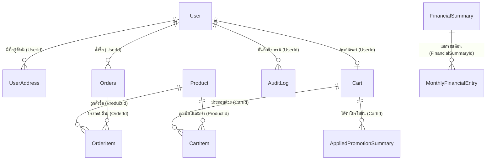

# 📖 Data Dictionary — ระบบการซื้อขายและของใช้สัตว์เลี้ยง (Pet Shop E-Commerce)
## Database Design Specification (อ้างอิงตรงกับฐานข้อมูล MySQL: `CSI402DB` 100%)

> เอกสารพจนานุกรมข้อมูล (Data Dictionary) ฉบับสมบูรณ์สำหรับระดับ Enterprise รองรับ **Audit Trail & Logging** ครบถ้วนทุกตาราง พร้อมตารางบันทึกกิจกรรม `AuditLog` สำหรับตรวจสอบย้อนหลัง (Auditing) ตามมาตรฐานระบบสารสนเทศและการประเมิน Assessment 8 วิชา CSI402

---

## 📑 สารบัญตารางฐานข้อมูล (13 Tables)

| # | ชื่อ Table ใน DB | ความหมายภาษาไทย | Primary Key | Foreign Key |
|---|------------------|----------------|-------------|-------------|
| 1 | [Product](#1-product-ข้อมูลสินค้า) | ข้อมูลสินค้าสัตว์เลี้ยง | `Id` | — |
| 2 | [Promotion](#2-promotion-โปรโมชั่น) | แคมเปญโปรโมชั่น 5 แบบ | `Id` | — |
| 3 | [User](#3-user-ผู้ใช้งานระบบ) | ผู้ใช้งานระบบทุกบทบาท (10 Roles) | `Id` | — |
| 4 | [UserAddress](#4-useraddress-สมุดที่อยู่จัดส่ง) | สมุดที่อยู่จัดส่งของลูกค้า | `Id` | `UserId` → `User.Id` |
| 5 | [Cart](#5-cart-ตะกร้าสินค้า) | ตะกร้าสินค้า | `Id` | `UserId` → `User.Id` |
| 6 | [CartItem](#6-cartitem-รายการสินค้าในตะกร้า) | รายการสินค้าที่อยู่ในตะกร้า | `Id` | `CartId` → `Cart.Id` `ProductId` → `Product.Id` |
| 7 | [AppliedPromotionSummary](#7-appliedpromotionsummary-สรุปโปรโมชั่นที่ใช้) | บันทึกโปรโมชั่นที่ถูกคำนวณใช้ | `Id` | `CartId` → `Cart.Id` |
| 8 | [Orders](#8-orders-คำสั่งซื้อ) | คำสั่งซื้อและข้อมูลการจัดส่ง | `OrderId` | `UserId` → `User.Id` |
| 9 | [OrderItem](#9-orderitem-รายการสินค้าในคำสั่งซื้อ) | รายการสินค้าแต่ละชิ้นในคำสั่งซื้อ | `Id` | `OrderId` → `Orders.OrderId` `ProductId` → `Product.Id` |
| 10 | [SupportTicket](#10-supportticket-ตั๋วแจ้งปัญหา) | ตั๋วแจ้งปัญหา/แจ้งเคลมสินค้า | `Id` | — |
| 11 | [FinancialSummary](#11-financialsummary-สรุปภาพรวมการเงิน) | ข้อมูลสรุปรายรับ-รายจ่ายของร้าน | `Id` | — |
| 12 | [MonthlyFinancialEntry](#12-monthlyfinancialentry-สรุปการเงินรายเดือน) | รายละเอียดการเงินแยกรายเดือน | `Id` | `FinancialSummaryId` → `FinancialSummary.Id` |
| 13 | [AuditLog](#13-auditlog-ตารางบันทึกประวัติการกระทำและตรวจสอบ-log) | บันทึกประวัติและ Log กิจกรรมทั้งหมด | `Id` | `UserId` → `User.Id` |

---

## 📌 นิยามค่าคงที่ / Enums ในระบบ

### E1. PetType (ประเภทสัตว์เลี้ยง)
* `0` = **Dog** (สุนัข)
* `1` = **Cat** (แมว)
* `2` = **Other** (สัตว์เลี้ยงอื่น ๆ เช่น กระต่าย นก ปลา)

### E2. Category (หมวดหมู่สินค้า)
* `0` = **Food** (อาหารสัตว์เลี้ยง)
* `1` = **Supply** (ของใช้และอุปกรณ์)
* `2` = **Hygiene** (สุขอนามัย เช่น ทรายแมว แชมพู)

### E3. AgeStage (ช่วงวัยสัตว์เลี้ยง)
* `0` = **AllAges** (ทุกช่วงวัย)
* `1` = **PuppyOrKitten** (ลูกสัตว์ / วัยเด็ก 0-12 เดือน)
* `2` = **Adult** (โตเต็มวัย 1-7 ปี)
* `3` = **Senior** (สูงอายุ 7 ปีขึ้นไป)

### E4. PromotionType (ประเภทโปรโมชั่น 5 แบบ)
* `0` = **Buy3ItemsDiscount** (โปร 1: ซื้อครบ 3 ชิ้นลดทันที 50 บาท)
* `1` = **FoodCategoryDiscount** (โปร 2: ซื้ออาหารอย่างน้อย 2 รายการลดพิเศษ 10%)
* `2` = **FreeShippingWeightCap** (โปร 3: ยอดถึงเกณฑ์ + น้ำหนัก ≤ 10 kg ส่งฟรี)
* `3` = **FreeGiftMilestone** (โปร 4: ยอดครบ 1,000 บาท รับของแถมฟรี)
* `4` = **SameBrandFoodDiscount** (โปร 5: ซื้ออาหารแบรนด์เดียวกันตั้งแต่ 2 ชิ้น ลด 15%)

### E5. Role (บทบาทผู้ใช้งานระบบ)
* `0` = **Customer** (ลูกค้าทั่วไป)
* `1` = **Admin** (ผู้ดูแลระบบ)
* `2` = **InventoryStaff** (พนักงานคลังสินค้า)
* `3` = **OrderStaff** (พนักงานจัดการคำสั่งซื้อ)
* `4` = **ShippingStaff** (พนักงานขนส่งและจัดส่ง)
* `5` = **MarketingStaff** (ฝ่ายการตลาด)
* `6` = **AccountingStaff** (ฝ่ายบัญชีและการเงิน)
* `7` = **ITSupport** (ฝ่ายบริการและซัพพอร์ตระบบ)
* `8` = **Owner** (เจ้าของร้าน / ผู้บริหาร)
* `9` = **Guest** (ผู้เยี่ยมชมเว็บไซต์)

### E6. OrderStatus (สถานะคำสั่งซื้อ)
* `0` = **PendingPayment** (รอชำระเงิน)
* `1` = **PaymentVerified** (ชำระเงินเรียบร้อย รอจัดเตรียมสินค้า)
* `2` = **Preparing** (กำลังจัดเตรียมและแพ็กสินค้า)
* `3` = **Shipped** (จัดส่งพัสดุแล้ว มีเลข Tracking)
* `4` = **Completed** (ลูกค้าได้รับสินค้าสำเร็จ)
* `5` = **Cancelled** (ยกเลิกคำสั่งซื้อ)
* `6` = **RefundRequested** (ลูกค้าแจ้งขอคืนเงิน)
* `7` = **Refunded** (คืนเงินเรียบร้อยแล้ว)

---

## 🗄️ รายละเอียดตารางและคอลัมน์ในฐานข้อมูล (ตรงกับ DB เป๊ะ 100%)

---

### 1. Product (ข้อมูลสินค้า)

| Field Name | Data Type | Constraint | Null? | Default | Description (คำอธิบาย) |
|---|---|---|---|---|---|
| `Id` | `int` | **PK**, Auto Increment | ❌ No | — | รหัสสินค้า |
| `Name` | `varchar(200)` | — | ❌ No | — | ชื่อสินค้า เช่น "Royal Canin Medium Adult" |
| `Brand` | `varchar(100)` | — | ❌ No | — | แบรนด์สินค้า เช่น "Royal Canin", "Me-O" (ใช้กับโปร 5) |
| `PetType` | `int` | — | ❌ No | `0` | ประเภทสัตว์เลี้ยง (0:Dog, 1:Cat, 2:Other) |
| `Category` | `int` | — | ❌ No | `0` | หมวดหมู่สินค้า (0:Food, 1:Supply, 2:Hygiene) |
| `WeightKg` | `decimal(10,2)` | — | ❌ No | `0.00` | น้ำหนักสินค้า (กิโลกรัม) ใช้คิดค่าส่งและโปรส่งฟรี |
| `Price` | `decimal(18,2)` | — | ❌ No | — | ราคาปกติของสินค้า |
| `SpecialDiscountPrice` | `decimal(18,2)` | — | ✅ Yes | `NULL` | ราคาพิเศษ/โปรโมชั่นรายชิ้น (ถ้ามี) |
| `AgeStage` | `int` | — | ❌ No | `0` | ช่วงวัยที่เหมาะสม (0:AllAges, 1:Puppy, 2:Adult, 3:Senior) |
| `SpecialNeed` | `varchar(100)` | — | ❌ No | `'ทั่วไป'` | ความต้องการเฉพาะ เช่น บำรุงขน, บำรุงไต |
| `StockQuantity` | `int` | — | ❌ No | `0` | จำนวนสินค้าคงเหลือในคลัง |
| `LowStockThreshold` | `int` | — | ❌ No | `5` | เกณฑ์แจ้งเตือนสินค้าใกล้หมด (Low Stock) |
| `CartAddCount` | `int` | — | ❌ No | `0` | สถิติจำนวนครั้งที่ถูกหยิบใส่ตะกร้า |
| `ImageUrl` | `varchar(500)` | — | ❌ No | `''` | ลิงก์ URL รูปภาพสินค้า |
| `Description` | `text` | — | ❌ No | — | รายละเอียดและคำบรรยายสินค้า |
| `CreatedAt` | `datetime` | — | ❌ No | `CURRENT_TIMESTAMP` | วัน-เวลาที่เพิ่มสินค้าเข้าสู่ระบบ |
| `UpdatedAt` | `datetime` | — | ❌ No | `CURRENT_TIMESTAMP` | วัน-เวลาที่แก้ไขข้อมูลสินค้าล่าสุด |

---

### 2. Promotion (โปรโมชั่น)

| Field Name | Data Type | Constraint | Null? | Default | Description (คำอธิบาย) |
|---|---|---|---|---|---|
| `Id` | `int` | **PK**, Auto Increment | ❌ No | — | รหัสโปรโมชั่น |
| `Code` | `varchar(50)` | **Unique** | ❌ No | — | โค้ดโปรโมชั่น เช่น "BUY3SAVE", "FREESHIP10KG" |
| `Title` | `varchar(200)` | — | ❌ No | — | ชื่อโปรโมชั่นที่แสดงหน้าเว็บ |
| `Description` | `text` | — | ❌ No | — | คำอธิบายเงื่อนไขโปรโมชั่น |
| `Type` | `int` | — | ❌ No | — | ประเภทโปรโมชั่น (0 ถึง 4 ตาม Enums) |
| `MinQuantity` | `int` | — | ❌ No | `0` | จำนวนสินค้าขั้นต่ำที่ต้องซื้อ |
| `MinSpend` | `decimal(18,2)` | — | ❌ No | `0.00` | ยอดซื้อขั้นต่ำ (บาท) |
| `ParticipatingBrand` | `varchar(100)` | — | ✅ Yes | `NULL` | แบรนด์ที่เข้าร่วมโปรโมชั่น (โปร 5) |
| `TargetCategory` | `int` | — | ✅ Yes | `NULL` | หมวดหมู่สินค้าเป้าหมาย (เช่น Food=0) |
| `DiscountAmount` | `decimal(18,2)` | — | ❌ No | `0.00` | ส่วนลดจำนวนเงินบาทคงที่ |
| `DiscountPercent` | `decimal(5,2)` | — | ❌ No | `0.00` | ส่วนลดเป็นเปอร์เซ็นต์ เช่น 10.00 (10%) |
| `GiftItemName` | `varchar(200)` | — | ✅ Yes | `NULL` | ชื่อของแถมสำหรับโปรโมชั่น FreeGift |
| `StartDate` | `datetime` | — | ❌ No | — | วันเริ่มต้นแคมเปญ |
| `EndDate` | `datetime` | — | ❌ No | — | วันสิ้นสุดแคมเปญ |
| `IsActive` | `tinyint(1)` | — | ❌ No | `1` | สถานะเปิด/ปิดโปรโมชั่น (1=เปิด, 0=ปิด) |
| `UsageCount` | `int` | — | ❌ No | `0` | สถิติจำนวนครั้งที่โปรโมชั่นนี้ถูกใช้งาน |
| `CreatedAt` | `datetime` | — | ❌ No | `CURRENT_TIMESTAMP` | วัน-เวลาที่สร้างแคมเปญ |
| `UpdatedAt` | `datetime` | — | ❌ No | `CURRENT_TIMESTAMP` | วัน-เวลาที่อัปเดตแคมเปญล่าสุด |

---

### 3. User (ผู้ใช้งานระบบ)

| Field Name | Data Type | Constraint | Null? | Default | Description (คำอธิบาย) |
|---|---|---|---|---|---|
| `Id` | `int` | **PK**, Auto Increment | ❌ No | — | รหัสผู้ใช้ |
| `Username` | `varchar(50)` | **Unique** | ❌ No | — | ชื่อผู้ใช้งาน (ไม่ซ้ำกัน) |
| `Password` | `varchar(255)` | — | ❌ No | — | รหัสผ่าน |
| `FullName` | `varchar(150)` | — | ❌ No | — | ชื่อ-นามสกุล |
| `Email` | `varchar(100)` | **Unique** | ❌ No | — | อีเมลผู้ใช้ (ไม่ซ้ำกัน) |
| `Phone` | `varchar(20)` | — | ❌ No | `''` | เบอร์โทรศัพท์ติดต่อ |
| `Role` | `int` | — | ❌ No | `0` | บทบาทในระบบ (0 ถึง 9 ตาม Role Enum) |
| `IsActive` | `tinyint(1)` | — | ❌ No | `1` | สถานะบัญชี (1=เปิดใช้งาน, 0=ระงับใช้งานโดย Admin) |
| `GrantedPermissions` | `json` | — | ✅ Yes | `NULL` | สิทธิ์พิเศษที่ Admin กำหนดเพิ่มเติม |
| `CreatedAt` | `datetime` | — | ❌ No | `CURRENT_TIMESTAMP` | วัน-เวลาที่สมัคร/สร้างบัญชี |
| `UpdatedAt` | `datetime` | — | ❌ No | `CURRENT_TIMESTAMP` | วัน-เวลาที่อัปเดตข้อมูลบัญชีล่าสุด |

---

### 4. UserAddress (สมุดที่อยู่จัดส่ง)

| Field Name | Data Type | Constraint | Null? | Default | Description (คำอธิบาย) |
|---|---|---|---|---|---|
| `Id` | `int` | **PK**, Auto Increment | ❌ No | — | รหัสที่อยู่ |
| `UserId` | `int` | **FK → User.Id** | ❌ No | — | รหัสผู้ใช้เจ้าของที่อยู่ |
| `Title` | `varchar(50)` | — | ❌ No | `'ที่อยู่บ้าน'` | ชื่อป้ายกำกับ เช่น บ้าน, ที่ทำงาน, คอนโด |
| `RecipientName` | `varchar(150)` | — | ❌ No | — | ชื่อผู้รับพัสดุ |
| `Phone` | `varchar(20)` | — | ❌ No | — | เบอร์โทรศัพท์ผู้รับ |
| `FullAddress` | `varchar(300)` | — | ❌ No | — | ที่อยู่ (บ้านเลขที่ อาคาร ซอย ถนน) |
| `Subdistrict` | `varchar(100)` | — | ❌ No | — | ตำบล / แขวง |
| `District` | `varchar(100)` | — | ❌ No | — | อำเภอ / เขต |
| `Province` | `varchar(100)` | — | ❌ No | — | จังหวัด |
| `PostalCode` | `varchar(10)` | — | ❌ No | — | รหัสไปรษณีย์ |
| `IsDefault` | `tinyint(1)` | — | ❌ No | `1` | เป็นที่อยู่เริ่มต้นหรือไม่ (1=ใช่, 0=ไม่ใช่) |
| `CreatedAt` | `datetime` | — | ❌ No | `CURRENT_TIMESTAMP` | วัน-เวลาที่บันทึกที่อยู่นี้ |
| `UpdatedAt` | `datetime` | — | ❌ No | `CURRENT_TIMESTAMP` | วัน-เวลาที่แก้ไขที่อยู่นี้ล่าสุด |

---

### 5. Cart (ตะกร้าสินค้า)

| Field Name | Data Type | Constraint | Null? | Default | Description (คำอธิบาย) |
|---|---|---|---|---|---|
| `Id` | `int` | **PK**, Auto Increment | ❌ No | — | รหัสตะกร้าสินค้า |
| `UserId` | `int` | **FK → User.Id**, **Unique** | ❌ No | — | รหัสผู้ใช้ (1 คน มีได้ 1 ตะกร้าหลัก) |
| `FreeGiftItem` | `varchar(200)` | — | ✅ Yes | `NULL` | ของแถมที่ได้รับจากโปรโมชั่น |
| `ShippingFee` | `decimal(18,2)` | — | ❌ No | `0.00` | ค่าจัดส่งที่คำนวณได้ |
| `ShippingCalculationDetail` | `text` | — | ❌ No | — | รายละเอียดขั้นตอนคำนวณค่าจัดส่ง |
| `IsFreeShippingQualified` | `tinyint(1)` | — | ❌ No | `0` | ผ่านเกณฑ์จัดส่งฟรีหรือไม่ (1=ใช่, 0=ไม่) |

---

### 6. CartItem (รายการสินค้าในตะกร้า)

| Field Name | Data Type | Constraint | Null? | Default | Description (คำอธิบาย) |
|---|---|---|---|---|---|
| `Id` | `int` | **PK**, Auto Increment | ❌ No | — | รหัสแถวรายการ |
| `CartId` | `int` | **FK → Cart.Id** | ❌ No | — | รหัสตะกร้าที่สินค้าชิ้นนี้อยู่ |
| `ProductId` | `int` | **FK → Product.Id** | ❌ No | — | รหัสสินค้าที่อ้างอิง |
| `Quantity` | `int` | — | ❌ No | `1` | จำนวนสินค้าที่ต้องการซื้อ |

---

### 7. AppliedPromotionSummary (สรุปโปรโมชั่นที่ใช้)

| Field Name | Data Type | Constraint | Null? | Default | Description (คำอธิบาย) |
|---|---|---|---|---|---|
| `Id` | `int` | **PK**, Auto Increment | ❌ No | — | รหัสสรุปโปรโมชั่น |
| `CartId` | `int` | **FK → Cart.Id** | ✅ Yes | `NULL` | ตะกร้าที่ได้รับโปรโมชั่นนี้ |
| `OrderId` | `varchar(30)` | — | ✅ Yes | `NULL` | คำสั่งซื้อที่ได้รับโปรโมชั่นนี้ |
| `PromotionTitle` | `varchar(200)` | — | ❌ No | — | ชื่อโปรโมชั่นที่ถูกใช้งาน |
| `DiscountAmount` | `decimal(18,2)` | — | ❌ No | `0.00` | จำนวนเงินส่วนลดที่ได้รับ |
| `Note` | `text` | — | ❌ No | — | เงื่อนไขโปรโมชั่นที่ตรงกัน |

---

### 8. Orders (คำสั่งซื้อ)

> **หมายเหตุ:** ใช้ชื่อตารางเป็น `Orders` (เติม s) เพื่อป้องกันการชนกับคำสงวน (Reserved Keyword) `ORDER BY` ในภาษา SQL

| Field Name | Data Type | Constraint | Null? | Default | Description (คำอธิบาย) |
|---|---|---|---|---|---|
| `OrderId` | `varchar(30)` | **PK** | ❌ No | — | รหัสคำสั่งซื้อ เช่น "ORD-20261003-001" |
| `UserId` | `int` | **FK → User.Id** | ❌ No | — | รหัสลูกค้าผู้สั่งซื้อ |
| `CustomerName` | `varchar(150)` | — | ❌ No | — | ชื่อลูกค้าขณะสั่งซื้อ |
| `CustomerPhone` | `varchar(20)` | — | ❌ No | — | เบอร์โทรติดต่อผู้รับ |
| `ShippingAddress` | `varchar(500)` | — | ❌ No | — | ที่อยู่จัดส่งแบบเต็ม |
| `OrderDate` | `datetime` | — | ❌ No | `CURRENT_TIMESTAMP` | วันที่และเวลาสั่งซื้อ |
| `EstimatedWeightKg`| `decimal(10,2)` | — | ❌ No | `0.00` | น้ำหนักรวมประมาณการ (kg) |
| `ActualWeightKg` | `decimal(10,2)` | — | ✅ Yes | `NULL` | น้ำหนักชั่งจริงโดยฝ่าย Shipping |
| `ItemsTotal` | `decimal(18,2)` | — | ❌ No | `0.00` | ราคาสินค้ารวม (ก่อนหักส่วนลด) |
| `DiscountTotal` | `decimal(18,2)` | — | ❌ No | `0.00` | ส่วนลดรวมจากโปรโมชั่น |
| `ShippingFee` | `decimal(18,2)` | — | ❌ No | `0.00` | ค่าจัดส่งพัสดุ |
| `GrandTotal` | `decimal(18,2)` | — | ❌ No | `0.00` | ยอดชำระสุทธิ |
| `FreeGiftItem` | `varchar(200)` | — | ✅ Yes | `NULL` | ของแถมที่ได้รับ (ถ้ามี) |
| `Status` | `int` | — | ❌ No | `1` | สถานะคำสั่งซื้อ (OrderStatus enum) |
| `Courier` | `varchar(100)` | — | ❌ No | `'Flash Express'` | ชื่อบริษัทขนส่ง |
| `TrackingNumber` | `varchar(50)` | — | ✅ Yes | `NULL` | เลขพัสดุ Tracking |
| `ShippedDate` | `datetime` | — | ✅ Yes | `NULL` | วันที่จัดส่งพัสดุออก |
| `PaymentMethod` | `varchar(50)` | — | ❌ No | `'โอนผ่านธนาคาร'`| วิธีการชำระเงิน |
| `PaymentSlipUrl` | `varchar(500)` | — | ✅ Yes | `NULL` | ลิงก์ URL รูปสลิปการโอนเงิน |
| `IsPaymentApproved`| `tinyint(1)` | — | ❌ No | `1` | สถานะตรวจสอบสลิป (Accounting Staff) |
| `RefundAmount` | `decimal(18,2)` | — | ✅ Yes | `NULL` | จำนวนเงินที่คืนให้ลูกค้า |
| `RefundReason` | `text` | — | ✅ Yes | `NULL` | เหตุผลการขอคืนเงิน |
| `RefundedDate` | `datetime` | — | ✅ Yes | `NULL` | วันที่โอนเงินคืนสำเร็จ |
| `CreatedAt` | `datetime` | — | ❌ No | `CURRENT_TIMESTAMP` | วัน-เวลาที่สร้างคำสั่งซื้อ |
| `UpdatedAt` | `datetime` | — | ❌ No | `CURRENT_TIMESTAMP` | วัน-เวลาที่อัปเดตสถานะออเดอร์ล่าสุด |

---

### 9. OrderItem (รายการสินค้าในคำสั่งซื้อ)

| Field Name | Data Type | Constraint | Null? | Default | Description (คำอธิบาย) |
|---|---|---|---|---|---|
| `Id` | `int` | **PK**, Auto Increment | ❌ No | — | รหัสแถวรายการ |
| `OrderId` | `varchar(30)` | **FK → Orders.OrderId** | ❌ No | — | รหัสคำสั่งซื้ออ้างอิง |
| `ProductId` | `int` | **FK → Product.Id** | ❌ No | — | รหัสสินค้าอ้างอิง |
| `ProductName` | `varchar(200)` | — | ❌ No | — | ชื่อสินค้า (Snapshot) |
| `UnitPrice` | `decimal(18,2)` | — | ❌ No | — | ราคาต่อหน่วย ณ เวลาสั่งซื้อ |
| `Quantity` | `int` | — | ❌ No | `1` | จำนวนชิ้นที่สั่งซื้อ |
| `UnitWeightKg` | `decimal(10,2)` | — | ❌ No | `0.00` | น้ำหนักต่อหน่วย (kg) |

---

### 10. SupportTicket (ตั๋วแจ้งปัญหา)

| Field Name | Data Type | Constraint | Null? | Default | Description (คำอธิบาย) |
|---|---|---|---|---|---|
| `Id` | `int` | **PK**, Auto Increment | ❌ No | — | รหัสแถวรายการตั๋ว |
| `TicketNumber` | `varchar(50)` | **Unique** | ❌ No | — | รหัสตั๋วแจ้งปัญหา เช่น "TCK-20261003-001" |
| `CustomerName` | `varchar(150)` | — | ❌ No | — | ชื่อลูกค้าผู้แจ้งปัญหา |
| `CustomerEmail` | `varchar(100)` | — | ❌ No | — | อีเมลติดต่อกลับของลูกค้า |
| `CustomerPhone` | `varchar(20)` | — | ❌ No | — | เบอร์โทรศัพท์ติดต่อของลูกค้า |
| `Subject` | `varchar(200)` | — | ❌ No | — | หัวข้อปัญหา |
| `Description` | `text` | — | ❌ No | — | รายละเอียดปัญหาที่ได้รับแจ้ง |
| `Status` | `int` | — | ❌ No | `0` | สถานะตั๋ว (0:Open, 1:InProgress, 2:Resolved, 3:Closed) |
| `Priority` | `int` | — | ❌ No | `1` | ระดับความเร่งด่วน (0:Low, 1:Medium, 2:High, 3:Urgent) |
| `AssignedToStaffId` | `int` | — | ✅ Yes | `NULL` | รหัสเจ้าหน้าที่ IT Support ที่รับผิดชอบ |
| `StaffNotes` | `text` | — | ✅ Yes | `NULL` | บันทึกรายละเอียดการแก้ไขปัญหาของเจ้าหน้าที่ |
| `RelatedOrderId` | `varchar(30)` | — | ✅ Yes | `NULL` | รหัสคำสั่งซื้อที่เกี่ยวข้อง (ถ้ามี) |
| `ResolvedDate` | `datetime` | — | ✅ Yes | `NULL` | วัน-เวลาที่แก้ไขปัญหาเสร็จสิ้น |
| `CreatedAt` | `datetime` | — | ❌ No | `CURRENT_TIMESTAMP` | วัน-เวลาที่เปิดตั๋วแจ้งเรื่อง |

---

### 11. FinancialSummary (สรุปภาพรวมการเงิน)

| Field Name | Data Type | Constraint | Null? | Default | Description (คำอธิบาย) |
|---|---|---|---|---|---|
| `Id` | `int` | **PK**, Auto Increment | ❌ No | — | รหัสรายการสรุปการเงิน |
| `TotalRevenue` | `decimal(18,2)` | — | ❌ No | `0.00` | รายรับรวมทั้งหมด |
| `TotalExpenses` | `decimal(18,2)` | — | ❌ No | `0.00` | รายจ่ายรวมทั้งหมด |
| `NetProfit` | `decimal(18,2)` | — | ❌ No | `0.00` | กำไรสุทธิ |
| `TotalOrdersCount` | `int` | — | ❌ No | `0` | จำนวนคำสั่งซื้อทั้งหมด |
| `SuccessfulOrdersCount` | `int` | — | ❌ No | `0` | จำนวนคำสั่งซื้อที่สำเร็จ |
| `RefundedOrdersCount` | `int` | — | ❌ No | `0` | จำนวนคำสั่งซื้อที่ขอคืนเงิน |
| `CreatedAt` | `datetime` | — | ❌ No | `CURRENT_TIMESTAMP` | วัน-เวลาที่สร้างสรุปการเงิน |
| `UpdatedAt` | `datetime` | — | ❌ No | `CURRENT_TIMESTAMP` | วัน-เวลาที่ปรับปรุงยอดสรุปการเงินล่าสุด |

---

### 12. MonthlyFinancialEntry (สรุปการเงินรายเดือน)

| Field Name | Data Type | Constraint | Null? | Default | Description (คำอธิบาย) |
|---|---|---|---|---|---|
| `Id` | `int` | **PK**, Auto Increment | ❌ No | — | รหัสรายการ |
| `FinancialSummaryId` | `int` | **FK → FinancialSummary.Id** | ✅ Yes | `NULL` | เชื่อมโยงเข้ากับรายงานสรุปการเงินหลัก |
| `Month` | `varchar(30)` | — | ❌ No | — | ชื่อเดือน เช่น "ตุลาคม 2569" |
| `Revenue` | `decimal(18,2)` | — | ❌ No | `0.00` | รายรับประจำเดือนนี้ |
| `Expenses` | `decimal(18,2)` | — | ❌ No | `0.00` | รายจ่ายประจำเดือนนี้ |
| `CreatedAt` | `datetime` | — | ❌ No | `CURRENT_TIMESTAMP` | วัน-เวลาที่บันทึกข้อมูลเดือนนี้ |
| `UpdatedAt` | `datetime` | — | ❌ No | `CURRENT_TIMESTAMP` | วัน-เวลาที่ปรับปรุงยอดเดือนนี้ล่าสุด |

---

### 13. AuditLog (ตารางบันทึกประวัติการกระทำและตรวจสอบ Log)

> ตารางสำหรับบันทึก Log กิจกรรมทั้งหมดในระบบเพื่อการสืบย้อนหลัง (Audit Trail) ตามที่เจ้าหน้าที่ 10 แผนกหรือลูกค้ากระทำ

| Field Name | Data Type | Constraint | Null? | Default | Description (คำอธิบาย) |
|---|---|---|---|---|---|
| `Id` | `int` | **PK**, Auto Increment | ❌ No | — | รหัสบันทึก Log |
| `UserId` | `int` | **FK → User.Id** | ✅ Yes | `NULL` | รหัสผู้ใช้งานที่ทำกิจกรรม |
| `Username` | `varchar(50)` | — | ❌ No | — | ชื่อผู้ใช้ (Snapshot ป้องกัน User โดนลบ) |
| `UserRole` | `varchar(50)` | — | ❌ No | — | แผนก/บทบาท เช่น "Admin", "InventoryStaff", "AccountingStaff" |
| `Action` | `varchar(100)` | — | ❌ No | — | กิจกรรมที่ทำ เช่น "UPDATE_STOCK", "APPROVE_PAYMENT", "REFUND" |
| `TableName` | `varchar(50)` | — | ❌ No | — | ตารางที่ได้รับผลกระทบ เช่น "Product", "Orders", "Promotion" |
| `RecordId` | `varchar(50)` | — | ✅ Yes | `NULL` | รหัสแถวข้อมูลที่ถูกแก้ไข เช่น "ORD-20261003-001" หรือ "5" |
| `Details` | `text` | — | ✅ Yes | `NULL` | รายละเอียด เช่น "เปลี่ยนสต็อกจาก 15 เป็น 10", "อนุมัติสลิป" |
| `IpAddress` | `varchar(45)` | — | ✅ Yes | `NULL` | IP Address เครื่องของผู้ใช้งานขณะทำรายการ |
| `Timestamp` | `datetime` | — | ❌ No | `CURRENT_TIMESTAMP` | วันและเวลาที่เกิดกิจกรรมจริงในระบบ |

---

## 🔗 ความสัมพันธ์ระหว่างตาราง (Entity Relationship Diagram - ERD)

