# เอกสารนำเสนอผังงานระบบ (System Flowchart Specification)
## เรื่อง ระบบจัดการร้านค้าสัตว์เลี้ยงออนไลน์ (PetStore Pro)

**จัดทำโดย:** นายพูห์ไพศาล อุดมเพชรไพศาล (รหัสนักศึกษา: 67088026)  
**เสนอ:** อาจารย์ ณัฐพล พุทธจรรยาวงศ์  
**รายงานฉบับนี้เป็นส่วนหนึ่งของการศึกษา:**  
วิชา CSI402 การเชื่อมต่อโปรแกรมส่วนหน้ากับโปรแกรมส่วนหลัง  
ภาคเรียนที่ 2 ปีการศึกษา 2568  
มหาวิทยาลัยศรีปทุม กรุงเทพมหานคร  

---

## 1. ความต้องการของผู้ใช้ (Requirement)
**PetStore Pro** เป็นระบบขายอาหารและของใช้สัตว์เลี้ยงออนไลน์ที่รองรับการใช้งานครบวงจร ตั้งแต่การสมัครสมาชิก เลือกสินค้า กรองตามประเภทสัตว์เลี้ยง (สุนัข/แมว) และช่วงวัย (Layer) ใส่ตะกร้า สั่งซื้อ ชำระเงินผ่าน PromptPay QR และแนบสลิป ไปจนถึงการติดตามสถานะการจัดส่งแบบ Step Progress โดยลูกค้าสามารถจัดการข้อมูลส่วนตัว สมุดที่อยู่จัดส่ง ดูประวัติคำสั่งซื้อ ขอยกเลิก/คืนเงิน รวมถึงแจ้งปัญหาการใช้งาน (Support Ticket) ได้

ระบบยังมีส่วนหลังบ้านสำหรับพนักงานที่แบ่งหน้าที่อย่างชัดเจน:
* **แผนกการเงินและบัญชี (Accounting Staff):** ตรวจสอบและอนุมัติสลิปโอนเงิน อนุมัติการคืนเงิน และสรุปรายรับ-รายจ่าย
* **แผนกคลังสินค้า (Inventory Staff):** ดูแลสต็อกสินค้า แจ้งเตือน Low Stock Alert และจัดการเพิ่ม/แก้ไขข้อมูลสินค้า
* **แผนกจัดเตรียมคำสั่งซื้อ (Order Staff):** รับออเดอร์ที่จ่ายเงินแล้ว ตรวจสอบของแถมโปรโมชั่น และพิมพ์ใบ Packing Slip
* **แผนกจัดส่ง (Shipping Staff):** ชั่งน้ำหนักจริง บันทึกเลขพัสดุ (Tracking Number) และอัปเดตสถานะจัดส่ง
* **แผนกการตลาด (Marketing Staff):** จัดการแคมเปญโปรโมชั่น 5 รูปแบบ สวิตช์เปิด/ปิด และกำหนดเงื่อนไข Rule Builder
* **ฝ่ายบริการเทคนิค (IT Support):** รับเรื่องแจ้งปัญหาจากลูกค้าและพนักงาน บันทึกประวัติและผลการแก้ไขปัญหา
* **ผู้ดูแลระบบ (Admin):** ควบคุมและจัดการบัญชีผู้ใช้งาน กำหนดสิทธิ์การเข้าถึง (RBAC Matrix) และตรวจสอบ Audit Log
* **ผู้บริหารสูงสุด (Owner):** ดูแดชบอร์ดภาพรวมธุรกิจ (Executive BI) ยอดขายรวม กำไรสุทธิ สัดส่วนสุนัข/แมว และสิทธิ์ Super-Access

---

## 2. บทบาทผู้ใช้และสิทธิ์การใช้งาน
ระบบแบ่งผู้ใช้งานออกเป็น **10 บทบาท**:
1. **Guest (ผู้เยี่ยมชม):** ดูสินค้า กรองหมวดหมู่/ช่วงวัย ทดลองใส่ตะกร้าดูส่วนลดจำลอง และสมัครสมาชิก
2. **Customer (ลูกค้า):** สั่งซื้อสินค้า ชำระเงิน แนบสลิป จัดการที่อยู่ ติดตามพัสดุ ขอคืนเงิน และเปิดตั๋วแจ้งปัญหา
3. **Inventory Staff (พนักงานคลังสินค้า):** ตรวจสอบสต็อก ปรับยอดด่วน Quick In/Out และเพิ่ม/แก้ไขข้อมูลสินค้า
4. **Order Staff (พนักงานฝ่ายคำสั่งซื้อ):** ตรวจสอบออเดอร์ที่จ่ายเงินแล้ว ตรวจของแถมโปรโมชั่น และพิมพ์ใบจัดของ
5. **Shipping Staff (พนักงานฝ่ายจัดส่ง):** ชั่งน้ำหนักพัสดุจริง บันทึกเลข Tracking และเปลี่ยนสถานะเป็น Shipped
6. **Marketing Staff (พนักงานฝ่ายการตลาด):** จัดการ 5 แคมเปญโปรโมชั่น ตั้งเงื่อนไขส่วนลด และดูสถิติการใช้งาน
7. **Accounting Staff (พนักงานฝ่ายการเงิน):** ตรวจสอบสลิปโอนเงิน อนุมัติคำขอคืนเงิน และสรุปบัญชีรายรับ-รายจ่าย
8. **IT Support (เจ้าหน้าที่ฝ่ายไอที):** ตรวจสอบตั๋วแจ้งปัญหา ช่วยเหลือผู้ใช้งาน และบันทึกผลการแก้ไขปัญหา
9. **Admin (ผู้ดูแลระบบ):** จัดการบัญชีผู้ใช้ กำหนดบทบาทและสิทธิ์การเข้าถึง ตรวจสอบความปลอดภัย Audit Log
10. **Owner (เจ้าของธุรกิจ/ผู้บริหาร):** ตรวจสอบภาพรวมธุรกิจ ยอดขายรวม กำไรสุทธิ และเข้าถึงหน้างานของทุกแผนกได้

---

## 3. ขอบเขตของระบบ
ระบบ PetStore Pro รองรับการทำงานหลักดังนี้:
* 3.1 ระบบสมัครสมาชิก เข้าสู่ระบบ และสลับสิทธิ์การใช้งาน (Multi-Role Switcher)
* 3.2 ระบบแสดงสินค้า แคตตาล็อก ตัวกรองตามประเภทสัตว์ และตัวกรองช่วงวัย (Age Layer)
* 3.3 ระบบตะกร้าสินค้า และระบบคำนวณส่วนลด 5 โปรโมชั่นอัตโนมัติ
* 3.4 ระบบคำนวณค่าจัดส่งตามเกณฑ์น้ำหนัก (Weight-based Shipping เกณฑ์ 10 kg)
* 3.5 ระบบชำระเงิน QR พร้อมเพย์ แนบสลิป และตรวจสอบสถานะออเดอร์
* 3.6 ระบบติดตามการจัดส่งสินค้า (Step Progress Tracking) และการขอคืนเงิน
* 3.7 ระบบแจ้งปัญหาการใช้งาน (Customer Helpdesk) และบันทึกประวัติการแก้ไข
* 3.8 ระบบจัดการสินค้าในคลังและการแจ้งเตือนสินค้าใกล้หมด (Low Stock Alert)
* 3.9 ระบบจัดการคำสั่งซื้อและออกใบจัดเตรียมสินค้า (Packing Slip)
* 3.10 ระบบบริหารแคมเปญโปรโมชั่นและบันทึกเงื่อนไข (Rule Builder)
* 3.11 ระบบการเงิน ตรวจสอบสลิป และจัดทำรายงานรายรับ-รายจ่าย
* 3.12 ระบบจัดการผู้ใช้งานและกำหนดสิทธิ์ตามบทบาท (RBAC)
* 3.13 ระบบแดชบอร์ดภาพรวมธุรกิจสำหรับผู้บริหาร (Executive BI Dashboard)

---

# 📊 ผังงานกระบวนการภาพรวม (System Flowcharts)

## ผังงานกระบวนการฝั่ง Customer (ลูกค้า)
แสดงลำดับการทำงานของลูกค้าตั้งแต่เริ่มต้นเข้าใช้งานระบบจนถึงการสั่งซื้อสินค้าสำเร็จ โดยใช้สัญลักษณ์ตัวเชื่อมโยงในหน้าเดียวกัน (On-page Connector `(( ))`) เมื่อมีการตรวจสอบเงื่อนไขไม่ผ่านแล้วโยงเส้นกลับมา

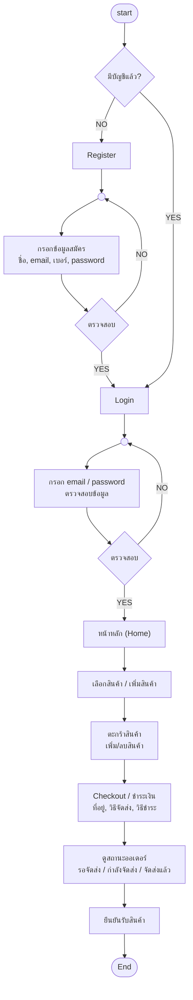

---

## ผังงานกระบวนการฝั่ง Admin และพนักงานหลังบ้าน
แสดงลำดับการทำงานของผู้ดูแลระบบ ผู้บริหารสูงสุด และพนักงานฝ่ายต่างๆ หลังจากล็อกอินสำเร็จแล้วจะเข้าสู่หน้า Dashboard ของแผนกตนเอง โดยมีตัวเชื่อมโยง (Connector `(( ))`) รองรับการวนซ้ำและการรวมจุดกระบวนการ

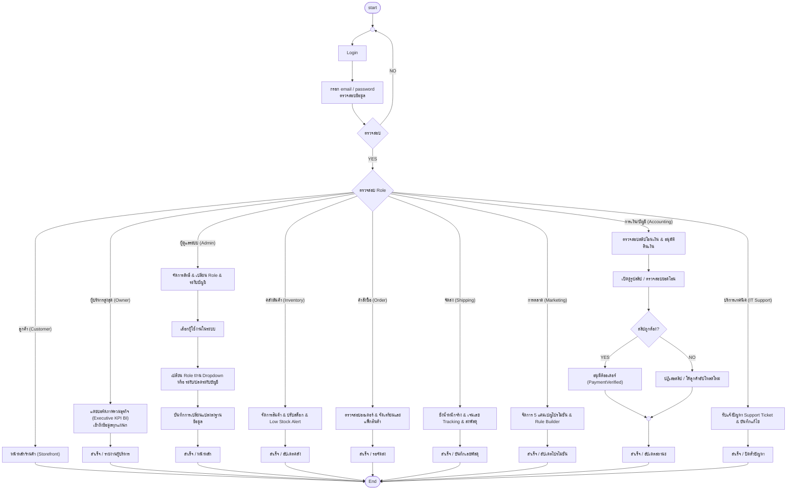

---

# 📑 Flowchart แต่ละหน้า (Page-by-Page Flowcharts)
> ทุกผังงานใช้สัญลักษณ์ **ตัวเชื่อมโยงในหน้าเดียวกัน (On-page Connector `(( ))`)** ตามมาตรฐาน ANSI/ISO 5807 เมื่อตรวจสอบเงื่อนไขไม่ผ่านหรือต้องการวนกลับมาทำซ้ำ

---

### 1. LOGIN (การเข้าสู่ระบบ)
กระบวนการเข้าสู่ระบบ ระบบจะตรวจสอบ Email และ Password จากฐานข้อมูล หากถูกต้องจะบันทึก Session แล้ว Redirect ไปยังหน้าหลัก หากไม่ถูกต้องจะแสดงข้อความแจ้งเตือนและวนกลับมาที่ตัวเชื่อมโยงเพื่อกรอกใหม่

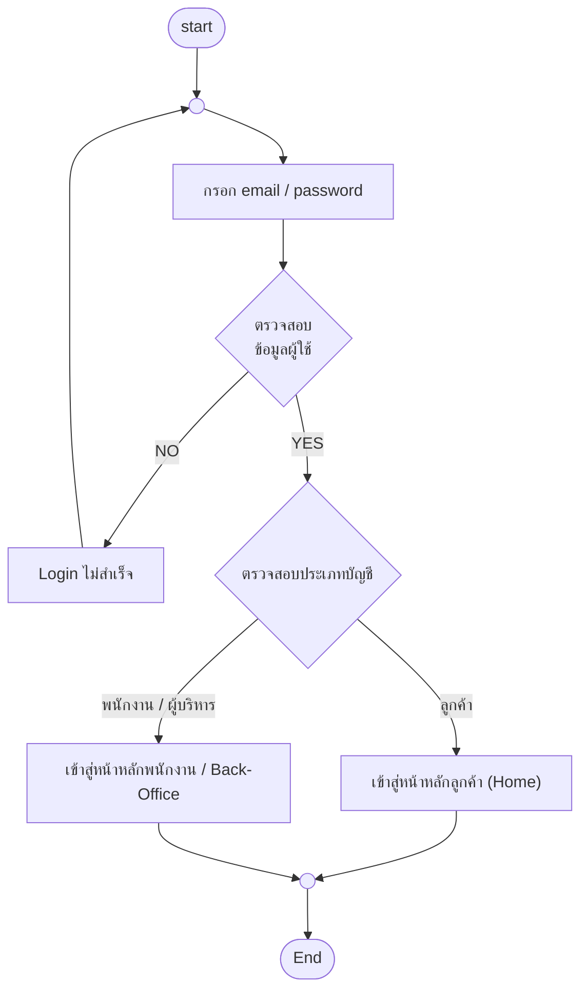

---

### 2. REGISTER (การสมัครสมาชิก)
กระบวนการสมัครสมาชิก ผู้ใช้กรอกข้อมูล Email, ชื่อ, เบอร์โทร และรหัสผ่าน หากข้อมูลไม่ครบจะแจ้งเตือนและวนกลับมาที่ตัวเชื่อมโยง หากถูกต้องระบบจะสร้าง ID อัตโนมัติแล้วบันทึกลงฐานข้อมูล จากนั้น Redirect ไปหน้า Login

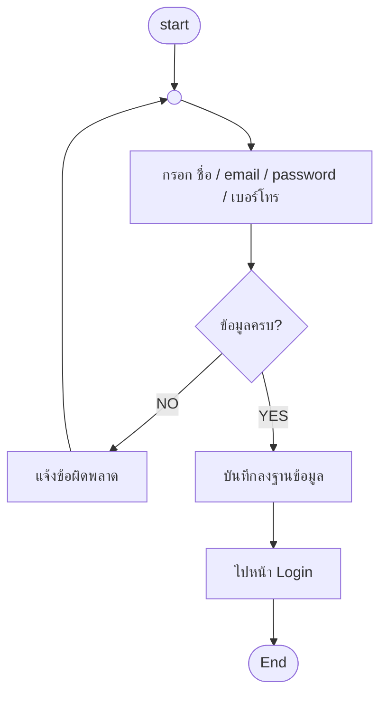

---

### 3. HOME (หน้าหลักร้านค้า)
หน้าหลักแสดงรายการสินค้าและหมวดหมู่ ลูกค้าสามารถกดดูสินค้าแยกตามประเภทสัตว์เลี้ยง (สุนัข/แมว) ช่วงวัย (Layer) หรือคลิกดูรายละเอียดสินค้าแต่ละชิ้น

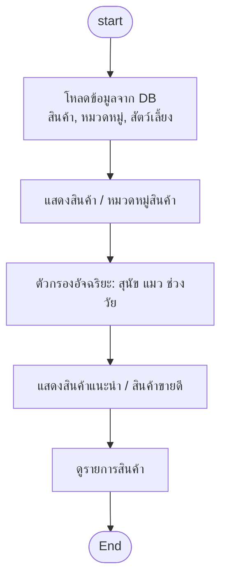

---

### 4. PRODUCT DETAIL (User) (หน้ารายละเอียดสินค้า)
หน้ารายละเอียดสินค้า แสดงรูป ชื่อ ราคา แบรนด์ น้ำหนัก และคำอธิบายสินค้า โดยลูกค้าเลือกจำนวนสินค้าและกดเพิ่มลงตะกร้าเพื่อบันทึกลงระบบตะกร้าสินค้าก่อนดำเนินการสั่งซื้อ

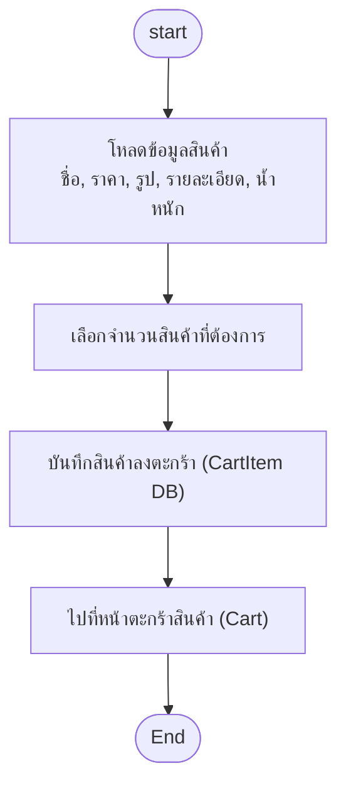

---

### 5. CART (User) (หน้าตะกร้าสินค้า)
หน้าตะกร้าสินค้า แสดงรายการสินค้าที่เลือกไว้ สามารถปรับจำนวน ลบสินค้า โดยหากมีการแก้ไขจะวนกลับมาที่ตัวเชื่อมโยงเพื่อคำนวณ 5 โปรโมชั่นและน้ำหนักใหม่ และกดสั่งซื้อเพื่อไปหน้า Checkout

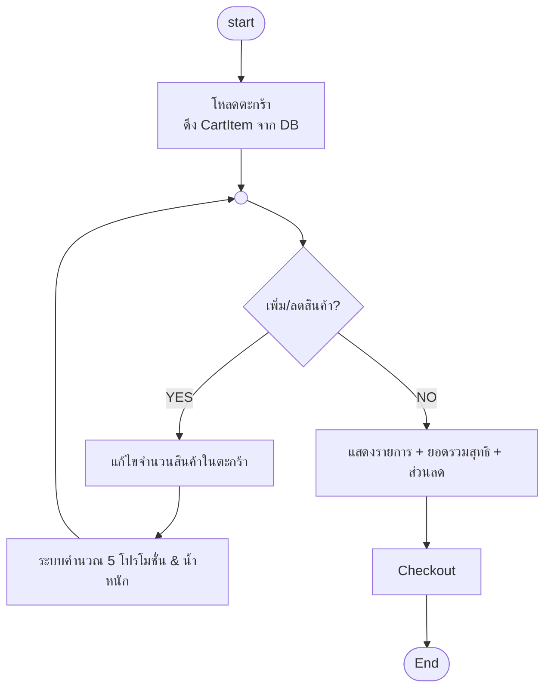

---

### 6. CHECKOUT (User) (หน้ายืนยันคำสั่งซื้อและชำระเงิน)
หน้ายืนยันคำสั่งซื้อ ลูกค้ากรอกข้อมูลและที่อยู่จัดส่ง เลือกผู้ให้บริการขนส่ง (Flash Express / Kerry Express / ไปรษณีย์ไทย EMS) ระบบคำนวณค่าจัดส่งตามเกณฑ์น้ำหนักและประเภทขนส่ง (Flash/Kerry อัตราปกติ, EMS ด่วนพิเศษ +30 บาท) และคำนวณส่วนลดจาก 5 แคมเปญโปรโมชั่นให้อัตโนมัติ ลูกค้าสแกนชำระผ่าน PromptPay QR แนบสลิปโอนเงิน และกดยืนยันสั่งซื้อ

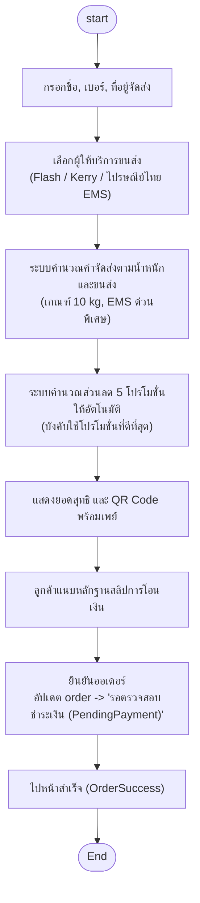

---

### 7. ORDER (User) (หน้าติดตามสถานะออเดอร์)
หน้าติดตามสถานะออเดอร์ แสดงรายการคำสั่งซื้อทั้งหมดของลูกค้าพร้อมสถานะปัจจุบันแบบ Step Progress หากยังไม่จัดส่งจะวนกลับมาที่ตัวเชื่อมโยงเพื่อรอสถานะล่าสุด

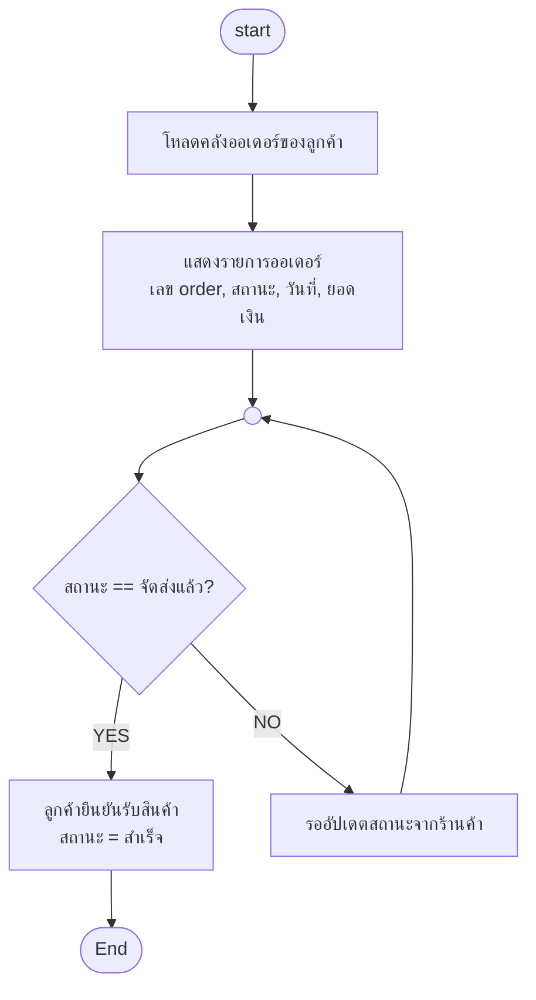

---

### 8. DASHBOARD (Owner) (หน้าสรุปภาพรวมธุรกิจสำหรับผู้บริหารสูงสุด)
หน้าสรุปภาพรวมธุรกิจสำหรับ Owner (ผู้บริหารสูงสุด) แสดงข้อมูล KPI สถิติยอดขายรวม รายได้ กำไรสุทธิ ออเดอร์ สต็อกสินค้า กราฟสัดส่วนสัตว์เลี้ยง และรายการธุรกรรมล่าสุด

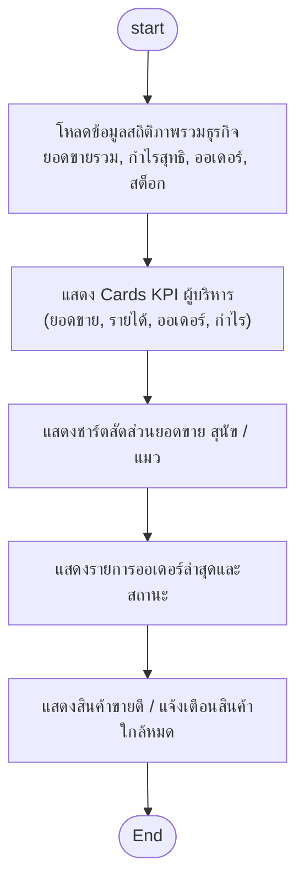

---

### 9. AddProduct (Inventory Staff) (การเพิ่มสินค้าใหม่)
กระบวนการเพิ่มสินค้าใหม่เข้าระบบโดยพนักงานคลังสินค้า (Inventory Staff) กรอกข้อมูลสินค้า แบรนด์ หมวดหมู่ ราคา ต้นทุน น้ำหนัก kg และช่วงวัย (Layer) หากข้อมูลไม่ครบจะวนกลับมาที่ตัวเชื่อมโยงเพื่อกรอกใหม่ หากครบจะอัปโหลดรูปภาพและบันทึกลงฐานข้อมูล

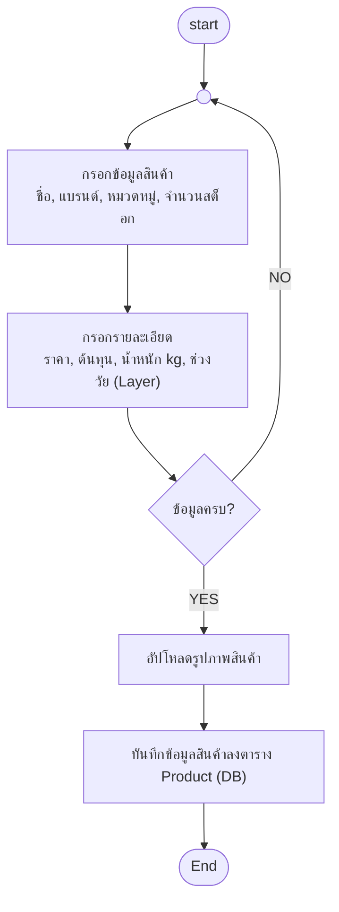

---

### 10. EditProduct (Inventory Staff) (การแก้ไขสินค้า)
กระบวนการแก้ไขข้อมูลสินค้าโดยพนักงานคลังสินค้า (Inventory Staff) เลือกสินค้าที่ต้องการแก้ไข ระบบโหลดข้อมูลเดิมมาให้ หากกรอกข้อมูลไม่ครบจะวนกลับมาที่ตัวเชื่อมโยง หากครบจะตรวจสอบการเปลี่ยนรูปภาพและบันทึกลงฐานข้อมูล

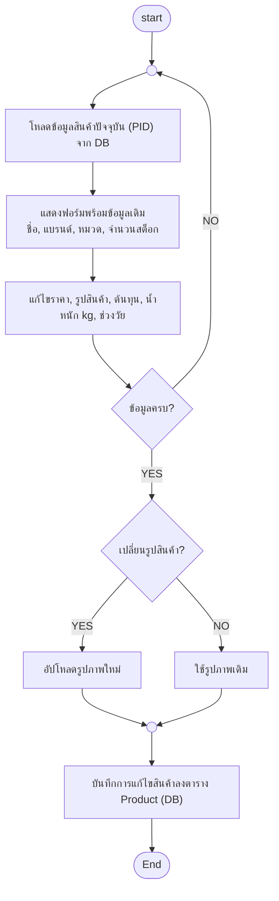

---

### 11. ADD USER (Admin / Owner) (การเพิ่มพนักงานใหม่)
กระบวนการเพิ่มข้อมูลพนักงานใหม่เข้าระบบ Admin หรือ Owner กรอกข้อมูลและกำหนดบทบาทหน้าที่ (โดยบทบาท Admin สงวนสิทธิ์ให้ Owner เป็นผู้เพิ่มเท่านั้น) หากข้อมูลไม่ครบจะวนกลับมาที่ตัวเชื่อมโยงเพื่อแก้ไข

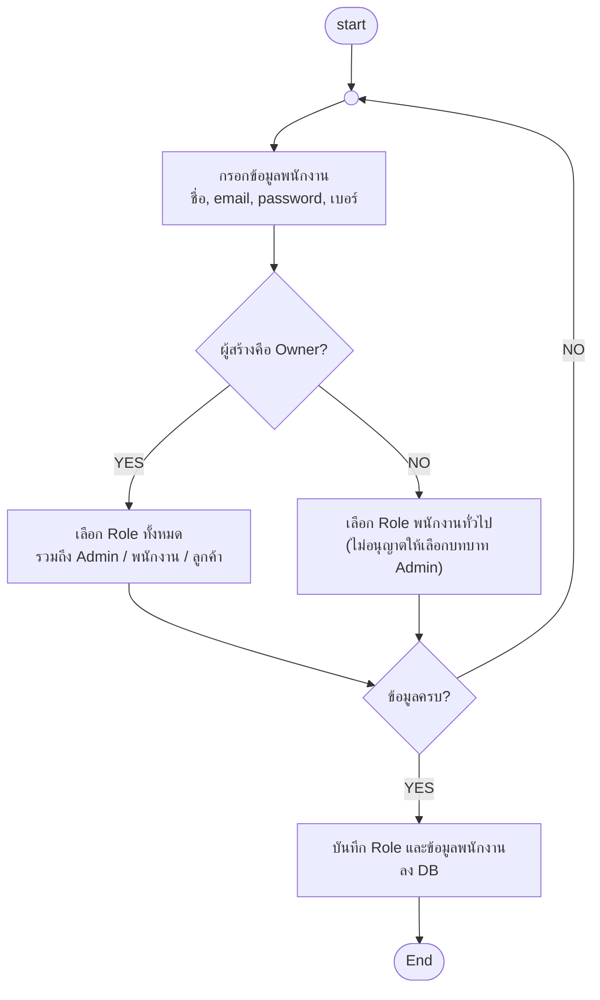

---

### 12. ROLE & PERMISSIONS MANAGEMENT (Admin) (การจัดการสิทธิ์และระงับบัญชีผู้ใช้)
กระบวนการจัดการสิทธิ์และสถานะบัญชีผู้ใช้โดยผู้ดูแลระบบ (Admin) สามารถเปลี่ยนบทบาท (Role) ของผู้ใช้ผ่าน Dropdown (เฉพาะตำแหน่งพนักงานทั่วไปและลูกค้า โดยไม่สามารถแต่งตั้งหรือเปลี่ยนเป็น Admin/Owner ได้ ต้องให้ Owner ทำเท่านั้น) และดำเนินการระงับการใช้งาน (Suspend) หรือปลดระงับบัญชี (Reactivate) ได้โดยตรง โดยไม่มีการลบประวัติข้อมูลผู้ใช้ออกจากระบบ

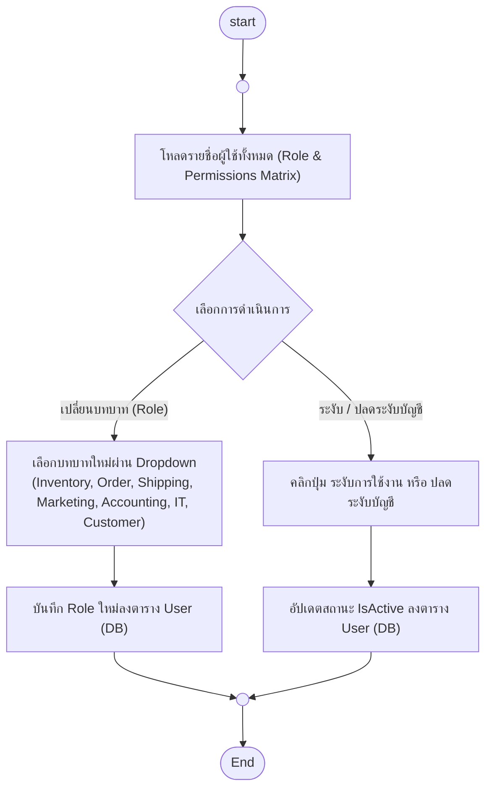

---

### 13. SHIPPING (Shipping Staff) (การจัดส่งและบันทึกเลขพัสดุ)
กระบวนการฝ่ายจัดส่ง รับออเดอร์ที่เตรียมสินค้าเสร็จแล้ว ชั่งน้ำหนักพัสดุจริง บันทึกเลข Tracking Number และเปลี่ยนสถานะเป็นจัดส่งแล้ว

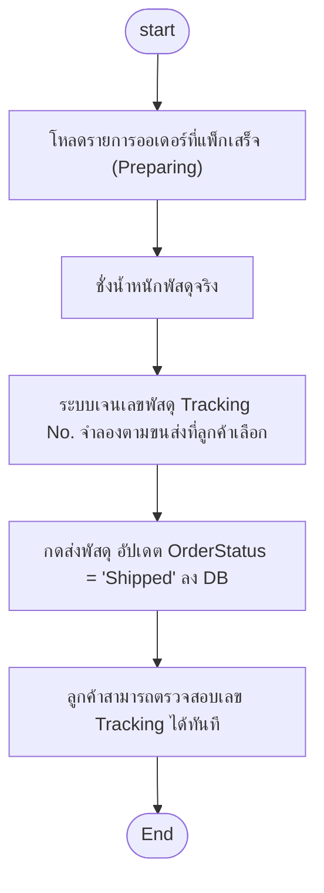

---

### 14. MARKETING & PROMOTIONS (Marketing Staff) (การจัดการแคมเปญโปรโมชั่น)
กระบวนการฝ่ายการตลาด ตรวจสอบสถิติการใช้งานโปรโมชั่น ควบคุมสวิตช์เปิด/ปิดการใช้งานโปรโมชั่นแบบเรียลไทม์ และกำหนดเงื่อนไขโปรโมชั่น โดยรวมจุดบันทึกที่ตัวเชื่อมโยง

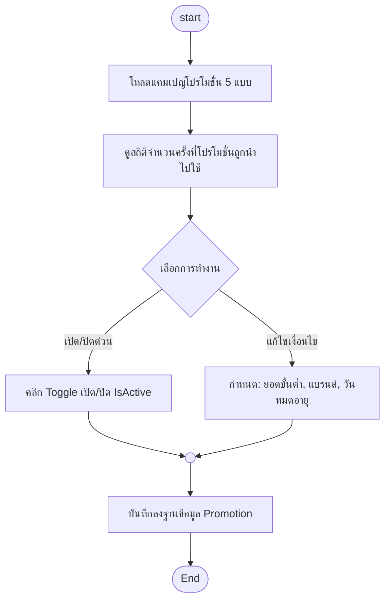

---

### 15. ACCOUNTING & FINANCE (Accounting Staff) (การตรวจสอบการชำระเงินและคืนเงิน)
กระบวนการฝ่ายการเงิน ตรวจสอบสลิปโอนเงินของลูกค้า อนุมัติการชำระเงิน และดำเนินการอนุมัติการขอคืนเงิน (Refund) โดยมีตัวเชื่อมโยงรวมผลลัพธ์สิ้นสุด

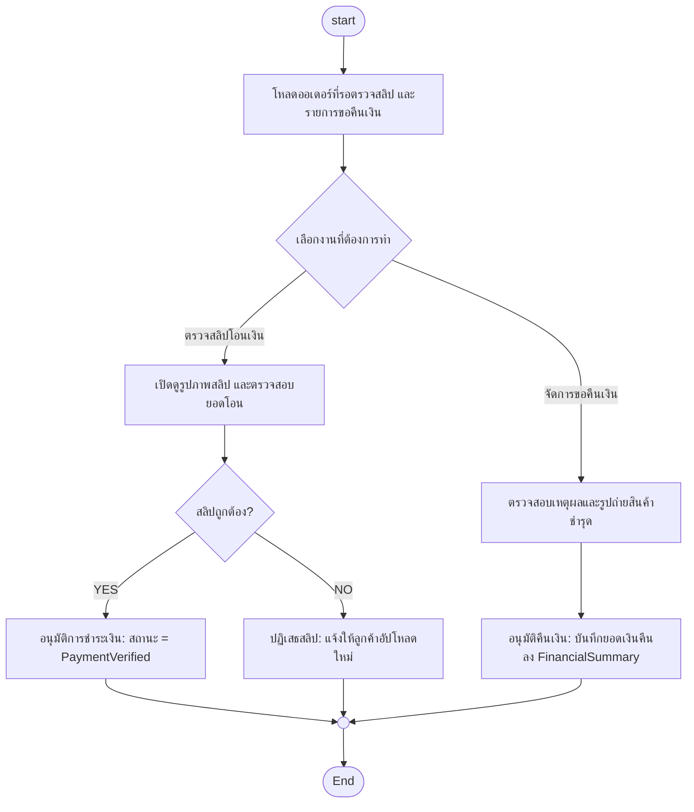

---

### 16. IT SUPPORT & HELPDESK (IT Support) (ศูนย์ช่วยเหลือและจัดการปัญหา)
กระบวนการฝ่ายเทคนิค ตรวจสอบตั๋วปัญหาที่ลูกค้าแจ้งเข้ามา ดำเนินการแก้ไขข้อผิดพลาดในระบบ และบันทึกประวัติการแก้ไขเพื่อปิดงาน

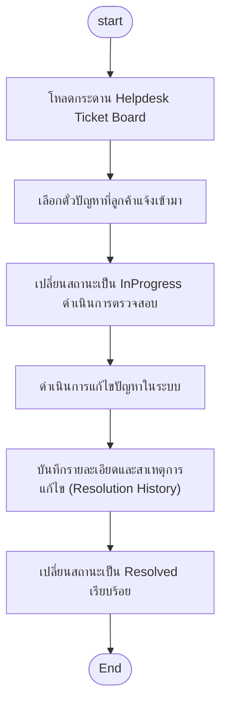

---

## 4. โครงสร้างฐานข้อมูลหลัก (Database Schema 13 Tables)
ระบบใช้ฐานข้อมูล MySQL ชื่อ **`CSI402DB`** ประกอบด้วย 13 ตารางหลัก:
1. `Product` — ข้อมูลสินค้าสัตว์เลี้ยง (ชื่อ, ราคา, หมวด, ช่วงวัย, น้ำหนัก kg, แบรนด์)
2. `Promotion` — แคมเปญโปรโมชั่น 5 แบบ (ส่วนลด, ยอดขั้นต่ำ, วันเริ่ม-สิ้นสุด)
3. `User` — บัญชีผู้ใช้งานระบบ 10 บทบาท (Username, PasswordHash, Role, IsActive)
4. `UserAddress` — สมุดที่อยู่จัดส่งของลูกค้า
5. `Cart` — ตะกร้าสินค้า
6. `CartItem` — รายการสินค้าในตะกร้า
7. `AppliedPromotionSummary` — บันทึกโปรโมชั่นที่ถูกคำนวณใช้
8. `Orders` — คำสั่งซื้อ ยอดสุทธิ สลิปโอนเงิน เลขพัสดุ
9. `OrderItem` — รายการสินค้าแต่ละชิ้นในคำสั่งซื้อ
10. `SupportTicket` — ตั๋วแจ้งปัญหาของลูกค้าและประวัติการแก้ไข
11. `FinancialSummary` — สรุปภาพรวมรายได้ กำไรสุทธิ และยอดคืนเงิน
12. `MonthlyFinancialEntry` — สรุปการเงินแยกรายเดือน
13. `AuditLog` — ตารางบันทึกกิจกรรมย้อนหลัง (Auditing)

---

## 5. แหล่งข้อมูลเพิ่มเติมและเครื่องมือส่งงานอาจารย์
* 🎨 **แบบร่างหน้าจอ Low-Fidelity Wireframes (17 หน้า):** เปิดไฟล์ `wireframe_viewer.html` บนเบราว์เซอร์
* 📊 **ระบบแสดงผังงานแบบโต้ตอบ (Interactive Flowchart Studio):** เปิดไฟล์ `flowchart_viewer.html`
* 📖 **พจนานุกรมข้อมูลฉบับสมบูรณ์:** อ่านได้ที่ [DATA_DICTIONARY.md](DATA_DICTIONARY.md)
* 📑 **บัญชีแจกแจงฟังก์ชันละเอียดครบทั้ง 53 ฟังก์ชัน:** อ่านได้ที่ [ALL_53_FUNCTIONS_FLOWCHARTS.md](ALL_53_FUNCTIONS_FLOWCHARTS.md)

---
© 2026 PetStore Pro. เอกสารนำเสนอโครงงานวิชา CSI402 คณะเทคโนโลยีสารสนเทศ มหาวิทยาลัยศรีปทุม
