# 🐾 PetStore Pro — ระบบการซื้อขายและของใช้สัตว์เลี้ยงออนไลน์ (E-Commerce Platform)
> **เอกสารรายงานสถาปัตยกรรมและผังงานระบบฉบับสมบูรณ์ (Complete System Architecture & Flowchart Specification)**  
> **รายวิชา:** CSI402 การเชื่อมต่อโปรแกรมส่วนหน้ากับโปรแกรมส่วนหลัง (Front-end and Back-end Integration)  
> **คณะเทคโนโลยีสารสนเทศ มหาวิทยาลัยศรีปทุม**  
> **ผู้พัฒนา:** นายพูห์ไพศาล อุดมเพชรไพศาล (67088026)  
> **สถาปัตยกรรม:** ASP.NET Core MVC (.NET 10), Entity Framework Core, MySQL Database (`CSI402DB`), Role-Based Access Control (RBAC 10 Roles)

---

## 📑 สารบัญเอกสาร (Table of Contents)
1. [ภาพรวมและวัตถุประสงค์ของระบบ (Project Overview)](#1-ภาพรวมและวัตถุประสงค์ของระบบ-project-overview)
2. [สถาปัตยกรรมระบบ (System Architecture)](#2-สถาปัตยกรรมระบบ-system-architecture)
3. [ตารางกำหนดสิทธิ์ 10 บทบาท (Role & Permission Matrix)](#3-ตารางกำหนดสิทธิ์-10-บทบาท-role--permission-matrix)
4. [ข้อกำหนดความต้องการ 27 ข้อและโปรโมชั่น 5 แบบ (Requirements)](#4-ข้อกำหนดความต้องการ-27-ข้อ-และโปรโมชั่น-5-แบบ)
5. [ผังงานกระบวนการหลักของระบบ 16 ผังงาน (System Macro Flowcharts)](#5-ผังงานกระบวนการหลักของระบบ-16-ผังงาน-system-macro-flowcharts)
6. [สารบัญและโฟลว์ชาร์ตเจาะลึกครบทั้ง 53 ฟังก์ชัน (All 53 Functions Flowcharts)](#6-สารบัญและโฟลว์ชาร์ตเจาะลึกครบทั้ง-53-ฟังก์ชัน-all-53-functions-flowcharts)
7. [พจนานุกรมข้อมูลและโครงสร้างฐานข้อมูล 13 ตาราง (Database Schema)](#7-พจนานุกรมข้อมูลและโครงสร้างฐานข้อมูล-13-ตาราง-database-schema)
8. [คู่มือเครื่องมือและแบบร่างหน้าจอ (Tools & Viewers)](#8-คู่มือเครื่องมือและแบบร่างหน้าจอ-tools--viewers)

---

## 1. ภาพรวมและวัตถุประสงค์ของระบบ (Project Overview)
**PetStore Pro** ได้รับการออกแบบและพัฒนาขึ้นเพื่อเป็นระบบการซื้อขายอาหารและของใช้สัตว์เลี้ยงแบบครบวงจร ครอบคลุมทั้งฝั่งหน้าร้าน (Storefront) สำหรับผู้เยี่ยมชมและลูกค้าสมาชิก และฝั่งหลังบ้าน (Back-Office Portal) สำหรับพนักงานทั้ง 8 แผนก โดยมุ่งเน้นการเชื่อมต่อส่วนหน้าและส่วนหลังอย่างไร้รอยต่อ:
* **ระบบคำนวณ 5 แคมเปญโปรโมชั่นอัตโนมัติ:** คำนวณส่วนลดตามเงื่อนไข (ซื้อครบ 3 ชิ้น, หมวดหมู่อาหาร, อาหารแบรนด์เดียวกัน, ของแถมฟรี)
* **ระบบคิดค่าจัดส่งตามเกณฑ์น้ำหนัก (Weight-based Shipping):** คำนวณตามน้ำหนักรวม โดยยกเว้นค่าจัดส่งเมื่อยอดซื้อถึงเกณฑ์และน้ำหนัก $\le 10$ kg และคิดค่าบริการเพิ่ม 20 บาท/kg เมื่อเกิน 10 kg
* **การจำแนกสินค้าอัจฉริยะ (Multi-Filter & Age Layer):** คัดกรองตามประเภทสัตว์ (หมา/แมว), หมวดหมู่, พิกัดน้ำหนัก และช่วงวัย (ลูกสัตว์, โตเต็มวัย, สูงวัย) พร้อมตัวนับคนใส่ตะกร้า (Social Proof Badge)
* **ความปลอดภัยและการแยกบทบาท (RBAC):** รองรับ 10 บทบาทอย่างเคร่งครัด แยกสิทธิ์การเข้าถึงเมนูและระบบงานอย่างชัดเจน

---

## 2. สถาปัตยกรรมระบบ (System Architecture)
ระบบถูกออกแบบตามหลัก Layered MVC Architecture และ Clean Separation of Concerns เพื่อประสิทธิภาพ ความปลอดภัย และการรองรับการขยายตัว:

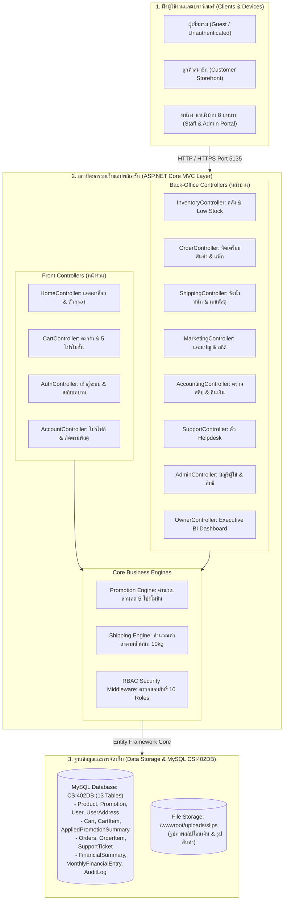

### ตารางแจกแจงหน้าที่รับผิดชอบตามสถาปัตยกรรม
| เซอร์วิส / คอนโทรลเลอร์ | พอร์ต / เส้นทาง | เทคโนโลยีหลัก | หน้าที่รับผิดชอบ |
|---|:---:|---|---|
| **Storefront** | Port 5135 (`/Home`, `/Cart`) | ASP.NET Core MVC, Razor, Bootstrap 5 | แสดงแคตตาล็อกสินค้า, ตัวกรองอัจฉริยะ, ตะกร้าสินค้า, คำนวณโปรโมชั่น, ชำระเงิน |
| **Authentication & RBAC** | Port 5135 (`/Auth`) | Cookie Auth, Claims, Session | ยืนยันตัวตน, สมัครสมาชิก, สลับบทบาท 10 Roles (Fast Switch), ป้องกันการเข้าถึง |
| **Customer Portal** | Port 5135 (`/Account`) | ASP.NET Core MVC, EF Core | จัดการข้อมูลส่วนตัว, สมุดที่อยู่จัดส่ง, ประวัติคำสั่งซื้อ, อัปโหลดสลิป, เปิดตั๋ว Helpdesk |
| **Back-Office Hub** | Port 5135 (`/Inventory` ถึง `/Owner`) | ASP.NET Core MVC, EF Core | ระบบงานพนักงาน 8 แผนก: คลัง, เตรียมออเดอร์, จัดส่ง, การตลาด, การเงิน, ไอที, แอดมิน, ผู้บริหาร |
| **MySQL Database** | Port 3306 (`CSI402DB`) | MySQL 8.0, Pomelo EF Core | จัดเก็บข้อมูล 13 ตาราง (ACID Transactions, Foreign Keys, Audit Logs) |

---

## 3. ตารางกำหนดสิทธิ์ 10 บทบาท (Role & Permission Matrix)

| สิทธิ์ / โมดูลระบบ | Guest | Customer | Inventory | Order | Shipping | Marketing | Accounting | IT Support | Admin | Owner |
|---|:---:|:---:|:---:|:---:|:---:|:---:|:---:|:---:|:---:|:---:|
| ดูแคตตาล็อก & กรองสินค้า | ✅ | ✅ | ✅ | ✅ | ✅ | ✅ | ✅ | ✅ | ✅ | ✅ |
| สมัครสมาชิก / เข้าสู่ระบบ | ✅ | ✅ | ✅ | ✅ | ✅ | ✅ | ✅ | ✅ | ✅ | ✅ |
| สั่งซื้อ & ชำระเงิน PromptPay | ❌ | ✅ | ❌ | ❌ | ❌ | ❌ | ❌ | ❌ | ❌ | ❌ |
| ติดตามพัสดุ & ขอยกเลิก/คืนเงิน | ❌ | ✅ | ❌ | ❌ | ❌ | ❌ | ❌ | ❌ | ❌ | ❌ |
| เปิดตั๋วแจ้งปัญหา (Helpdesk) | ❌ | ✅ | ❌ | ❌ | ❌ | ❌ | ❌ | ❌ | ❌ | ❌ |
| จัดการสต็อก & Low Stock Alert | ❌ | ❌ | ✅ | ❌ | ❌ | ❌ | ❌ | ❌ | ❌ | ✅ |
| คิวออเดอร์ & พิมพ์ Packing Slip | ❌ | ❌ | ❌ | ✅ | ❌ | ❌ | ❌ | ❌ | ❌ | ✅ |
| ชั่งน้ำหนักจริง & บันทึก Tracking | ❌ | ❌ | ❌ | ❌ | ✅ | ❌ | ❌ | ❌ | ❌ | ✅ |
| จัดการ 5 โปรโมชั่น & Rule Builder | ❌ | ❌ | ❌ | ❌ | ❌ | ✅ | ❌ | ❌ | ❌ | ✅ |
| ตรวจสอบสลิป & อนุมัติคืนเงิน | ❌ | ❌ | ❌ | ❌ | ❌ | ❌ | ✅ | ❌ | ❌ | ✅ |
| ตรวจสอบ & บันทึกแก้ไขตั๋วไอที | ❌ | ❌ | ❌ | ❌ | ❌ | ❌ | ❌ | ✅ | ❌ | ✅ |
| จัดการบัญชีผู้ใช้ & สิทธิ์ RBAC | ❌ | ❌ | ❌ | ❌ | ❌ | ❌ | ❌ | ❌ | ✅ | ✅ |
| Executive BI Dashboard (ภาพรวม) | ❌ | ❌ | ❌ | ❌ | ❌ | ❌ | ❌ | ❌ | ❌ | ✅ |

---

## 4. ข้อกำหนดความต้องการ 27 ข้อ และโปรโมชั่น 5 แบบ

### แคมเปญโปรโมชั่นทั้ง 5 รูปแบบ (5 Promotion Rules)
1. **โปรโมชั่นที่ 1 (Buy 3 Items Discount):** ลูกค้าซื้อสินค้าใดก็ได้ครบ 3 ชิ้น ได้รับส่วนลดทันที 50 บาท
2. **โปรโมชั่นที่ 2 (Food Variety Discount):** รับส่วนลดพิเศษ 10% เมื่อซื้ออาหารสัตว์เลี้ยงตามหมวดหมู่อย่างน้อย 2 รายการขึ้นไป
3. **โปรโมชั่นที่ 3 (Free Shipping Weight Cap):** จัดส่งฟรีเมื่อยอดซื้อถึงกำหนด (ครบ 800 บาท) แต่น้ำหนักรวมต้องไม่เกินเกณฑ์ 10 kg
4. **โปรโมชั่นที่ 4 (Free Gift Milestone):** รับของใช้สัตว์เลี้ยงฟรีเมื่อยอดซื้อถึงกำหนด (ยอดครบ 1,000 บาท รับเสื้อสัตว์เลี้ยงฟรี 1 ตัว)
5. **โปรโมชั่นที่ 5 (Same Brand Food Discount):** รับส่วนลดพิเศษ 15% เมื่อซื้ออาหารจากแบรนด์เดียวกันตั้งแต่ 2 ถุงขึ้นไป

### สรุปความต้องการเชิงหน้าที่ (Functional Requirements 27 ข้อ)
* **Req 1–10 (ด้านสินค้าและการค้นหา):** จำแนกสุนัข/แมว, กรองตามน้ำหนัก, คำนวณราคาและส่วนลดอัตโนมัติ, ขนส่งตามน้ำหนัก 10kg, การตลาดจัดการแคมเปญ, แก้ไขสินค้าหลังบ้าน, แนะนำสินค้าตามช่วงวัย, แสดงตัวนับคนใส่ตะกร้า (Social Proof), ค้นหาแยกหมวดหมู่, แสดง Layer ช่วงวัย
* **Req 11–13 (ด้านตะกร้าและโปรโมชั่น):** เพิ่ม/ลบ/แก้ไขจำนวนสินค้า, ตรวจสอบและใช้ส่วนลดอัตโนมัติ, แสดงรายละเอียดโปรโมชั่น
* **Req 14–16 (ด้านการจัดส่งและน้ำหนัก):** คำนวณค่าส่งตามน้ำหนักรวม, ยกเว้นค่าส่งเมื่อเข้าโปรโมชั่นและน้ำหนัก $\le 10$kg, คิดค่าบริการเพิ่ม 20 บาท/kg เมื่อเกิน 10kg
* **Req 17–18 (ด้านสินค้าและสต็อก):** เพิ่ม/แก้ไข/ลบสินค้า, แจ้งเตือนสินค้าต่ำกว่าระดับที่กำหนด (Low Stock Alert)
* **Req 19–21 (ด้านการสั่งซื้อและการเงิน):** บันทึกและตรวจสถานะชำระเงิน, บันทึกการคืนเงินและสถานะคืนเงิน, จัดทำรายงานรายรับ-รายจ่ายของร้าน
* **Req 22–24 (ด้านการแจ้งปัญหา):** ลูกค้าแจ้งปัญหาการใช้งาน, IT Support ตรวจสอบและอัปเดตสถานะ, บันทึกประวัติและผลการแก้ไขปัญหา
* **Req 25–27 (ด้านการจัดการโปรโมชั่น):** กำหนดเงื่อนไขขั้นต่ำและแบรนด์, กำหนดวันเวลาเริ่ม-สิ้นสุด, แสดงสถิติจำนวนครั้งที่โปรโมชั่นถูกนำไปใช้

---

## 5. ผังงานกระบวนการหลักของระบบ 16 ผังงาน (System Macro Flowcharts)

### ผังงานที่ 1: ภาพรวมระบบและการจำแนก 10 บทบาท (System Architecture Overview)
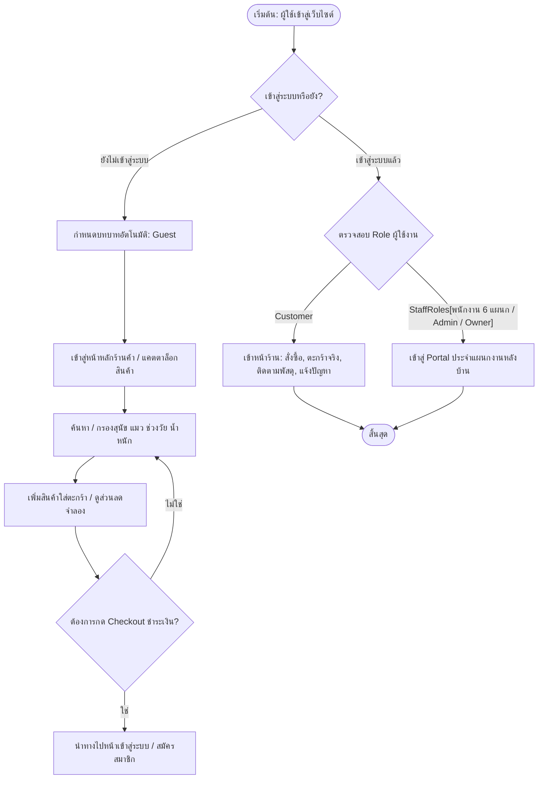

### ผังงานที่ 2: ระบบความปลอดภัยและการสลับสิทธิ์ (Authentication & Fast Role Switch)
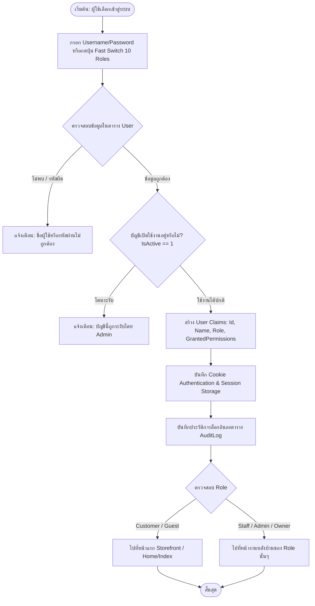

### ผังงานที่ 3: หน้าร้าน แคตตาล็อก & ตัวกรองอัจฉริยะ (Storefront Multi-Filter & Social Proof)
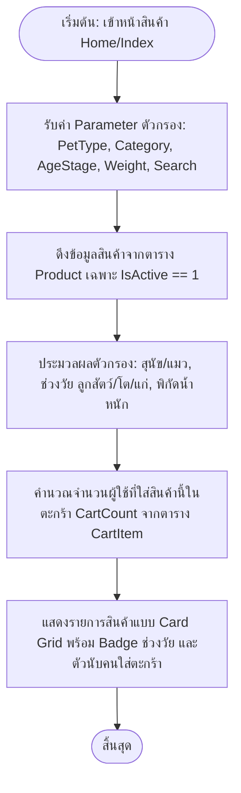

### ผังงานที่ 4: ตะกร้าสินค้า & การคำนวณ 5 โปรโมชั่นอัตโนมัติ (Cart & 5-Promotion Engine)
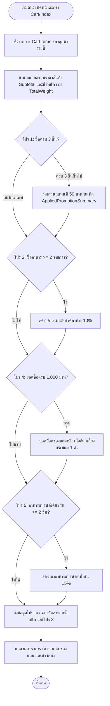

### ผังงานที่ 5: ระบบคำนวณค่าจัดส่งตามเกณฑ์น้ำหนัก (Weight-based Shipping Calculation)
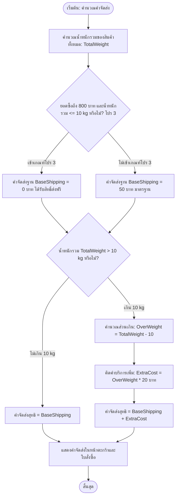

### ผังงานที่ 6: การสั่งซื้อ ชำระเงิน และแนบสลิป (Checkout & Payment Flowchart)
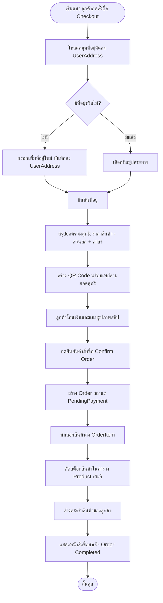

### ผังงานที่ 7: ลูกค้าติดตามพัสดุ ขอคืนเงิน & แจ้งปัญหา (Orders, Refund & Support)
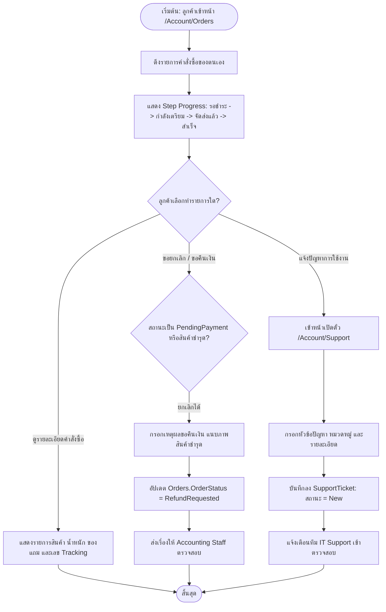

### ผังงานที่ 8: คลังสินค้าและแจ้งเตือนสินค้าใกล้หมด (Inventory Staff)
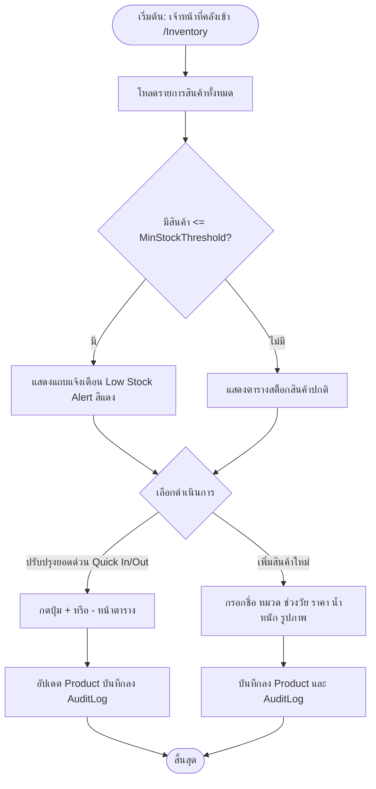

### ผังงานที่ 9: จัดการคำสั่งซื้อและเตรียมสินค้า (Order Staff)
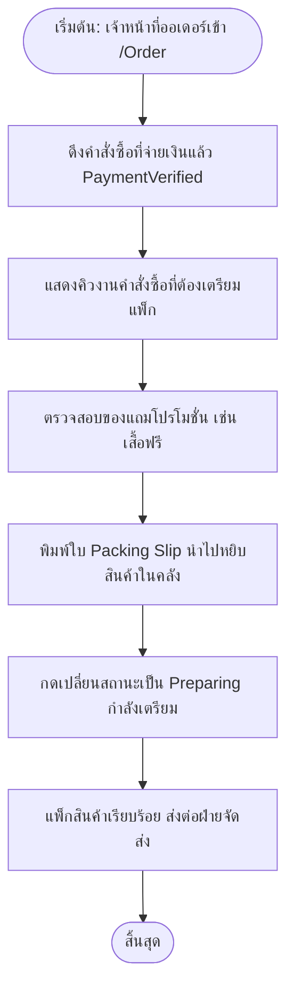

### ผังงานที่ 10: ฝ่ายจัดส่งและบันทึกเลขพัสดุ (Shipping Staff)
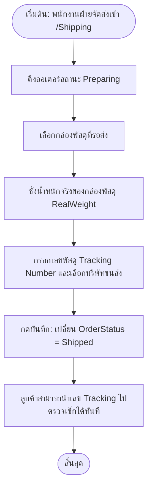

### ผังงานที่ 11: ฝ่ายการตลาดและแคมเปญโปรโมชั่น (Marketing Staff)
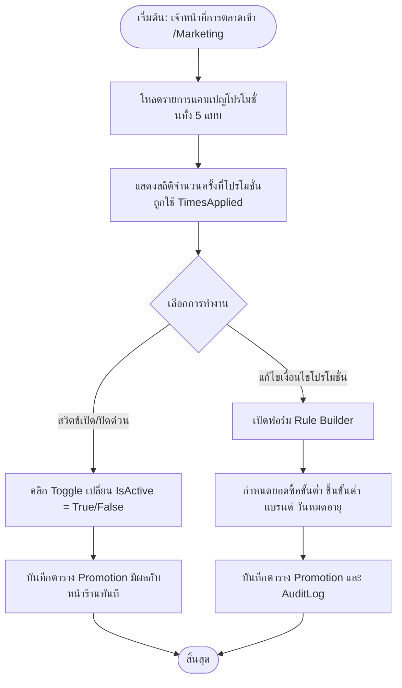

### ผังงานที่ 12: การเงิน บัญชี และตรวจสอบสลิป (Accounting Staff)
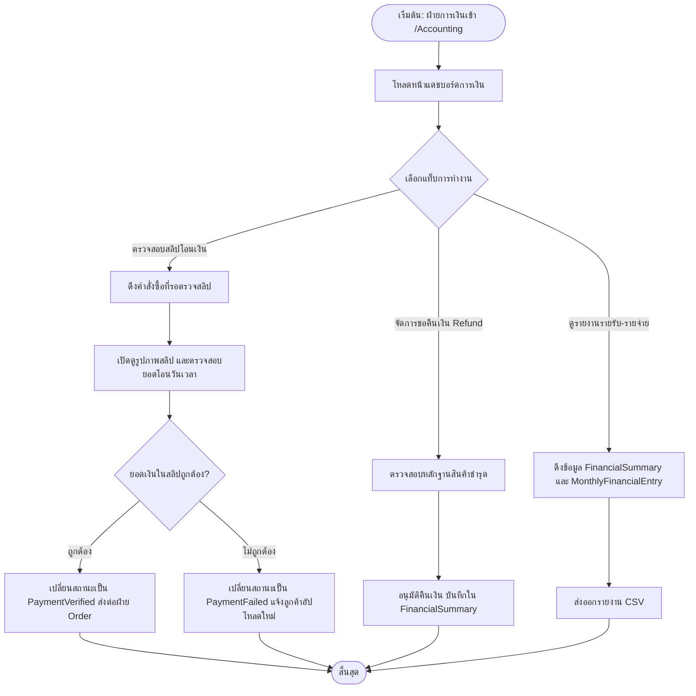

### ผังงานที่ 13: ศูนย์ช่วยเหลือและฝ่ายเทคนิค (IT Support Helpdesk)
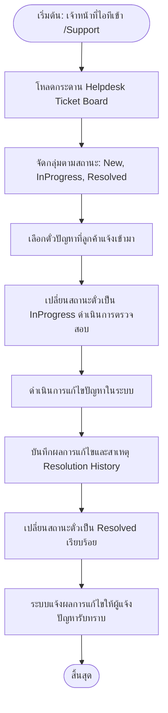

### ผังงานที่ 14: ผู้ดูแลระบบและจัดการสิทธิ์ (Admin)
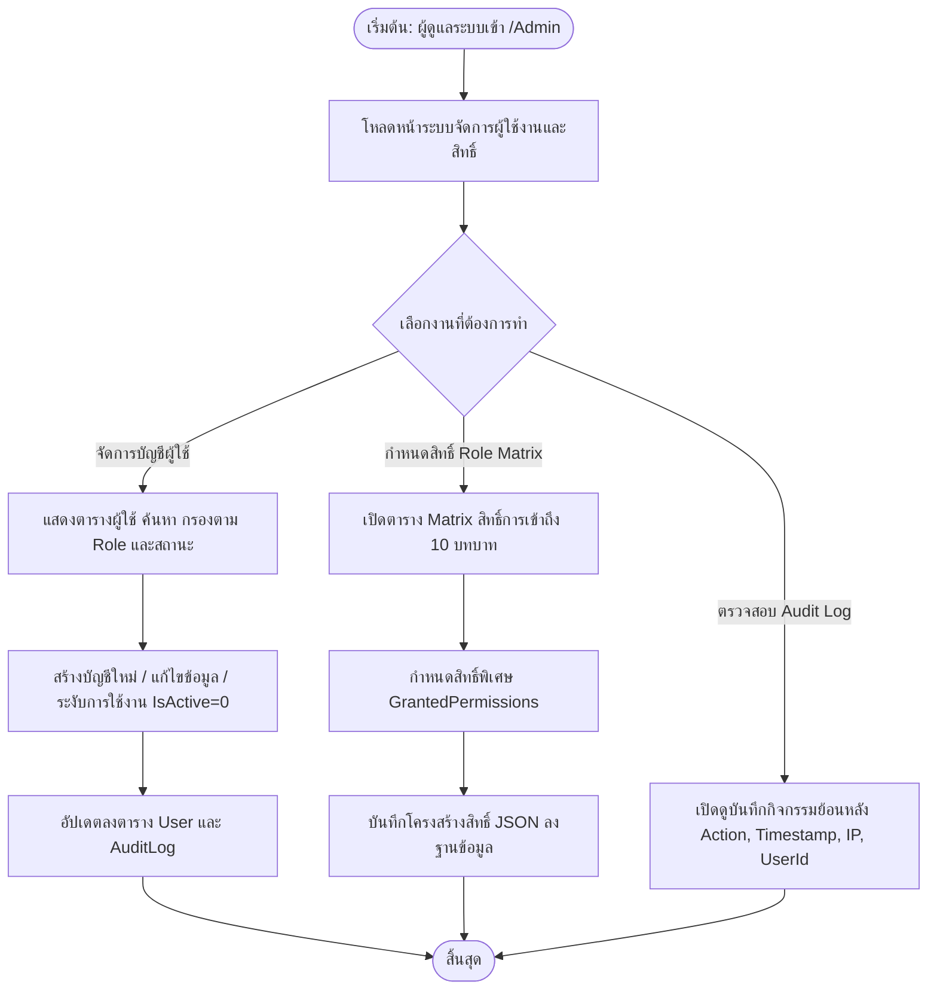

### ผังงานที่ 15: เจ้าของร้านและภาพรวมธุรกิจ (Owner Executive BI Dashboard)
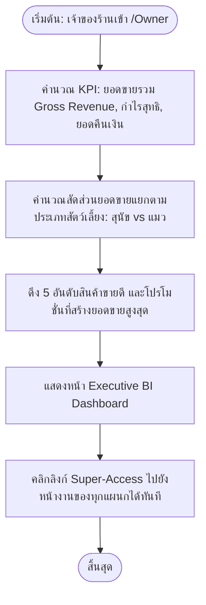

---

## 6. สารบัญและโฟลว์ชาร์ตเจาะลึกครบทั้ง 53 ฟังก์ชัน (All 53 Functions Flowcharts)

ด้านล่างนี้คือการแจกแจงโฟลว์ชาร์ตและขั้นตอนการทำงานครบทุก Action Method ทั้ง **53 ฟังก์ชัน** ใน **12 Controllers** โดยจัดกลุ่มแบบ Collapsible Dropdown ให้เปิดดูได้อย่างเป็นระเบียบ:


<details>
<summary><h3>📦 AccountController (10 ฟังก์ชัน) — คลิกเพื่อเปิดดูโฟลว์ชาร์ตทั้งหมด</h3></summary>


#### ฟังก์ชันที่ 1: ดูข้อมูลโปรไฟล์และสมุดที่อยู่จัดส่ง (`AccountController.Profile`)
* **Method & Role:** `GET` • **สิทธิ์:** Customer
* **Requirements:** Profile & Address Management • **ตาราง DB:** `User, UserAddress`
* **ลำดับขั้นตอนการทำงาน:**
1. ดึง UserId ของผู้ใช้ที่เข้าสู่ระบบจาก Claims
2. คิวรีตาราง User เพื่อนำชื่อ นามสกุล อีเมล และเบอร์โทร
3. คิวรีตาราง UserAddress เพื่อดึงรายการที่อยู่จัดส่งทั้งหมด
4. ส่งข้อมูลไปยังหน้า Profile View

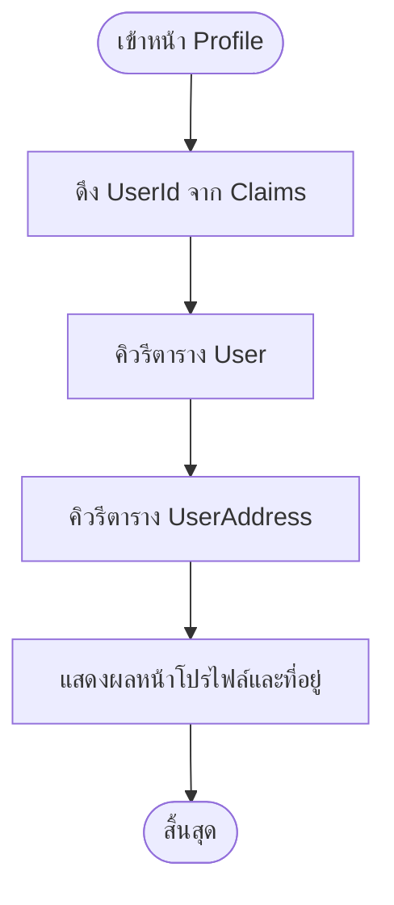

---

#### ฟังก์ชันที่ 2: แก้ไขข้อมูลส่วนตัวลูกค้า (`AccountController.UpdateProfile`)
* **Method & Role:** `POST` • **สิทธิ์:** Customer
* **Requirements:** Profile Management • **ตาราง DB:** `User, AuditLog`
* **ลำดับขั้นตอนการทำงาน:**
1. รับข้อมูล Form: FullName, Email, Phone
2. ตรวจสอบความถูกต้องของข้อมูล (Model Validation)
3. อัปเดตข้อมูลลงตาราง User
4. บันทึกกิจกรรมลงตาราง AuditLog และแสดง Toast แจ้งเตือนสำเร็จ

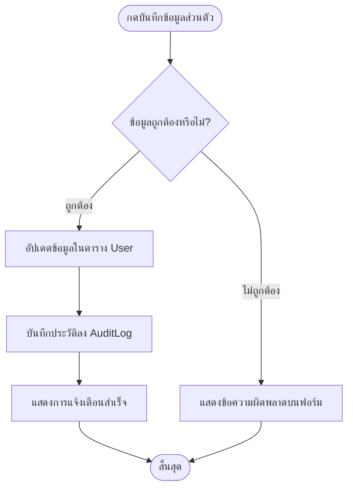

---

#### ฟังก์ชันที่ 3: เพิ่มหรือแก้ไขที่อยู่จัดส่ง (`AccountController.SaveAddress`)
* **Method & Role:** `POST` • **สิทธิ์:** Customer
* **Requirements:** Multi-Address Management • **ตาราง DB:** `UserAddress`
* **ลำดับขั้นตอนการทำงาน:**
1. รับข้อมูลที่อยู่: ชื่อผู้รับ เบอร์โทร ที่อยู่ ตำบล อำเภอ จังหวัด รหัสไปรษณีย์
2. เช็กว่าเป็นที่อยู่ใหม่ (Id=0) หรือแก้ไข
3. หากระบุเป็นที่อยู่หลัก ให้ปลด IsDefault ของที่อยู่อื่นออก
4. บันทึกข้อมูลลงตาราง UserAddress

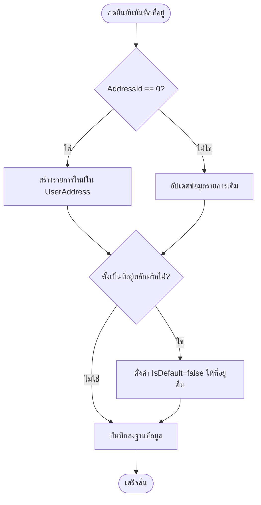

---

#### ฟังก์ชันที่ 4: ลบที่อยู่จัดส่ง (`AccountController.DeleteAddress`)
* **Method & Role:** `POST` • **สิทธิ์:** Customer
* **Requirements:** Address Management • **ตาราง DB:** `UserAddress`
* **ลำดับขั้นตอนการทำงาน:**
1. รับ AddressId ที่ต้องการลบ
2. ตรวจสอบสิทธิ์ความเป็นเจ้าของที่อยู่
3. ลบแถวออกจากตาราง UserAddress
4. รีเฟรชหน้ารายการที่อยู่

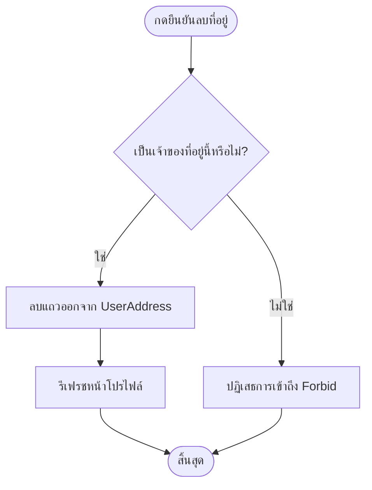

---

#### ฟังก์ชันที่ 5: กำหนดที่อยู่จัดส่งเริ่มต้น (Default Address) (`AccountController.SetDefaultAddress`)
* **Method & Role:** `POST` • **สิทธิ์:** Customer
* **Requirements:** Default Address • **ตาราง DB:** `UserAddress`
* **ลำดับขั้นตอนการทำงาน:**
1. รับ AddressId ที่ต้องการตั้งเป็นหลัก
2. ปรับ IsDefault ของทุกที่อยู่ในบัญชีของผู้ใช้นี้ให้เป็น false
3. ตั้ง IsDefault = true ให้กับที่อยู่ที่เลือก
4. บันทึกการเปลี่ยนแปลง

```mermaid
flowchart TD
    Start([เลือกเป็นที่อยู่หลัก]) --> ResetDef[อัปเดตทุกที่อยู่ IsDefault = false]
    ResetDef --> SetCurrent[อัปเดตที่อยู่ที่เลือก IsDefault = true]
    SetCurrent --> Save[บันทึกตาราง UserAddress]
    Save --> End([สิ้นสุด])
```

---

#### ฟังก์ชันที่ 6: ดูประวัติและติดตามสถานะคำสั่งซื้อ (`AccountController.Orders`)
* **Method & Role:** `GET` • **สิทธิ์:** Customer
* **Requirements:** Order History & Step Tracking • **ตาราง DB:** `Orders, OrderItem, Product`
* **ลำดับขั้นตอนการทำงาน:**
1. ดึงคำสั่งซื้อทั้งหมดที่ผูกกับ UserId ของลูกค้ารายนี้
2. เชื่อมโยงข้อมูลสินค้าและจำนวนจาก OrderItem
3. ประมวลผล Step Progress Bar (รอชำระ -> กำลังเตรียม -> จัดส่งแล้ว -> สำเร็จ)
4. ส่งข้อมูลไปยังหน้า Orders View

```mermaid
flowchart TD
    Start([เข้าหน้า Orders]) --> QueryOrders[ดึง Orders ของลูกค้าจากตาราง Orders]
    QueryOrders --> IncludeItems[ดึงรายการสินค้าจาก OrderItem]
    IncludeItems --> CalcProgress[คำนวณสถานะ Step Progress]
    CalcProgress --> RenderView[แสดงหน้าประวัติคำสั่งซื้อ]
    RenderView --> End([สิ้นสุด])
```

---

#### ฟังก์ชันที่ 7: อัปโหลดสลิปโอนเงินเพิ่มเติมภายหลัง (`AccountController.UploadSlip`)
* **Method & Role:** `POST` • **สิทธิ์:** Customer
* **Requirements:** Req 19 Payment Slip Upload • **ตาราง DB:** `Orders`
* **ลำดับขั้นตอนการทำงาน:**
1. รับ OrderId และไฟล์รูปภาพสลิป IFormFile
2. บันทึกไฟล์รูปภาพลงโฟลเดอร์ /wwwroot/uploads/slips
3. อัปเดตฟิลด์ PaymentSlipUrl ในตาราง Orders
4. แจ้งเตือนลูกค้าว่าส่งสลิปเรียบร้อย

```mermaid
flowchart TD
    Start([ลูกค้าอัปโหลดสลิปเพิ่มเติม]) --> CheckFile{มีไฟล์รูปภาพแนบหรือไม่?}
    CheckFile -- มี --> SaveFile[บันทึกไฟล์ภาพใน wwwroot/uploads/slips]
    SaveFile --> UpdateOrder[อัปเดต Orders.PaymentSlipUrl]
    UpdateOrder --> Notify[แสดง Toast สลิปถูกส่งแล้ว]
    CheckFile -- ไม่มี --> ShowErr[แจ้งเตือนให้เลือกไฟล์สลิป]
    Notify --> End([สิ้นสุด])
    ShowErr --> End
```

---

#### ฟังก์ชันที่ 8: ขอยกเลิกคำสั่งซื้อ หรือขอยื่นคืนเงิน (`AccountController.CancelOrder`)
* **Method & Role:** `POST` • **สิทธิ์:** Customer
* **Requirements:** Req 20 Order Cancellation & Refund • **ตาราง DB:** `Orders, Product, AuditLog`
* **ลำดับขั้นตอนการทำงาน:**
1. ตรวจสอบสถานะคำสั่งซื้อปัจจุบัน
2. หากยังไม่ชำระเงิน (PendingPayment) ให้เปลี่ยนเป็น Cancelled และคืนสต็อกสินค้าใน Product
3. หากชำระเงินแล้ว ให้เปลี่ยนเป็น RefundRequested ส่งต่อฝ่ายบัญชี
4. บันทึก AuditLog

```mermaid
flowchart TD
    Start([ลูกค้ายื่นขอยกเลิกออเดอร์]) --> CheckStatus{สถานะออเดอร์?}
    CheckStatus -- PendingPayment --> CancelOrder[เปลี่ยน OrderStatus = Cancelled]
    CancelOrder --> Restock[คืนสต็อกสินค้าใน Product]
    CheckStatus -- ชำระเงินแล้ว --> ReqRefund[เปลี่ยน OrderStatus = RefundRequested]
    ReqRefund --> AlertAcc[แจ้งเตือน Accounting Staff รออนุมัติ]
    Restock --> LogAction[บันทึกลง AuditLog]
    AlertAcc --> LogAction
    LogAction --> End([สิ้นสุด])
```

---

#### ฟังก์ชันที่ 9: หน้าศูนย์ช่วยเหลือและเปิดตั๋วแจ้งปัญหา (`AccountController.Support`)
* **Method & Role:** `GET` • **สิทธิ์:** Customer
* **Requirements:** Req 22 Customer Helpdesk • **ตาราง DB:** `SupportTicket`
* **ลำดับขั้นตอนการทำงาน:**
1. ดึงประวัติตั๋วปัญหาเดิมที่ลูกค้าเคยส่งเข้ามา
2. โหลดรายการหมวดหมู่ปัญหาและระดับความสำคัญ
3. แสดงแบบฟอร์มเปิดตั๋ว Support ใหม่

```mermaid
flowchart TD
    Start([เข้าหน้า Support]) --> FetchHistory[ดึงประวัติตั๋วเดิมของลูกค้า]
    FetchHistory --> LoadCategories[โหลดหมวดหมู่ปัญหา]
    LoadCategories --> RenderSupport[แสดงหน้าแบบฟอร์มแจ้งปัญหา]
    RenderSupport --> End([สิ้นสุด])
```

---

#### ฟังก์ชันที่ 10: บันทึกการเปิดตั๋วแจ้งปัญหาของลูกค้า (`AccountController.SubmitTicket`)
* **Method & Role:** `POST` • **สิทธิ์:** Customer
* **Requirements:** Req 22 Ticket Creation • **ตาราง DB:** `SupportTicket, AuditLog`
* **ลำดับขั้นตอนการทำงาน:**
1. รับข้อมูลหัวข้อ, หมวดหมู่, รายละเอียดปัญหา, เบอร์โทร, ความสำคัญ
2. สร้างแถวใหม่ในตาราง SupportTicket สถานะเริ่มต้นเป็น New
3. บันทึก AuditLog และแจ้งเตือนทีม IT Support

```mermaid
flowchart TD
    Start([กดยืนยันส่งตั๋วแจ้งปัญหา]) --> ValidateForm{กรอกข้อมูลครบถ้วน?}
    ValidateForm -- ครบ --> CreateTicket[สร้างตั๋วใหม่ใน SupportTicket: สถานะ = New]
    CreateTicket --> SaveAudit[บันทึกประวัติ AuditLog]
    SaveAudit --> AlertIT[ส่งเรื่องเข้า Helpdesk Board ของ IT]
    AlertIT --> Success[แจ้งเตือนลูกค้าได้รับเรื่องแล้ว]
    ValidateForm -- ไม่ครบ --> ShowFormErr[แจ้งเตือนให้กรอกข้อมูลให้ครบ]
    Success --> End([สิ้นสุด])
    ShowFormErr --> End
```

---
</details>


<details>
<summary><h3>📦 AccountingController (6 ฟังก์ชัน) — คลิกเพื่อเปิดดูโฟลว์ชาร์ตทั้งหมด</h3></summary>


#### ฟังก์ชันที่ 11: แดชบอร์ดภาพรวมการเงินและการตรวจสอบสลิป (`AccountingController.Index`)
* **Method & Role:** `GET` • **สิทธิ์:** AccountingStaff, Owner
* **Requirements:** Req 19, 20, 21 Financial Dashboard • **ตาราง DB:** `Orders, FinancialSummary, MonthlyFinancialEntry`
* **ลำดับขั้นตอนการทำงาน:**
1. คำนวณยอดขายรวม Gross Revenue, กำไรสุทธิ, ยอดคืนเงินสะสม
2. คัดกรองออเดอร์ที่รอตรวจสอบสลิป และรายการที่ยื่นขอคืนเงิน
3. ดึงบันทึกรายรับ-รายจ่ายรายเดือน
4. ส่งข้อมูลไปยังหน้า Accounting Dashboard

```mermaid
flowchart TD
    Start([เข้าหน้า Accounting]) --> CalcTotals[คำนวณยอดรวมรายได้และกำไร]
    CalcTotals --> FilterOrders[ดึงรายการรอตรวจสลิป และรอคืนเงิน]
    FilterOrders --> FetchMonthly[ดึงสรุปการเงินรายเดือน]
    FetchMonthly --> RenderDashboard[แสดงหน้าแดชบอร์ดการเงิน]
    RenderDashboard --> End([สิ้นสุด])
```

---

#### ฟังก์ชันที่ 12: อนุมัติสลิปการชำระเงิน (`AccountingController.ApprovePayment`)
* **Method & Role:** `POST` • **สิทธิ์:** AccountingStaff, Owner
* **Requirements:** Req 19 Payment Verification • **ตาราง DB:** `Orders, FinancialSummary, AuditLog`
* **ลำดับขั้นตอนการทำงาน:**
1. ตรวจสอบสลิปและยอดเงิน
2. อัปเดต Orders.OrderStatus = PaymentVerified
3. บวกยอดเงินเข้า GrossRevenue ใน FinancialSummary
4. บันทึก AuditLog และส่งออเดอร์เข้าคิว Order Staff

```mermaid
flowchart TD
    Start([กดอนุมัติสลิปชำระเงิน]) --> VerifySlip[ตรวจสอบสลิป]
    VerifySlip --> UpdateStatus[Orders.OrderStatus = PaymentVerified]
    UpdateStatus --> UpdateFinance[บวกยอดเงินเข้า FinancialSummary]
    UpdateFinance --> LogAudit[บันทึก AuditLog]
    LogAudit --> ForwardToOrder[ส่งต่อให้ฝ่ายจัดเตรียมสินค้า]
    ForwardToOrder --> End([สิ้นสุด])
```

---

#### ฟังก์ชันที่ 13: ปฏิเสธสลิปการชำระเงิน (`AccountingController.RejectPayment`)
* **Method & Role:** `POST` • **สิทธิ์:** AccountingStaff, Owner
* **Requirements:** Req 19 Reject Invalid Slip • **ตาราง DB:** `Orders, AuditLog`
* **ลำดับขั้นตอนการทำงาน:**
1. รับเหตุผลการปฏิเสธสลิปจากเจ้าหน้าที่การเงิน
2. เปลี่ยนสถานะ Orders.OrderStatus = PaymentFailed
3. บันทึกหมายเหตุและแจ้งเตือนให้ลูกค้าอัปโหลดสลิปใหม่

```mermaid
flowchart TD
    Start([กดปฏิเสธสลิป]) --> InputReason[รับเหตุผลปฏิเสธสลิป]
    InputReason --> SetFailed[Orders.OrderStatus = PaymentFailed]
    SetFailed --> LogAudit[บันทึก AuditLog]
    LogAudit --> AlertCustomer[แจ้งเตือนลูกค้าให้อัปโหลดใหม่]
    AlertCustomer --> End([สิ้นสุด])
```

---

#### ฟังก์ชันที่ 14: อนุมัติการคืนเงินให้ลูกค้า (`AccountingController.ApproveRefund`)
* **Method & Role:** `POST` • **สิทธิ์:** AccountingStaff, Owner
* **Requirements:** Req 20 Refund Processing • **ตาราง DB:** `Orders, FinancialSummary, AuditLog`
* **ลำดับขั้นตอนการทำงาน:**
1. ตรวจสอบหลักฐานสินค้าชำรุดและเหตุผลขอคืนเงิน
2. เปลี่ยนสถานะ Orders.OrderStatus = Refunded
3. บันทึกยอดเงินคืนลง FinancialSummary.RefundedAmount
4. บันทึกประวัติการคืนเงินลง AuditLog

```mermaid
flowchart TD
    Start([กดอนุมัติคืนเงิน]) --> CheckProof[ตรวจสอบหลักฐานการคืนเงิน]
    CheckProof --> SetRefunded[Orders.OrderStatus = Refunded]
    SetRefunded --> DeductFinance[บันทึกยอดเงินคืนใน FinancialSummary]
    DeductFinance --> LogAudit[บันทึก AuditLog]
    LogAudit --> CompleteRefund[แจ้งผลการคืนเงินสำเร็จ]
    CompleteRefund --> End([สิ้นสุด])
```

---

#### ฟังก์ชันที่ 15: บันทึกรายจ่ายและต้นทุนประจำเดือน (`AccountingController.SaveMonthlyExpense`)
* **Method & Role:** `POST` • **สิทธิ์:** AccountingStaff, Owner
* **Requirements:** Req 21 Financial Records • **ตาราง DB:** `MonthlyFinancialEntry, FinancialSummary, AuditLog`
* **ลำดับขั้นตอนการทำงาน:**
1. รับข้อมูลเดือนและยอดรายจ่ายจริง (ต้นทุนสินค้า ค่าเช่า ขนส่ง)
2. อัปเดตข้อมูลในตาราง MonthlyFinancialEntry
3. คำนวณกำไรสุทธิใหม่ NetProfit = Revenue - Expense
4. บันทึก AuditLog

```mermaid
flowchart TD
    Start([บันทึกรายจ่ายประจำเดือน]) --> InputExpense[รับยอดรายจ่าย]
    InputExpense --> UpdateMonthly[อัปเดต MonthlyFinancialEntry]
    UpdateMonthly --> RecalcProfit[คำนวณ NetProfit ใหม่]
    RecalcProfit --> SaveFinance[บันทึก FinancialSummary]
    SaveFinance --> End([สิ้นสุด])
```

---

#### ฟังก์ชันที่ 16: ส่งออกรายงานสรุปการเงินเป็นไฟล์ CSV (`AccountingController.ExportFinancialCsv`)
* **Method & Role:** `GET` • **สิทธิ์:** AccountingStaff, Owner
* **Requirements:** Req 21 CSV Financial Export • **ตาราง DB:** `FinancialSummary, MonthlyFinancialEntry`
* **ลำดับขั้นตอนการทำงาน:**
1. คิวรีข้อมูลสรุปรายได้ รายจ่าย กำไรสุทธิ และยอดคืนเงิน
2. จัดรูปแบบข้อความเป็นโครงสร้าง Comma-Separated Values (CSV)
3. ส่งออกเป็นไฟล์ดาวน์โหลดด้วย MIME Type text/csv

```mermaid
flowchart TD
    Start([กดส่งออกรายงาน CSV]) --> QueryData[คิวรีข้อมูลสรุปการเงินทั้งหมด]
    QueryData --> BuildCSV[สร้างโครงสร้างไฟล์ CSV]
    BuildCSV --> OutputFile[ส่งไฟล์ CSV ให้ผู้ใช้ดาวน์โหลด]
    OutputFile --> End([สิ้นสุด])
```

---
</details>


<details>
<summary><h3>📦 AdminController (3 ฟังก์ชัน) — คลิกเพื่อเปิดดูโฟลว์ชาร์ตทั้งหมด</h3></summary>


#### ฟังก์ชันที่ 17: หน้าจัดการผู้ใช้งาน สิทธิ์ และตรวจสอบ Audit Log (`AdminController.Index`)
* **Method & Role:** `GET` • **สิทธิ์:** Admin
* **Requirements:** Req 57, 58 User & Permission Hub • **ตาราง DB:** `User, AuditLog`
* **ลำดับขั้นตอนการทำงาน:**
1. ดึงรายชื่อผู้ใช้และพนักงานทั้งหมดในระบบ
2. ดึงตาราง Matrix สิทธิ์การเข้าถึง 10 บทบาท
3. ดึงบันทึกกิจกรรมย้อนหลัง AuditLog ล่าสุด
4. ส่งข้อมูลไปยังหน้า Admin Management

```mermaid
flowchart TD
    Start([เข้าหน้า Admin]) --> LoadUsers[ดึงรายชื่อผู้ใช้จากตาราง User]
    LoadUsers --> LoadMatrix[โหลดตาราง Role & Permission Matrix]
    LoadMatrix --> LoadAudit[ดึงรายการประวัติ AuditLog]
    LoadAudit --> RenderAdmin[แสดงหน้าแดชบอร์ด Admin]
    RenderAdmin --> End([สิ้นสุด])
```

---

#### ฟังก์ชันที่ 18: ปรับเปลี่ยนบทบาทและสถานะการเปิด/ระงับบัญชี (`AdminController.UpdateUserRole`)
* **Method & Role:** `POST` • **สิทธิ์:** Admin
* **Requirements:** Req 58 RBAC Role Assignment • **ตาราง DB:** `User, AuditLog`
* **ลำดับขั้นตอนการทำงาน:**
1. รับ UserId, บทบาทใหม่ NewRole, และสถานะ IsActive
2. ตรวจสอบว่าไม่ได้ระงับบัญชีของตนเอง
3. อัปเดตตาราง User ในฐานข้อมูล
4. บันทึกการเปลี่ยนแปลงสิทธิ์ลง AuditLog

```mermaid
flowchart TD
    Start([กดเปลี่ยนบทบาท/สถานะ]) --> CheckSelf{เป็นบัญชีตนเองหรือไม่?}
    CheckSelf -- ใช่ --> DenySelf[ห้ามระงับสิทธิ์บัญชีตนเอง]
    CheckSelf -- ไม่ใช่ --> UpdateUserDB[อัปเดต User.Role และ IsActive]
    UpdateUserDB --> LogAudit[บันทึก AuditLog]
    LogAudit --> ToastSuccess[แจ้งเตือนอัปเดตสำเร็จ]
    DenySelf --> End([สิ้นสุด])
    ToastSuccess --> End
```

---

#### ฟังก์ชันที่ 19: สร้างบัญชีพนักงานหรือผู้ใช้งานใหม่ (`AdminController.CreateUser`)
* **Method & Role:** `POST` • **สิทธิ์:** Admin
* **Requirements:** Req 57 User Creation • **ตาราง DB:** `User, AuditLog`
* **ลำดับขั้นตอนการทำงาน:**
1. รับข้อมูลผู้ใช้ใหม่: Username, Password, FullName, Email, Role
2. ตรวจสอบความซ้ำซ้อนของ Username
3. บันทึกบัญชีใหม่ลงตาราง User
4. บันทึก AuditLog

```mermaid
flowchart TD
    Start([กดยืนยันสร้างผู้ใช้]) --> CheckDuplicate{Username ซ้ำหรือไม่?}
    CheckDuplicate -- ซ้ำ --> ShowDupErr[แจ้งเตือนชื่อผู้ใช้ซ้ำ]
    CheckDuplicate -- ไม่ซ้ำ --> InsertUser[เพิ่มแถวใหม่ในตาราง User]
    InsertUser --> LogAudit[บันทึกประวัติ AuditLog]
    LogAudit --> SuccessToast[แจ้งเตือนสร้างบัญชีสำเร็จ]
    ShowDupErr --> End([สิ้นสุด])
    SuccessToast --> End
```

---
</details>


<details>
<summary><h3>📦 AuthController (8 ฟังก์ชัน) — คลิกเพื่อเปิดดูโฟลว์ชาร์ตทั้งหมด</h3></summary>


#### ฟังก์ชันที่ 20: แสดงหน้าเข้าสู่ระบบ (`AuthController.Login`)
* **Method & Role:** `GET` • **สิทธิ์:** Guest / Unauthenticated
* **Requirements:** Login View • **ตาราง DB:** `-`
* **ลำดับขั้นตอนการทำงาน:**
1. ตรวจสอบ ReturnUrl (หากมี)
2. แสดงผลหน้าฟอร์มเข้าสู่ระบบ

```mermaid
flowchart TD
    Start([เข้าหน้า Login]) --> RenderLoginForm[แสดงฟอร์มเข้าสู่ระบบ]
    RenderLoginForm --> End([สิ้นสุด])
```

---

#### ฟังก์ชันที่ 21: ตรวจสอบรหัสผ่านและสร้างเซสชันล็อกอิน (`AuthController.Login`)
* **Method & Role:** `POST` • **สิทธิ์:** Guest / Unauthenticated
* **Requirements:** Authentication • **ตาราง DB:** `User, AuditLog`
* **ลำดับขั้นตอนการทำงาน:**
1. รับ Username และ Password จาก Form
2. ตรวจสอบกับตาราง User
3. เช็ก IsActive == 1
4. สร้าง Claims ออก Cookie Authentication
5. บันทึก AuditLog นำทางผู้ใช้ตามสิทธิ์ Role

```mermaid
flowchart TD
    Start([กดปุ่มเข้าสู่ระบบ]) --> QueryUser[ค้นหา Username ใน User]
    QueryUser --> CheckPass{รหัสผ่านถูกต้อง?}
    CheckPass -- ไม่ถูกต้อง --> ErrLogin[แจ้งชื่อหรือรหัสผ่านผิด]
    CheckPass -- ถูกต้อง --> CheckActive{IsActive == 1?}
    CheckActive -- ไม่ใช่ --> ErrSuspended[แจ้งบัญชีถูกระงับ]
    CheckActive -- ใช่ --> IssueClaims[สร้าง Claims & ออก Cookie]
    IssueClaims --> LogAudit[บันทึก AuditLog]
    LogAudit --> RouteRole[นำทางไปยังหน้าตาม Role]
    ErrLogin --> End([สิ้นสุด])
    ErrSuspended --> End
    RouteRole --> End
```

---

#### ฟังก์ชันที่ 22: เข้าสู่ระบบคลิกเดียวด้วยบัญชีทดสอบ (Quick Demo Login) (`AuthController.QuickLogin`)
* **Method & Role:** `POST` • **สิทธิ์:** Demo / Testing
* **Requirements:** Developer Fast Switch • **ตาราง DB:** `User, AuditLog`
* **ลำดับขั้นตอนการทำงาน:**
1. รับ Username ทดสอบที่เลือก
2. ดึงข้อมูล User และออก Claims ทันที
3. บันทึก Session Storage และ Cookie
4. นำทางไปยังหน้าของ Role นั้น

```mermaid
flowchart TD
    Start([กดปุ่ม Quick Login]) --> FindDemoUser[ค้นหาบัญชี Demo]
    FindDemoUser --> IssueCookie[สร้าง Claims และออก Cookie ทันที]
    IssueCookie --> RoutePortal[ส่งไปยัง Portal ตามสิทธิ์]
    RoutePortal --> End([สิ้นสุด])
```

---

#### ฟังก์ชันที่ 23: สลับมุมมองบทบาทแบบ Real-time พร้อมออก Session ใหม่ (`AuthController.SwitchRole`)
* **Method & Role:** `GET/POST` • **สิทธิ์:** All Roles
* **Requirements:** Multi-Role Realtime Switcher • **ตาราง DB:** `User, AuditLog`
* **ลำดับขั้นตอนการทำงาน:**
1. รับ Role ปลายทางที่ต้องการสลับ
2. ปรับปรุง Session Storage ประจำ Tab (petshop_tab_role)
3. ออก Cookie Claims บัญชีของ Role นั้น
4. เปลี่ยนเส้นทางไปยังหน้าแรกของแผนกนั้นทันที

```mermaid
flowchart TD
    Start([เลือกสลับบทบาทบน Bar]) --> SetTabSession[อัปเดต sessionStorage ประจำแท็บ]
    SetTabSession --> ReissueClaims[ออก Cookie Claims สำหรับ Role ใหม่]
    ReissueClaims --> RedirectToRole[Redirect ไปยังหน้า Dashboard ของบทบาทนั้น]
    RedirectToRole --> End([สิ้นสุด])
```

---

#### ฟังก์ชันที่ 24: แสดงหน้าฟอร์มสมัครสมาชิกใหม่ (`AuthController.Register`)
* **Method & Role:** `GET` • **สิทธิ์:** Guest
* **Requirements:** Customer Registration View • **ตาราง DB:** `-`
* **ลำดับขั้นตอนการทำงาน:**
1. แสดงหน้าฟอร์มสมัครสมาชิกให้กรอกข้อมูล

```mermaid
flowchart TD
    Start([เข้าหน้า Register]) --> RenderForm[แสดงฟอร์มกรอกข้อมูลสมัครสมาชิก]
    RenderForm --> End([สิ้นสุด])
```

---

#### ฟังก์ชันที่ 25: ประมวลผลการสมัครสมาชิกใหม่สำหรับลูกค้า (`AuthController.Register`)
* **Method & Role:** `POST` • **สิทธิ์:** Guest
* **Requirements:** Customer Registration Processing • **ตาราง DB:** `User, Cart, AuditLog`
* **ลำดับขั้นตอนการทำงาน:**
1. ตรวจสอบความถูกต้องของข้อมูล (Validation)
2. ตรวจสอบชื่อผู้ใช้และอีเมลไม่ให้ซ้ำ
3. สร้างผู้ใช้ใหม่กำหนด Role = Customer
4. สร้าง Cart ว่างเริ่มต้นสำหรับผู้ใช้ใหม่
5. ล็อกอินให้อัตโนมัติและนำทางไปยังหน้าร้าน

```mermaid
flowchart TD
    Start([กดยืนยันสมัครสมาชิก]) --> ValidateModel{ข้อมูลถูกต้อง?}
    ValidateModel -- ถูกต้อง --> CheckDup{Username ซ้ำ?}
    CheckDup -- ไม่ซ้ำ --> CreateUser[บันทึก User บทบาท Customer]
    CreateUser --> CreateCart[สร้าง Cart ว่างในตาราง Cart]
    CreateCart --> AutoSignIn[ล็อกอินอัตโนมัติ]
    AutoSignIn --> GoStorefront[ไปที่หน้าร้านค้า]
    CheckDup -- ซ้ำ --> ShowDup[แจ้งชื่อผู้ใช้มีในระบบแล้ว]
    ValidateModel -- ผิดพลาด --> ShowErr[แจ้งเตือนข้อผิดพลาด]
    GoStorefront --> End([สิ้นสุด])
    ShowDup --> End
    ShowErr --> End
```

---

#### ฟังก์ชันที่ 26: ออกจากระบบและล้างเซสชัน (`AuthController.Logout`)
* **Method & Role:** `GET/POST` • **สิทธิ์:** Authenticated Users
* **Requirements:** Sign Out • **ตาราง DB:** `AuditLog`
* **ลำดับขั้นตอนการทำงาน:**
1. เรียก HttpContext.SignOutAsync ล้าง Cookie
2. ล้าง Session Storage ประจำ Tab ให้เป็น Guest
3. บันทึก AuditLog และเปลี่ยนเส้นทางไปยังหน้าแรก

```mermaid
flowchart TD
    Start([กดยืนยันออกจากระบบ]) --> SignOutCookie[ล้าง Cookie Authentication]
    SignOutCookie --> ClearSession[ตั้งค่า sessionStorage เป็น Guest]
    ClearSession --> LogAudit[บันทึก AuditLog]
    LogAudit --> GoHome[กลับสู่หน้าแรก Home/Index]
    GoHome --> End([สิ้นสุด])
```

---

#### ฟังก์ชันที่ 27: หน้าแจ้งเตือนปฏิเสธการเข้าถึง (Access Denied) (`AuthController.AccessDenied`)
* **Method & Role:** `GET` • **สิทธิ์:** All Roles
* **Requirements:** Security Access Control • **ตาราง DB:** `-`
* **ลำดับขั้นตอนการทำงาน:**
1. แสดงหน้าแจ้งเตือนว่าผู้ใช้ไม่มีสิทธิ์ในหน้างานดังกล่าว
2. แสดงปุ่มกลับหน้าร้าน และปุ่มสลับบัญชี

```mermaid
flowchart TD
    Start([เข้าหน้าระบบที่ไม่ได้รับสิทธิ์]) --> RenderDenied[แสดงข้อความปฏิเสธการเข้าถึง]
    RenderDenied --> ShowButtons[แสดงปุ่มกลับหน้าร้านและปุ่มสลับบัญชี]
    ShowButtons --> End([สิ้นสุด])
```

---
</details>


<details>
<summary><h3>📦 CartController (7 ฟังก์ชัน) — คลิกเพื่อเปิดดูโฟลว์ชาร์ตทั้งหมด</h3></summary>


#### ฟังก์ชันที่ 28: แสดงหน้าตะกร้าสินค้าและคำนวณ 5 โปรโมชั่น (`CartController.Index`)
* **Method & Role:** `GET` • **สิทธิ์:** Customer & Guest
* **Requirements:** Req 3, 4, 11-16 Cart & Promotion Engine • **ตาราง DB:** `Cart, CartItem, Product, Promotion, AppliedPromotionSummary`
* **ลำดับขั้นตอนการทำงาน:**
1. ดึงรายการสินค้าทั้งหมดในตะกร้า
2. คำนวณยอดรวมราคาสินค้าและน้ำหนักรวม
3. ตรวจสอบกฎแคมเปญโปรโมชั่น 1 ถึง 5 แบบ Real-time
4. คำนวณค่าจัดส่งตามน้ำหนักรวม (เกณฑ์ 10kg และ 20฿/kg)
5. บันทึก AppliedPromotionSummary และแสดงผลในหน้า Cart

```mermaid
flowchart TD
    Start([เข้าหน้า Cart]) --> FetchItems[ดึง CartItem และ Product]
    FetchItems --> CalcSubtotal[คำนวณราคารวมและน้ำหนักรวม]
    CalcSubtotal --> Eval5Promos[ประมวลผล 5 โปรโมชั่นอัตโนมัติ]
    Eval5Promos --> CalcWeightShip[คำนวณค่าส่งตามเกณฑ์น้ำหนัก 10kg]
    CalcWeightShip --> SaveSummary[บันทึก AppliedPromotionSummary]
    SaveSummary --> RenderCart[แสดงผลหน้าตะกร้าสินค้า]
    RenderCart --> End([สิ้นสุด])
```

---

#### ฟังก์ชันที่ 29: เพิ่มสินค้าลงตะกร้า (AJAX Optimistic UI) (`CartController.Add`)
* **Method & Role:** `POST` • **สิทธิ์:** Customer & Guest
* **Requirements:** Req 11 Add to Cart • **ตาราง DB:** `Cart, CartItem, Product`
* **ลำดับขั้นตอนการทำงาน:**
1. รับ ProductId และ Quantity ที่ต้องการเพิ่ม
2. ตรวจสอบจำนวนสต็อกใน Product
3. เพิ่มจำนวนใน CartItem (หากมีแล้วให้บวกเพิ่ม หากยังไม่มีให้สร้างแถวใหม่)
4. ส่งผลลัพธ์ JSON ตอบกลับทันที (0ms Optimistic UI)

```mermaid
flowchart TD
    Start([กดปุ่มเพิ่มลงตะกร้า]) --> CheckStock{สต็อกคงเหลือเพียงพอ?}
    CheckStock -- พอ --> CheckExist{มีในตะกร้าแล้วหรือยัง?}
    CheckExist -- มีแล้ว --> IncQty[บวกจำนวนเพิ่มใน CartItem]
    CheckExist -- ยังไม่มี --> AddItem[เพิ่มแถวใหม่ใน CartItem]
    IncQty --> ReturnJson[ส่ง JSON สำเร็จ + อัปเดตตัวนับตะกร้า]
    AddItem --> ReturnJson
    CheckStock -- ไม่พอ --> ReturnErr[ส่ง JSON แจ้งสินค้าไม่พอ]
    ReturnJson --> End([สิ้นสุด])
    ReturnErr --> End
```

---

#### ฟังก์ชันที่ 30: ปรับปรุงจำนวนสินค้าในตะกร้า (`CartController.Update`)
* **Method & Role:** `POST` • **สิทธิ์:** Customer & Guest
* **Requirements:** Req 11 Update Cart Quantity • **ตาราง DB:** `CartItem, Product`
* **ลำดับขั้นตอนการทำงาน:**
1. รับ ProductId และจำนวนใหม่ Quantity
2. หาก Quantity <= 0 ให้ลบรายการออก
3. หากมีสต็อกเพียงพอ อัปเดตตาราง CartItem
4. รีเฟรชคำนวณส่วนลดและค่าส่งใหม่

```mermaid
flowchart TD
    Start([เปลี่ยนจำนวนสินค้า]) --> CheckZero{Quantity <= 0?}
    CheckZero -- ใช่ --> RemoveItem[ลบรายการออกจาก CartItem]
    CheckZero -- ไม่ใช่ --> CheckStock{สต็อกพอหรือไม่?}
    CheckStock -- พอ --> UpdateQty[อัปเดต CartItem.Quantity]
    CheckStock -- ไม่พอ --> CapMax[ปรับเป็นจำนวนสูงสุดที่มี]
    RemoveItem --> Recalc[คำนวณราคาและโปรโมชั่นใหม่]
    UpdateQty --> Recalc
    CapMax --> Recalc
    Recalc --> End([สิ้นสุด])
```

---

#### ฟังก์ชันที่ 31: ลบรายการสินค้าออกจากตะกร้า (`CartController.Remove`)
* **Method & Role:** `POST` • **สิทธิ์:** Customer & Guest
* **Requirements:** Req 11 Remove Cart Item • **ตาราง DB:** `CartItem`
* **ลำดับขั้นตอนการทำงาน:**
1. รับ ProductId ที่ต้องการลบ
2. ลบแถวใน CartItem ที่ตรงกับสินค้านี้
3. นำทางกลับหน้าตะกร้าเพื่อคำนวณยอดเงินใหม่

```mermaid
flowchart TD
    Start([กดปุ่มลบสินค้า]) --> DeleteItem[ลบแถวออกจากตาราง CartItem]
    DeleteItem --> RecalcTotals[คำนวณยอดเงินและโปรโมชั่นใหม่]
    RecalcTotals --> End([สิ้นสุด])
```

---

#### ฟังก์ชันที่ 32: หน้าสรุปยอดชำระเงินและเลือกที่อยู่จัดส่ง (`CartController.Checkout`)
* **Method & Role:** `GET` • **สิทธิ์:** Customer
* **Requirements:** Checkout Preparation • **ตาราง DB:** `Cart, CartItem, UserAddress, Product, Promotion`
* **ลำดับขั้นตอนการทำงาน:**
1. ตรวจสอบว่ามีสินค้าในตะกร้าหรือไม่
2. ดึงสมุดที่อยู่จัดส่ง UserAddress ของลูกค้า
3. คำนวณยอดเงินสุทธิ ส่วนลด 5 โปรโมชั่น และค่าส่งตามน้ำหนัก
4. แสดง QR Code พร้อมเพย์สำหรับชำระเงิน

```mermaid
flowchart TD
    Start([กดดำเนินการสั่งซื้อ Checkout]) --> CheckCartEmpty{ตะกร้าว่างหรือไม่?}
    CheckCartEmpty -- ว่าง --> GoBackCart[กลับไปหน้าตะกร้าสินค้า]
    CheckCartEmpty -- มีสินค้า --> LoadAddr[ดึงสมุดที่อยู่ของลูกค้า]
    LoadAddr --> CalcBill[คำนวณยอดสุทธิและค่าส่ง]
    CalcBill --> GenQR[สร้าง QR Code พร้อมเพย์]
    GenQR --> RenderCheckout[แสดงหน้าจอสรุปการสั่งซื้อ]
    GoBackCart --> End([สิ้นสุด])
    RenderCheckout --> End
```

---

#### ฟังก์ชันที่ 33: ยืนยันการสั่งซื้อ บันทึกออเดอร์ และตัดสต็อก (`CartController.SubmitOrder`)
* **Method & Role:** `POST` • **สิทธิ์:** Customer
* **Requirements:** Req 19 Order Placement & Payment • **ตาราง DB:** `Orders, OrderItem, Product, Cart, CartItem, AuditLog`
* **ลำดับขั้นตอนการทำงาน:**
1. รับที่อยู่จัดส่ง วิธีชำระเงิน และรูปภาพสลิปโอนเงิน
2. สร้างแถวใหม่ใน Orders: สถานะ = PendingPayment
3. บันทึกรายการสินค้าลง OrderItem
4. ตัดสต็อกสินค้าใน Product ทันที
5. ล้างตะกร้าสินค้า และนำทางไปหน้าสำเร็จ

```mermaid
flowchart TD
    Start([กดยืนยันการสั่งซื้อ]) --> ValidateInput{ข้อมูลและสลิปครบถ้วน?}
    ValidateInput -- ครบ --> SaveSlip[บันทึกไฟล์สลิปลง wwwroot]
    SaveSlip --> InsertOrder[สร้าง Order ในตาราง Orders]
    InsertOrder --> InsertItems[คัดลอกลงตาราง OrderItem]
    InsertItems --> DeductStock[ตัดยอดสต็อกสินค้าใน Product]
    DeductStock --> ClearCart[ล้างสินค้าในตะกร้า CartItem]
    ClearCart --> ShowSuccess[แสดงหน้าสั่งซื้อสำเร็จ Order Completed]
    ValidateInput -- ไม่ครบ --> ShowErr[แจ้งเตือนแนบสลิป/เลือกที่อยู่]
    ShowSuccess --> End([สิ้นสุด])
    ShowErr --> End
```

---

#### ฟังก์ชันที่ 34: รองรับกรณีผู้ใช้กด Refresh หรือ Back ในหน้าสั่งซื้อ (`CartController.SubmitOrder`)
* **Method & Role:** `GET` • **สิทธิ์:** Customer
* **Requirements:** Safe Navigation Fallback • **ตาราง DB:** `-`
* **ลำดับขั้นตอนการทำงาน:**
1. ดักจับกรณีผู้ใช้เข้าสู่ /Cart/SubmitOrder ผ่าน HTTP GET
2. นำทางผู้ใช้กลับไปยังหน้า /Cart/Checkout อย่างปลอดภัย

```mermaid
flowchart TD
    Start([เข้า /Cart/SubmitOrder ด้วย GET]) --> Redirect[Redirect ไปยัง /Cart/Checkout]
    Redirect --> End([สิ้นสุด])
```

---
</details>


<details>
<summary><h3>📦 HomeController (3 ฟังก์ชัน) — คลิกเพื่อเปิดดูโฟลว์ชาร์ตทั้งหมด</h3></summary>


#### ฟังก์ชันที่ 35: หน้าร้านค้า แคตตาล็อก และระบบตัวกรองอัจฉริยะ (`HomeController.Index`)
* **Method & Role:** `GET` • **สิทธิ์:** Guest & Customer
* **Requirements:** Req 1, 2, 7, 8, 9, 10 Multi-Filter & Social Proof • **ตาราง DB:** `Product, CartItem`
* **ลำดับขั้นตอนการทำงาน:**
1. รับตัวกรอง: ประเภทสัตว์, หมวดสินค้า, ช่วงวัย Layer, น้ำหนัก, คำค้นหา
2. คิวรีสินค้าใน Product ที่ IsActive = 1
3. คำนวณจำนวนคนที่ใส่สินค้านี้ในตะกร้า CartCount จากตาราง CartItem (Req 8)
4. ส่งข้อมูลไปยังหน้าแรก Storefront

```mermaid
flowchart TD
    Start([เข้าหน้าแรก Home/Index]) --> ReadFilters[รับค่าตัวกรองประเภทสัตว์ ช่วงวัย น้ำหนัก]
    ReadFilters --> QueryProducts[คิวรีตาราง Product]
    QueryProducts --> CountCartUsers[นับจำนวนคนใส่ตะกร้าจาก CartItem (Req 8)]
    CountCartUsers --> RenderStorefront[แสดงแคตตาล็อกสินค้าพร้อมป้าย Layer]
    RenderStorefront --> End([สิ้นสุด])
```

---

#### ฟังก์ชันที่ 36: หน้ารายละเอียดสินค้า ข้อมูลโภชนาการ และสินค้าแนะนำตามช่วงวัย (`HomeController.Details`)
* **Method & Role:** `GET` • **สิทธิ์:** Guest & Customer
* **Requirements:** Req 7, 8, 10 Product Details & Recommendations • **ตาราง DB:** `Product, CartItem`
* **ลำดับขั้นตอนการทำงาน:**
1. รับ ProductId ที่ต้องการดู
2. ดึงข้อมูลโภชนาการ น้ำหนัก ป้ายช่วงวัย และแบรนด์
3. ดึงสินค้าแนะนำในสายพันธุ์และช่วงวัยเดียวกัน
4. แสดงหน้า Product Details

```mermaid
flowchart TD
    Start([คลิกดูสินค้า]) --> FindProduct[ดึงข้อมูลสินค้าตาม ProductId]
    FindProduct --> GetRecommendations[ดึงสินค้าแนะนำช่วงวัยเดียวกัน]
    GetRecommendations --> RenderDetails[แสดงหน้า Details โภชนาการและน้ำหนัก]
    RenderDetails --> End([สิ้นสุด])
```

---

#### ฟังก์ชันที่ 37: สลับบทบาทการทดสอบจาก Role Switcher Bar (`HomeController.SwitchRole`)
* **Method & Role:** `POST` • **สิทธิ์:** All Roles
* **Requirements:** Fast Testing Role Switcher • **ตาราง DB:** `User`
* **ลำดับขั้นตอนการทำงาน:**
1. รับบทบาทเป้าหมายที่เลือกบนแถบ Bar
2. ส่งต่อไปยัง AuthController เพื่อออกเซสชัน
3. รีเฟรชหน้าร้านตามมุมมองบทบาทใหม่

```mermaid
flowchart TD
    Start([สลับบทบาทบน Bar]) --> DispatchAuth[ส่งต่อให้ AuthController.SwitchRole]
    DispatchAuth --> Reload[รีเฟรชหน้าจอตามสิทธิ์ใหม่]
    Reload --> End([สิ้นสุด])
```

---
</details>


<details>
<summary><h3>📦 InventoryController (4 ฟังก์ชัน) — คลิกเพื่อเปิดดูโฟลว์ชาร์ตทั้งหมด</h3></summary>


#### ฟังก์ชันที่ 38: แดชบอร์ดสต็อกสินค้าและการแจ้งเตือน Low Stock Alert (`InventoryController.Index`)
* **Method & Role:** `GET` • **สิทธิ์:** InventoryStaff, Owner
* **Requirements:** Req 18 Low Stock Alert • **ตาราง DB:** `Product`
* **ลำดับขั้นตอนการทำงาน:**
1. ดึงรายการสินค้าทั้งหมดในระบบ
2. ตรวจสอบสินค้าที่สต็อกต่ำกว่าเกณฑ์ MinStockThreshold
3. จัดหมวดหมู่ตัวกรอง All, Low Stock, Out of Stock
4. แสดงผลตารางสต็อกสินค้า

```mermaid
flowchart TD
    Start([เข้าหน้า Inventory]) --> FetchAll[ดึงสินค้าทั้งหมดจาก Product]
    FetchAll --> EvalLowStock{มีสินค้า <= MinStockThreshold?}
    EvalLowStock -- มี --> ShowBadge[แสดงแถบเตือนสีแดง Low Stock Alert]
    EvalLowStock -- ไม่มี --> NormalTable[แสดงตารางสต็อกปกติ]
    ShowBadge --> RenderView[แสดงแดชบอร์ดสต็อกสินค้า]
    NormalTable --> RenderView
    RenderView --> End([สิ้นสุด])
```

---

#### ฟังก์ชันที่ 39: ปรับปรุงจำนวนสต็อกสินค้าด่วน (Quick In/Out) (`InventoryController.UpdateStock`)
* **Method & Role:** `POST` • **สิทธิ์:** InventoryStaff, Owner
* **Requirements:** Stock Quick Adjustment • **ตาราง DB:** `Product, AuditLog`
* **ลำดับขั้นตอนการทำงาน:**
1. รับ ProductId และค่าการปรับยอด (+1, -1, หรือตัวเลขระบุ)
2. ปรับยอด StockQuantity ในตาราง Product (ไม่ให้ต่ำกว่า 0)
3. บันทึกกิจกรรมลง AuditLog
4. รีเฟรชคงสถานะตัวกรองเดิมไว้

```mermaid
flowchart TD
    Start([กดปุ่ม + หรือ - สต็อก]) --> CalcNewStock[คำนวณ StockQuantity ใหม่]
    CalcNewStock --> CheckNegative{ค่าใหม่ < 0?}
    CheckNegative -- ใช่ --> SetZero[กำหนดสต็อก = 0]
    CheckNegative -- ไม่ใช่ --> SetValue[กำหนดค่าตามผลคำนวณ]
    SetZero --> UpdateDB[อัปเดตตาราง Product]
    SetValue --> UpdateDB
    UpdateDB --> LogAudit[บันทึกประวัติลง AuditLog]
    LogAudit --> End([สิ้นสุด])
```

---

#### ฟังก์ชันที่ 40: เพิ่มสินค้าใหม่ หรือแก้ไขข้อมูลสินค้าและอัปโหลดรูปภาพ (`InventoryController.SaveProduct`)
* **Method & Role:** `POST` • **สิทธิ์:** InventoryStaff, Owner
* **Requirements:** Req 6, 17 Product CRUD • **ตาราง DB:** `Product, AuditLog`
* **ลำดับขั้นตอนการทำงาน:**
1. รับข้อมูลสินค้า: ชื่อ, หมวด, ประเภทสัตว์, ช่วงวัย, ราคา, น้ำหนัก kg, จุดสั่งซื้อซ้ำ
2. บันทึกไฟล์รูปภาพ (ถ้ามี)
3. หากเป็นสินค้าใหม่ ให้สร้างแถวใหม่ หากแก้ไขให้อัปเดตข้อมูลเดิม
4. บันทึก AuditLog

```mermaid
flowchart TD
    Start([กดยืนยันบันทึกสินค้า]) --> CheckImage{มีไฟล์รูปภาพใหม่แนบ?}
    CheckImage -- มี --> UploadImg[บันทึกรูปลง wwwroot/uploads/products]
    CheckImage -- ไม่มี --> KeepImg[ใช้ URL รูปเดิม]
    UploadImg --> CheckIsNew{ProductId == 0?}
    KeepImg --> CheckIsNew
    CheckIsNew -- ใช่ --> InsertProd[เพิ่มสินค้าใหม่ใน Product]
    CheckIsNew -- ไม่ใช่ --> UpdateProd[อัปเดตข้อมูลใน Product]
    InsertProd --> LogAudit[บันทึก AuditLog]
    UpdateProd --> LogAudit
    LogAudit --> End([สิ้นสุด])
```

---

#### ฟังก์ชันที่ 41: ระงับการจำหน่ายหรือลบสินค้า (`InventoryController.DeleteProduct`)
* **Method & Role:** `POST` • **สิทธิ์:** InventoryStaff, Owner
* **Requirements:** Req 17 Product Deletion • **ตาราง DB:** `Product, AuditLog`
* **ลำดับขั้นตอนการทำงาน:**
1. รับ ProductId ที่ต้องการลบ
2. ตั้งค่า IsActive = false (Soft Delete) หรือลบออกจากระบบ
3. บันทึก AuditLog

```mermaid
flowchart TD
    Start([กดยืนยันลบสินค้า]) --> SoftDelete[ตั้งค่า Product.IsActive = false]
    SoftDelete --> LogAudit[บันทึก AuditLog]
    LogAudit --> End([สิ้นสุด])
```

---
</details>


<details>
<summary><h3>📦 MarketingController (5 ฟังก์ชัน) — คลิกเพื่อเปิดดูโฟลว์ชาร์ตทั้งหมด</h3></summary>


#### ฟังก์ชันที่ 42: แดชบอร์ดจัดการ 5 แคมเปญโปรโมชั่นและดูสถิติ (`MarketingController.Index`)
* **Method & Role:** `GET` • **สิทธิ์:** MarketingStaff, Owner
* **Requirements:** Req 5, 27 Promotion Dashboard & Stats • **ตาราง DB:** `Promotion`
* **ลำดับขั้นตอนการทำงาน:**
1. ดึงแคมเปญโปรโมชั่นทั้ง 5 แคมเปญ
2. ดึงสถิติจำนวนครั้งที่ถูกนำไปใช้ (TimesApplied)
3. แสดงผลตารางโปรโมชั่นพร้อมสถานะเปิด/ปิด

```mermaid
flowchart TD
    Start([เข้าหน้า Marketing]) --> FetchPromos[ดึงข้อมูลตาราง Promotion]
    FetchPromos --> FetchStats[รวบรวมสถิติจำนวนครั้งที่โปรโมชั่นถูกใช้]
    FetchStats --> RenderView[แสดงผลหน้าแดชบอร์ดการตลาด]
    RenderView --> End([สิ้นสุด])
```

---

#### ฟังก์ชันที่ 43: สวิตช์เปิด/ปิดการใช้งานโปรโมชั่นแบบ Real-time (`MarketingController.ToggleStatus`)
* **Method & Role:** `POST` • **สิทธิ์:** MarketingStaff, Owner
* **Requirements:** Req 5 Real-time Promotion Switch • **ตาราง DB:** `Promotion, AuditLog`
* **ลำดับขั้นตอนการทำงาน:**
1. รับ PromotionId
2. สลับค่า IsActive = !IsActive
3. บันทึกตาราง Promotion มีผลกับหน้าร้านทันที
4. บันทึก AuditLog

```mermaid
flowchart TD
    Start([คลิก Toggle สวิตช์โปรโมชั่น]) --> FindPromo[ค้นหาโปรโมชั่นตาม Id]
    FindPromo --> InvertStatus[สลับ IsActive = !IsActive]
    InvertStatus --> SaveDB[บันทึกลงตาราง Promotion]
    SaveDB --> LogAudit[บันทึก AuditLog]
    LogAudit --> End([สิ้นสุด])
```

---

#### ฟังก์ชันที่ 44: บันทึกเงื่อนไข Rule Builder แคมเปญโปรโมชั่น (`MarketingController.Save`)
* **Method & Role:** `POST` • **สิทธิ์:** MarketingStaff, Owner
* **Requirements:** Req 5, 25, 26 Promotion Rule Builder • **ตาราง DB:** `Promotion, AuditLog`
* **ลำดับขั้นตอนการทำงาน:**
1. รับข้อมูลเงื่อนไข: ยอดซื้อขั้นต่ำ, จำนวนชิ้นขั้นต่ำ, แบรนด์ที่ร่วมรายการ
2. กำหนดช่วงเวลาเริ่มต้น StartDate และสิ้นสุด EndDate
3. อัปเดตตาราง Promotion
4. บันทึก AuditLog

```mermaid
flowchart TD
    Start([กดบันทึกเงื่อนไขโปรโมชั่น]) --> ParseRules[รับค่ายอดขั้นต่ำ/ชิ้น/แบรนด์]
    ParseRules --> SetDates[กำหนดวันเริ่มและวันสิ้นสุด]
    SetDates --> UpdatePromo[อัปเดตข้อมูลตาราง Promotion]
    UpdatePromo --> LogAudit[บันทึก AuditLog]
    LogAudit --> End([สิ้นสุด])
```

---

#### ฟังก์ชันที่ 45: สร้างแคมเปญโปรโมชั่นใหม่ (`MarketingController.Create`)
* **Method & Role:** `POST` • **สิทธิ์:** MarketingStaff, Owner
* **Requirements:** Promotion Creation • **ตาราง DB:** `Promotion, AuditLog`
* **ลำดับขั้นตอนการทำงาน:**
1. รับข้อมูลแคมเปญใหม่
2. เพิ่มแถวใหม่ลงตาราง Promotion
3. บันทึก AuditLog

```mermaid
flowchart TD
    Start([สร้างโปรโมชั่นใหม่]) --> InsertPromo[เพิ่มแถวในตาราง Promotion]
    InsertPromo --> LogAudit[บันทึก AuditLog]
    LogAudit --> End([สิ้นสุด])
```

---

#### ฟังก์ชันที่ 46: ลบแคมเปญโปรโมชั่น (`MarketingController.Delete`)
* **Method & Role:** `POST` • **สิทธิ์:** MarketingStaff, Owner
* **Requirements:** Promotion Deletion • **ตาราง DB:** `Promotion, AuditLog`
* **ลำดับขั้นตอนการทำงาน:**
1. รับ PromotionId ที่ต้องการลบ
2. ลบแถวออกจากตาราง Promotion
3. บันทึก AuditLog

```mermaid
flowchart TD
    Start([กดยืนยันลบโปรโมชั่น]) --> DeletePromoRow[ลบแถวออกจากตาราง Promotion]
    DeletePromoRow --> LogAudit[บันทึก AuditLog]
    LogAudit --> End([สิ้นสุด])
```

---
</details>


<details>
<summary><h3>📦 OrderController (2 ฟังก์ชัน) — คลิกเพื่อเปิดดูโฟลว์ชาร์ตทั้งหมด</h3></summary>


#### ฟังก์ชันที่ 47: คิวงานคำสั่งซื้อที่ชำระเงินแล้วและออกใบแพ็กของ (`OrderController.Index`)
* **Method & Role:** `GET` • **สิทธิ์:** OrderStaff, Owner
* **Requirements:** Req 42, 43, 44 Order Queue & Packing Slip • **ตาราง DB:** `Orders, OrderItem, Product`
* **ลำดับขั้นตอนการทำงาน:**
1. ดึงคำสั่งซื้อที่มีสถานะ PaymentVerified
2. ตรวจสอบของแถมโปรโมชั่นที่ต้องจัดแพ็กเกจ (เช่น เสื้อฟรี)
3. แสดงคิวงานพร้อมปุ่มพิมพ์ใบ Packing Slip

```mermaid
flowchart TD
    Start([เข้าหน้า Order]) --> FetchPaid[ดึงออเดอร์สถานะ PaymentVerified]
    FetchPaid --> CheckGifts[ตรวจสอบของแถมโปรโมชั่นที่ต้องแพ็ก]
    CheckGifts --> ShowQueue[แสดงคิวงานและปุ่มพิมพ์ Packing Slip]
    ShowQueue --> End([สิ้นสุด])
```

---

#### ฟังก์ชันที่ 48: อัปเดตสถานะการเตรียมสินค้า (Preparing / ReadyToShip) (`OrderController.UpdateStatus`)
* **Method & Role:** `POST` • **สิทธิ์:** OrderStaff, Owner
* **Requirements:** Order Status Update • **ตาราง DB:** `Orders, AuditLog`
* **ลำดับขั้นตอนการทำงาน:**
1. รับ OrderId และสถานะใหม่ NewStatus
2. อัปเดต Orders.OrderStatus = Preparing (กำลังแพ็ก) หรือพร้อมส่ง
3. ส่งต่อให้ฝ่ายจัดส่ง (Shipping Staff)
4. บันทึก AuditLog

```mermaid
flowchart TD
    Start([กดเปลี่ยนสถานะเตรียมสินค้า]) --> SetPreparing[อัปเดต Orders.OrderStatus = Preparing]
    SetPreparing --> LogAudit[บันทึก AuditLog]
    LogAudit --> ForwardToShip[ส่งต่อเข้าคิวงานฝ่าย Shipping]
    ForwardToShip --> End([สิ้นสุด])
```

---
</details>


<details>
<summary><h3>📦 OwnerController (1 ฟังก์ชัน) — คลิกเพื่อเปิดดูโฟลว์ชาร์ตทั้งหมด</h3></summary>


#### ฟังก์ชันที่ 49: แดชบอร์ดผู้บริหารสูงสุด (Executive BI Dashboard) (`OwnerController.Index`)
* **Method & Role:** `GET` • **สิทธิ์:** Owner (Super-Access)
* **Requirements:** Req 60, 61 Owner Executive BI • **ตาราง DB:** `Orders, OrderItem, Product, Promotion, FinancialSummary`
* **ลำดับขั้นตอนการทำงาน:**
1. คำนวณ KPI: ยอดขายรวม Gross Revenue, กำไรสุทธิ Net Profit, ยอดเงินขอคืนสะสม
2. คำนวณสัดส่วนยอดขายตามประเภทสัตว์เลี้ยง (สุนัข vs แมว)
3. ดึง 5 อันดับสินค้าขายดี และโปรโมชั่นที่สร้างยอดขายสูงสุด
4. แสดงทางลัด Super-Access ไปยังทุกแผนก

```mermaid
flowchart TD
    Start([เข้าหน้า Owner]) --> CalcKPI[คำนวณ KPI ยอดขายรวม กำไรสุทธิ และยอดคืนเงิน]
    CalcKPI --> CalcRatio[คำนวณสัดส่วนยอดขาย สุนัข vs แมว]
    CalcRatio --> QueryTop5[ดึง Top 5 สินค้าขายดี และโปรโมชั่นยอดนิยม]
    QueryTop5 --> RenderDashboard[แสดงหน้า Executive BI Dashboard]
    RenderDashboard --> End([สิ้นสุด])
```

---
</details>


<details>
<summary><h3>📦 ShippingController (2 ฟังก์ชัน) — คลิกเพื่อเปิดดูโฟลว์ชาร์ตทั้งหมด</h3></summary>


#### ฟังก์ชันที่ 50: ตารางพัสดุที่รอจัดส่งและบันทึกเลขพัสดุ (`ShippingController.Index`)
* **Method & Role:** `GET` • **สิทธิ์:** ShippingStaff, Owner
* **Requirements:** Req 4, 14, 16 Shipping Operations • **ตาราง DB:** `Orders`
* **ลำดับขั้นตอนการทำงาน:**
1. ดึงรายการคำสั่งซื้อที่มีสถานะ Preparing (แพ็กเสร็จสิ้น)
2. แสดงช่องชั่งน้ำหนักพัสดุจริงและช่องกรอกเลข Tracking Number
3. แสดงหน้าจอจัดการการจัดส่ง

```mermaid
flowchart TD
    Start([เข้าหน้า Shipping]) --> FetchReady[ดึงออเดอร์สถานะ Preparing]
    FetchReady --> RenderShipTable[แสดงตารางพัสดุและช่องกรอก Tracking]
    RenderShipTable --> End([สิ้นสุด])
```

---

#### ฟังก์ชันที่ 51: บันทึกน้ำหนักจริง เลข Tracking และเปลี่ยนสถานะจัดส่งแล้ว (`ShippingController.DispatchOrder`)
* **Method & Role:** `POST` • **สิทธิ์:** ShippingStaff, Owner
* **Requirements:** Req 4, 14, 16 Order Dispatching • **ตาราง DB:** `Orders, AuditLog`
* **ลำดับขั้นตอนการทำงาน:**
1. รับข้อมูล: OrderId, บริษัทขนส่ง Courier, เลขพัสดุ TrackingNumber, น้ำหนักจริง ActualWeightKg
2. อัปเดต Orders.OrderStatus = Shipped
3. บันทึกประวัติลง AuditLog
4. ลูกค้าสามารถนำเลข Tracking ไปตรวจสอบสถานะได้ทันที

```mermaid
flowchart TD
    Start([กดยืนยันจัดส่งพัสดุ]) --> WeighCheck[บันทึกน้ำหนักพัสดุจริง]
    WeighCheck --> InputTrack[บันทึกเลขพัสดุและเลือกบริษัทขนส่ง]
    InputTrack --> SetShipped[อัปเดต Orders.OrderStatus = Shipped]
    SetShipped --> LogAudit[บันทึก AuditLog]
    LogAudit --> NotifyCustomer[อัปเดตให้ลูกค้าตรวจเช็กเลข Tracking ได้]
    NotifyCustomer --> End([สิ้นสุด])
```

---
</details>


<details>
<summary><h3>📦 SupportController (2 ฟังก์ชัน) — คลิกเพื่อเปิดดูโฟลว์ชาร์ตทั้งหมด</h3></summary>


#### ฟังก์ชันที่ 52: กระดานตั๋วแจ้งปัญหาของฝ่ายเทคนิค (IT Helpdesk Board) (`SupportController.Index`)
* **Method & Role:** `GET` • **สิทธิ์:** ITSupport, Owner
* **Requirements:** Req 23 IT Helpdesk Board • **ตาราง DB:** `SupportTicket`
* **ลำดับขั้นตอนการทำงาน:**
1. ดึงตั๋วแจ้งปัญหาทั้งหมดในระบบ
2. จัดกลุ่มตั๋วตามสถานะ New, InProgress, Resolved
3. แสดงผลกระดาน Helpdesk Ticket Board

```mermaid
flowchart TD
    Start([เข้าหน้า Support ของ IT]) --> QueryTickets[ดึงตั๋วปัญหาทั้งหมดจาก SupportTicket]
    QueryTickets --> GroupStatus[จัดกลุ่มตามสถานะ New, InProgress, Resolved]
    QueryStatus --> RenderBoard[แสดง Helpdesk Ticket Board]
    RenderBoard --> End([สิ้นสุด])
```

---

#### ฟังก์ชันที่ 53: บันทึกผลการแก้ไขปัญหาและปิดงานตั๋ว Helpdesk (`SupportController.ResolveTicket`)
* **Method & Role:** `POST` • **สิทธิ์:** ITSupport, Owner
* **Requirements:** Req 24 Ticket Resolution • **ตาราง DB:** `SupportTicket, AuditLog`
* **ลำดับขั้นตอนการทำงาน:**
1. รับ TicketId, ชื่อเจ้าหน้าที่ผู้แก้ไข Technician, บันทึกการแก้ไข ResolutionNote, และสถานะใหม่
2. อัปเดตตาราง SupportTicket สถานะเป็น Resolved
3. บันทึก AuditLog
4. ระบบแจ้งผลการแก้ไขปัญหาให้ผู้แจ้งทราบ

```mermaid
flowchart TD
    Start([กดบันทึกผลการแก้ไขตั๋ว]) --> InputSolution[กรอกสาเหตุและวิธีแก้ไขปัญหา]
    InputSolution --> SetResolved[อัปเดต SupportTicket: สถานะ = Resolved]
    SetResolved --> LogAudit[บันทึก AuditLog]
    LogAudit --> NotifyReporter[ส่งข้อความแจ้งผลการแก้ไขให้ผู้แจ้ง]
    NotifyReporter --> End([สิ้นสุด])
```

---
</details>


---

## 7. พจนานุกรมข้อมูลและโครงสร้างฐานข้อมูล 13 ตาราง (Database Schema)

ระบบใช้งานฐานข้อมูล MySQL ชื่อ **`CSI402DB`** ประกอบด้วย **13 ตารางหลัก** และ 6 ค่าคงที่ Enums:

| # | ชื่อ Table ใน DB | ความหมายภาษาไทย | Primary Key | Foreign Key / ความสัมพันธ์ |
|---|------------------|----------------|:---:|---|
| 1 | `Product` | ข้อมูลสินค้าสัตว์เลี้ยง | `Id` | หมวดหมู่, สัตว์เลี้ยง, ช่วงวัย, แบรนด์, น้ำหนัก |
| 2 | `Promotion` | แคมเปญโปรโมชั่น 5 แบบ | `Id` | Rule Builder, ยอดขั้นต่ำ, วันเริ่ม-สิ้นสุด |
| 3 | `User` | บัญชีผู้ใช้งานระบบ 10 บทบาท | `Id` | Username, PasswordHash, Role, IsActive |
| 4 | `UserAddress` | สมุดที่อยู่จัดส่งของลูกค้า | `Id` | `UserId` → `User.Id` |
| 5 | `Cart` | ตะกร้าสินค้า | `Id` | `UserId` → `User.Id` |
| 6 | `CartItem` | รายการสินค้าในตะกร้า | `Id` | `CartId` → `Cart.Id`, `ProductId` → `Product.Id` |
| 7 | `AppliedPromotionSummary` | สรุปโปรโมชั่นที่ถูกคำนวณใช้ | `Id` | `CartId` → `Cart.Id` |
| 8 | `Orders` | คำสั่งซื้อและข้อมูลจัดส่ง | `OrderId` | `UserId` → `User.Id`, PaymentSlipUrl, Tracking |
| 9 | `OrderItem` | รายการสินค้าในคำสั่งซื้อ | `Id` | `OrderId` → `Orders.OrderId`, `ProductId` → `Product.Id` |
| 10 | `SupportTicket` | ตั๋วแจ้งปัญหาของลูกค้า | `Id` | Helpdesk Board, Resolution History |
| 11 | `FinancialSummary` | สรุปภาพรวมรายได้กำไร | `Id` | GrossRevenue, NetProfit, RefundedAmount |
| 12 | `MonthlyFinancialEntry` | สรุปการเงินแยกรายเดือน | `Id` | `FinancialSummaryId` → `FinancialSummary.Id` |
| 13 | `AuditLog` | ตารางบันทึกกิจกรรมย้อนหลัง | `Id` | `UserId` → `User.Id`, Timestamp, Action, IP |

> ดูรายละเอียดระดับคอลัมน์ ชนิดข้อมูล Nullable และคำอธิบายอย่างละเอียดได้ที่: [DATA_DICTIONARY.md](DATA_DICTIONARY.md)

---

## 8. คู่มือเครื่องมือและแบบร่างหน้าจอ (Tools & Viewers)

* 🎨 **แบบร่างหน้าจอ Wireframe Grayscale (17 หน้า):** เปิดไฟล์ `wireframe_viewer.html` บนเบราว์เซอร์ เพื่อดูแบบร่าง Low-Fidelity Wireframe พร้อมปุ่ม "สั่งพิมพ์ / บันทึกเป็น PDF ทั้ง 17 หน้า"
* 📊 **ระบบแสดงผังงานแบบโต้ตอบ (Interactive Flowchart Studio):** เปิดไฟล์ `flowchart_viewer.html` เพื่อดูผังงานทั้ง 53 ฟังก์ชันแบบขยายซูมเข้า-ออก, เต็มจอ, และกดดาวน์โหลดไฟล์รูปภาพ SVG เวกเตอร์ความคมชัดสูง 300 DPI ไปใส่ในเล่มรายงาน Word ได้ทันที!
* 📋 **คู่มือการจัดทำเล่มรายงาน 5 บท:** ศึกษาแนวทางการเขียนเล่มรายงานส่งอาจารย์ได้ที่ [CSI402_PROJECT_REPORT_GUIDE.md](CSI402_PROJECT_REPORT_GUIDE.md)

---
© 2026 PetStore Pro. สงวนลิขสิทธิ์ตามหลักสูตรวิชา CSI402 คณะเทคโนโลยีสารสนเทศ มหาวิทยาลัยศรีปทุม
