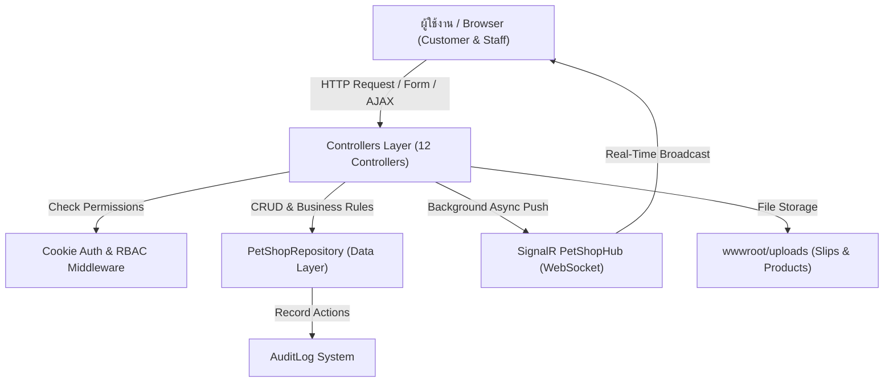

# คู่มือการทำงานเชิงลึกของ Controller ทุกฟังก์ชัน ทุกไฟล์ (Controller Architecture & Action Methods Specification)
## ระบบ PetStore Pro — ระบบการซื้อขายและของใช้สัตว์เลี้ยงออนไลน์
**รหัสวิชา:** CSI402 การเชื่อมต่อโปรแกรมส่วนหน้ากับโปรแกรมส่วนหลัง  
**คณะเทคโนโลยีสารสนเทศ มหาวิทยาลัยศรีปทุม**  
**มาตรฐานเอกสาร:** อธิบายการทำงานของทุก Controller และทุก Action Method อย่างละเอียด 100% ครบถ้วนตามซอร์สโค้ดจริง

---

## 📑 สารบัญภาพรวมระบบและรายชื่อ Controller (System Overview & Table of Contents)

ระบบ **PetStore Pro** ได้รับการพัฒนาขึ้นบนสถาปัตยกรรม **ASP.NET Core MVC (.NET 8/9)** ร่วมกับ **Repository Pattern**, **SignalR WebSocket Real-Time Communication**, **Cookie Authentication**, และ **Role-Based Access Control (RBAC)** โดยแบ่งส่วน Controller ออกเป็น **12 Controller files** รวมทั้งสิ้นมากกว่า **50+ Action Methods** ดังตารางสรุปต่อไปนี้:

| ลำดับที่ | ชื่อ Controller File | สิทธิ์การเข้าถึง (Authorization Roles) | วัตถุประสงค์หลักของโมดูล | จำนวน Action Methods |
|:---:|---|---|---|:---:|
| 1 | `AccountController.cs` | `[Authorize]` (Customer, Staff ทุกบทบาท) | จัดการข้อมูลส่วนตัว, สมุดที่อยู่, ประวัติคำสั่งซื้อ, แนบสลิป, แจ้งปัญหา | 10 ฟังก์ชัน |
| 2 | `AccountingController.cs` | `[Authorize(Roles = "AccountingStaff,Owner,Admin")]` | ตรวจสอบสลิป, อนุมัติ/ปฏิเสธเงิน, บันทึกรายจ่าย, ส่งออก CSV | 6 ฟังก์ชัน |
| 3 | `AdminController.cs` | `[Authorize(Roles = "Admin,Owner")]` | จัดการผู้ใช้งาน, ปรับเปลี่ยนบทบาท, ระงับบัญชี (เตะ Real-time), ตรวจสอบ Audit Log | 4 ฟังก์ชัน + Helper |
| 4 | `AuthController.cs` | เปิดสาธารณะ (Anonymous / Guest) | ระบบ Login, Quick Demo Login, Multi-Role Switcher, Register, Logout | 8 ฟังก์ชัน + Helper |
| 5 | `CartController.cs` | ผสมผสาน (Guest / `[Authorize]` ในขั้นตอนสั่งซื้อ) | ตะกร้าสินค้า, คำนวณโปรโมชั่น, AJAX Add/Update, สั่งซื้อ และ SignalR Broadcast | 8 ฟังก์ชัน |
| 6 | `HomeController.cs` | เปิดสาธารณะ (Guest & Customer) | หน้าร้านหลัก, ระบบตัวกรองสินค้าขั้นสูง, หน้าเจาะลึกสินค้า, สินค้าแนะนำ | 4 ฟังก์ชัน |
| 7 | `InventoryController.cs` | `[Authorize(Roles = "InventoryStaff,Owner,")]` | คลังสินค้า, ปรับสต็อกด่วน, เพิ่ม/แก้ไข/ลบสินค้า, แจ้งเตือน Low Stock | 8 ฟังก์ชัน |
| 8 | `MarketingController.cs` | `[Authorize(Roles = "MarketingStaff,Owner,Admin")]` | แดชบอร์ดโปรโมชั่น, สวิตช์เปิด/ปิด, สร้างและแก้ไขกฎโปรโมชั่น | 5 ฟังก์ชัน |
| 9 | `OrderController.cs` | `[Authorize(Roles = "OrderStaff,Owner,Admin")]` | คิวงานจัดเตรียมสินค้า, เปลี่ยนสถานะออเดอร์หลังชำระเงิน | 2 ฟังก์ชัน |
| 10 | `OwnerController.cs` | `[Authorize(Roles = "Owner")]` | Executive BI Dashboard ภาพรวมรายได้ ยอดขาย สัดส่วนหมวดหมู่ และสินค้าขายดี | 1 ฟังก์ชัน |
| 11 | `ShippingController.cs` | `[Authorize(Roles = "ShippingStaff,Owner,Admin")]` | คิวงานจัดส่งพัสดุ, ชั่งน้ำหนักจริง, ออกเลขพัสดุ (Tracking Number) | 2 ฟังก์ชัน |
| 12 | `SupportController.cs` | `[Authorize(Roles = "ITSupport,Owner,Admin")]` | IT Helpdesk Board, รับเรื่องและบันทึกแนวทางแก้ไขปัญหาทางเทคนิค | 2 ฟังก์ชัน |

---

## 1. AccountController.cs

* **ที่ตั้งไฟล์:** `Controllers/AccountController.cs`
* **การสืบทอดคลาส:** `Controller`
* **การกำหนดสิทธิ์ระดับคลาส:** `[Authorize]` (ผู้ใช้ต้องผ่านการพิสูจน์ตัวตนแล้วเท่านั้น)
* **Dependency Injection:**
  1. `PetShopRepository _repo`: เข้าถึงและประมวลผลข้อมูลในฐานข้อมูล/หน่วยความจำ
  2. `IWebHostEnvironment _env`: จัดการพาธโฟลเดอร์สำหรับอัปโหลดไฟล์ เช่น `wwwroot/slips`

---

### ฟังก์ชันที่ 1.1: `Profile()` [GET]
* **การทำงาน:** แสดงหน้าข้อมูลส่วนตัว (Profile View) และรายการสมุดที่อยู่จัดส่งของลูกค้า
* **HTTP Method:** `[HttpGet]`
* **สิทธิ์การใช้งาน:** ลูกค้าที่เข้าสู่ระบบ (`[Authorize]`)
* **พารามิเตอร์:** ไม่มี
* **กระบวนการทำงาน (Workflow Step-by-Step):**
  1. ดึงชื่อผู้ใช้ (`username`) จากข้อมูลตัวตน `User.Identity?.Name`
  2. เรียกคำสั่ง `_repo.GetUserByUsername(username)` เพื่อดึง Entity ของผู้ใช้งาน
  3. ตรวจสอบหากไม่พบผู้ใช้ในระบบ ให้ทำการ `RedirectToAction("Login", "Auth")`
  4. สร้าง Object `ProfileViewModel` และบรรจุข้อมูล: `Username`, `FullName`, `Email`, `Phone`, `Role` และรายการที่อยู่ `Addresses`
  5. ส่ง Model ไปยังหน้ามุมมอง `View(model)`
* **ผลลัพธ์ที่ส่งกลับ:** `IActionResult` (แสดงผลหน้า Profile View)

---

### ฟังก์ชันที่ 1.2: `UpdateProfile(ProfileViewModel model)` [POST]
* **การทำงาน:** บันทึกการแก้ไขข้อมูลส่วนตัวของลูกค้า (ชื่อ-นามสกุล, อีเมล, เบอร์โทรศัพท์)
* **HTTP Method:** `[HttpPost]`
* **ความปลอดภัย:** มีแอตทริบิวต์ `[ValidateAntiForgeryToken]` ป้องกันการโจมตีแบบ CSRF
* **พารามิเตอร์:** `ProfileViewModel model` (รับข้อมูลที่ผูกมาจากฟอร์มแก้ไข)
* **กระบวนการทำงาน (Workflow Step-by-Step):**
  1. ตรวจสอบชื่อผู้ใช้งานจาก `User.Identity?.Name`
  2. สั่งการบันทึกข้อมูลไปยัง Repository ผ่านคำสั่ง `_repo.UpdateUserProfile(username, model.FullName, model.Email, model.Phone)` ซึ่งจะทำการบันทึก Audit Log การแก้ไขข้อมูลส่วนตัวโดยอัตโนมัติ
  3. ตั้งค่าข้อความแจ้งเตือนความสำเร็จลงใน `TempData["SuccessMessage"] = "บันทึกข้อมูลส่วนตัวเรียบร้อยแล้ว"`
  4. ส่งกลับไปยังหน้าโปรไฟล์ด้วย `RedirectToAction(nameof(Profile))`
* **ผลลัพธ์ที่ส่งกลับ:** `RedirectToActionResult`

---

### ฟังก์ชันที่ 1.3: `SaveAddress(UserAddress address, string? returnUrl = null)` [POST]
* **การทำงาน:** เพิ่มที่อยู่จัดส่งใหม่ หรือแก้ไขที่อยู่จัดส่งเดิม (รองรับทั้งการ Submit แบบปกติ และ AJAX Request จากหน้า Checkout)
* **HTTP Method:** `[HttpPost]`
* **พารามิเตอร์:**
  * `UserAddress address`: ออบเจกต์ข้อมูลที่อยู่ (ชื่อผู้รับ, เบอร์โทร, รายละเอียดที่อยู่, จังหวัด, รหัสไปรษณีย์, สถานะที่อยู่หลัก)
  * `string? returnUrl`: URL ปลายทางที่ต้องการให้ Redirect กลับไปหลังจากบันทึกเสร็จ
* **กระบวนการทำงาน (Workflow Step-by-Step):**
  1. ดึงชื่อผู้ใช้งานปัจจุบันจาก `User.Identity?.Name`
  2. ตรวจสอบความถูกต้องของข้อมูล (Validation): ตรวจสอบว่า `FullAddress` และ `Province` ไม่เป็นค่าว่าง
     * หากข้อมูลไม่ครบถ้วน และคำขอเป็นแบบ AJAX (`X-Requested-With: XMLHttpRequest`) จะตอบกลับเป็น `Json(new { success = false, message = ... })`
     * หากเป็นฟอร์มปกติ จะตั้งค่า `TempData["ErrorMessage"]` แล้วส่งกลับไปยัง `returnUrl` หรือหน้า Profile
  3. เรียกคำสั่ง `_repo.AddOrUpdateAddress(username, address)` เพื่อบันทึกลงระบบ
  4. ตอบกลับผลลัพธ์:
     * หากเป็นคำขอ AJAX: ส่งผลลัพธ์กลับเป็น JSON Object ประกอบด้วย `id`, `title`, `recipientName`, `phone`, `displayAddress`, `isDefault`, และข้อความแจ้งเตือน เพื่อให้ JavaScript หน้าบ้านนำไปอัปเดต Dropdown ที่อยู่ทันทีโดยไม่ต้องโหลดหน้าซ้ำ
     * หากเป็นฟอร์มปกติ: แสดง Flash Message ผ่าน TempData และ Redirect กลับ
* **ผลลัพธ์ที่ส่งกลับ:** `JsonResult` หรือ `RedirectResult / LocalRedirectResult`

---

### ฟังก์ชันที่ 1.4: `DeleteAddress(int addressId)` [POST]
* **การทำงาน:** ลบข้อมูลที่อยู่จัดส่งที่ไม่ต้องการออกจากสมุดที่อยู่ของผู้ใช้
* **HTTP Method:** `[HttpPost]`
* **ความปลอดภัย:** `[ValidateAntiForgeryToken]`
* **พารามิเตอร์:** `int addressId` (รหัส ID ของที่อยู่ที่ต้องการลบ)
* **กระบวนการทำงาน (Workflow Step-by-Step):**
  1. ระบุชื่อผู้ใช้งานปัจจุบันจาก Claims
  2. สั่งการ Repository `_repo.DeleteAddress(username, addressId)` เพื่อลบรายการที่อยู่ออกจาก Entity ของผู้ใช้นั้น
  3. ตั้งค่า `TempData["SuccessMessage"] = "ลบที่อยู่จัดส่งเรียบร้อยแล้ว"`
  4. นำทางกลับไปยังหน้าโปรไฟล์ `RedirectToAction(nameof(Profile))`
* **ผลลัพธ์ที่ส่งกลับ:** `RedirectToActionResult`

---

### ฟังก์ชันที่ 1.5: `SetDefaultAddress(int addressId)` [POST]
* **การทำงาน:** กำหนดที่อยู่จัดส่งที่เลือกให้กลายเป็น "ที่อยู่หลัก (Default Address)" สำหรับใช้งานในการสั่งซื้อครั้งถัดไป
* **HTTP Method:** `[HttpPost]`
* **ความปลอดภัย:** `[ValidateAntiForgeryToken]`
* **พารามิเตอร์:** `int addressId` (รหัส ID ของที่อยู่ที่จะตั้งเป็นค่าเริ่มต้น)
* **กระบวนการทำงาน (Workflow Step-by-Step):**
  1. ดึงชื่อผู้ใช้งานปัจจุบัน
  2. เรียกใช้งานฟังก์ชัน `_repo.SetDefaultAddress(username, addressId)` ซึ่งระบบจะทำการปลดสถานะ `IsDefault = false` ของที่อยู่อื่นทั้งหมดของผู้ใช้นี้ แล้วตั้งค่าที่อยู่รายการนี้ให้เป็น `IsDefault = true`
  3. แสดงข้อความแจ้งเตือน "ตั้งเป็นที่อยู่จัดส่งหลักเรียบร้อยแล้ว"
  4. Redirect กลับสู่หน้าโปรไฟล์
* **ผลลัพธ์ที่ส่งกลับ:** `RedirectToActionResult`

---

### ฟังก์ชันที่ 1.6: `Orders(string? successOrderId = null)` [GET]
* **การทำงาน:** แสดงรายการประวัติและสถานะคำสั่งซื้อทั้งหมดของลูกค้าเจ้าของบัญชี
* **HTTP Method:** `[HttpGet]`
* **พารามิเตอร์:** `string? successOrderId` (รหัสคำสั่งซื้อที่เพิ่งทำรายการเสร็จ เพื่อนำไปไฮไลท์แสดงความยินดี)
* **กระบวนการทำงาน (Workflow Step-by-Step):**
  1. ดึงชื่อผู้ใช้งานจาก `User.Identity?.Name`
  2. จัดเก็บ `successOrderId` และ `CurrentRole` ลงใน `ViewBag` เพื่อใช้ควบคุมการแสดงผลบนหน้าเว็บ
  3. ดึงคำสั่งซื้อเฉพาะของผู้ใช้นี้ผ่านคำสั่ง `_repo.GetOrdersForUser(username)`
  4. ส่ง List ของออเดอร์ไปยังหน้า `View(orders)`
* **ผลลัพธ์ที่ส่งกลับ:** `ViewResult`

---

### ฟังก์ชันที่ 1.7: `UploadSlip(string orderId, IFormFile? paymentSlip)` [POST]
* **การทำงาน:** อัปโหลดหรือเปลี่ยนแปลงรูปภาพหลักฐานสลิปการโอนเงินย้อนหลัง (กรณีที่ตอนสั่งซื้อยังไม่ได้แนบสลิป)
* **HTTP Method:** `[HttpPost]`
* **พารามิเตอร์:**
  * `string orderId`: รหัสคำสั่งซื้อ
  * `IFormFile? paymentSlip`: ไฟล์รูปภาพสลิปที่ส่งมาจากเครื่องผู้ใช้
* **กระบวนการทำงาน (Workflow Step-by-Step):**
  1. ตรวจสอบความถูกต้องของไฟล์ หากไฟล์เป็นค่าว่างหรือขนาด 0 ไบต์ จะแจ้งข้อผิดพลาดและส่งกลับหน้า Orders
  2. ใช้ฟังก์ชันช่วย `FileUploadHelper.SaveImageAsync(paymentSlip, _env.WebRootPath, "slips")` ในการตรวจสอบนามสกุลไฟล์ที่ปลอดภัย (.jpg, .jpeg, .png, .webp), สร้างชื่อไฟล์แบบ Unique ป้องกันการทับซ้อน, และบันทึกลงในโฟลเดอร์ `wwwroot/uploads/slips`
  3. หากบันทึกไฟล์สำเร็จ จะเรียก `_repo.AttachPaymentSlip(username, orderId, uploadedUrl)` เพื่อบันทึก URL ของสลิปลงในออเดอร์
  4. ตรวจสอบเงื่อนไขทางธุรกิจ: หากคำสั่งซื้อนั้นถูกตรวจสอบและล็อกแล้ว จะไม่อนุญาตให้เปลี่ยนรูปสลิปอีกต่อไป
  5. ส่งข้อความแจ้งเตือนสถานะกลับไปยังหน้า Orders
* **ผลลัพธ์ที่ส่งกลับ:** `Task<IActionResult>` (RedirectToAction ไปยังหน้า Orders)

---

### ฟังก์ชันที่ 1.8: `CancelOrder(string orderId, string reason)` [POST]
* **การทำงาน:** ลูกค้ายื่นคำขอยกเลิกคำสั่งซื้อ หรือขอยื่นคืนเงินในกรณีที่สั่งซื้อผิดพลาด
* **HTTP Method:** `[HttpPost]`
* **พารามิเตอร์:**
  * `string orderId`: รหัสคำสั่งซื้อที่ต้องการยกเลิก
  * `string reason`: เหตุผลในการขอยกเลิก
* **กระบวนการทำงาน (Workflow Step-by-Step):**
  1. รับชื่อผู้ใช้จากระบบยืนยันตัวตน
  2. เรียกฟังก์ชัน `_repo.CancelOrder(username, orderId, reason)`
  3. Repository จะตรวจสอบสถานะคำสั่งซื้อ:
     * หากยังไม่ชำระเงิน จะทำการยกเลิกและคืนสต็อกสินค้าทันที
     * หากชำระเงินแล้ว จะปรับสถานะเป็น `RefundRequested` เพื่อส่งต่องานไปยังฝ่ายบัญชี
  4. แจ้งเตือนข้อความสถานะการดำเนินการผ่าน TempData และส่งกลับไปยังหน้าประวัติออเดอร์
* **ผลลัพธ์ที่ส่งกลับ:** `RedirectToActionResult`

---

### ฟังก์ชันที่ 1.9: `Support()` [GET]
* **การทำงาน:** แสดงหน้าจอศูนย์ช่วยเหลือลูกค้า (Helpdesk Support Portal) แสดงฟอร์มเปิดตั๋วแจ้งปัญหาและรายการตั๋วปัญหาเดิมที่ลูกค้าเคยส่งเข้ามา
* **HTTP Method:** `[HttpGet]`
* **พารามิเตอร์:** ไม่มี
* **กระบวนการทำงาน (Workflow Step-by-Step):**
  1. ดึงข้อมูล User ปัจจุบันผ่าน `_repo.GetUserByUsername(username)`
  2. ส่งข้อมูลผู้ใช้และบทบาทผ่าน `ViewBag.CurrentUser` และ `ViewBag.CurrentRole`
  3. ดึงรายการ Ticket ปัญหาที่ผูกกับอีเมลของลูกค้าคนนี้ผ่านคำสั่ง `_repo.GetSupportTickets(customerEmail: user?.Email)`
  4. เก็บผลลัพธ์ลงใน `ViewBag.MyTickets` และแสดงผลหน้า `View()`
* **ผลลัพธ์ที่ส่งกลับ:** `ViewResult`

---

### ฟังก์ชันที่ 1.10: `SubmitTicket(...)` [POST]
* **การทำงาน:** บันทึกการส่งตั๋วแจ้งปัญหาการใช้งานระบบจากลูกค้าเข้าสู่ฐานข้อมูล IT Support
* **HTTP Method:** `[HttpPost]`
* **พารามิเตอร์:**
  * `string customerName`: ชื่อผู้แจ้งปัญหา
  * `string email`: อีเมลติดต่อกลับ
  * `string? phone`: เบอร์โทรศัพท์ติดต่อกลับ
  * `string category`: หมวดหมู่ปัญหา (เช่น การสั่งซื้อ, การชำระเงิน, ปัญหาการจัดส่ง, การใช้งานระบบ)
  * `string subject`: หัวข้อเรื่องที่แจ้ง
  * `string description`: รายละเอียดของปัญหา
  * `TicketPriority priority`: ระดับความสำคัญ (Low, Normal, High, Urgent)
* **กระบวนการทำงาน (Workflow Step-by-Step):**
  1. ตรวจสอบข้อมูลผู้ใช้งานในระบบ หากไม่มีเบอร์โทรในฟอร์มจะดึงจากฐานข้อมูลโปรไฟล์
  2. สั่งสร้างตั๋วงานผ่านคำสั่ง `_repo.CreateSupportTicket(...)`
  3. ระบบจะออกรหัสอ้างอิงตั๋วปัญหาอัตโนมัติ (เช่น `TCK-202611-001`) และบันทึกลงฐานข้อมูลพร้อม Audit Log
  4. แจ้งรหัส Ticket ให้ลูกค้าทราบผ่าน Flash Message และ Redirect กลับไปหน้า Support
* **ผลลัพธ์ที่ส่งกลับ:** `RedirectToActionResult`

---

## 2. AccountingController.cs

* **ที่ตั้งไฟล์:** `Controllers/AccountingController.cs`
* **การสืบทอดคลาส:** `Controller`
* **การกำหนดสิทธิ์ระดับคลาส:** `[Authorize(Roles = "AccountingStaff,Owner,Admin")]` (เฉพาะฝ่ายบัญชีการเงิน, ผู้บริหาร และผู้ดูแลระบบ)
* **Dependency Injection:** `PetShopRepository _repo`

---

### ฟังก์ชันที่ 2.1: `Index()` [GET]
* **การทำงาน:** แสดงแดชบอร์ดภาพรวมการเงิน บัญชีรายรับ-รายจ่าย รายการรอตรวจสอบสลิป และรายการขอคืนเงิน
* **HTTP Method:** `[HttpGet]`
* **พารามิเตอร์:** ไม่มี
* **กระบวนการทำงาน (Workflow Step-by-Step):**
  1. ดึงรายการคำสั่งซื้อทั้งหมดจาก `_repo.Orders`
  2. เรียกรายงานสรุปทางการเงิน `_repo.GetFinancialSummary()` ประกอบด้วย ยอดขายรวม (Total Revenue), รายจ่ายรวม (Total Expenses), ยอดคืนเงินรวม (Total Refunds), กำไรสุทธิ (Net Profit) และตารางแจกแจงรายเดือน (Monthly Breakdown) บันทึกลงใน `ViewBag.FinancialSummary`
  3. คัดกรองออเดอร์ที่สถานะเป็น `PendingPayment` เก็บลง `ViewBag.PendingPayments` (สำหรับตรวจสอบสลิป)
  4. คัดกรองออเดอร์ที่สถานะเป็น `RefundRequested` เก็บลง `ViewBag.PendingRefunds` (สำหรับรออนุมัติการคืนเงิน)
  5. นำออเดอร์ล่าสุด 15 รายการส่งเป็น Model ให้กับหน้า `View(recentOrders)`
* **ผลลัพธ์ที่ส่งกลับ:** `ViewResult`

---

### ฟังก์ชันที่ 2.2: `ApprovePayment(string orderId, string? returnUrl = null, string? role = null)` [POST]
* **การทำงาน:** อนุมัติสลิปการโอนเงิน ยืนยันการรับเงิน และส่งคำสั่งซื้อเข้าสู่กระบวนการแพ็กสินค้า
* **HTTP Method:** `[HttpPost]`
* **พารามิเตอร์:**
  * `string orderId`: รหัสคำสั่งซื้อที่ต้องการอนุมัติ
  * `string? returnUrl`: หน้าปลายทางที่ต้องการให้กลับไป
  * `string? role`: บทบาทปัจจุบันที่ใช้งานอยู่
* **กระบวนการทำงาน (Workflow Step-by-Step):**
  1. เรียกใช้คำสั่ง `_repo.ApprovePayment(orderId)`
  2. Repository จะทำการตรวจสอบ:
     * เปลี่ยนสถานะออเดอร์จาก `PendingPayment` เป็น `PaymentVerified`
     * ปรับปรุงยอดรายรับจริงในสรุปบัญชีการเงิน
     * บันทึกบันทึกกิจกรรม Audit Log (`APPROVE_PAYMENT`)
  3. แจ้งเตือนข้อความสำเร็จ: ยืนยันการอนุมัติและแจ้งว่าออเดอร์ถูกส่งไปยังคิวฝ่ายจัดเตรียมสินค้าแล้ว
  4. Redirect กลับไปยัง `returnUrl` หรือหน้า `Index`
* **ผลลัพธ์ที่ส่งกลับ:** `IActionResult`

---

### ฟังก์ชันที่ 2.3: `RejectPayment(string orderId, string reason, string? returnUrl = null, string? role = null)` [POST]
* **การทำงาน:** ปฏิเสธหลักฐานการชำระเงิน (กรณีสลิปปลอม, โอนเงินไม่ครบ, สลิปซ้ำ) และทำการคืนสต็อกสินค้าอัตโนมัติ
* **HTTP Method:** `[HttpPost]`
* **พารามิเตอร์:**
  * `string orderId`: รหัสคำสั่งซื้อ
  * `string reason`: เหตุผลที่ปฏิเสธสลิป
* **กระบวนการทำงาน (Workflow Step-by-Step):**
  1. ดำเนินการผ่าน `_repo.RejectPayment(orderId, reason)`
  2. ระบบจะปรับสถานะออเดอร์เป็นถูกยกเลิก/ปฏิเสธ
  3. คืนสต็อกสินค้า (Restock) ทุกชิ้นที่อยู่ในออเดอร์นั้นกลับคืนสู่คลังสินค้าแบบอัตโนมัติ
  4. บันทึกประวัติ Audit Log พร้อมระบุเหตุผลการปฏิเสธ
  5. แสดงผลข้อความสำเร็จและนำทางกลับสู่หน้า Index
* **ผลลัพธ์ที่ส่งกลับ:** `IActionResult`

---

### ฟังก์ชันที่ 2.4: `ApproveRefund(string orderId, string? returnUrl = null, string? role = null)` [POST]
* **การทำงาน:** อนุมัติการคืนเงินให้แก่ลูกค้าที่มีการขอยกเลิกออเดอร์ที่ชำระเงินแล้ว
* **HTTP Method:** `[HttpPost]`
* **พารามิเตอร์:** `string orderId` (รหัสคำสั่งซื้อ)
* **กระบวนการทำงาน (Workflow Step-by-Step):**
  1. เรียกใช้ `_repo.ApproveRefund(orderId)`
  2. ปรับสถานะคำสั่งซื้อเป็น `Refunded`
  3. คำนวณหักลบยอดคืนเงินออกจากยอดขายสุทธิในระบบบัญชี
  4. บันทึกเหตุการณ์ลงใน Audit Trail
  5. ส่งข้อความแจ้งเตือนยอดเงินที่ทำการคืนสำเร็จ
* **ผลลัพธ์ที่ส่งกลับ:** `IActionResult`

---

### ฟังก์ชันที่ 2.5: `SaveMonthlyExpense(string month, decimal expenses)` [POST]
* **การทำงาน:** บันทึกรายจ่ายจริงประจำเดือน (เช่น ค่าเช่าคลังสินค้า, ค่าจ้างพนักงาน, ค่าน้ำ-ค่าไฟ) เพื่อใช้ในการคำนวณกำไรสุทธิ
* **HTTP Method:** `[HttpPost]`
* **พารามิเตอร์:**
  * `string month`: เดือนที่ต้องการบันทึก (รูปแบบ `YYYY-MM`)
  * `decimal expenses`: ยอดจำนวนเงินรายจ่าย (บาท)
* **กระบวนการทำงาน (Workflow Step-by-Step):**
  1. ตรวจสอบว่าได้ระบุเดือนหรือไม่ หากไม่ระบุจะแจ้งเตือนความผิดพลาด
  2. เรียกใช้งานฟังก์ชัน `_repo.SaveMonthlyExpense(month, expenses)`
  3. ระบบจะบันทึกหรืออัปเดตข้อมูลรายจ่ายประจำเดือนลงในฐานข้อมูล และคำนวณกำไรสุทธิของเดือนนั้นใหม่
  4. แสดง Flash Message บันทึกข้อมูลสำเร็จ และ Redirect กลับหน้า Index
* **ผลลัพธ์ที่ส่งกลับ:** `RedirectToActionResult`

---

### ฟังก์ชันที่ 2.6: `ExportFinancialCsv()` [GET]
* **การทำงาน:** ประมวลผลและส่งออกรายงานบัญชีรายรับ-รายจ่าย กำไรสุทธิ ออกมาเป็นไฟล์สเปรดชีต CSV
* **HTTP Method:** `[HttpGet]`
* **พารามิเตอร์:** ไม่มี
* **กระบวนการทำงาน (Workflow Step-by-Step):**
  1. ดึงข้อมูลสรุปการเงินผ่าน `_repo.GetFinancialSummary()`
  2. ใช้ `StringBuilder` ในการสร้างข้อความ CSV โดยมีคอลัมน์: `Month,Revenue(THB),Expenses(THB),Profit(THB)`
  3. วนลูปนำข้อมูลใน `MonthlyBreakdown` เขียนลงในแต่ละแถว
  4. สรุปผลรวมท้ายตาราง: ยอดรวมรายรับ (Total Revenue), ยอดรวมรายจ่าย (Total Expenses), ยอดคืนเงิน (Total Refunds) และกำไรสุทธิ (Net Profit)
  5. แปลงข้อความเป็น Byte Array พร้อมทั้งแทรก **UTF-8 BOM (Byte Order Mark)** เพื่อป้องกันปัญหาภาษาไทยเพี้ยนเมื่อเปิดด้วยโปรแกรม Microsoft Excel
  6. ตั้งชื่อไฟล์ตามวันที่ปัจจุบัน (เช่น `financial_report_20261125.csv`)
  7. ส่งคืนไฟล์ให้เบราว์เซอร์ดาวน์โหลดด้วย MIME Type `text/csv; charset=utf-8`
* **ผลลัพธ์ที่ส่งกลับ:** `FileContentResult`

---

## 3. AdminController.cs

* **ที่ตั้งไฟล์:** `Controllers/AdminController.cs`
* **การสืบทอดคลาส:** `Controller`
* **การกำหนดสิทธิ์ระดับคลาส:** `[Authorize(Roles = "Admin,Owner")]` (เฉพาะผู้ดูแลระบบและผู้บริหารสูงสุด)
* **Dependency Injection:**
  1. `PetShopRepository _repo`
  2. `IHubContext<PetShopHub> _hubContext`: SignalR WebSocket สำหรับส่งการแจ้งเตือน Real-Time ทั่วทั้งระบบ

---

### ฟังก์ชันช่วยเหลือภายใน: `IsCurrentOperatorOwner(string? roleParam)` (Private Helper)
* **หน้าที่:** ตรวจสอบว่าผู้ใช้งานที่กำลังกระทำการอยู่ในขณะนั้นมีอำนาจสิทธิ์เป็น "Owner" หรือไม่ โดยตรวจสอบจากทั้ง Parameter จำลองบทบาท (`roleParam`) และ Claims ของระบบ เพื่อบังคับใช้หลักการความปลอดภัยสูงสุด (Security Governance Rule):
  > **กฎความปลอดภัย:** บัญชีระดับ Admin ทั่วไปจะ**ไม่สามารถ**แก้ไข, ระงับ, ปลดสิทธิ์บัญชี Admin ด้วยกันเอง หรือบัญชี Owner ได้ และไม่สามารถแต่งตั้งใครให้เป็น Admin/Owner ได้ (สิทธิ์นี้สงวนไว้ให้ Owner เท่านั้น)

---

### ฟังก์ชันที่ 3.1: `Index(...)` [GET]
* **การทำงาน:** แสดงหน้ากระดานบริหารจัดการบัญชีผู้ใช้งาน สิทธิ์การเข้าถึง และระบบค้นหา/กรองผู้ใช้
* **HTTP Method:** `[HttpGet]`
* **พารามิเตอร์:**
  * `string? role`: บทบาทที่กำลังเรียกดู
  * `string? roleFilter = "all"`: ตัวกรองประเภทบัญชี (all, staff, customer หรือบทบาทเฉพาะ)
  * `string? search`: คำค้นหา (Username, FullName, Email)
* **กระบวนการทำงาน (Workflow Step-by-Step):**
  1. ดึงรายชื่อผู้ใช้ทั้งหมดในระบบ
  2. ทำการตรวจสอบและรีเฟรชสถานะการระงับบัญชี (`_repo.CheckAndRefreshUserSuspension(u)`) สำหรับบัญชีที่ถูกระงับชั่วคราวและครบกำหนดเวลาแล้ว ให้ปลดระงับอัตโนมัติ
  3. คำนวณยอดสถิติ: ผู้ใช้ทั้งหมด (TotalUsers), จำนวนพนักงาน (TotalStaff), จำนวนลูกค้า (TotalCustomers)
  4. คัดกรองข้อมูลตามเงื่อนไข `roleFilter` และค้นหาข้อความจาก `search`
  5. ส่งผลลัพธ์รายการผู้ใช้ที่ผ่านการคัดกรองไปยัง `View(filtered.ToList())`
* **ผลลัพธ์ที่ส่งกลับ:** `ViewResult`

---

### ฟังก์ชันที่ 3.2: `UpdateUserRole(...)` [POST]
* **การทำงาน:** ปรับเปลี่ยนบทบาทหน้าที่ของพนักงาน หรือสั่งระงับบัญชีผู้ใช้งาน พร้อมกำหนดเหตุผลและระยะเวลา โดยมีระบบเตะออกจากระบบทันทีแบบ Real-Time ผ่าน SignalR
* **HTTP Method:** `[HttpPost]`
* **พารามิเตอร์:**
  * `int userId`: รหัสผู้ใช้ที่ต้องการแก้ไข
  * `UserRole newRole`: บทบาทใหม่ที่ต้องการมอบหมาย
  * `bool isActive`: สถานะเปิดใช้งาน (`true`) หรือระงับการใช้งาน (`false`)
  * `string? suspendReason`: เหตุผลในการระงับบัญชี
  * `int suspendDurationMinutes`: ระยะเวลาระงับ (นาที) หรือ `-1` สำหรับระงับถาวร
* **กระบวนการทำงาน (Workflow Step-by-Step):**
  1. ตรวจสอบสิทธิ์ผู้กระทำการด้วย `IsCurrentOperatorOwner(role)`
  2. ค้นหาเป้าหมาย `targetUser` หากไม่พบจะแจ้ง Error
  3. ตรวจสอบกฎความปลอดภัย: หากผู้สั่งการไม่ใช่ Owner แต่พยายามแก้ไขบัญชี Admin/Owner หรือพยายามแต่งตั้งใครเป็น Admin/Owner ระบบจะบล็อกและแจ้งเตือนทันที
  4. เรียกคำสั่ง `_repo.UpdateUserRole(...)` เพื่อบันทึกข้อมูลลงฐานข้อมูลและ Audit Log
  5. **กรณีการระงับบัญชี (`!isActive`):**
     * ระบบจะส่งสัญญาณ WebSocket ผ่าน SignalR Hub ไปยังไคลเอนต์ทั้งหมดทันที:
       `_hubContext.Clients.All.SendAsync("ReceiveAccountSuspended", targetUser.Username, targetUser.Role.ToString(), reasonText, untilText)`
     * ทุกหน้าจอหรือแท็บเบราว์เซอร์ที่ผู้ใช้รายนี้กำลังล็อกอินอยู่ จะถูกเตะออกจากระบบและแสดงข้อความแจ้งเตือนเหตุผลการระงับทันทีโดยไม่ต้องรอโหลดหน้าใหม่
  6. แสดง Flash Message และ Redirect กลับสู่หน้ารายการผู้ใช้
* **ผลลัพธ์ที่ส่งกลับ:** `Task<IActionResult>`

---

### ฟังก์ชันที่ 3.3: `CreateUser(SystemUser user, string? newUserRole = null, string? role = null)` [POST]
* **การทำงาน:** สร้างบัญชีผู้ใช้งานใหม่ลงในฐานข้อมูลระบบ (สำหรับสร้างบัญชีพนักงานฝ่ายต่างๆ หรือลูกค้า)
* **HTTP Method:** `[HttpPost]`
* **พารามิเตอร์:**
  * `SystemUser user`: ข้อมูลผู้ใช้งานที่กรอกจากฟอร์ม (Username, Password, FullName, Email, Phone)
  * `string? newUserRole`: บทบาทที่ต้องการมอบหมายให้แก่ผู้ใช้ใหม่
* **กระบวนการทำงาน (Workflow Step-by-Step):**
  1. แปลงค่า `newUserRole` เป็น Enum `UserRole` และผูกเข้ากับ Object
  2. ตรวจสอบกฎความปลอดภัย: ป้องกันไม่ให้ Admin ทั่วไปสร้างบัญชี Admin หรือ Owner โดยไม่ได้รับอนุญาต
  3. เรียกคำสั่ง `_repo.CreateUser(user)` เพื่อตรวจสอบความซ้ำซ้อนของ Username/Email และบันทึกลงในระบบ
  4. บันทึกผลลัพธ์และแจ้งเตือนสถานะความสำเร็จหรือข้อผิดพลาด
  5. Redirect กลับหน้า Index
* **ผลลัพธ์ที่ส่งกลับ:** `IActionResult`

---

### ฟังก์ชันที่ 3.4: `AuditLogs(...)` [GET]
* **การทำงาน:** แสดงหน้าประวัติบันทึกกิจกรรมย้อนหลัง (Audit Trail Log) ของทุกการกระทำสำคัญในระบบ เพื่อความโปร่งใสและการตรวจสอบย้อนหลัง
* **HTTP Method:** `[HttpGet]`
* **พารามิเตอร์:**
  * `string? search`: คำค้นหา (Username, Action, Table, RecordId, รายละเอียด, IP Address)
  * `string? roleFilter`: กรองตามบทบาทผู้ใช้งาน
  * `string? actionFilter`: กรองตามประเภทของ Action (เช่น LOGIN, UPDATE_USER_ROLE, PAYMENT)
* **กระบวนการทำงาน (Workflow Step-by-Step):**
  1. ดึงบันทึกกิจกรรมล่าสุด 500 รายการผ่าน `_repo.GetAuditLogs(500)`
  2. คำนวณสถิติแยกตามหมวดหมู่: Security Logs (การแก้ไขสิทธิ์/ระงับบัญชี), Finance Logs (การเงิน/ชำระเงิน), Inventory Logs (สินค้า/สต็อก)
  3. ทำการคัดกรองข้อมูลตามบทบาท ประเภทแอ็กชัน และคำค้นหาที่ผู้ใช้ระบุ
  4. ส่ง List ของบันทึกกิจกรรมไปแสดงผลใน `View(logs)`
* **ผลลัพธ์ที่ส่งกลับ:** `ViewResult`

---

## 4. AuthController.cs

* **ที่ตั้งไฟล์:** `Controllers/AuthController.cs`
* **การสืบทอดคลาส:** `Controller`
* **การกำหนดสิทธิ์:** เปิดสาธารณะ (Anonymous) เพื่อให้ผู้ใช้เข้าสู่ระบบ สมัครสมาชิก หรือสลับบทบาทได้
* **Dependency Injection:** `PetShopRepository _repo`

---

### ฟังก์ชันที่ 4.1: `Login(...)` [GET]
* **การทำงาน:** แสดงหน้าฟอร์มเข้าสู่ระบบ พร้อมแสดงรายการบัญชีตัวอย่าง (Demo Users) สำหรับการทดสอบ และรองรับการแจ้งเตือนกรณีบัญชีถูกระงับ
* **HTTP Method:** `[HttpGet]`
* **พารามิเตอร์:**
  * `string? returnUrl`: URL ที่ต้องการให้ส่งกลับไปหลังจากเข้าสู่ระบบสำเร็จ
  * `bool suspended`: ตัวบ่งชี้ว่าบัญชีถูกสั่งระงับหรือไม่
  * `string? u`: ชื่อผู้ใช้งานที่ถูกระงับ
  * `string? reason`: เหตุผลในการระงับ
  * `string? until`: วันเวลาที่สิ้นสุดการระงับ
* **กระบวนการทำงาน (Workflow Step-by-Step):**
  1. ตรวจสอบสถานะการระงับบัญชี หากมีพารามิเตอร์ระงับ จะดึงข้อมูลจาก DB เพื่อแสดงเหตุผลและระยะเวลาการระงับในหน้า View
  2. เรียกฟังก์ชันภายใน `GetDemoRoleUsers()` เพื่อดึงรายการบัญชีตัวอย่างของทุก Role มาแสดงเป็น Quick Login Buttons
  3. ส่งโมเดล `LoginViewModel` ไปยังหน้า `View`
* **ผลลัพธ์ที่ส่งกลับ:** `ViewResult`

---

### ฟังก์ชันที่ 4.2: `Login(LoginViewModel model)` [POST]
* **การทำงาน:** ตรวจสอบข้อมูลประจำตัว ยืนยันรหัสผ่าน ตรวจสอบสถานะการระงับบัญชี สร้างเซสชัน Cookie Authentication และ Merge ตะกร้าสินค้า
* **HTTP Method:** `[HttpPost]`, `[IgnoreAntiforgeryToken]`
* **พารามิเตอร์:** `LoginViewModel model` (Username, Password, RememberMe, ReturnUrl)
* **กระบวนการทำงาน (Workflow Step-by-Step):**
  1. ตรวจสอบความถูกต้องของโมเดล (`ModelState.IsValid`)
  2. ตรวจสอบสถานะบัญชีก่อน: หากรหัสผ่านถูกต้องแต่บัญชีมีสถานะ `IsActive == false` ระบบจะปฏิเสธการเข้าสู่ระบบทันที พร้อมแจ้งข้อความเหตุผลและระยะเวลาที่ถูกระงับ
  3. ตรวจสอบความถูกต้องของ Username และ Password ผ่าน `_repo.ValidateUser(model.Username, model.Password)`
  4. เมื่อตรวจสอบผ่าน:
     * เรียก `SignInUserAsync(user, model.RememberMe)` เพื่อสร้าง Cookie Authentication Ticket และออก Claims สิทธิ์
     * เรียก `_repo.MergeGuestCartToUser(user.Id)` เพื่อนำสินค้าที่หยิบใส่ตะกร้าค้างไว้ช่วงเป็น Guest เข้าสู่ตะกร้าของ User ในฐานข้อมูล
     * บันทึกบันทึกกิจกรรม `_repo.LogAudit("LOGIN", ...)`
  5. นำทางผู้ใช้งานไปยังหน้าแดชบอร์ดหลักตามบทบาทหน้าที่ของตนเองผ่าน `RedirectToRoleHome(user.Role.ToString(), user.Username)`
* **ผลลัพธ์ที่ส่งกลับ:** `Task<IActionResult>`

---

### ฟังก์ชันที่ 4.3: `QuickLogin(string? username = null, string? returnUrl = null)` [GET/POST]
* **การทำงาน:** ฟังก์ชันสำหรับทดสอบระบบแบบคลิกเดียว (1-Click Demo Login) เพื่อความสะดวกรวดเร็วในการตรวจงานและสาธิตการทำงานของแต่ละบทบาท
* **HTTP Method:** `[HttpGet]`, `[HttpPost]`, `[IgnoreAntiforgeryToken]`
* **พารามิเตอร์:** `string? username` (ชื่อบัญชี หรือชื่อบทบาทที่ต้องการเข้าใช้งาน)
* **กระบวนการทำงาน (Workflow Step-by-Step):**
  1. ค้นหาผู้ใช้จาก Username หรือชื่อ Role ผ่าน Helper `DemoUserHelper.GetDemoUserInfo`
  2. ตรวจสอบสถานะการระงับบัญชีอย่างเข้มงวด: หากบัญชีถูกระงับอยู่ จะไม่อนุญาตให้ล็อกอินเด็ดขาด และจะ Redirect ไปยังหน้า Login พร้อมแสดงรายละเอียดการระงับ
  3. ออกบัตรประจำตัว Cookie Session ผ่าน `SignInUserAsync`
  4. ทำการ Merge ตะกร้าสินค้า และบันทึก Audit Log (`QUICK_LOGIN`)
  5. Redirect นำทางไปยังหน้าหลักของบทบาทนั้นทันที
* **ผลลัพธ์ที่ส่งกลับ:** `Task<IActionResult>`

---

### ฟังก์ชันที่ 4.4: `SwitchRole(string role, string? returnUrl = null)` [GET]
* **การทำงาน:** สลับมุมมองบทบาทการทำงานแบบ Real-Time (Multi-Role Switcher Bar) โดยไม่ต้องกรอกรหัสผ่านซ้ำ
* **HTTP Method:** `[HttpGet]`
* **พารามิเตอร์:** `string role` (ชื่อบทบาทที่ต้องการสลับไป เช่น Owner, Admin, AccountingStaff)
* **กระบวนการทำงาน (Workflow Step-by-Step):**
  1. ค้นหาข้อมูลบัญชีประจำบทบาทที่เลือก
  2. ตรวจสอบว่าบัญชีดังกล่าวถูกสั่งระงับหรือไม่ หากถูกระงับจะสั่ง SignOut และแสดงข้อความเตือน
  3. หากสถานะปกติ จะสั่ง `SignInUserAsync` เพื่อออก Claims ประจำบทบาทใหม่ทันที
  4. บันทึกประวัติการสลับบทบาทลงใน Audit Log
  5. ส่งผู้ใช้งานไปยังหน้าแรกของบทบาทที่เพิ่งสลับไป
* **ผลลัพธ์ที่ส่งกลับ:** `Task<IActionResult>`

---

### ฟังก์ชันที่ 4.5: `Register()` [GET]
* **การทำงาน:** แสดงหน้าฟอร์มสำหรับสมัครสมาชิกใหม่สำหรับลูกค้า
* **HTTP Method:** `[HttpGet]`
* **พารามิเตอร์:** ไม่มี
* **ผลลัพธ์ที่ส่งกลับ:** `View(new RegisterViewModel())`

---

### ฟังก์ชันที่ 4.6: `Register(RegisterViewModel model)` [POST]
* **การทำงาน:** ประมวลผลการสมัครสมาชิก ตรวจสอบความซ้ำซ้อน บันทึกข้อมูลลูกค้าใหม่ลงฐานข้อมูล และล็อกอินให้อัตโนมัติทันที
* **HTTP Method:** `[HttpPost]`, `[IgnoreAntiforgeryToken]`
* **พารามิเตอร์:** `RegisterViewModel model` (ชื่อผู้ใช้, รหัสผ่าน, ชื่อนามสกุล, อีเมล, เบอร์โทรศัพท์)
* **กระบวนการทำงาน (Workflow Step-by-Step):**
  1. ตรวจสอบความสมบูรณ์ของฟอร์มผ่าน Data Annotations
  2. เรียกใช้งาน `_repo.RegisterCustomer(model)`
  3. หากพบว่า Username หรือ Email มีอยู่ในระบบแล้ว จะแสดงข้อผิดพลาด `ModelState.AddModelError`
  4. เมื่อลงทะเบียนสำเร็จ ระบบจะทำการล็อกอินให้อัตโนมัติ (`SignInUserAsync`), รวมตะกร้าสินค้าจาก Guest เข้าสู่ User, และ Redirect ไปยังหน้าร้านค้าหลัก
* **ผลลัพธ์ที่ส่งกลับ:** `Task<IActionResult>`

---

### ฟังก์ชันที่ 4.7: `Logout()` [GET/POST]
* **การทำงาน:** ออกจากระบบ ทำลายเซสชัน Cookie Authentication และบันทึกประวัติการออกจากระบบ
* **HTTP Method:** `[HttpGet]`, `[HttpPost]`, `[IgnoreAntiforgeryToken]`
* **กระบวนการทำงาน (Workflow Step-by-Step):**
  1. บันทึกกิจกรรม Audit Log (`LOGOUT`)
  2. เรียกใช้งานคำสั่ง `HttpContext.SignOutAsync(CookieAuthenticationDefaults.AuthenticationScheme)` เพื่อเพิกถอน Cookie ในเบราว์เซอร์
  3. ตั้งค่า Flash Message "คุณได้ออกจากระบบเรียบร้อยแล้ว"
  4. นำทางกลับไปยังหน้า Home ในสถานะ Guest
* **ผลลัพธ์ที่ส่งกลับ:** `Task<IActionResult>`

---

### ฟังก์ชันที่ 4.8: `AccessDenied()` [GET]
* **การทำงาน:** แสดงหน้าแจ้งเตือนการปฏิเสธสิทธิ์การเข้าถึง (403 Forbidden UI) เมื่อผู้ใช้พยายามเข้า URL ที่ตนเองไม่มีสิทธิ์ในบทบาทนั้น
* **HTTP Method:** `[HttpGet]`
* **ผลลัพธ์ที่ส่งกลับ:** `ViewResult`

---

### ฟังก์ชันและ Helper ภายในของ AuthController:
* **`SignInUserAsync(SystemUser user, bool isPersistent)`:**
  * สร้าง Claim List ประกอบด้วย `NameIdentifier` (User ID), `Name` (Username), `Role`, `FullName`, `Email`, `Phone`
  * **รองรับ Multi-Role Testing:** หากผู้ใช้เป็น `Owner` หรือ `Admin` ฟังก์ชันจะเพิ่ม Claims ของทุก Role ในระบบเข้าไปด้วยโดยอัตโนมัติ ทำให้สามารถเปิดหลายแท็บและทดสอบทุกหน้าจอได้อย่างอิสระโดยไม่ติดปัญหา Access Denied
  * สร้าง `ClaimsPrincipal` และสั่ง `HttpContext.SignInAsync` พร้อมกำหนดอายุการใช้งาน Cookie นานสูงสุด 8 ชั่วโมง
* **`RedirectToRoleHome(string? role, string? username = null)`:** นำทางผู้ใช้ไปยัง Action `Index` ของ Controller ที่ตรงตามบทบาทของตนเอง เช่น Inventory, Order, Shipping, Accounting, Support, Admin, Owner หรือ Home

---

## 5. CartController.cs

* **ที่ตั้งไฟล์:** `Controllers/CartController.cs`
* **การสืบทอดคลาส:** `Controller`
* **Dependency Injection:**
  1. `PetShopRepository _repo`
  2. `IHubContext<PetShopHub> _hubContext`: SignalR WebSocket สำหรับบรอดแคสต์สต็อกและยอดสินค้าในตะกร้าแบบ Real-Time
  3. `IWebHostEnvironment _env`: จัดการไฟล์รูปสลิปโอนเงิน

---

### ฟังก์ชันที่ 5.1: `Index()` [GET]
* **การทำงาน:** แสดงหน้าตะกร้าสินค้า รายการสินค้าที่เลือก คำนวณส่วนลดตาม 5 โปรโมชั่นอัตโนมัติ และคำนวณยอดเงินสุทธิ
* **HTTP Method:** `[HttpGet]`
* **กระบวนการทำงาน (Workflow Step-by-Step):**
  1. ดึงโปรโมชั่นที่กำลังเปิดใช้งานและยังไม่หมดอายุผ่าน `_repo.GetValidPromotions()`
  2. นำตะกร้าสินค้าของผู้ใช้ปัจจุบัน `_repo.CurrentCart` มาประมวลผลคำนวณราคา ส่วนลด และค่าจัดส่ง
  3. ส่งโมเดลตะกร้าสินค้าไปยังหน้า `View(_repo.CurrentCart)`
* **ผลลัพธ์ที่ส่งกลับ:** `ViewResult`

---

### ฟังก์ชันที่ 5.2: `Add(int productId, int quantity = 1, string returnUrl = "/Cart")` [POST]
* **การทำงาน:** หยิบสินค้าใส่ตะกร้า (รองรับทั้ง AJAX Optimistic UI และ Form Submission) พร้อมตรวจสอบการเข้าสู่ระบบ และบรอดแคสต์ข้อมูลผ่าน SignalR
* **HTTP Method:** `[HttpPost]`
* **พารามิเตอร์:**
  * `int productId`: รหัสสินค้าที่ต้องการเพิ่ม
  * `int quantity`: จำนวนสินค้า (ค่าเริ่มต้นคือ 1)
  * `string returnUrl`: URL ที่ต้องการให้ย้อนกลับ
* **กระบวนการทำงาน (Workflow Step-by-Step):**
  1. ตรวจสอบการยืนยันตัวตน (`User?.Identity?.IsAuthenticated`): หากเป็น Guest ระบบจะไม่อนุญาตให้หยิบสินค้า และจะตอบกลับเป็น JSON พร้อม URL ล็อกอิน (กรณี AJAX) หรือ Redirect ไปหน้า Login
  2. เรียกใช้งาน `_repo.AddToCart(productId, quantity)` เพื่อเพิ่มรายการเข้าสู่ตะกร้า และเพิ่มตัวนับ Social Proof `CartAddCount`
  3. **SignalR Background Broadcast (`Task.Run`):**
     * ส่งยอดคนใส่ตะกร้าแบบ Real-Time: `ReceiveCartCountUpdate`
     * ส่งยอดสต็อกคงเหลือปัจจุบัน: `ReceiveStockUpdate`
     * หากสต็อกสินค้าเข้าสู่เกณฑ์ Low Stock จะส่งการแจ้งเตือนเตือนภัย `ReceiveLowStockAlert` ไปยังหน้าจอพนักงานทันที
  4. ตอบกลับผลลัพธ์:
     * หากเป็นคำขอ AJAX: ส่งคืน JSON Object ประกอบด้วย `cartCount`, `remainingStock`, `isOutOfStock`, และข้อความแจ้งเตือน เพื่อให้หน้าบ้านอัปเดต Badge บนแถบเมนูได้ทันทีโดยไม่ต้องโหลดหน้าใหม่
     * หากเป็นฟอร์มปกติ: สั่ง Redirect ไปยัง `returnUrl` หรือหน้าตะกร้า
* **ผลลัพธ์ที่ส่งกลับ:** `Task<IActionResult>` (JsonResult หรือ RedirectResult)

---

### ฟังก์ชันที่ 5.3: `Update(int productId, int quantity)` [POST]
* **การทำงาน:** ปรับปรุงจำนวนชิ้นของสินค้าที่มีอยู่ในตะกร้า (เพิ่ม/ลด)
* **HTTP Method:** `[HttpPost]`
* **พารามิเตอร์:** `int productId`, `int quantity` (จำนวนใหม่ที่ระบุ)
* **กระบวนการทำงาน (Workflow Step-by-Step):**
  1. สั่งการ Repository `_repo.UpdateCartItem(productId, quantity)`
  2. ดึงข้อมูลสินค้าล่าสุดและส่งสัญญาณ SignalR อัปเดตสต็อกคงเหลือและการแจ้งเตือน Low Stock
  3. นำทางกลับไปยังหน้าตะกร้าสินค้า `RedirectToAction(nameof(Index))`
* **ผลลัพธ์ที่ส่งกลับ:** `Task<IActionResult>`

---

### ฟังก์ชันที่ 5.4: `Remove(int productId)` [POST]
* **การทำงาน:** ลบรายการสินค้าชิ้นนั้นออกจากตะกร้าสินค้า
* **HTTP Method:** `[HttpPost]`
* **พารามิเตอร์:** `int productId` (รหัสสินค้าที่ต้องการลบ)
* **กระบวนการทำงาน (Workflow Step-by-Step):**
  1. เรียกใช้ `_repo.RemoveFromCart(productId)`
  2. ส่งสัญญาณ SignalR เพื่ออัปเดตสถานะสต็อกให้หน้าจออื่นๆ ทราบ
  3. สั่ง Refresh กลับหน้าตะกร้าสินค้า
* **ผลลัพธ์ที่ส่งกลับ:** `Task<IActionResult>`

---

### ฟังก์ชันที่ 5.5: `Checkout()` [GET]
* **การทำงาน:** หน้าสรุปยอดการสั่งซื้อ ขั้นตอนเลือกที่อยู่จัดส่ง และสร้าง Dynamic QR Code พร้อมเพย์
* **HTTP Method:** `[HttpGet]`
* **การกำหนดสิทธิ์:** `[Authorize]` (ต้องล็อกอินเพื่อเชื่อมโยงออเดอร์กับ User)
* **กระบวนการทำงาน (Workflow Step-by-Step):**
  1. ตรวจสอบตะกร้าสินค้า หากไม่มีสินค้าอยู่ในตะกร้า จะส่งกลับไปยังหน้า Cart Index
  2. เรียกใช้งานฟังก์ชันช่วย `PromptPayHelper.GeneratePayload("0812345678", cart.GrandTotal)` เพื่อสร้างสตริงข้อมูลมาตรฐาน PromptPay QR Code ตามมาตรฐาน EMVCo โดยระบุยอดเงินสุทธิที่ต้องชำระ
  3. นำ Payload ไปเก็บไว้ใน `ViewBag.PromptPayPayload` เพื่อให้ View นำไปแปลงเป็น QR Code ให้ลูกค้าสแกนจ่ายเงินได้ทันที
  4. แสดงผลหน้า `View(cart)`
* **ผลลัพธ์ที่ส่งกลับ:** `IActionResult`

---

### ฟังก์ชันที่ 5.6: `GetCourierCalculation(string courier)` [GET]
* **การทำงาน:** AJAX API สำหรับคำนวณค่าจัดส่งและยอดสุทธิรวมแบบ Real-Time ตามตัวเลือกบริษัทขนส่ง (เช่น บริการ EMS ด่วนพิเศษ คิดค่าบริการเพิ่ม +30 บาท) พร้อมสร้าง QR Code พร้อมเพย์ใหม่
* **HTTP Method:** `[HttpGet]`
* **พารามิเตอร์:** `string courier` (ชื่อบริษัทขนส่งที่เลือก เช่น "Flash Express", "EMS ThaiPost", "Kerry Express")
* **กระบวนการทำงาน (Workflow Step-by-Step):**
  1. ดึงตะกร้าสินค้าปัจจุบันและคำนวณโปรโมชั่นใหม่
  2. เรียกคำสั่ง `Cart.GetCourierSurcharge(courier)` เพื่อคำนวณค่าธรรมเนียมขนส่งด่วน (หากเป็น EMS จะได้ +30 บาท)
  3. คำนวณค่าจัดส่งรวม `shippingFee = cart.ShippingFee + surcharge` และยอดรวมสุทธิ `grandTotal = cart.NetProductPrice + shippingFee`
  4. สร้าง Payload PromptPay และ URL รูป QR Code ใหม่ที่ตรงตามยอดสุทธิ
  5. ส่งค่ากลับเป็น JSON ให้ JavaScript ในหน้า Checkout ทำการเปลี่ยนตัวเลขบนหน้าจอและอัปเดตรูป QR Code ทันทีโดยไม่ต้องโหลดหน้าซ้ำ
* **ผลลัพธ์ที่ส่งกลับ:** `JsonResult`

---

### ฟังก์ชันที่ 5.7: `SubmitOrder()` [GET]
* **การทำงาน:** ป้องกันข้อผิดพลาดกรณีที่ลูกค้ากดปุ่ม Refresh หรือกด Back ในหน้าเบราว์เซอร์ขณะสั่งซื้อ
* **HTTP Method:** `[HttpGet]`
* **กระบวนการทำงาน:** สั่ง `RedirectToAction(nameof(Checkout))` ส่งผู้ใช้กลับไปยังหน้า Checkout อย่างปลอดภัย
* **ผลลัพธ์ที่ส่งกลับ:** `RedirectToActionResult`

---

### ฟังก์ชันที่ 5.8: `SubmitOrder(...)` [POST]
* **การทำงาน:** ยืนยันการสั่งซื้อ บันทึกหลักฐานสลิป ตัดสต็อกสินค้าในคลัง เคลียร์ตะกร้า และส่งสัญญาณแจ้งเตือน Real-Time ทั่วทั้งระบบ
* **HTTP Method:** `[HttpPost]`
* **การกำหนดสิทธิ์:** `[Authorize]`
* **พารามิเตอร์:**
  * `string customerName`, `string customerPhone`, `string shippingAddress`
  * `string paymentMethod`, `string courier`
  * `IFormFile? paymentSlip`: ไฟล์สลิปการโอนเงิน (หากมี)
* **กระบวนการทำงาน (Workflow Step-by-Step):**
  1. หากมีการแนบสลิป จะทำการบันทึกไฟล์รูปภาพผ่าน `FileUploadHelper.SaveImageAsync`
  2. เรียกใช้งานกระบวนการสั่งซื้อหลัก `_repo.CheckoutCurrentCart(...)` ซึ่งจะดำเนินการ:
     * ตรวจสอบความถูกต้องและสต็อกสินค้า
     * ตัดจำนวนสต็อกสินค้าในคลังทันที
     * บันทึกข้อมูลเข้าสู่ตาราง `Orders` และ `OrderItem`
     * ล้างรายการสินค้าออกจากตะกร้า (`CurrentCart.Clear()`)
     * บันทึก Audit Log
  3. **SignalR Broadcast แจ้งเตือนแบบ Real-Time:**
     * ส่งสัญญาณแจ้งเตือนฝ่ายบัญชีและฝ่ายจัดเตรียมสินค้า: `_hubContext.Clients.All.SendAsync("ReceiveNewOrderAlert", newOrder.OrderId, ...)`
     * ตรวจสอบว่าสินค้าที่เพิ่งถูกตัดสต็อกไป มีรายการใดเข้าสู่เกณฑ์ Low Stock หรือไม่ หากมีจะส่งสัญญาณเตือนภัย `ReceiveLowStockAlert` ไปยังหน้าจอฝ่ายคลังสินค้าทันที
  4. นำทางลูกค้าไปยังหน้าประวัติคำสั่งซื้อ `Account/Orders` พร้อมแนบรหัสออเดอร์เพื่อแสดงหน้าต่างแสดงความยินดี
* **ผลลัพธ์ที่ส่งกลับ:** `Task<IActionResult>`

---

## 6. HomeController.cs

* **ที่ตั้งไฟล์:** `Controllers/HomeController.cs`
* **การสืบทอดคลาส:** `Controller`
* **Dependency Injection:** `PetShopRepository _repo`

---

### ฟังก์ชันที่ 6.1: `Index(...)` [GET]
* **การทำงาน:** หน้าร้านค้าหลัก (Storefront Catalog) พร้อมระบบตัวกรองสินค้าอัจฉริยะแบบ Multi-faceted (ตามประเภทสัตว์, หมวดหมู่ของใช้/อาหาร, ช่วงวัย, ความต้องการพิเศษ/การดูแลเฉพาะโรค, น้ำหนักสูงสุด และการค้นหาข้อความ)
* **HTTP Method:** `[HttpGet]`
* **พารามิเตอร์:**
  * `PetCategory? petType`: ประเภทสัตว์ (สุนัข, แมว, อื่นๆ)
  * `ProductCategory? category`: หมวดหมู่สินค้า (Food, Supply, Hygiene)
  * `AgeStage? ageStage`: ช่วงวัย (ลูกสัตว์, โตเต็มวัย, สูงวัย, ทุกช่วงวัย)
  * `string? specialNeed`: ความต้องการพิเศษหรือโรคเฉพาะ (เช่น ทำหมัน, บำรุงไต, บำรุงขน)
  * `double? maxWeight`: ตัวกรองน้ำหนักแพ็กเกจสินค้าสูงสุด (กก.)
  * `string? search`: คำค้นหาชื่อ แบรนด์ หรือคำอธิบาย
* **กระบวนการทำงาน (Workflow Step-by-Step):**
  1. ดึงรายการสินค้าทั้งหมดจาก `_repo.QueryProducts()`
  2. คำนวณจำนวนสินค้าในแต่ละหมวดหมู่ (อาหาร, ของใช้, สุขอนามัย) ที่สอดคล้องกับประเภทสัตว์ที่เลือกอยู่เพื่อส่งไปแสดงบนปุ่ม Tab หมวดหมู่
  3. ทำการคัดกรองข้อมูลตามฟิลเตอร์ทีละเงื่อนไข (PetType, Category, AgeStage, SpecialNeed, MaxWeight, Search Keyword)
  4. ดึงรายการโปรโมชั่นที่เปิดใช้งานอยู่ และจำนวนสินค้าในตะกร้าปัจจุบันมาใส่ `ViewBag`
  5. ส่งรายการสินค้าที่ผ่านการคัดกรองไปยัง `View(products.ToList())`
* **ผลลัพธ์ที่ส่งกลับ:** `ViewResult`

---

### ฟังก์ชันที่ 6.2: `Details(int id)` [GET]
* **การทำงาน:** หน้ารายละเอียดสินค้า ข้อมูลโภชนาการ/คุณสมบัติ และระบบแนะนำสินค้าที่เกี่ยวข้องกันตามประเภทสัตว์และช่วงวัย (Related Products Recommender)
* **HTTP Method:** `[HttpGet]`
* **พารามิเตอร์:** `int id` (รหัสสินค้า)
* **กระบวนการทำงาน (Workflow Step-by-Step):**
  1. ค้นหาสินค้าจาก Repository หากไม่พบจะตอบกลับเป็น `NotFound()` (404)
  2. ระบบทำการประมวลผลคำแนะนำสินค้าที่เกี่ยวข้อง (Recommender Algorithm):
     * ค้นหาสินค้าประเภทสัตว์เดียวกันและหมวดหมู่เดียวกัน
     * ให้ความสำคัญกับสินค้าที่มีช่วงวัย (AgeStage) เดียวกันก่อน
     * ดึงมาแสดงผลจำนวน 4 รายการ
  3. ส่งรายการสินค้าแนะนำใส่ใน `ViewBag.RelatedProducts`
  4. แสดงผลหน้า `View(product)`
* **ผลลัพธ์ที่ส่งกลับ:** `ViewResult`

---

### ฟังก์ชันที่ 6.3: `SwitchRole(UserRole role, string returnUrl = "/")` [POST]
* **การทำงาน:** รองรับการรับคำขอสลับบทบาทจาก Role Switcher Bar ในส่วนหัวเว็บไซต์
* **HTTP Method:** `[HttpPost]`
* **พารามิเตอร์:** `UserRole role`, `string returnUrl`
* **ผลลัพธ์ที่ส่งกลับ:** `IActionResult` (Redirect กลับไปยัง URL เดิมอย่างปลอดภัย)

---

### ฟังก์ชันที่ 6.4: `Error()`
* **การทำงาน:** หน้าแสดงผลเมื่อเกิดข้อผิดพลาดระดับระบบ (Global Exception / Error Page)
* **คุณสมบัติ:** `[ResponseCache(Duration = 0, Location = ResponseCacheLocation.None, NoStore = true)]`
* **ผลลัพธ์ที่ส่งกลับ:** `ViewResult` พร้อมแนบ `RequestId` เพื่อใช้ในการตรวจสอบ Error Logs

---

## 7. InventoryController.cs

* **ที่ตั้งไฟล์:** `Controllers/InventoryController.cs`
* **การสืบทอดคลาส:** `Controller`
* **การกำหนดสิทธิ์ระดับคลาส:** `[Authorize(Roles = "InventoryStaff,Owner,Admin")]` (เฉพาะฝ่ายคลังสินค้า, ผู้บริหาร และผู้ดูแลระบบ)
* **Dependency Injection:**
  1. `PetShopRepository _repo`
  2. `IWebHostEnvironment _env`: บันทึกรูปภาพสินค้าลงไดเรกทอรี `wwwroot/uploads/products`
  3. `IHubContext<PetShopHub> _hubContext`: บรอดแคสต์การอัปเดตสต็อกสินค้าและการแจ้งเตือน Low Stock Alert ไปยังทุกหน้าจอผ่าน SignalR

---

### ฟังก์ชันที่ 7.1: `Index(...)` [GET]
* **การทำงาน:** หน้าแดชบอร์ดหลักของฝ่ายคลังสินค้า จัดการสต็อกสินค้า ติดตามสินค้าที่เหลือน้อย (Low Stock) และสินค้าหมด (Out of Stock) พร้อมตัวกรองตามสถานะสต็อกและหมวดหมู่สินค้า
* **HTTP Method:** `[HttpGet]`
* **พารามิเตอร์:**
  * `string? stockFilter = "all"`: กรองสถานะสต็อก (`all`, `low`, `out`, `normal`, `alert`)
  * `string? categoryFilter = "all"`: กรองหมวดหมู่สินค้า (`Food`, `Supply`, `Hygiene`)
  * `string? search`: ค้นหาชื่อสินค้า, แบรนด์ หรือความต้องการพิเศษ
* **กระบวนการทำงาน (Workflow Step-by-Step):**
  1. ดึงรายการสินค้าทั้งหมดจาก `_repo.Products` จัดเรียงตามจำนวนสต็อกคงเหลือจากน้อยไปมาก
  2. คำนวณสถิติภาพรวมสต็อก: จำนวนสินค้าทั้งหมด (`TotalProducts`), สินค้าใกล้หมด (`LowStockCount`), สินค้าหมดสต็อก (`OutOfStockCount`), สต็อกปกติ (`NormalStockCount`), และยอดสินค้าแยกตามหมวดอาหาร/ของใช้/สุขอนามัย
  3. คัดกรองรายการสินค้าตามเงื่อนไข `stockFilter`, `categoryFilter` และคำค้นหา `search`
  4. ส่งค่าสถิติ ตัวกรอง และรายการสินค้าที่คัดกรองแล้วไปยังหน้า `View(filtered.ToList())`
* **ผลลัพธ์ที่ส่งกลับ:** `ViewResult`

---

### ฟังก์ชันที่ 7.2: `UpdateStock(...)` [POST]
* **การทำงาน:** ปรับปรุงจำนวนสต็อกสินค้าแบบด่วน (Quick Stock In / Stock Out) พร้อมบรอดแคสต์จำนวนใหม่และการแจ้งเตือน Low Stock ผ่าน SignalR Real-Time
* **HTTP Method:** `[HttpPost]`
* **พารามิเตอร์:**
  * `int id`: รหัสสินค้า
  * `int adjustment`: จำนวนที่ต้องการปรับเพิ่ม (ค่าบวก) หรือปรับลด (ค่าลบ)
  * `string? stockFilter`, `string? categoryFilter`, `string? search`, `string? role`: พารามิเตอร์สำหรับคงสถานะการคัดกรองเดิมไว้หลังรีเฟรช
* **กระบวนการทำงาน (Workflow Step-by-Step):**
  1. เรียกใช้ฟังก์ชัน `_repo.UpdateProductStock(id, adjustment)` เพื่อปรับยอดในฐานข้อมูลและบันทึก Audit Log
  2. **SignalR Broadcast:**
     * ส่งยอดสต็อกล่าสุดไปยังทุกไคลเอนต์: `_hubContext.Clients.All.SendAsync("ReceiveStockUpdate", product.Id, product.StockQuantity)`
     * หากสต็อกคงเหลือต่ำกว่าเกณฑ์ Low Stock จะส่งสัญญาณเตือนภัย: `_hubContext.Clients.All.SendAsync("ReceiveLowStockAlert", product.Name, product.StockQuantity)`
  3. ตั้งค่าแจ้งเตือน Flash Message แจ้งจำนวนสต็อกล่าสุด
  4. Redirect กลับไปยังหน้า Index พร้อมคงตัวกรองเดิมไว้
* **ผลลัพธ์ที่ส่งกลับ:** `Task<IActionResult>`

---

### ฟังก์ชันที่ 7.3: `SaveProduct(int? id = null, string? role = null)` [GET]
* **การทำงาน:** ฟังก์ชันรองรับกรณีที่ผู้ใช้เข้าถึงผ่าน URL หรือกด Refresh ในขณะที่เปิดหน้าต่างแก้ไขสินค้า
* **HTTP Method:** `[HttpGet]`
* **กระบวนการทำงาน:** นำทางกลับไปยังหน้า Index พร้อมส่ง Query String `openCreate` หรือ `editId` เพื่อให้หน้าเว็บเปิด Modal ฟอร์มสินค้าให้ผู้ใช้อัตโนมัติ
* **ผลลัพธ์ที่ส่งกลับ:** `IActionResult`

---

### ฟังก์ชันที่ 7.4 และ 7.5: `CreateProduct(...)` และ `AddProduct(...)` [GET]
* **การทำงาน:** ทางลัด (Shortcut Actions) สำหรับการนำทางไปยังหน้าคลังสินค้าและเปิด Modal ฟอร์มเพิ่มสินค้าใหม่
* **HTTP Method:** `[HttpGet]`
* **กระบวนการทำงาน:** ส่งกลับไปยัง `Index` พร้อมพารามิเตอร์ `openCreate = "true"`
* **ผลลัพธ์ที่ส่งกลับ:** `IActionResult`

---

### ฟังก์ชันที่ 7.6: `SaveProduct(Product model, IFormFile? imageFile, string? role = null)` [POST]
* **การทำงาน:** บันทึกข้อมูลสินค้าใหม่ หรือแก้ไขข้อมูลสินค้าเดิม พร้อมอัปโหลดไฟล์รูปภาพสินค้า และแจ้งเตือน Real-Time
* **HTTP Method:** `[HttpPost]`
* **พารามิเตอร์:**
  * `Product model`: โมเดลข้อมูลสินค้า (ชื่อ, แบรนด์, ราคา, สต็อก, ประเภทสัตว์, หมวดหมู่, ช่วงวัย, น้ำหนัก, ความต้องการพิเศษ, ข้อมูลโภชนาการ)
  * `IFormFile? imageFile`: ไฟล์รูปภาพสินค้าที่อัปโหลด
* **กระบวนการทำงาน (Workflow Step-by-Step):**
  1. ตรวจสอบไฟล์รูปภาพ: หากมีการอัปโหลดไฟล์ใหม่ จะใช้ `FileUploadHelper.SaveImageAsync(imageFile, webRoot, "products")` เพื่อตรวจสอบความปลอดภัยและบันทึกลงในโฟลเดอร์ `wwwroot/uploads/products` แล้วนำ URL รูปมาใส่ในโมเดล `model.ImageUrl`
  2. สั่งบันทึกข้อมูลสินค้าผ่าน `_repo.SaveProduct(model, out var message)` (ระบบจะทำการสร้างสินค้าใหม่กรณี ID = 0 หรืออัปเดตสินค้าเดิมกรณี ID > 0)
  3. บันทึกประวัติกิจกรรมลงใน Audit Log
  4. ส่งสัญญาณ SignalR เพื่ออัปเดตสต็อกและสถานะ Low Stock ทันที
  5. ส่งข้อความแจ้งเตือนความสำเร็จและ Redirect กลับหน้า Index
* **ผลลัพธ์ที่ส่งกลับ:** `Task<IActionResult>`

---

### ฟังก์ชันที่ 7.7: `DeleteProduct(string? role = null)` [GET]
* **การทำงาน:** ป้องกันข้อผิดพลาดกรณีเข้าผ่าน URL ด้วย GET โดยสั่ง Redirect กลับหน้า Index
* **ผลลัพธ์ที่ส่งกลับ:** `IActionResult`

---

### ฟังก์ชันที่ 7.8: `DeleteProduct(...)` [POST]
* **การทำงาน:** ลบสินค้าหรือระงับการจำหน่ายสินค้าออกจากระบบ พร้อมอัปเดตสถานะผ่าน SignalR
* **HTTP Method:** `[HttpPost]`
* **พารามิเตอร์:** `int id` (รหัสสินค้า), ตัวกรองและบทบาท
* **กระบวนการทำงาน (Workflow Step-by-Step):**
  1. เรียกใช้คำสั่ง `_repo.DeleteProduct(id)` เพื่อลบสินค้าและบันทึก Audit Log
  2. ส่งสัญญาณ SignalR แจ้งว่าสต็อกของสินค้ารหัสนี้กลายเป็น 0
  3. แสดงข้อความสำเร็จและ Redirect กลับหน้า Index
* **ผลลัพธ์ที่ส่งกลับ:** `Task<IActionResult>`

---

## 8. MarketingController.cs

* **ที่ตั้งไฟล์:** `Controllers/MarketingController.cs`
* **การสืบทอดคลาส:** `Controller`
* **การกำหนดสิทธิ์ระดับคลาส:** `[Authorize(Roles = "MarketingStaff,Owner,Admin")]` (เฉพาะฝ่ายการตลาด, ผู้บริหาร และผู้ดูแลระบบ)
* **Dependency Injection:** `PetShopRepository _repo`

---

### ฟังก์ชันที่ 8.1: `Index()` [GET]
* **การทำงาน:** หน้าแดชบอร์ดฝ่ายการตลาด แสดงรายการแคมเปญโปรโมชั่นทั้งหมด สถิติจำนวนครั้งที่โปรโมชั่นถูกใช้งาน และสถานะความพร้อมใช้งาน
* **HTTP Method:** `[HttpGet]`
* **พารามิเตอร์:** ไม่มี
* **กระบวนการทำงาน (Workflow Step-by-Step):**
  1. ดึงรายการโปรโมชั่นทั้งหมดจาก `_repo.Promotions`
  2. คำนวณสถิติ: จำนวนโปรโมชั่นทั้งหมด (`TotalPromotions`), แคมเปญที่เปิดใช้งานอยู่ (`ActivePromotionsCount`), จำนวนครั้งที่ลูกค้าได้รับสิทธิ์รวม (`TotalUsageAllPromos`)
  3. ส่งรายการโปรโมชั่นไปยัง `View(promotions)`
* **ผลลัพธ์ที่ส่งกลับ:** `ViewResult`

---

### ฟังก์ชันที่ 8.2: `ToggleStatus(int id, string? role = null)` [POST]
* **การทำงาน:** สวิตช์เปิด/ปิดการใช้งานโปรโมชั่นแบบ Real-Time (Active / Inactive)
* **HTTP Method:** `[HttpPost]`
* **พารามิเตอร์:** `int id` (รหัสโปรโมชั่น)
* **กระบวนการทำงาน (Workflow Step-by-Step):**
  1. เรียกใช้ฟังก์ชัน `_repo.TogglePromotionStatus(id)` ซึ่งจะสลับค่า `IsActive` ของโปรโมชั่น
  2. บันทึกบันทึกกิจกรรม Audit Log (`TOGGLE_PROMOTION`)
  3. แจ้งเตือนสถานะใหม่ผ่าน Flash Message
  4. นำทางกลับสู่หน้าแดชบอร์ดโปรโมชั่น
* **ผลลัพธ์ที่ส่งกลับ:** `IActionResult`

---

### ฟังก์ชันที่ 8.3: `Save(Promotion model, string? role = null)` [POST]
* **การทำงาน:** สร้างแคมเปญโปรโมชั่นใหม่ หรือแก้ไขเงื่อนไข Rule Builder ของโปรโมชั่นเดิม (ประเภทส่วนลด, เงื่อนไขยอดซื้อขั้นต่ำ, ประเภทสัตว์, หมวดหมู่สินค้า, ช่วงเวลาเริ่ม-สิ้นสุด)
* **HTTP Method:** `[HttpPost]`
* **พารามิเตอร์:** `Promotion model`
* **กระบวนการทำงาน (Workflow Step-by-Step):**
  1. รับข้อมูลโครงสร้างกฎโปรโมชั่นจากฟอร์ม
  2. บันทึกผ่าน `_repo.SavePromotion(model)` ซึ่งจะตรวจสอบความถูกต้องของเงื่อนไขและช่วงเวลา
  3. บันทึก Audit Log และแสดงผลข้อความแจ้งสถานะ
  4. Redirect กลับหน้า Index
* **ผลลัพธ์ที่ส่งกลับ:** `IActionResult`

---

### ฟังก์ชันที่ 8.4: `Create(Promotion model, string? role = null)` [POST]
* **การทำงาน:** ฟังก์ชันทางเลือกสำหรับการสร้างโปรโมชั่นใหม่
* **HTTP Method:** `[HttpPost]`
* **กระบวนการทำงาน:** ส่งต่อการประมวลผลไปยังฟังก์ชัน `Save(model, role)`
* **ผลลัพธ์ที่ส่งกลับ:** `IActionResult`

---

### ฟังก์ชันที่ 8.5: `Delete(int id, string? role = null)` [POST]
* **การทำงาน:** ลบแคมเปญโปรโมชั่นออกจากระบบ
* **HTTP Method:** `[HttpPost]`
* **พารามิเตอร์:** `int id` (รหัสโปรโมชั่นที่ต้องการลบ)
* **กระบวนการทำงาน (Workflow Step-by-Step):**
  1. เรียกใช้งาน `_repo.DeletePromotion(id)`
  2. บันทึก Audit Log การลบโปรโมชั่น
  3. แสดงผลข้อความสำเร็จและ Redirect กลับสู่หน้า Index
* **ผลลัพธ์ที่ส่งกลับ:** `IActionResult`

---

## 9. OrderController.cs

* **ที่ตั้งไฟล์:** `Controllers/OrderController.cs`
* **การสืบทอดคลาส:** `Controller`
* **การกำหนดสิทธิ์ระดับคลาส:** `[Authorize(Roles = "OrderStaff,Owner,Admin")]` (เฉพาะฝ่ายจัดการคำสั่งซื้อและแพ็กสินค้า, ผู้บริหาร และผู้ดูแลระบบ)
* **Dependency Injection:** `PetShopRepository _repo`

---

### ฟังก์ชันที่ 9.1: `Index(OrderStatus? status = null)` [GET]
* **การทำงาน:** คิวงานคำสั่งซื้อที่ผ่านการอนุมัติการชำระเงินแล้ว เพื่อให้ฝ่าย Order Staff ทำการพิมพ์ใบแพ็กของและจัดเตรียมสินค้า
* **HTTP Method:** `[HttpGet]`
* **พารามิเตอร์:** `OrderStatus? status` (ตัวกรองสถานะคำสั่งซื้อ)
* **กระบวนการทำงาน (Workflow Step-by-Step):**
  1. ดึงรายการคำสั่งซื้อทั้งหมดจาก Repository
  2. คำนวณจำนวนออเดอร์ที่รอจัดเตรียม: ยอดที่ชำระเงินเรียบร้อยแล้ว (`PaymentVerified`) และยอดที่กำลังหยิบ/แพ็กของ (`Preparing`)
  3. ทำการคัดกรองออเดอร์ตามพารามิเตอร์ `status` (หากไม่ระบุจะแสดงรายการทั้งหมด)
  4. ส่งข้อมูลไปยังหน้า `View(filtered)`
* **ผลลัพธ์ที่ส่งกลับ:** `ViewResult`

---

### ฟังก์ชันที่ 9.2: `UpdateStatus(string orderId, OrderStatus newStatus, string? role = null)` [POST]
* **การทำงาน:** ปรับปรุงสถานะคำสั่งซื้อในการจัดเตรียมสินค้า (เช่น เปลี่ยนจาก `PaymentVerified` เป็น `Preparing` เมื่อเริ่มแพ็กของ)
* **HTTP Method:** `[HttpPost]`
* **พารามิเตอร์:**
  * `string orderId`: รหัสคำสั่งซื้อ
  * `OrderStatus newStatus`: สถานะใหม่ที่ต้องการเปลี่ยน
* **กระบวนการทำงาน (Workflow Step-by-Step):**
  1. เรียกใช้งาน `_repo.UpdateOrderStatus(orderId, newStatus)`
  2. ระบบจะอัปเดตสถานะใน Entity คำสั่งซื้อ และบันทึกประวัติการเปลี่ยนสถานะลงใน Audit Log
  3. แสดงข้อความแจ้งเตือนความสำเร็จและ Redirect กลับสู่หน้าคิวงานคำสั่งซื้อ
* **ผลลัพธ์ที่ส่งกลับ:** `IActionResult`

---

## 10. OwnerController.cs

* **ที่ตั้งไฟล์:** `Controllers/OwnerController.cs`
* **การสืบทอดคลาส:** `Controller`
* **การกำหนดสิทธิ์ระดับคลาส:** `[Authorize(Roles = "Owner")]` (สิทธิ์ระดับสูงสุด: สงวนไว้สำหรับผู้บริหารสูงสุดของกิจการเท่านั้น)
* **Dependency Injection:** `PetShopRepository _repo`

---

### ฟังก์ชันที่ 10.1: `Index()` [GET]
* **การทำงาน:** แสดงหน้ากระดานวิเคราะห์ข้อมูลธุรกิจชั้นสูง (Executive Business Intelligence Dashboard) รวบรวมข้อมูลสรุปรายได้ ยอดขาย กำไรสุทธิ สัดส่วนการจำหน่ายสินค้าแยกตามประเภทสัตว์ สัดส่วนหมวดหมู่อาหาร/ของใช้/สุขอนามัย และอันดับสินค้าขายดี
* **HTTP Method:** `[HttpGet]`
* **พารามิเตอร์:** ไม่มี
* **กระบวนการทำงาน (Workflow Step-by-Step):**
  1. ดึงข้อมูลพื้นฐานจาก Repository: คำสั่งซื้อทั้งหมด, รายการสินค้าทั้งหมด, และแคมเปญโปรโมชั่นทั้งหมด
  2. ดึงข้อมูลสรุปทางการเงินผ่าน `_repo.GetFinancialSummary()` บรรจุลงใน `ViewBag.Financial`
  3. **การวิเคราะห์ยอดสั่งซื้อแยกตามประเภทสัตว์ (Pet Type Distribution):**
     * คำนวณจำนวนการสั่งซื้อสินค้าสุนัข (`DogOrderCount`)
     * คำนวณจำนวนการสั่งซื้อสินค้าแมว (`CatOrderCount`)
     * คำนวณจำนวนการสั่งซื้อสินค้าสัตว์เลี้ยงอื่นๆ (`OtherOrderCount`)
  4. **การวิเคราะห์สัดส่วนหมวดหมู่สินค้าและยอดขาย (Category Analytics):**
     * สัดส่วนในแคตตาล็อก: อาหาร (`FoodCatalogCount`), ของใช้ (`SupplyCatalogCount`), สุขอนามัย (`HygieneCatalogCount`)
     * สัดส่วนในคำสั่งซื้อจริง: ยอดสั่งซื้อหมวดอาหาร (`FoodOrderCount`), หมวดของใช้ (`SupplyOrderCount`), หมวดสุขอนามัย (`HygieneOrderCount`)
  5. **การจัดอันดับสินค้าและโปรโมชั่นยอดนิยม:**
     * จัดอันดับสินค้า 5 รายการแรกที่ถูกหยิบใส่ตะกร้ามากที่สุด (`TopProducts` จัดเรียงตาม `CartAddCount`)
     * จัดอันดับโปรโมชั่น 4 แคมเปญแรกที่ถูกนำไปใช้ส่วนลดมากที่สุด (`TopPromotions` จัดเรียงตาม `UsageCount`)
  6. ดึงคำสั่งซื้อล่าสุด 5 รายการ (`RecentOrders`) มาแสดงเพื่อติดตามความเคลื่อนไหวล่าสุด
  7. แสดงผลหน้า `View()`
* **ผลลัพธ์ที่ส่งกลับ:** `ViewResult`

---

## 11. ShippingController.cs

* **ที่ตั้งไฟล์:** `Controllers/ShippingController.cs`
* **การสืบทอดคลาส:** `Controller`
* **การกำหนดสิทธิ์ระดับคลาส:** `[Authorize(Roles = "ShippingStaff,Owner,Admin")]` (เฉพาะฝ่ายจัดส่งสินค้า, ผู้บริหาร และผู้ดูแลระบบ)
* **Dependency Injection:**
  1. `PetShopRepository _repo`
  2. `IHubContext<PetShopHub> _hubContext`: บรอดแคสต์สถานะการจัดส่งพัสดุไปยังลูกค้าและระบบแบบ Real-Time

---

### ฟังก์ชันที่ 11.1: `Index()` [GET]
* **การทำงาน:** หน้าจัดการพัสดุและคิวงานจัดส่ง แสดงรายการพัสดุที่ฝ่ายแพ็กของจัดเตรียมเสร็จแล้ว (`Preparing`) และประวัติพัสดุที่ทำการจัดส่งเสร็จสิ้นแล้วในวันนี้
* **HTTP Method:** `[HttpGet]`
* **พารามิเตอร์:** ไม่มี
* **กระบวนการทำงาน (Workflow Step-by-Step):**
  1. ดึงรายการคำสั่งซื้อทั้งหมดจากระบบ
  2. คำนวณยอดพัสดุรอจัดส่ง (`ReadyToShipCount`) และยอดพัสดุที่จัดส่งแล้วในรอบวัน (`ShippedTodayCount`)
  3. คัดกรองออเดอร์เฉพาะที่มีสถานะ `Preparing` หรือ `Shipped` จัดเรียงให้ออเดอร์ที่รอจัดส่งอยู่ด้านบน
  4. ส่งรายการพัสดุไปยังหน้า `View(orders)`
* **ผลลัพธ์ที่ส่งกลับ:** `ViewResult`

---

### ฟังก์ชันที่ 11.2: `DispatchOrder(...)` [POST]
* **การทำงาน:** บันทึกข้อมูลการจัดส่งจริง ชั่งน้ำหนักพัสดุจริง บันทึกเลข Tracking Number เปลี่ยนสถานะออเดอร์เป็น `Shipped` และส่งสัญญาณ SignalR แจ้งเตือน
* **HTTP Method:** `[HttpPost]`
* **พารามิเตอร์:**
  * `string orderId`: รหัสคำสั่งซื้อ
  * `string courier`: บริษัทขนส่ง (เช่น Flash Express, EMS ThaiPost)
  * `string trackingNumber`: หมายเลขติดตามพัสดุ
  * `double actualWeightKg`: น้ำหนักพัสดุจริงที่ชั่งได้ (กิโลกรัม)
* **กระบวนการทำงาน (Workflow Step-by-Step):**
  1. เรียกใช้ฟังก์ชัน `_repo.DispatchOrder(orderId, courier, trackingNumber, actualWeightKg)`
  2. Repository จะดำเนินการ:
     * เปลี่ยนสถานะออเดอร์เป็น `OrderStatus.Shipped`
     * บันทึกวันเวลาที่จัดส่ง `ShippedDate = DateTime.Now`
     * บันทึกเลขพัสดุและน้ำหนักจริงลงในฐานข้อมูล
     * บันทึก Audit Log การส่งพัสดุ
  3. **SignalR Broadcast:** ส่งสัญญาณแจ้งเตือน Real-Time ทั่วทั้งระบบ:
     `_hubContext.Clients.All.SendAsync("ReceiveOrderShippedAlert", orderId, trackingNumber, courier)`
  4. ตั้งค่า Flash Message แจ้งความสำเร็จ และ Redirect กลับสู่หน้า Index
* **ผลลัพธ์ที่ส่งกลับ:** `Task<IActionResult>`

---

## 12. SupportController.cs

* **ที่ตั้งไฟล์:** `Controllers/SupportController.cs`
* **การสืบทอดคลาส:** `Controller`
* **การกำหนดสิทธิ์ระดับคลาส:** `[Authorize(Roles = "ITSupport,Owner,Admin")]` (เฉพาะเจ้าหน้าที่ฝ่ายสนับสนุนด้านเทคนิค IT Support, ผู้บริหาร และผู้ดูแลระบบ)
* **Dependency Injection:** `PetShopRepository _repo`

---

### ฟังก์ชันที่ 12.1: `Index(TicketStatus? status = null)` [GET]
* **การทำงาน:** หน้ากระดานงาน Helpdesk Board สำหรับเจ้าหน้าที่ IT Support ตรวจสอบตั๋วแจ้งปัญหาของลูกค้าและระบบ คัดกรองตามสถานะงาน
* **HTTP Method:** `[HttpGet]`
* **พารามิเตอร์:** `TicketStatus? status` (สถานะตั๋วปัญหา: `New`, `Investigating`, `Resolved`)
* **กระบวนการทำงาน (Workflow Step-by-Step):**
  1. ดึงรายการตั๋วแจ้งปัญหาทั้งหมดจาก `_repo.GetSupportTickets()`
  2. คำนวณสถิติงาน: ตั๋วใหม่ (`NewCount`), อยู่ระหว่างตรวจสอบ (`InvestigatingCount`), ปิดงานแก้ไขเรียบร้อย (`ResolvedCount`)
  3. คัดกรองรายการตั๋วปัญหาตามสถานะที่เลือก
  4. ส่งข้อมูลไปยังหน้า `View(filtered)`
* **ผลลัพธ์ที่ส่งกลับ:** `ViewResult`

---

### ฟังก์ชันที่ 12.2: `ResolveTicket(...)` [POST]
* **การทำงาน:** บันทึกบันทึกการแก้ไขปัญหาของช่างเทคนิค และปรับปรุงสถานะตั๋วปัญหา (ปิดงาน/อยู่ระหว่างตรวจสอบ)
* **HTTP Method:** `[HttpPost]`
* **พารามิเตอร์:**
  * `int ticketId`: รหัสตั๋วปัญหา
  * `string technician`: ชื่อเจ้าหน้าที่ผู้ดำเนินการแก้ไข
  * `string resolutionNote`: รายละเอียดและแนวทางการแก้ไขปัญหา
  * `TicketStatus newStatus`: สถานะใหม่ของตั๋ว
* **กระบวนการทำงาน (Workflow Step-by-Step):**
  1. เรียกใช้คำสั่ง `_repo.ResolveSupportTicket(ticketId, technician, resolutionNote, newStatus)`
  2. Repository บันทึกรายละเอียดการแก้ไข, ชื่อช่างเทคนิค, เวลาที่ปิดงาน และบันทึก Audit Log
  3. แสดง Flash Message แจ้งผลการอัปเดตตั๋วงาน
  4. Redirect กลับไปยังหน้ากระดาน Index
* **ผลลัพธ์ที่ส่งกลับ:** `IActionResult`

---

## 🌟 สรุปภาพรวมสถาปัตยกรรมการเชื่อมต่อระบบ (Cross-Cutting Architecture & Integration)

### 1. ระบบความปลอดภัยและการควบคุมสิทธิ์ (Role-Based Access Control - RBAC)
* การกำหนดสิทธิ์ระดับ Controller และระดับ Action Method ใช้ Attribute `[Authorize(Roles = "...")]` ของ ASP.NET Core
* ระบบรองรับบัญชีระดับ **Owner** และ **Admin** ให้สามารถถือสิทธิ์ครอบคลุมทุกบทบาทได้พร้อมกัน ทำให้สามารถเปิดหลายหน้าจอและทดสอบบทบาทต่างๆ (Multi-Role Simulation) ได้อย่างราบรื่น
* มีการบังคับใช้กฎความปลอดภัยระดับสูง (Security Governance): Admin ทั่วไปไม่สามารถแก้ไข ระงับ หรือแต่งตั้งบัญชีระดับ Admin ด้วยกันเองหรือบัญชี Owner ได้ ซึ่งสงวนไว้ให้ Owner เท่านั้น

### 2. ระบบการสื่อสารแบบ Real-Time ด้วย SignalR (`PetShopHub`)
Controller มีการฉีด `IHubContext<PetShopHub>` เพื่อบรอดแคสต์ข้อมูลแบบไม่ต้องรอโหลดหน้าใหม่ (Non-blocking Asynchronous WebSocket):
* `ReceiveCartCountUpdate`: อัปเดตตัวนับจำนวนคนใส่ตะกร้า (Social Proof)
* `ReceiveStockUpdate`: อัปเดตสต็อกสินค้าคงเหลือแบบสดทันทีที่มีการซื้อหรือปรับสต็อก
* `ReceiveLowStockAlert`: ส่งสัญญาณแจ้งเตือนสินค้าใกล้หมดไปยังฝ่ายคลังสินค้า
* `ReceiveNewOrderAlert`: แจ้งเตือนฝ่ายบัญชีและฝ่ายจัดส่งเมื่อมีคำสั่งซื้อใหม่เกิดขึ้น
* `ReceiveOrderShippedAlert`: แจ้งเตือนลูกค้าและระบบเมื่อพัสดุถูกจัดส่งพร้อมเลข Tracking
* `ReceiveAccountSuspended`: สั่งเตะบัญชีที่ถูกสั่งระงับออกจากระบบทันทีทุกแท็บที่เปิดอยู่

### 3. ระบบประวัติการทำงานและการตรวจสอบย้อนหลัง (Audit Trail Logging)
* ทุกการกระทำที่ส่งผลกระทบต่อข้อมูลสำคัญ (การล็อกอิน, การเปลี่ยนสิทธิ์, การอนุมัติเงิน, การปฏิเสธสลิป, การตัดสต็อก, การส่งพัสดุ, การปิดตั๋วปัญหา) จะถูกบันทึกลงในตาราง `AuditLog` โดยระบุ `Username`, `UserRole`, `Action`, `TableName`, `RecordId`, `Details`, `IpAddress` และ `Timestamp` เสมอ เพื่อความโปร่งใสและตรวจสอบย้อนหลังได้ 100%

### 4. ระบบคำนวณเงินและพาณิชย์อิเล็กทรอนิกส์ (E-Commerce Logic)
* **ระบบโปรโมชั่น (Promotions Engine):** รองรับ 5 กฎโปรโมชั่นอัตโนมัติ (ส่วนลดตามยอดซื้อ, ส่วนลดตามหมวดหมู่, ส่วนลดตามประเภทสัตว์) คำนวณแบบลำดับชั้น
* **การคำนวณค่าจัดส่งและส่วนเพิ่ม (Courier Surcharge):** คำนวณค่าน้ำหนักจริง และคิดค่าบริการขนส่งด่วนพิเศษ (EMS ThaiPost +30 บาท)
* **การสร้าง QR Code ชำระเงิน Dynamic PromptPay:** ฟังก์ชัน `PromptPayHelper` แปลงยอดเงินสุทธิตามมาตรฐาน EMVCo Payload และเรนเดอร์เป็นภาพ QR Code ให้สแกนจ่ายได้ทันที
